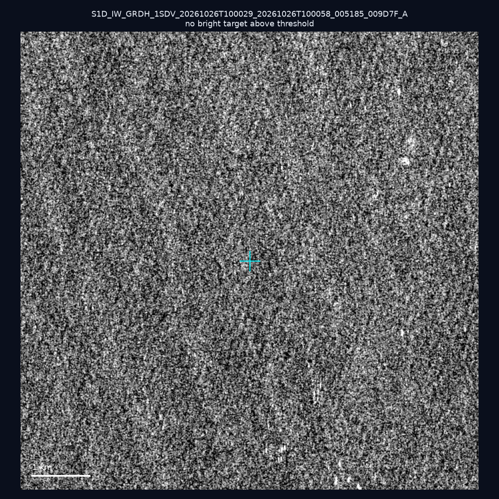
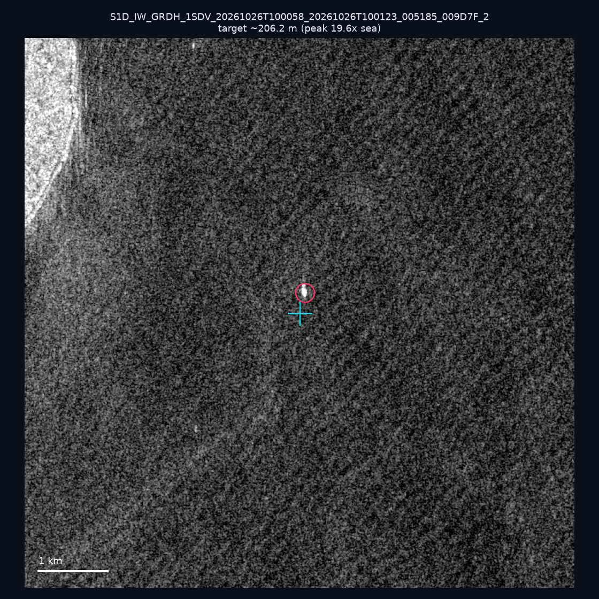
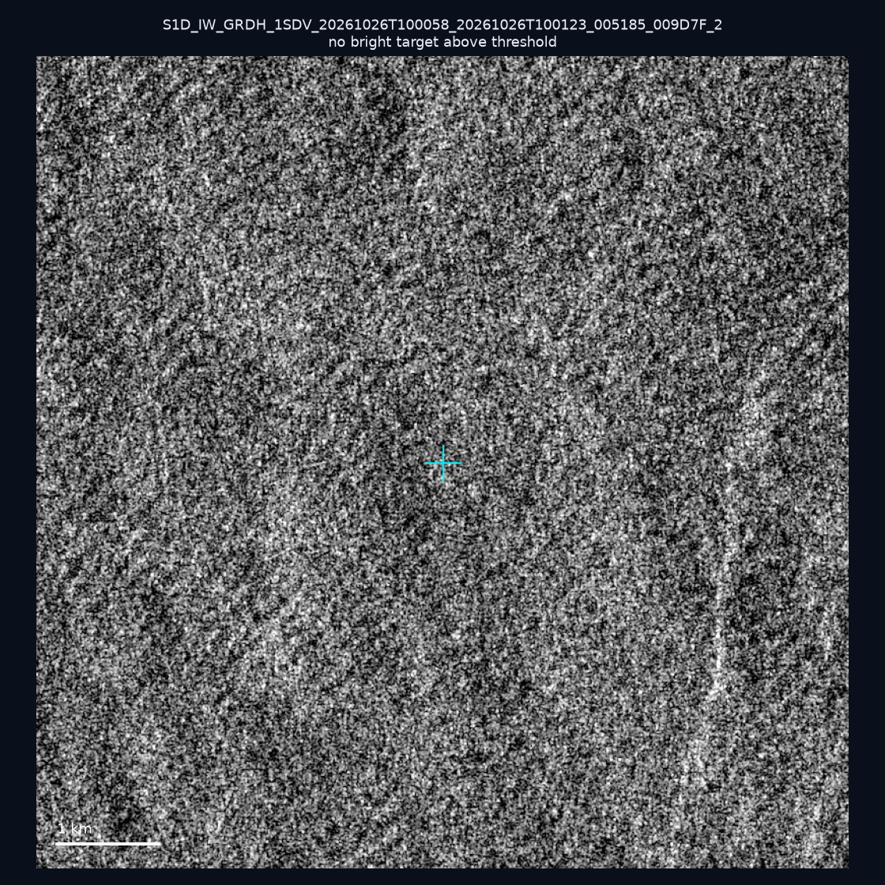
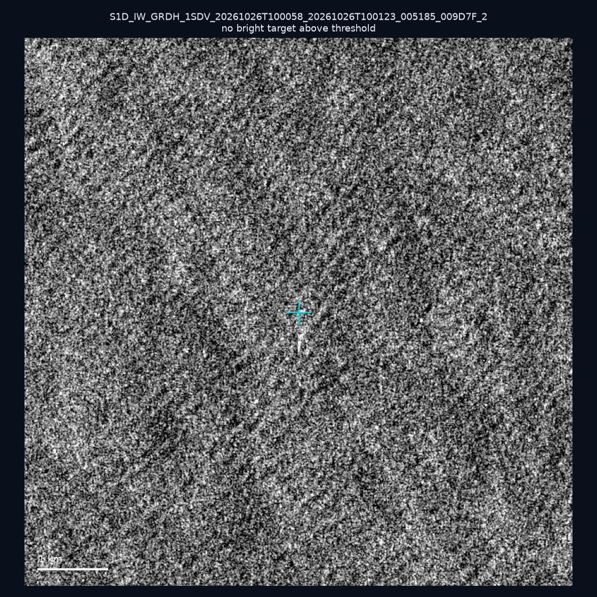
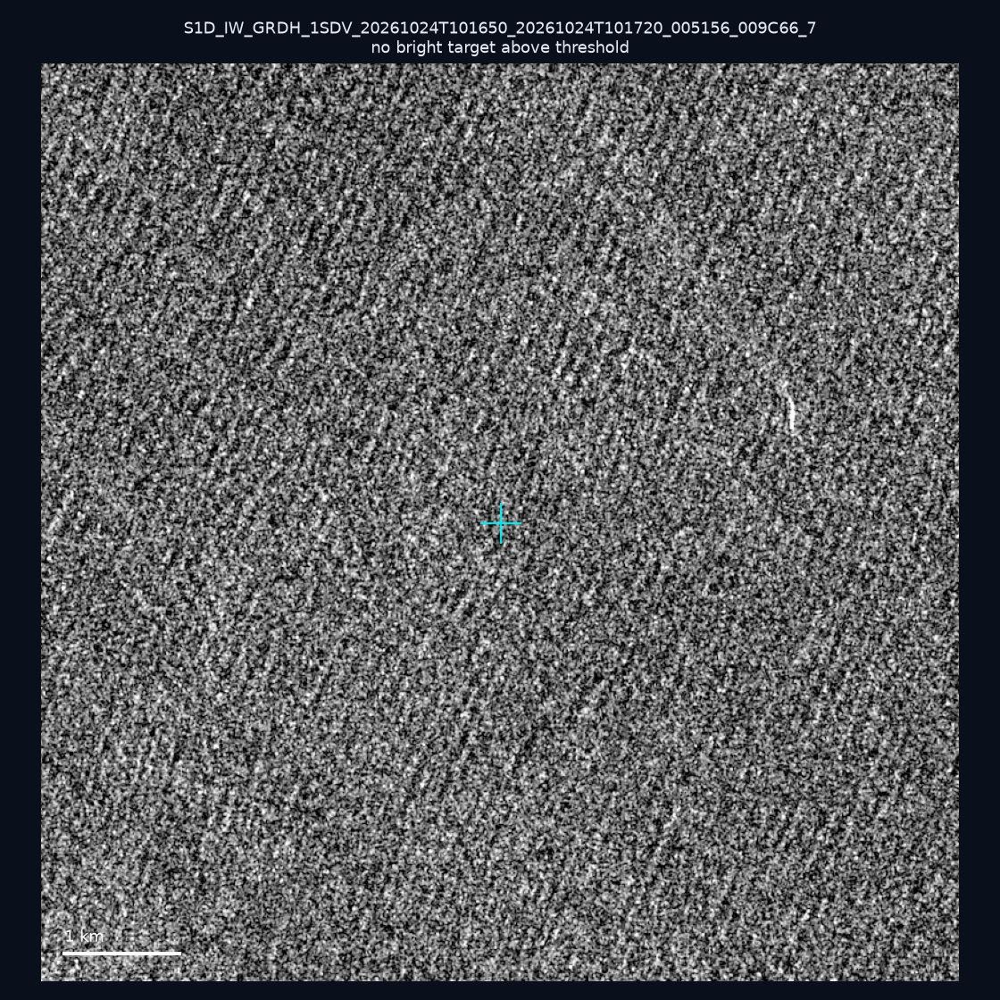
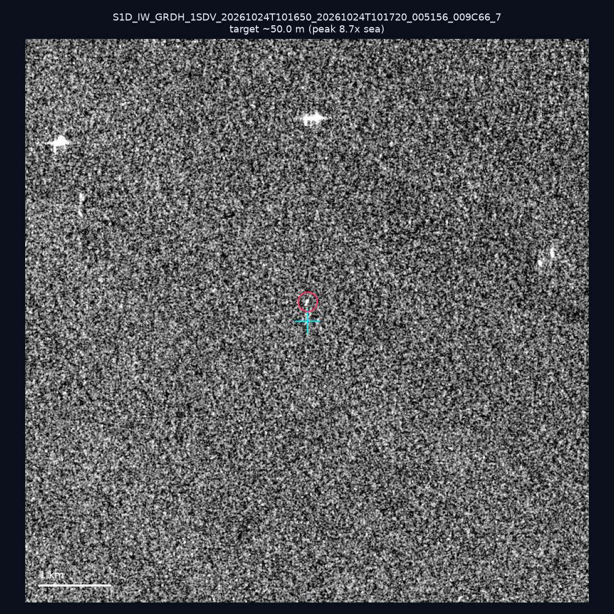
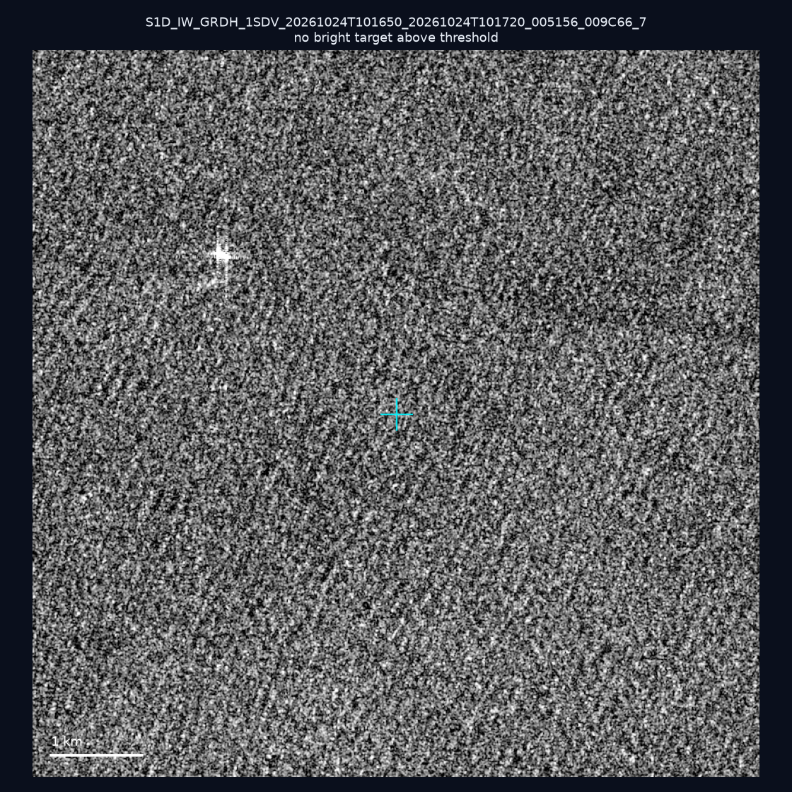
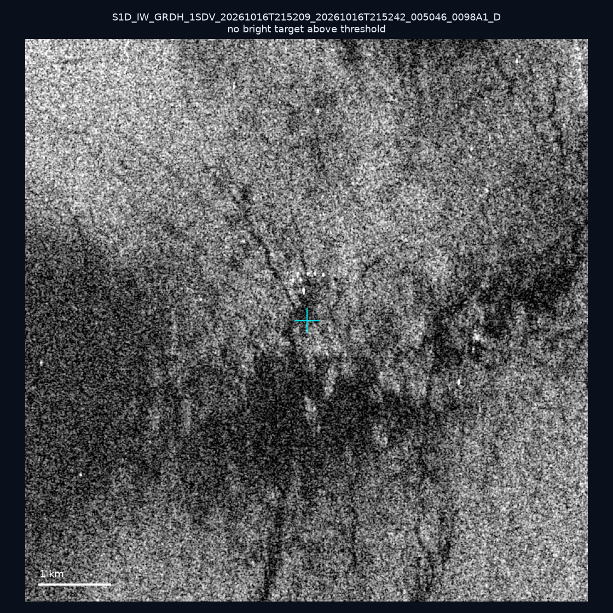
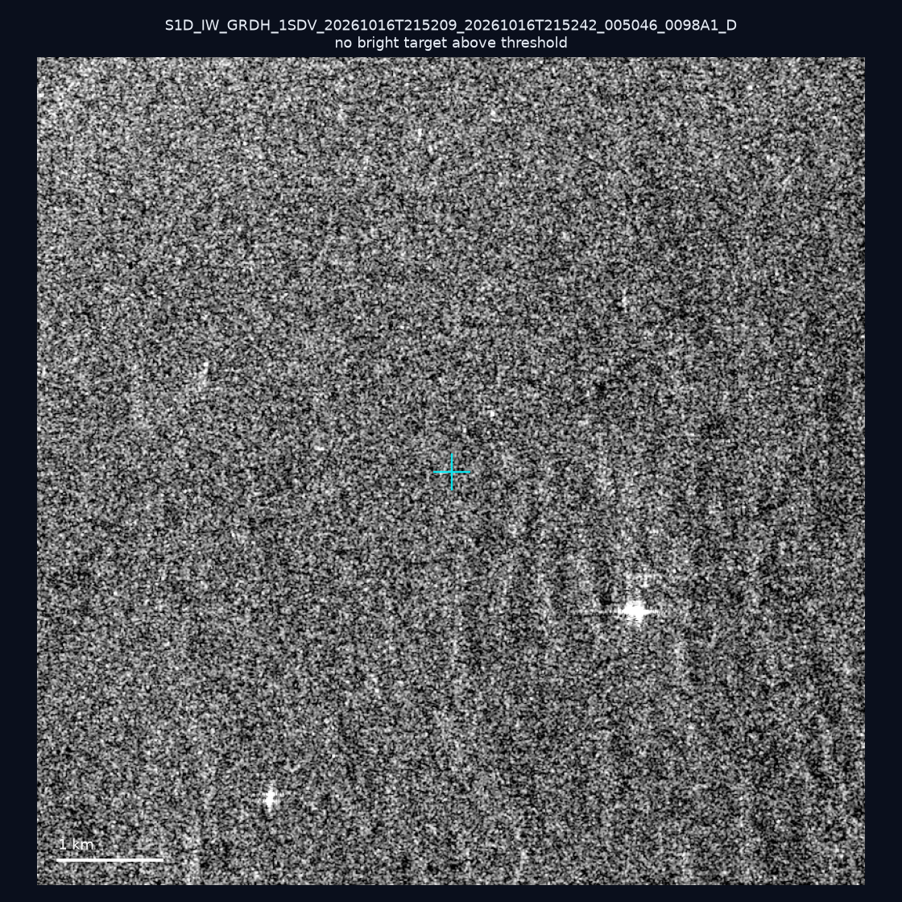
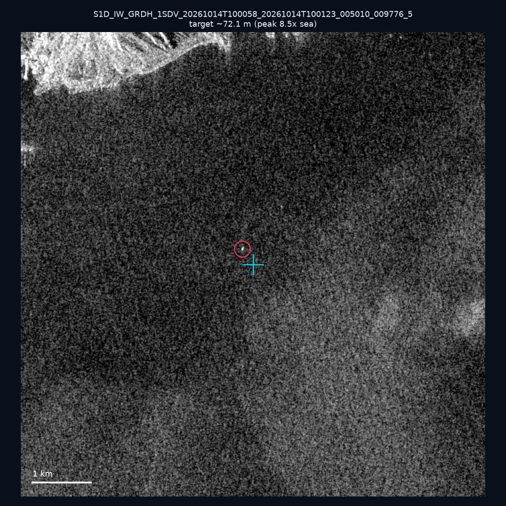

# 暗船 SAR 取證報告 — 2026-10-30

## 1. 總覽

- 執行時間：2026-10-30（GitHub Actions cron 自動執行）
- 線上比對摘要：暗偵測 11598 筆、殘餘暗船 7553 筆、假暗船剔除率 34.9%
- 本輪測試：10 筆
- 成功：10 筆
- 找到亮目標：3 筆
- 失敗：0 筆

## 2. 結果總表

| 日期 | 座標 | 海域 | 法域 | 成像時刻 | 判定 | 估計長度 | 峰值比 |
|------|------|------|------|----------|------|----------|--------|
| 2026-10-26 | 24.4, 121.95 | east | territorial_sea | 10:00:29 | ⚪ 無目標（雜訊或低RCS） | — | — |
| 2026-10-26 | 25.29, 121.66 | east | internal_waters | 10:00:58 | ✅ 確認實體目標 | ~206.2 m | 19.6× |
| 2026-10-26 | 25.47, 121.79 | east | territorial_sea | 10:00:58 | ⚪ 無目標（雜訊或低RCS） | — | — |
| 2026-10-26 | 25.42, 121.72 | east | territorial_sea | 10:00:58 | ⚪ 無目標（雜訊或低RCS） | — | — |
| 2026-10-24 | 23.26, 117.39 | southwest | eez | 10:16:50 | ⚪ 無目標（雜訊或低RCS） | — | — |
| 2026-10-24 | 23.17, 117.13 | southwest | eez | 10:16:50 | 🟡 弱目標 | ~50.0 m | 8.7× |
| 2026-10-24 | 23.1, 117.25 | southwest | eez | 10:16:50 | ⚪ 無目標（雜訊或低RCS） | — | — |
| 2026-10-16 | 22.27, 120.57 | southwest | internal_waters | 21:52:09 | ⚪ 無目標（雜訊或低RCS） | — | — |
| 2026-10-16 | 22.93, 120.07 | southwest | internal_waters | 21:52:09 | ⚪ 無目標（雜訊或低RCS） | — | — |
| 2026-10-14 | 25.16, 121.86 | east | internal_waters | 10:00:58 | 🟡 弱目標 | ~72.1 m | 8.5× |

## 3. 逐目標段落

### 2026-10-26 (24.4, 121.95)

⚪ 無目標（雜訊或低RCS）。

### 2026-10-26 (25.29, 121.66)

✅ 確認實體目標，估計長度 ~206.2 m，峰值 19.6× 海面背景（103 px）。

### 2026-10-26 (25.47, 121.79)

⚪ 無目標（雜訊或低RCS）。

### 2026-10-26 (25.42, 121.72)

⚪ 無目標（雜訊或低RCS）。

### 2026-10-24 (23.26, 117.39)

⚪ 無目標（雜訊或低RCS）。

### 2026-10-24 (23.17, 117.13)

🟡 弱目標，估計長度 ~50.0 m，峰值 8.7× 海面背景（10 px）。

### 2026-10-24 (23.1, 117.25)

⚪ 無目標（雜訊或低RCS）。

### 2026-10-16 (22.27, 120.57)

⚪ 無目標（雜訊或低RCS）。

### 2026-10-16 (22.93, 120.07)

⚪ 無目標（雜訊或低RCS）。

### 2026-10-14 (25.16, 121.86)

🟡 弱目標，估計長度 ~72.1 m，峰值 8.5× 海面背景（16 px）。

## 4. 後續建議

- 值得人工深查（確認實體目標且長度 ≥ 50m）：
  - 2026-10-26 (25.29, 121.66) ~206.2 m — 建議比對周邊 AIS 船長
- 累積統計：全歷史 673 筆（有效 672 筆），確認實體目標 76 筆（11.3%）

> 所有結果是研判線索，不是法律認定；無目標 ≠ 誤報（小型木殼漁船 RCS 低，SAR 可能拍不到）。
