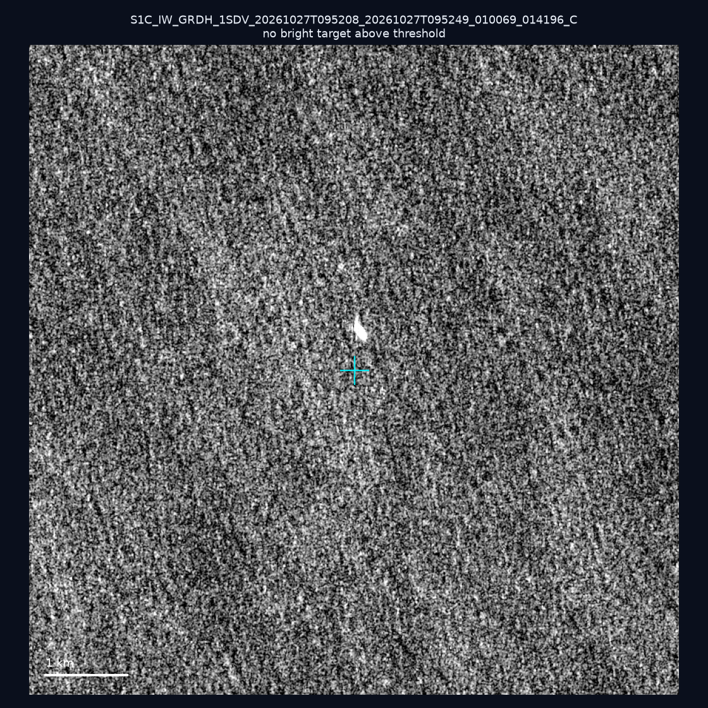
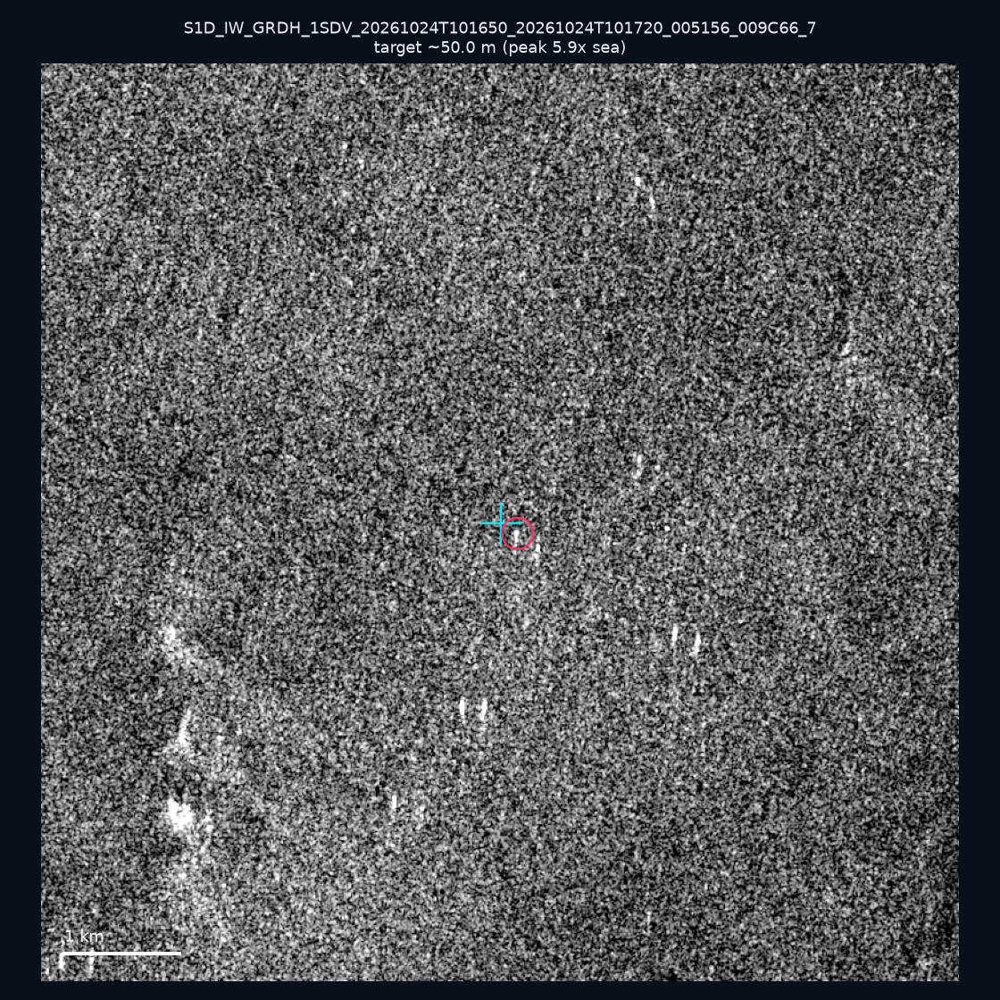
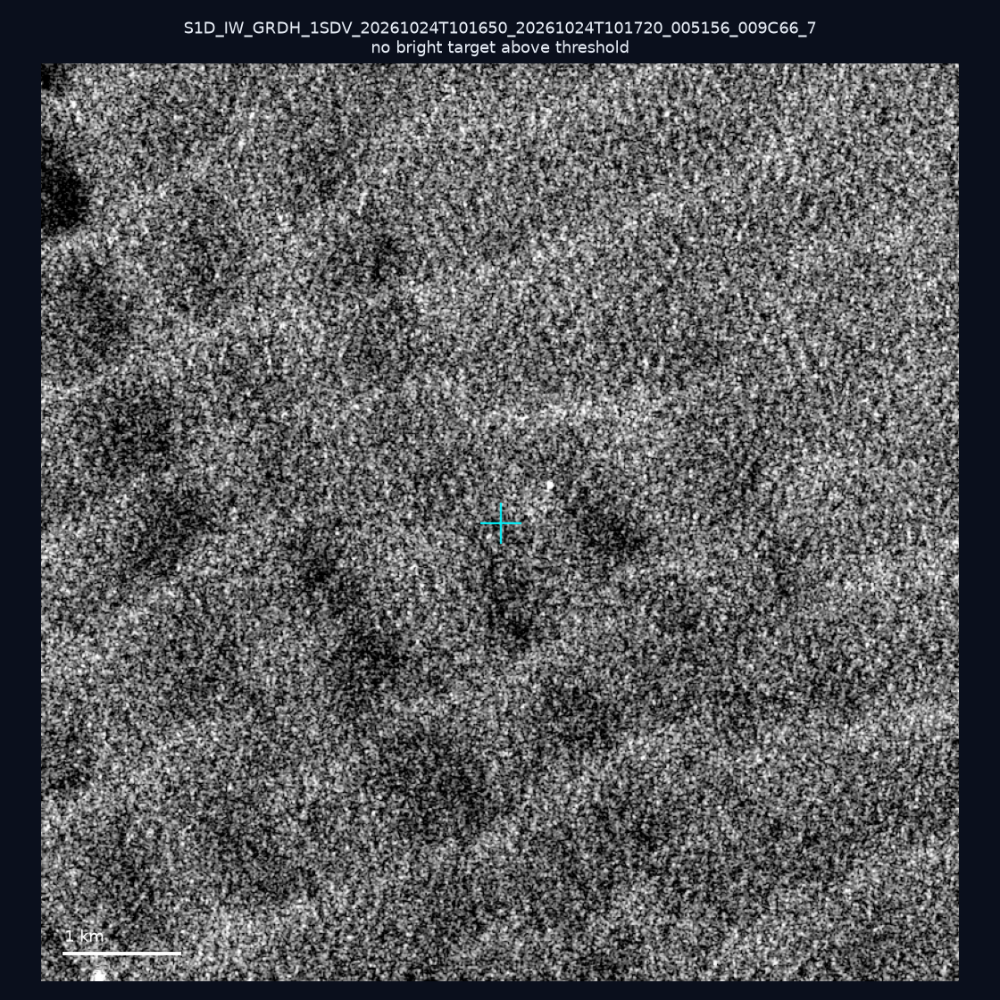
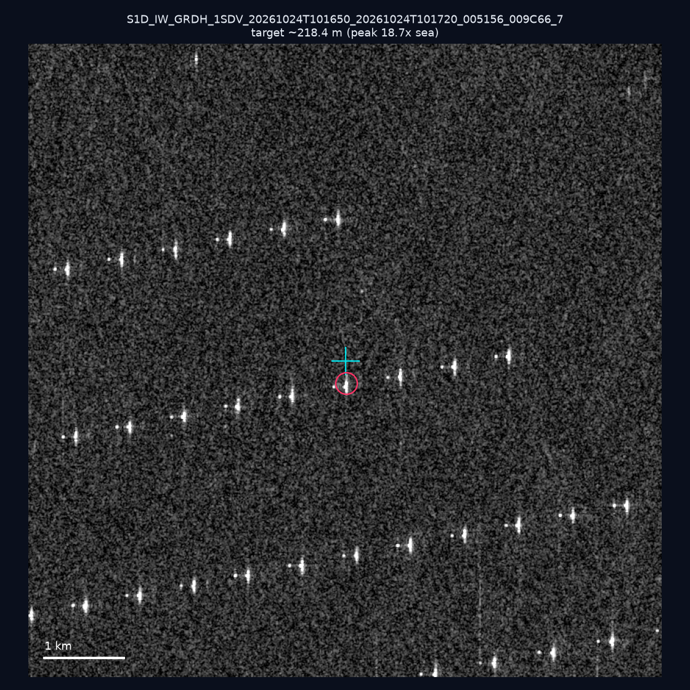
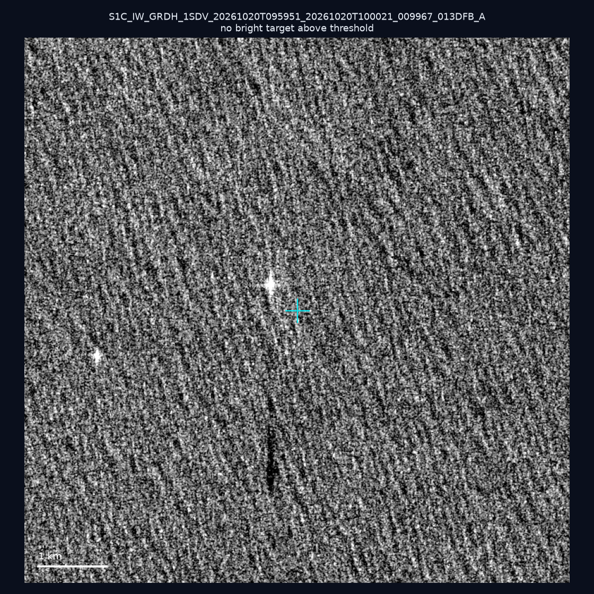
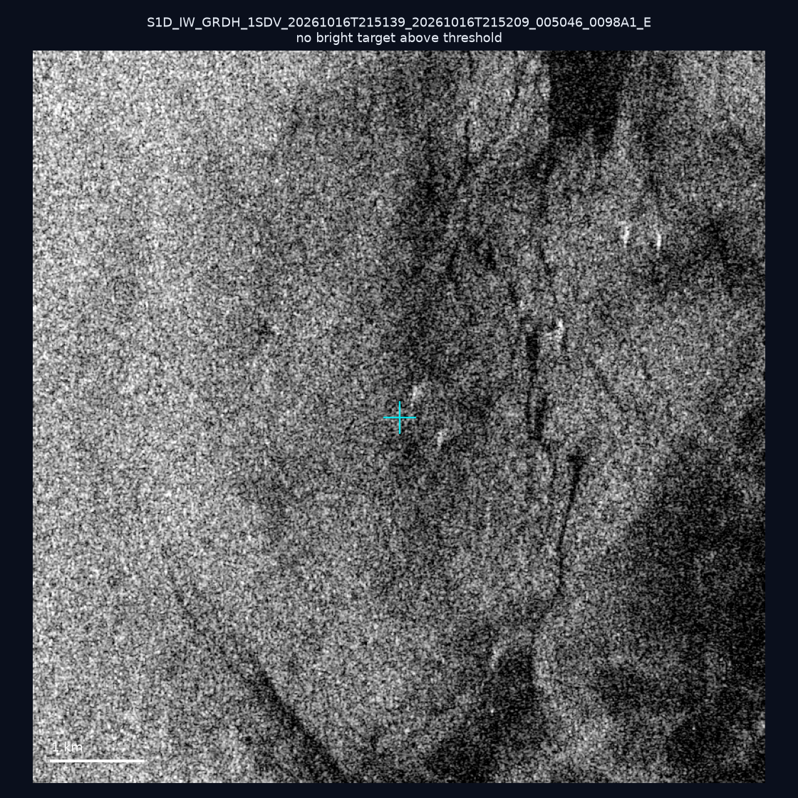
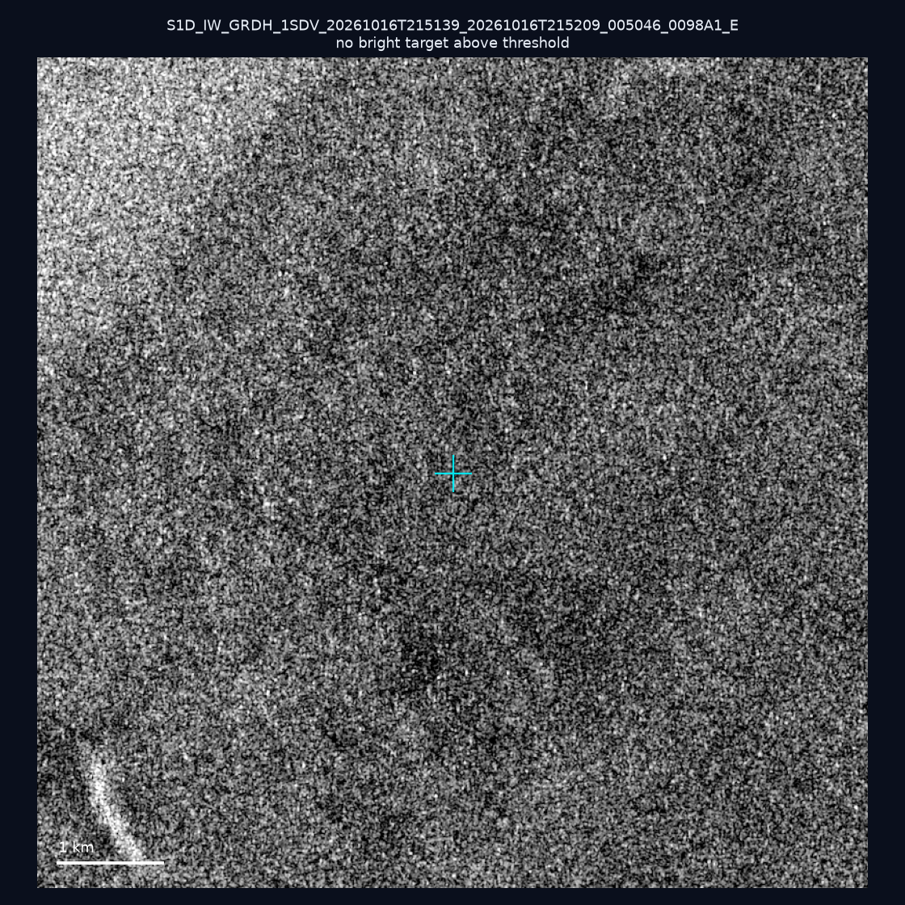
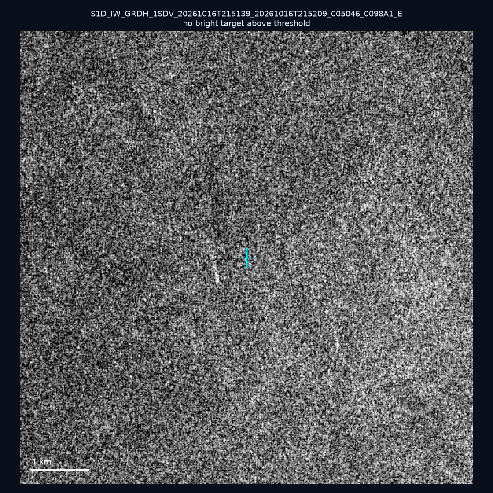
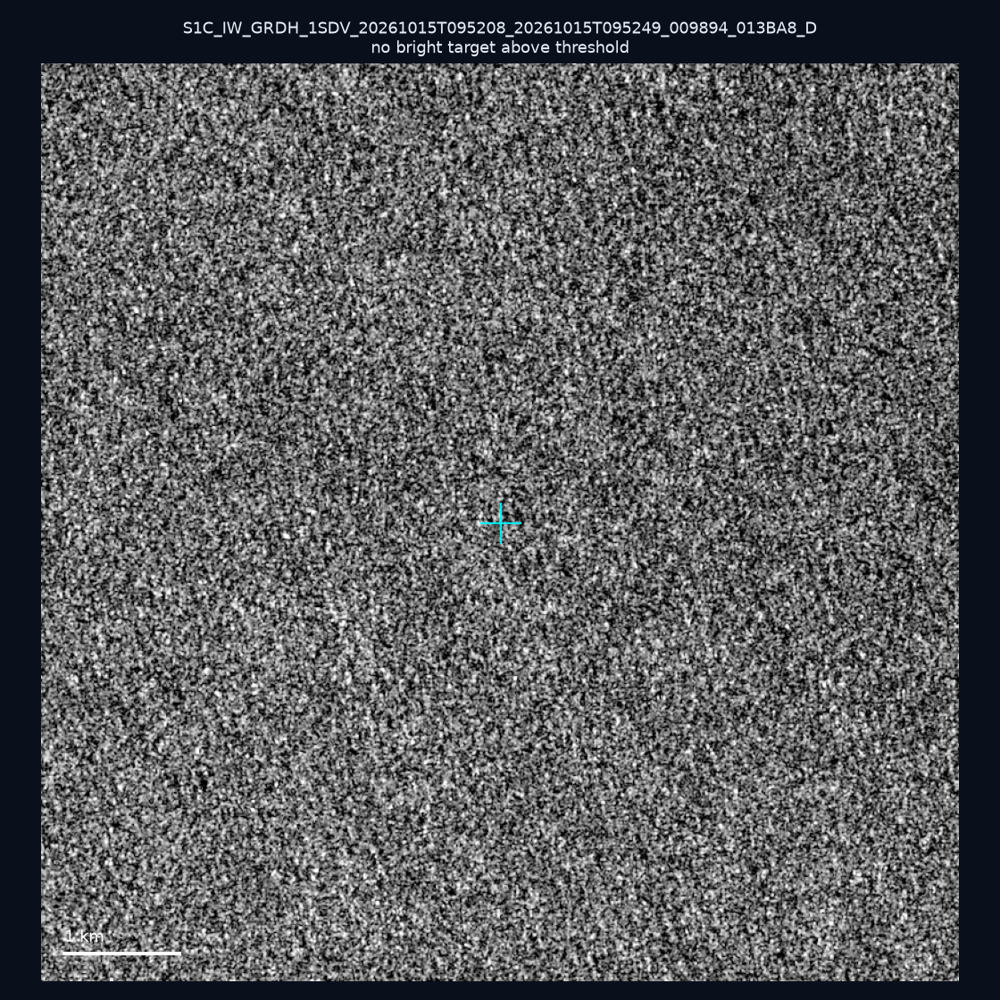
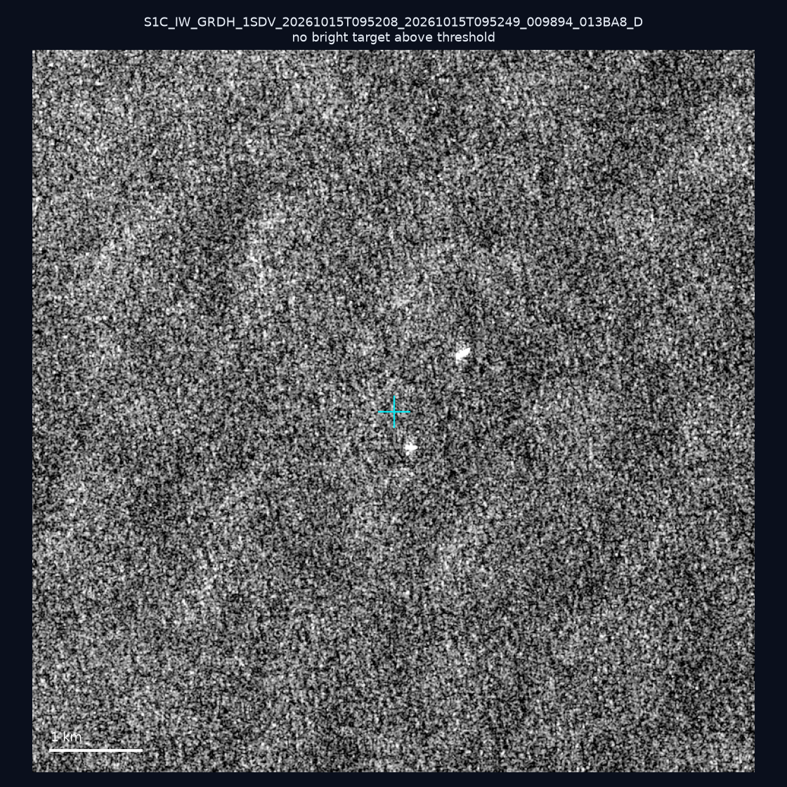

# 暗船 SAR 取證報告 — 2026-10-31

## 1. 總覽

- 執行時間：2026-10-31（GitHub Actions cron 自動執行）
- 線上比對摘要：暗偵測 11616 筆、殘餘暗船 7569 筆、假暗船剔除率 34.8%
- 本輪測試：10 筆
- 成功：10 筆
- 找到亮目標：2 筆
- 失敗：0 筆

## 2. 結果總表

| 日期 | 座標 | 海域 | 法域 | 成像時刻 | 判定 | 估計長度 | 峰值比 |
|------|------|------|------|----------|------|----------|--------|
| 2026-10-27 | 23.38, 122.83 | east | eez | 09:52:08 | ⚪ 無目標（雜訊或低RCS） | — | — |
| 2026-10-24 | 23.3, 117.15 | southwest | eez | 10:16:50 | 🟡 弱目標 | ~50.0 m | 5.9× |
| 2026-10-24 | 23.07, 117.83 | southwest | eez | 10:16:50 | ⚪ 無目標（雜訊或低RCS） | — | — |
| 2026-10-24 | 23.21, 117.04 | southwest | eez | 10:16:50 | ✅ 確認實體目標 | ~218.4 m | 18.7× |
| 2026-10-20 | 22.36, 122.04 | east | eez | 09:59:51 | ⚪ 無目標（雜訊或低RCS） | — | — |
| 2026-10-16 | 24.77, 121.91 | east | internal_waters | 21:51:39 | ⚪ 無目標（雜訊或低RCS） | — | — |
| 2026-10-16 | 25.25, 121.89 | east | internal_waters | 21:51:39 | ⚪ 無目標（雜訊或低RCS） | — | — |
| 2026-10-16 | 25.25, 121.83 | east | internal_waters | 21:51:39 | ⚪ 無目標（雜訊或低RCS） | — | — |
| 2026-10-15 | 25.21, 122.0 | east | internal_waters | 09:52:08 | ⚪ 無目標（雜訊或低RCS） | — | — |
| 2026-10-15 | 25.36, 123.56 | east | eez | 09:52:08 | ⚪ 無目標（雜訊或低RCS） | — | — |

## 3. 逐目標段落

### 2026-10-27 (23.38, 122.83)

⚪ 無目標（雜訊或低RCS）。

### 2026-10-24 (23.3, 117.15)

🟡 弱目標，估計長度 ~50.0 m，峰值 5.9× 海面背景（10 px）。

### 2026-10-24 (23.07, 117.83)

⚪ 無目標（雜訊或低RCS）。

### 2026-10-24 (23.21, 117.04)

✅ 確認實體目標，估計長度 ~218.4 m，峰值 18.7× 海面背景（79 px）。

### 2026-10-20 (22.36, 122.04)

⚪ 無目標（雜訊或低RCS）。

### 2026-10-16 (24.77, 121.91)

⚪ 無目標（雜訊或低RCS）。

### 2026-10-16 (25.25, 121.89)

⚪ 無目標（雜訊或低RCS）。

### 2026-10-16 (25.25, 121.83)

⚪ 無目標（雜訊或低RCS）。

### 2026-10-15 (25.21, 122.0)

⚪ 無目標（雜訊或低RCS）。

### 2026-10-15 (25.36, 123.56)

⚪ 無目標（雜訊或低RCS）。

## 4. 後續建議

- 值得人工深查（確認實體目標且長度 ≥ 50m）：
  - 2026-10-24 (23.21, 117.04) ~218.4 m — 建議比對周邊 AIS 船長
- 累積統計：全歷史 683 筆（有效 682 筆），確認實體目標 77 筆（11.3%）

> 所有結果是研判線索，不是法律認定；無目標 ≠ 誤報（小型木殼漁船 RCS 低，SAR 可能拍不到）。
