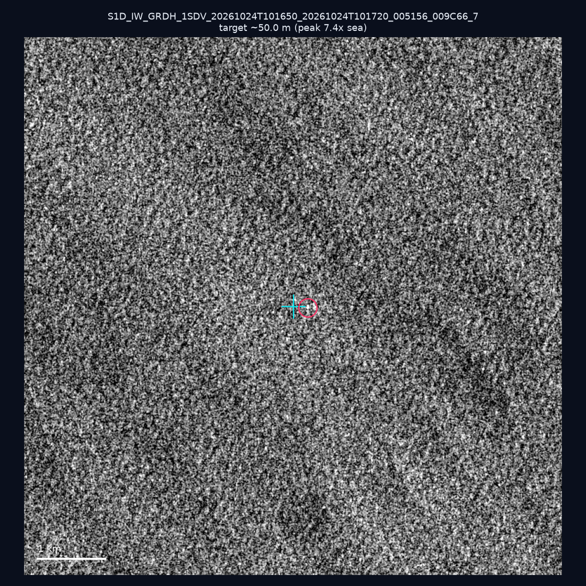
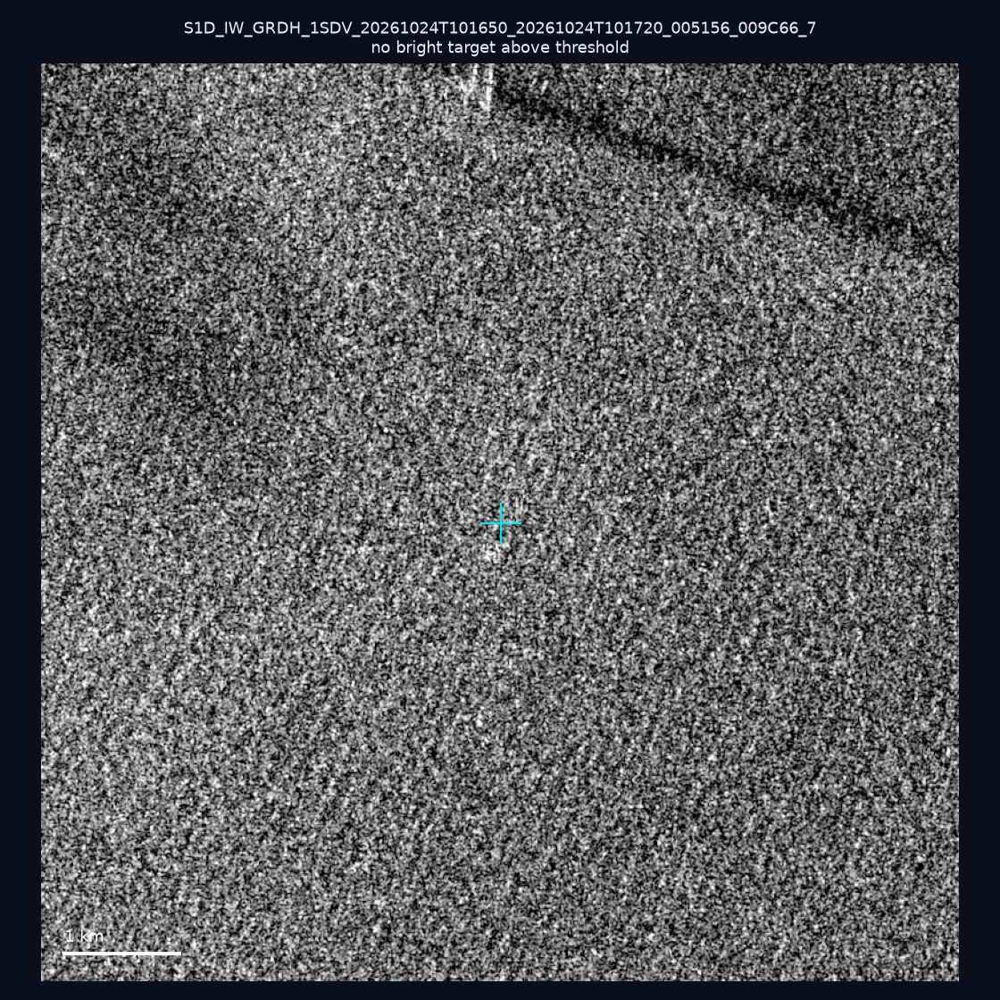
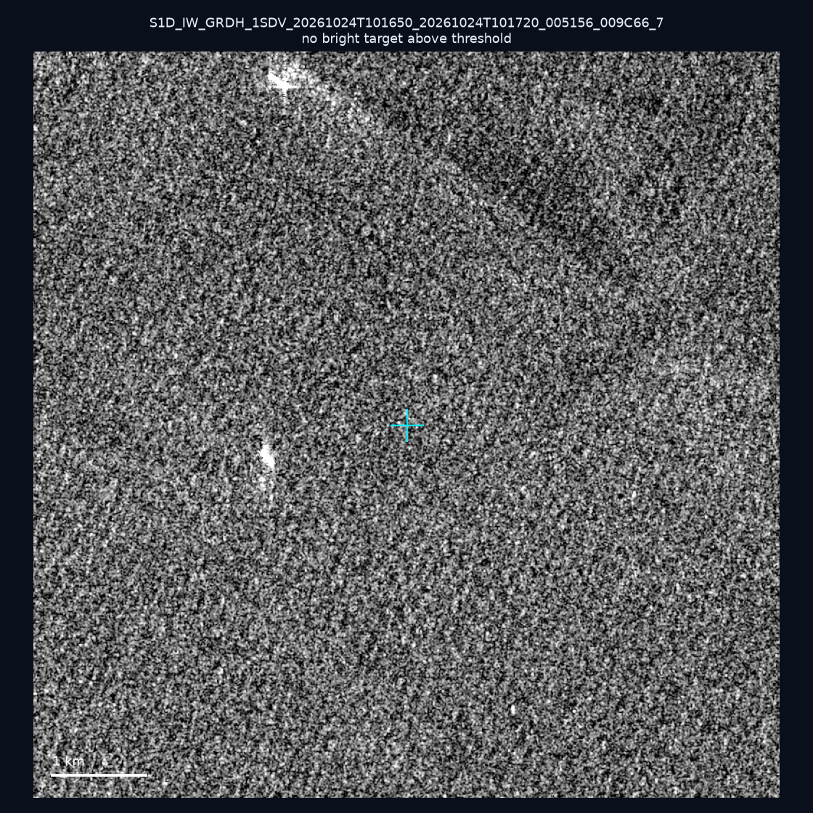
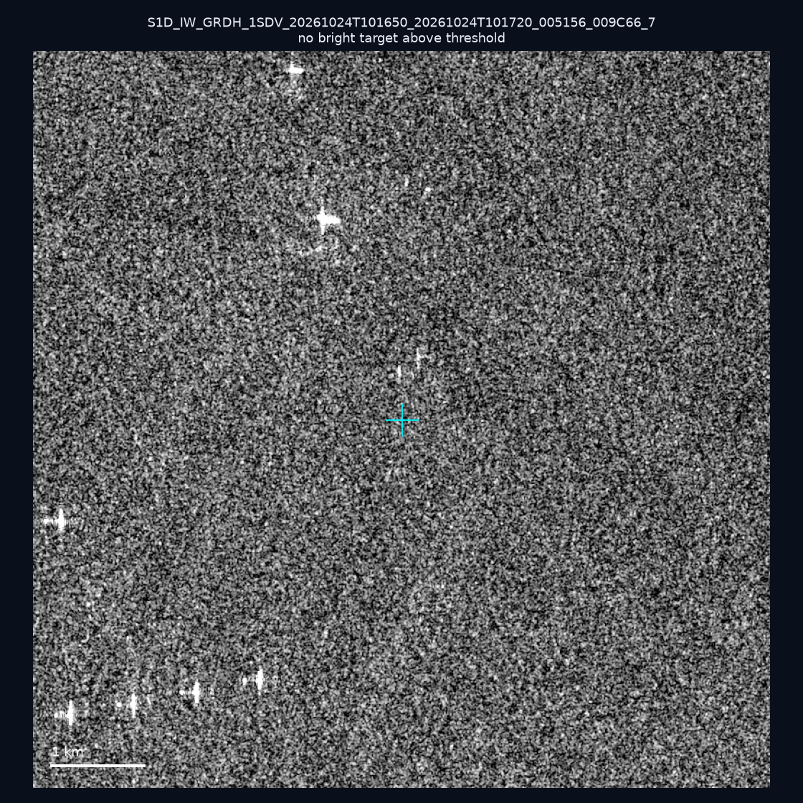
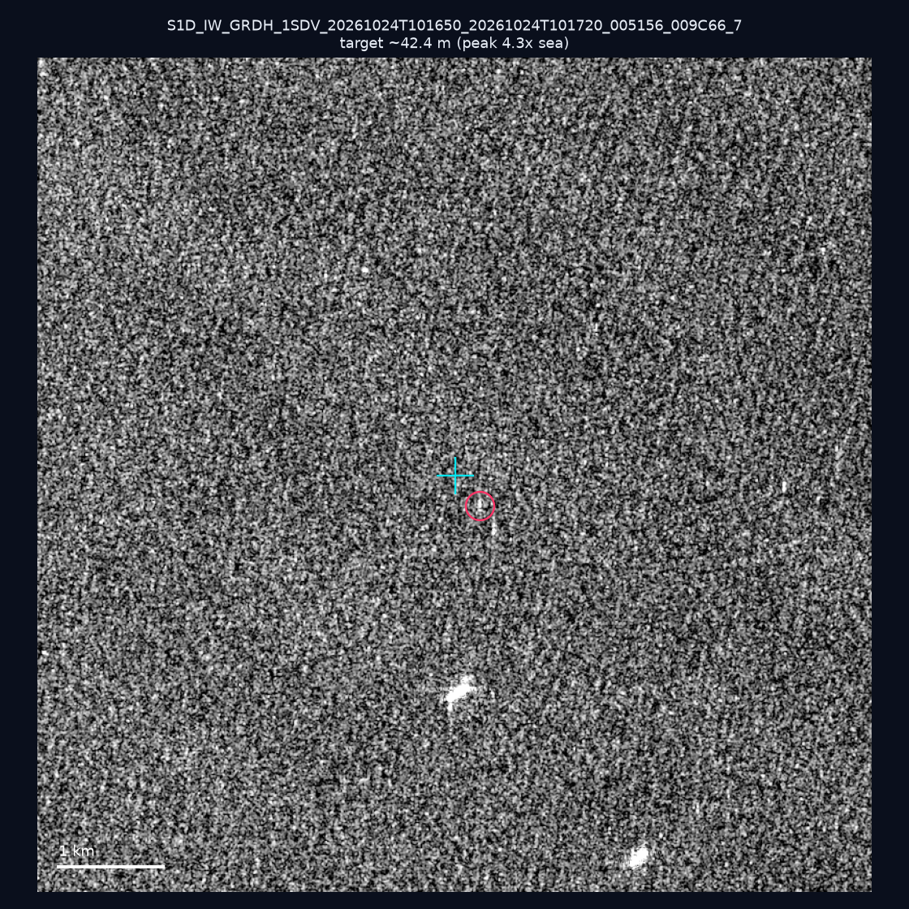
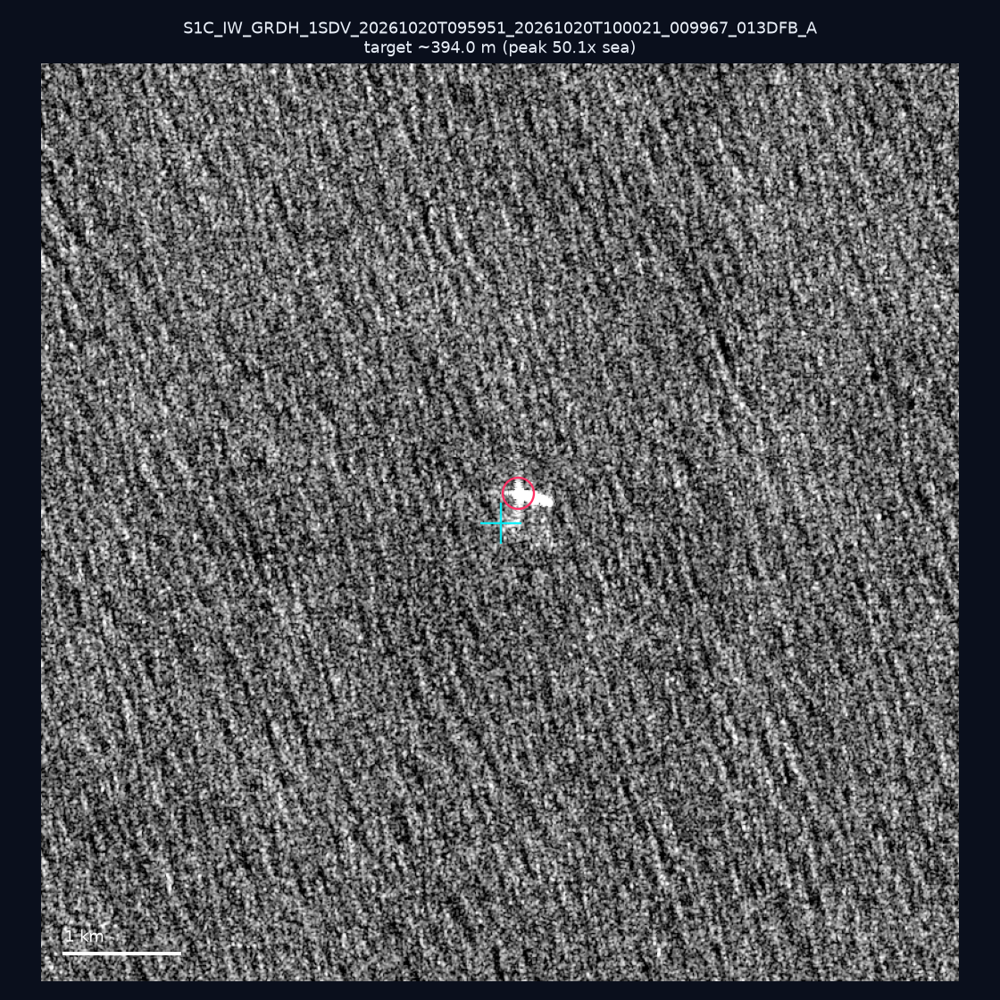
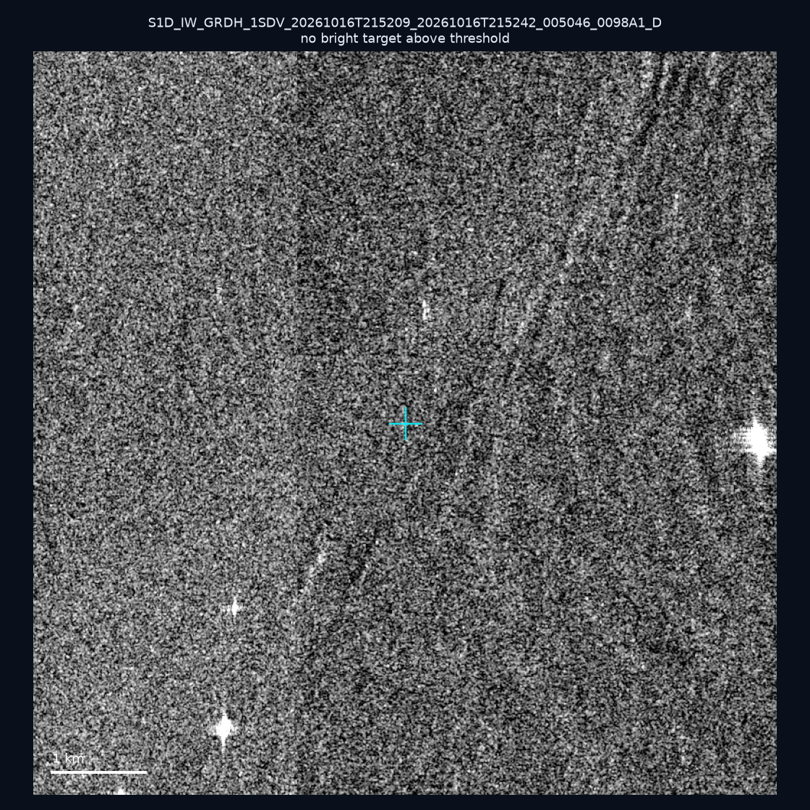
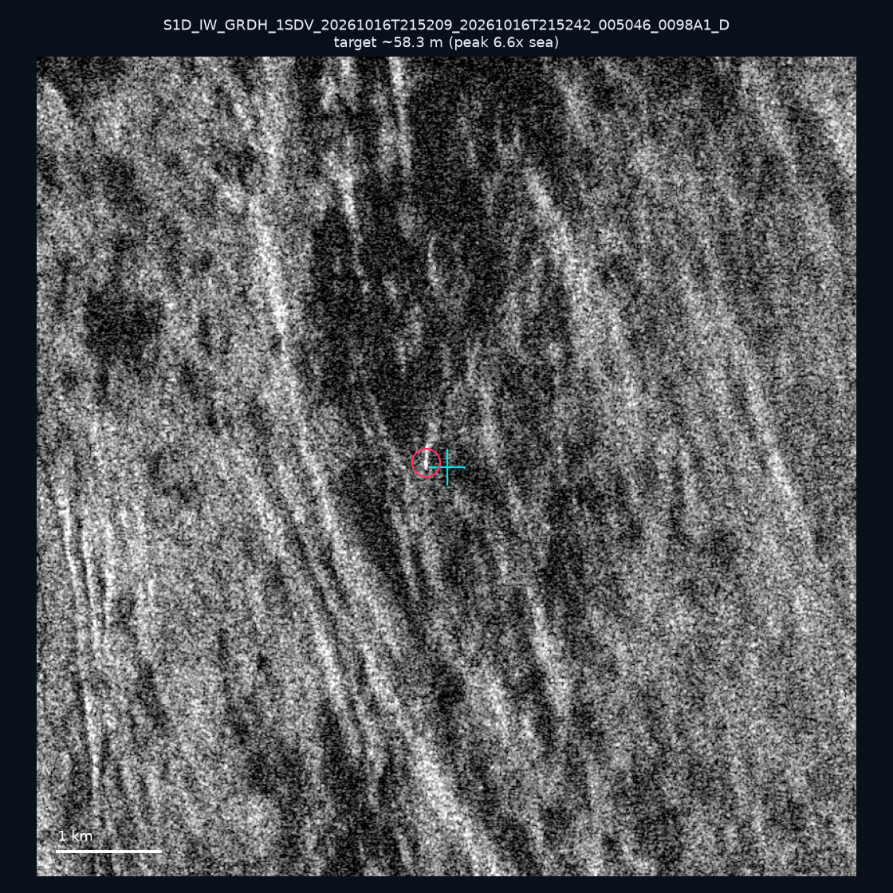
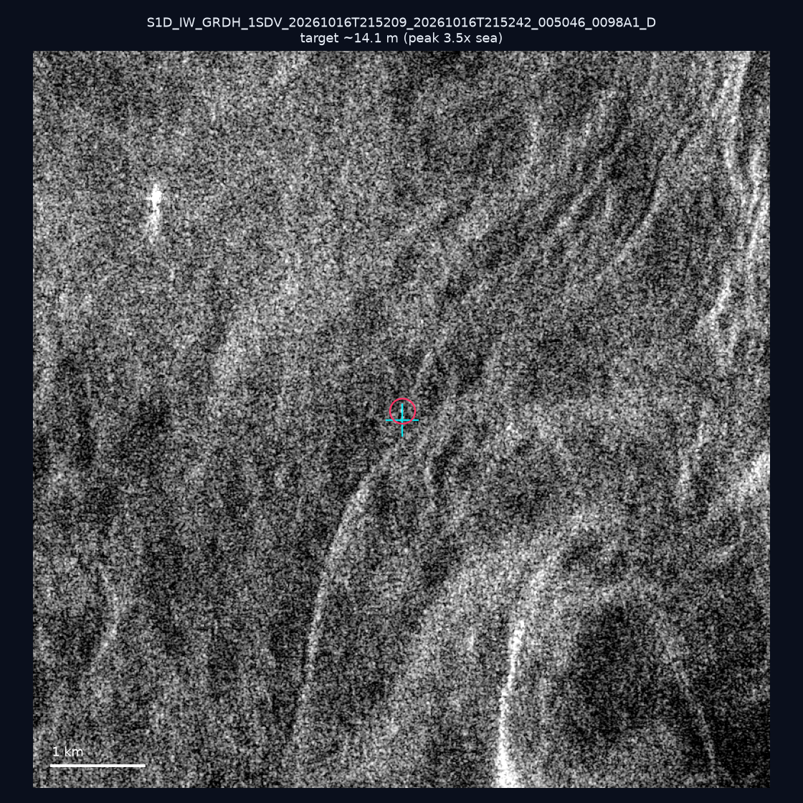
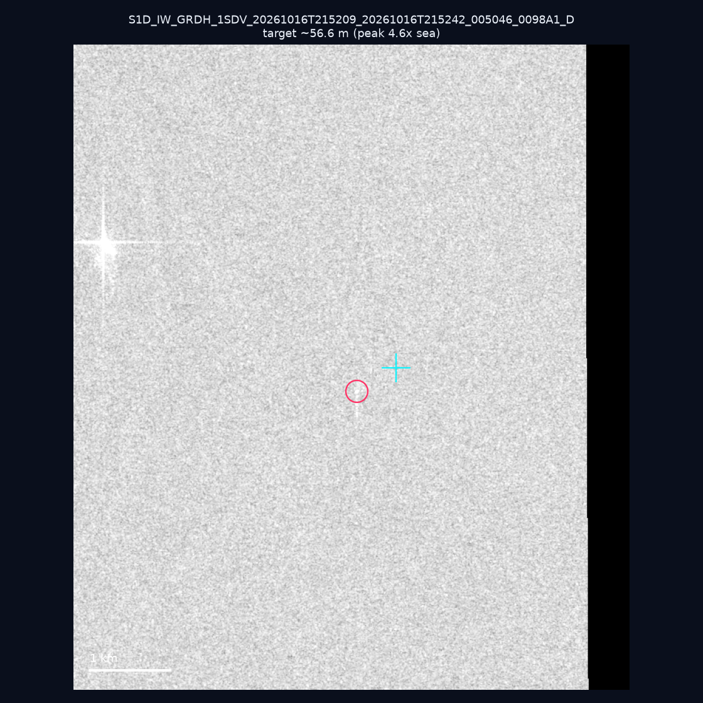

# 暗船 SAR 取證報告 — 2026-11-01

## 1. 總覽

- 執行時間：2026-11-01（GitHub Actions cron 自動執行）
- 線上比對摘要：暗偵測 10786 筆、殘餘暗船 6889 筆、假暗船剔除率 36.1%
- 本輪測試：10 筆
- 成功：10 筆
- 找到亮目標：6 筆
- 失敗：0 筆

## 2. 結果總表

| 日期 | 座標 | 海域 | 法域 | 成像時刻 | 判定 | 估計長度 | 峰值比 |
|------|------|------|------|----------|------|----------|--------|
| 2026-10-24 | 22.86, 117.53 | southwest | eez | 10:16:50 | 🟡 弱目標 | ~50.0 m | 7.4× |
| 2026-10-24 | 22.85, 117.23 | southwest | eez | 10:16:50 | ⚪ 無目標（雜訊或低RCS） | — | — |
| 2026-10-24 | 23.03, 117.21 | southwest | eez | 10:16:50 | ⚪ 無目標（雜訊或低RCS） | — | — |
| 2026-10-24 | 23.19, 117.08 | southwest | eez | 10:16:50 | ⚪ 無目標（雜訊或低RCS） | — | — |
| 2026-10-24 | 23.06, 117.05 | southwest | eez | 10:16:50 | 🟡 弱目標 | ~42.4 m | 4.3× |
| 2026-10-20 | 22.38, 121.52 | east | internal_waters | 09:59:51 | ✅ 確認實體目標 | ~394.0 m | 50.1× |
| 2026-10-16 | 22.8, 120.12 | southwest | internal_waters | 21:52:09 | ⚪ 無目標（雜訊或低RCS） | — | — |
| 2026-10-16 | 23.31, 119.95 | southwest | internal_waters | 21:52:09 | 🟡 弱目標 | ~58.3 m | 6.6× |
| 2026-10-16 | 23.27, 119.77 | southwest | internal_waters | 21:52:09 | 🟡 弱目標 | ~14.1 m | 3.5× |
| 2026-10-16 | 22.71, 119.36 | southwest | contiguous_zone | 21:52:09 | 🟡 弱目標 | ~56.6 m | 4.6× |

## 3. 逐目標段落

### 2026-10-24 (22.86, 117.53)

🟡 弱目標，估計長度 ~50.0 m，峰值 7.4× 海面背景（9 px）。

### 2026-10-24 (22.85, 117.23)

⚪ 無目標（雜訊或低RCS）。

### 2026-10-24 (23.03, 117.21)

⚪ 無目標（雜訊或低RCS）。

### 2026-10-24 (23.19, 117.08)

⚪ 無目標（雜訊或低RCS）。

### 2026-10-24 (23.06, 117.05)

🟡 弱目標，估計長度 ~42.4 m，峰值 4.3× 海面背景（6 px）。

### 2026-10-20 (22.38, 121.52)

✅ 確認實體目標，估計長度 ~394.0 m，峰值 50.1× 海面背景（291 px）。

### 2026-10-16 (22.8, 120.12)

⚪ 無目標（雜訊或低RCS）。

### 2026-10-16 (23.31, 119.95)

🟡 弱目標，估計長度 ~58.3 m，峰值 6.6× 海面背景（12 px）。

### 2026-10-16 (23.27, 119.77)

🟡 弱目標，估計長度 ~14.1 m，峰值 3.5× 海面背景（1 px）。

### 2026-10-16 (22.71, 119.36)

🟡 弱目標，估計長度 ~56.6 m，峰值 4.6× 海面背景（11 px）。

## 4. 後續建議

- 值得人工深查（確認實體目標且長度 ≥ 50m）：
  - 2026-10-20 (22.38, 121.52) ~394.0 m — 建議比對周邊 AIS 船長
- 累積統計：全歷史 693 筆（有效 692 筆），確認實體目標 78 筆（11.3%）

> 所有結果是研判線索，不是法律認定；無目標 ≠ 誤報（小型木殼漁船 RCS 低，SAR 可能拍不到）。
