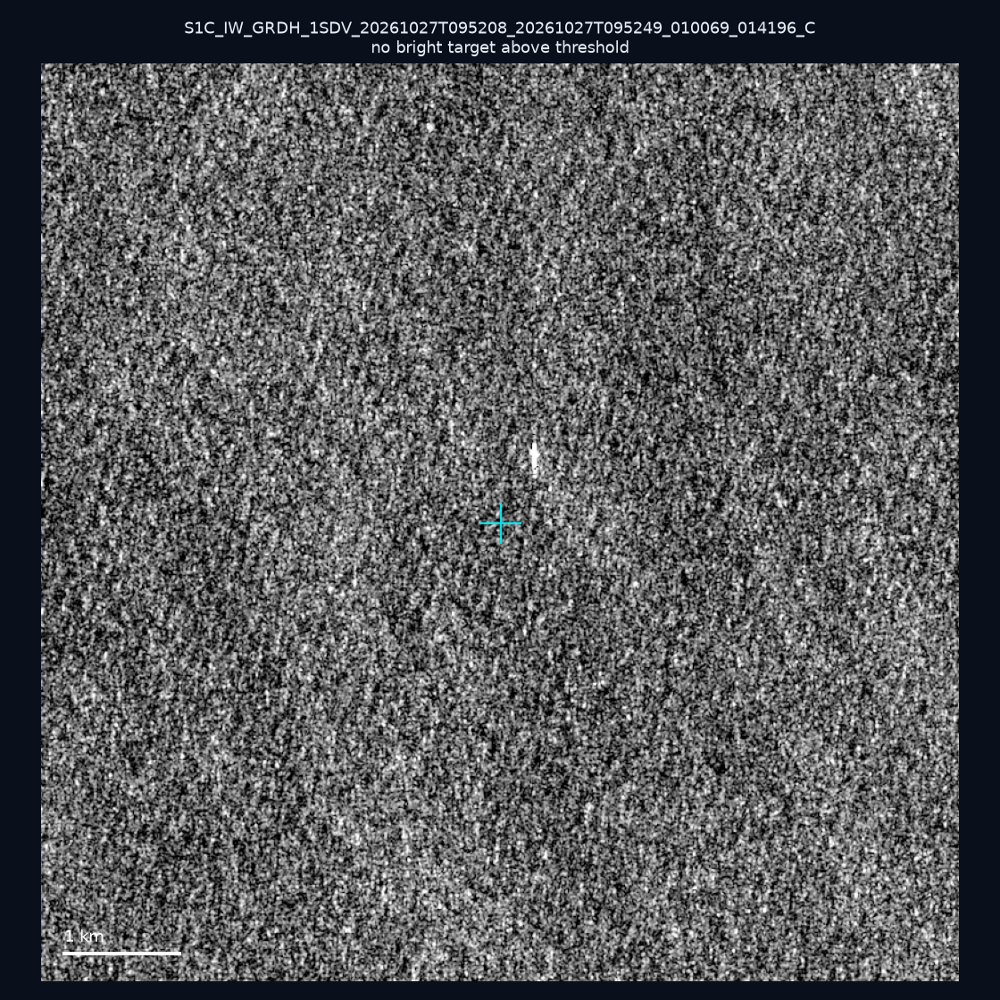
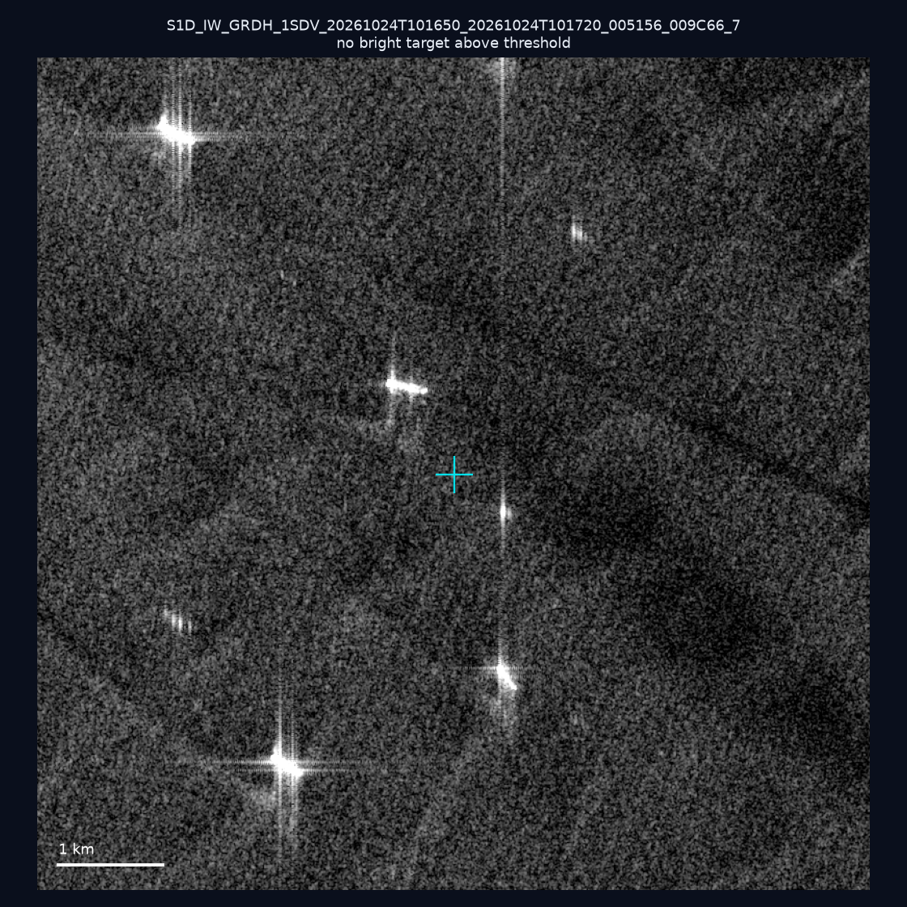
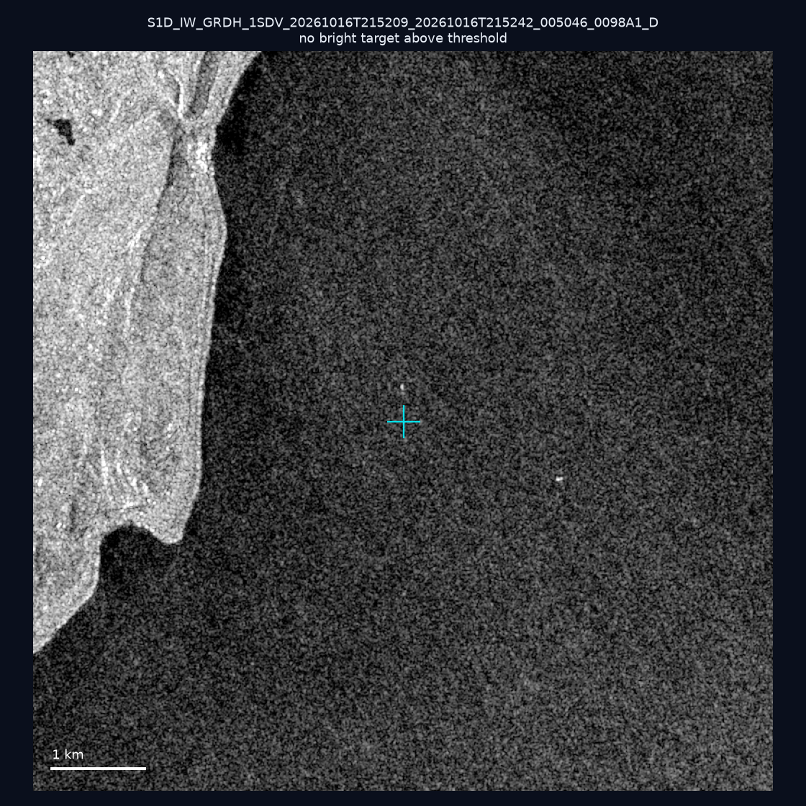
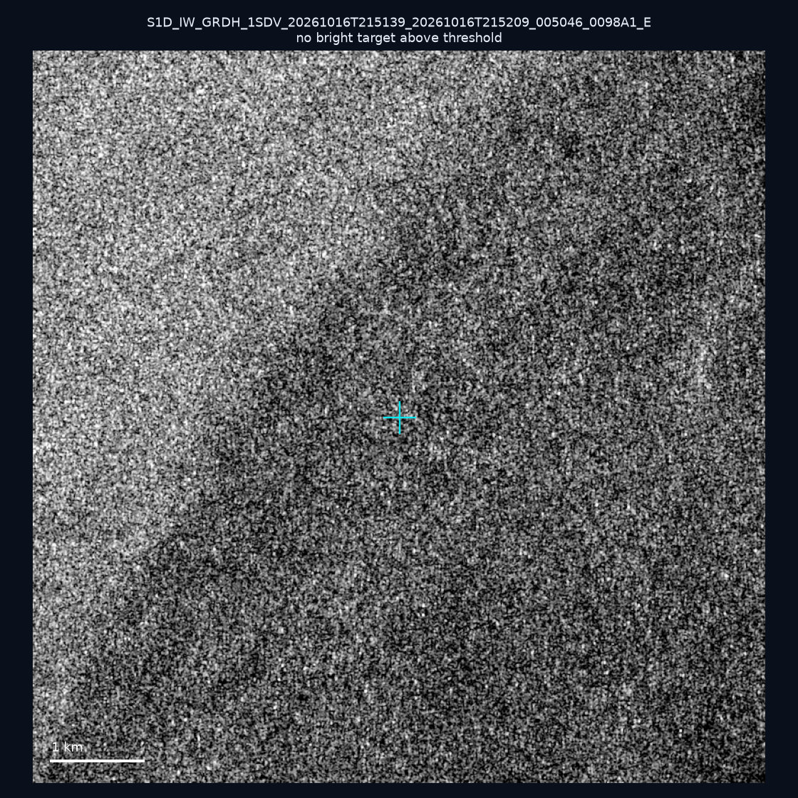
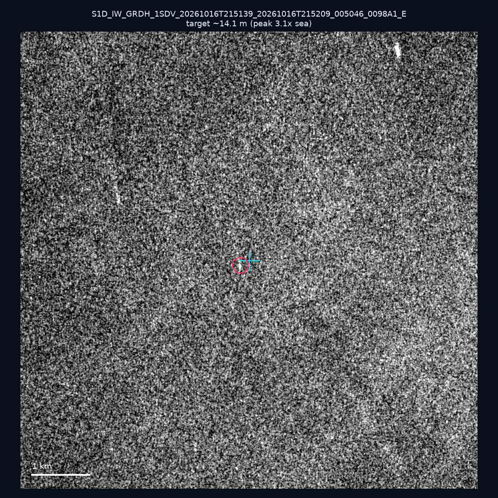
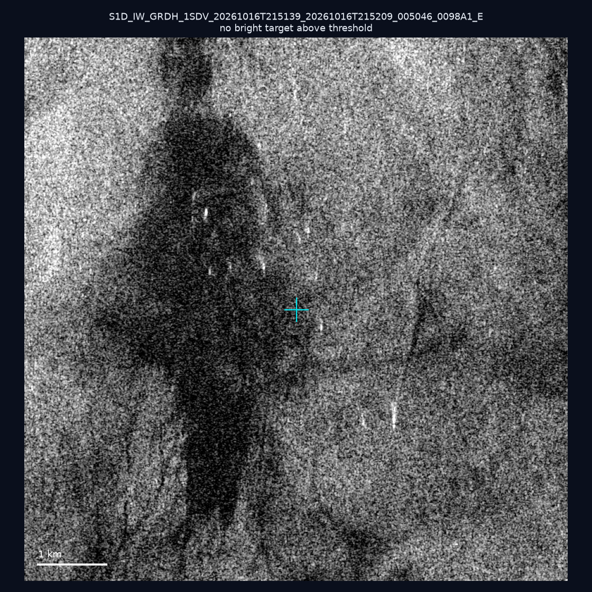
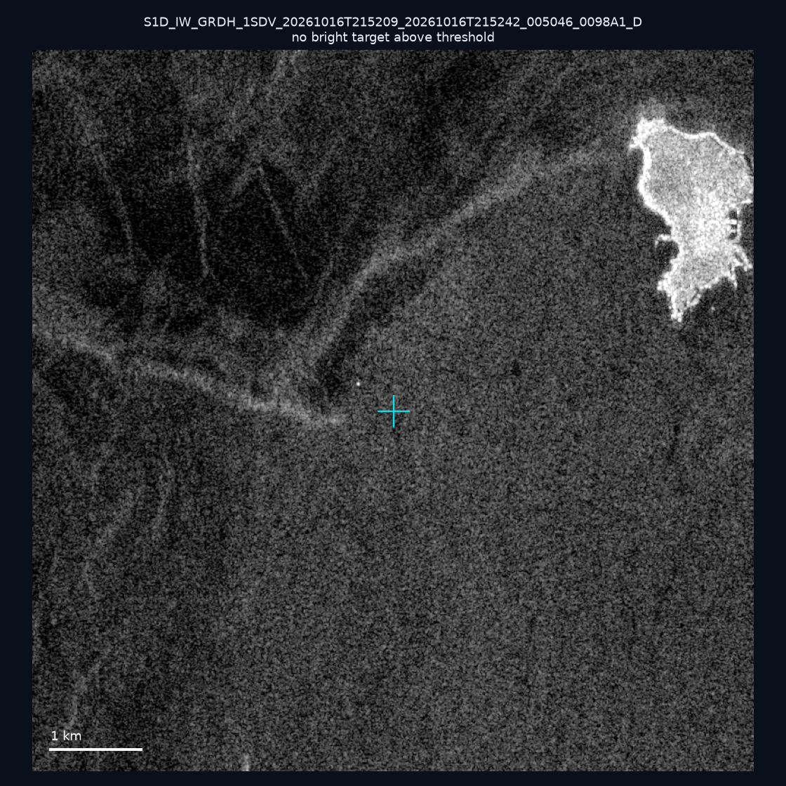
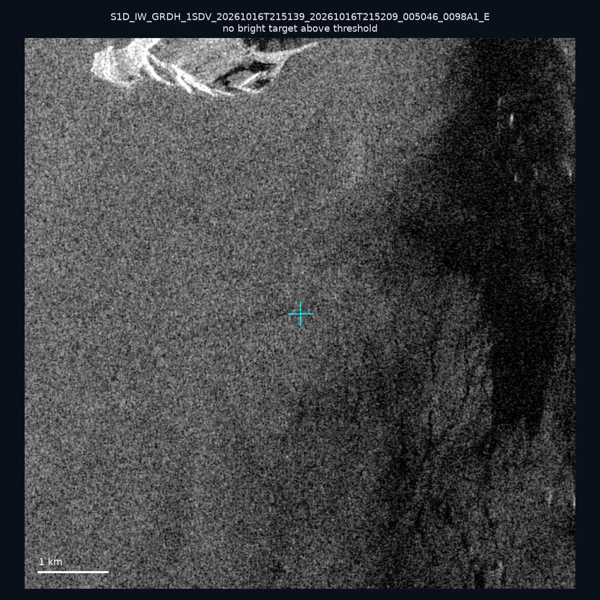
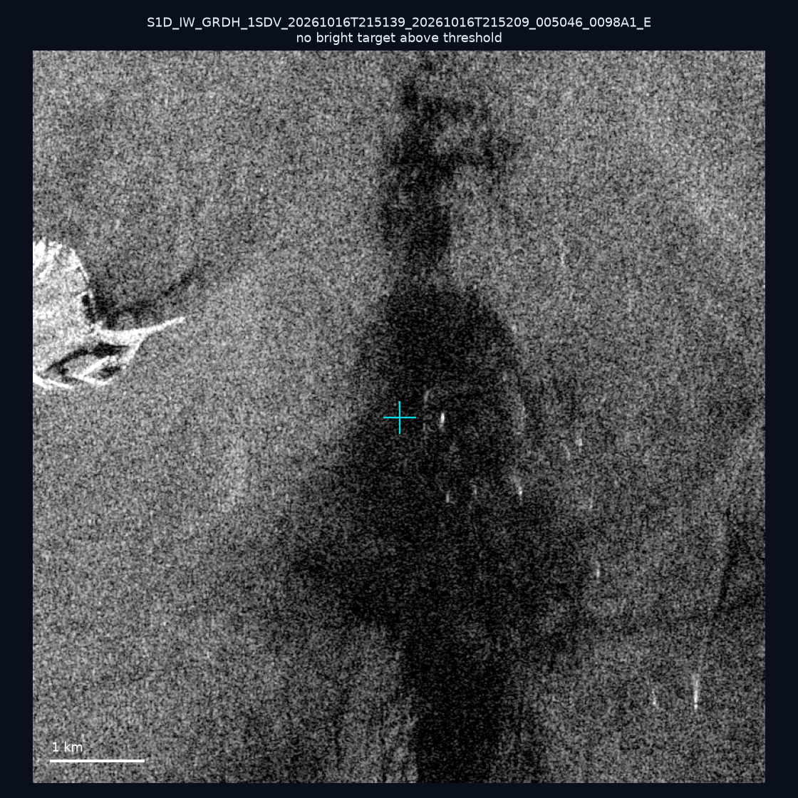
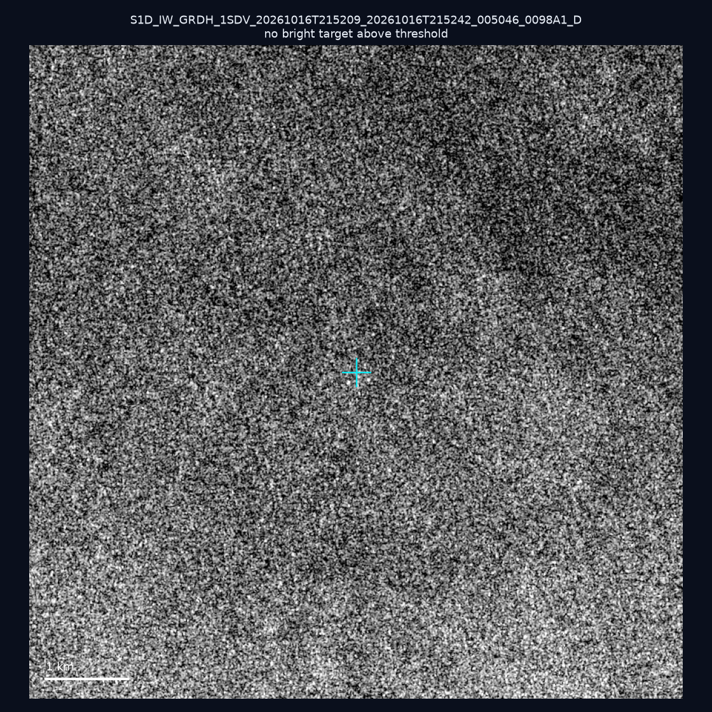

# 暗船 SAR 取證報告 — 2026-11-02

## 1. 總覽

- 執行時間：2026-11-02（GitHub Actions cron 自動執行）
- 線上比對摘要：暗偵測 10790 筆、殘餘暗船 6891 筆、假暗船剔除率 36.1%
- 本輪測試：10 筆
- 成功：10 筆
- 找到亮目標：1 筆
- 失敗：0 筆

## 2. 結果總表

| 日期 | 座標 | 海域 | 法域 | 成像時刻 | 判定 | 估計長度 | 峰值比 |
|------|------|------|------|----------|------|----------|--------|
| 2026-10-27 | 24.35, 122.47 | east | eez | 09:52:08 | ⚪ 無目標（雜訊或低RCS） | — | — |
| 2026-10-24 | 23.18, 117.63 | southwest | eez | 10:16:50 | ⚪ 無目標（雜訊或低RCS） | — | — |
| 2026-10-16 | 21.95, 120.69 | southwest | internal_waters | 21:52:09 | ⚪ 無目標（雜訊或低RCS） | — | — |
| 2026-10-16 | 25.1, 122.06 | east | territorial_sea | 21:51:39 | ⚪ 無目標（雜訊或低RCS） | — | — |
| 2026-10-16 | 25.24, 121.81 | east | internal_waters | 21:51:39 | 🟡 弱目標 | ~14.1 m | 3.1× |
| 2026-10-16 | 24.83, 121.89 | east | internal_waters | 21:51:39 | ⚪ 無目標（雜訊或低RCS） | — | — |
| 2026-10-16 | 23.23, 119.7 | southwest | internal_waters | 21:52:09 | ⚪ 無目標（雜訊或低RCS） | — | — |
| 2026-10-16 | 24.81, 121.93 | east | internal_waters | 21:51:39 | ⚪ 無目標（雜訊或低RCS） | — | — |
| 2026-10-16 | 24.84, 121.91 | east | internal_waters | 21:51:39 | ⚪ 無目標（雜訊或低RCS） | — | — |
| 2026-10-16 | 22.04, 119.77 | southwest | eez | 21:52:09 | ⚪ 無目標（雜訊或低RCS） | — | — |

## 3. 逐目標段落

### 2026-10-27 (24.35, 122.47)

⚪ 無目標（雜訊或低RCS）。

### 2026-10-24 (23.18, 117.63)

⚪ 無目標（雜訊或低RCS）。

### 2026-10-16 (21.95, 120.69)

⚪ 無目標（雜訊或低RCS）。

### 2026-10-16 (25.1, 122.06)

⚪ 無目標（雜訊或低RCS）。

### 2026-10-16 (25.24, 121.81)

🟡 弱目標，估計長度 ~14.1 m，峰值 3.1× 海面背景（1 px）。

### 2026-10-16 (24.83, 121.89)

⚪ 無目標（雜訊或低RCS）。

### 2026-10-16 (23.23, 119.7)

⚪ 無目標（雜訊或低RCS）。

### 2026-10-16 (24.81, 121.93)

⚪ 無目標（雜訊或低RCS）。

### 2026-10-16 (24.84, 121.91)

⚪ 無目標（雜訊或低RCS）。

### 2026-10-16 (22.04, 119.77)

⚪ 無目標（雜訊或低RCS）。

## 4. 後續建議

- 累積統計：全歷史 703 筆（有效 702 筆），確認實體目標 78 筆（11.1%）

> 所有結果是研判線索，不是法律認定；無目標 ≠ 誤報（小型木殼漁船 RCS 低，SAR 可能拍不到）。
