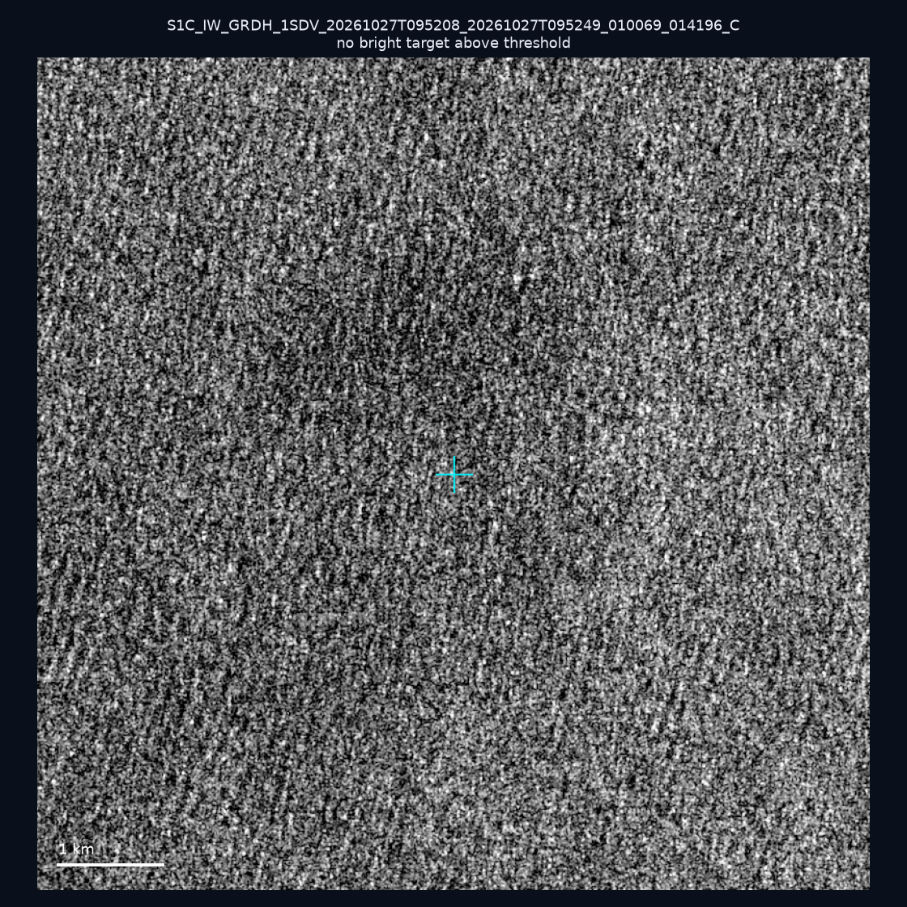
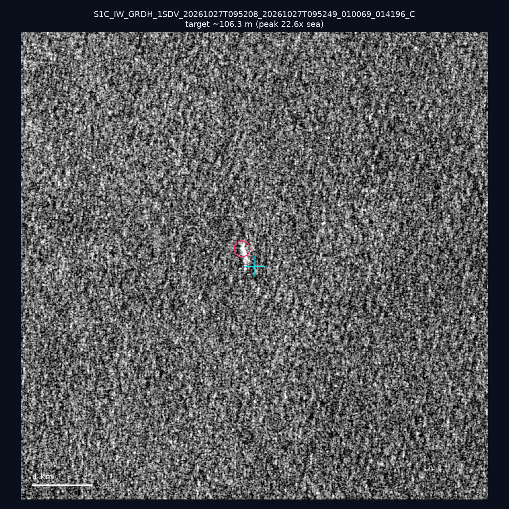
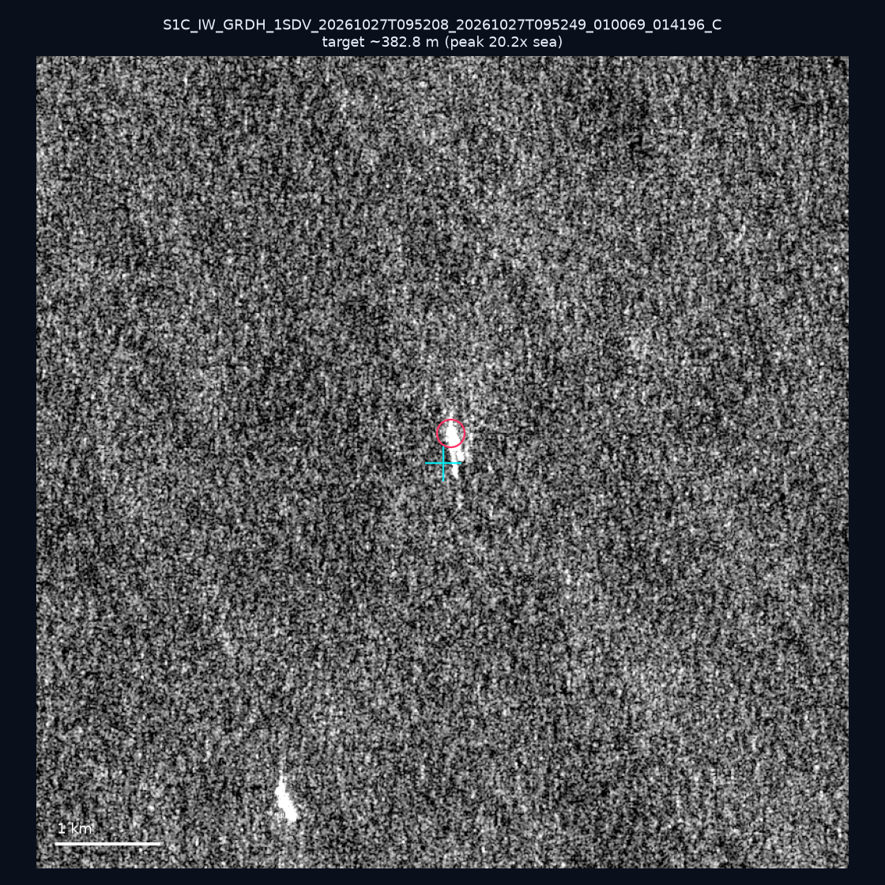
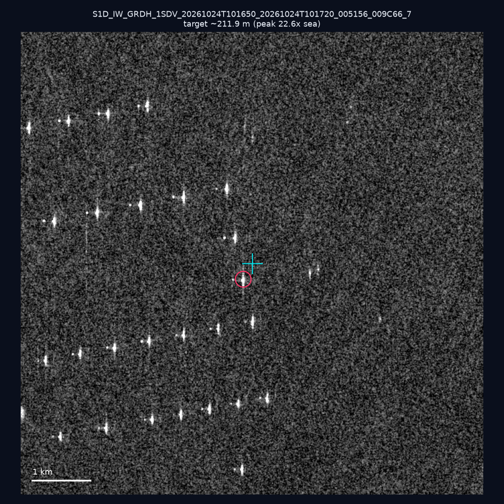
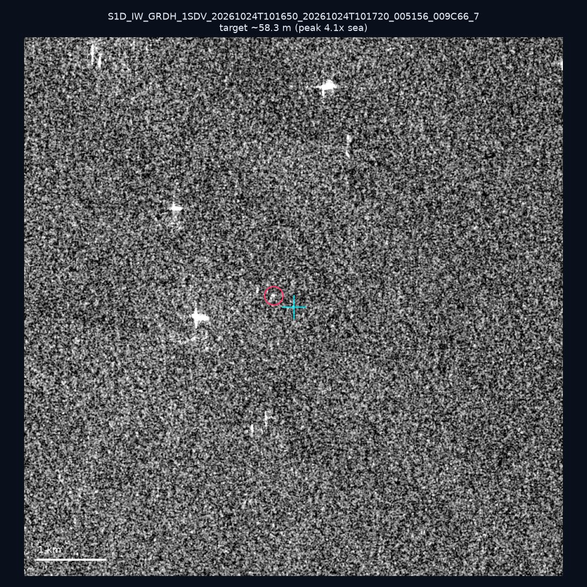
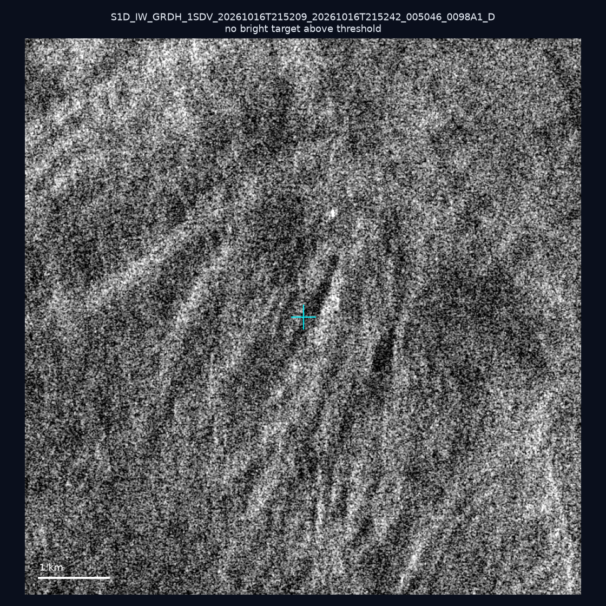
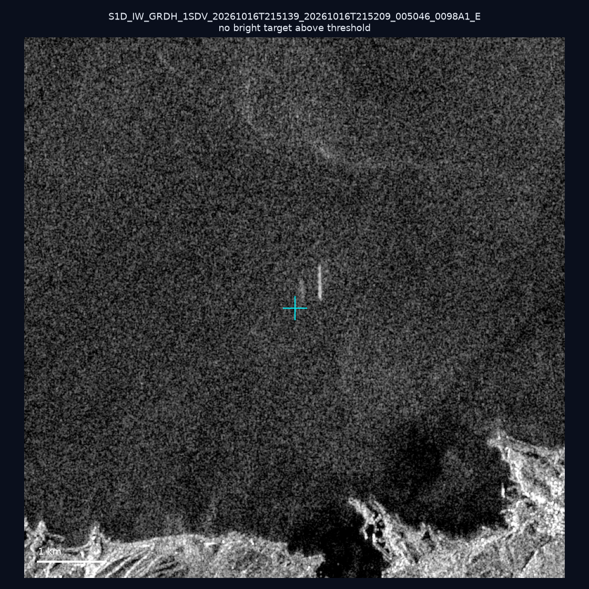
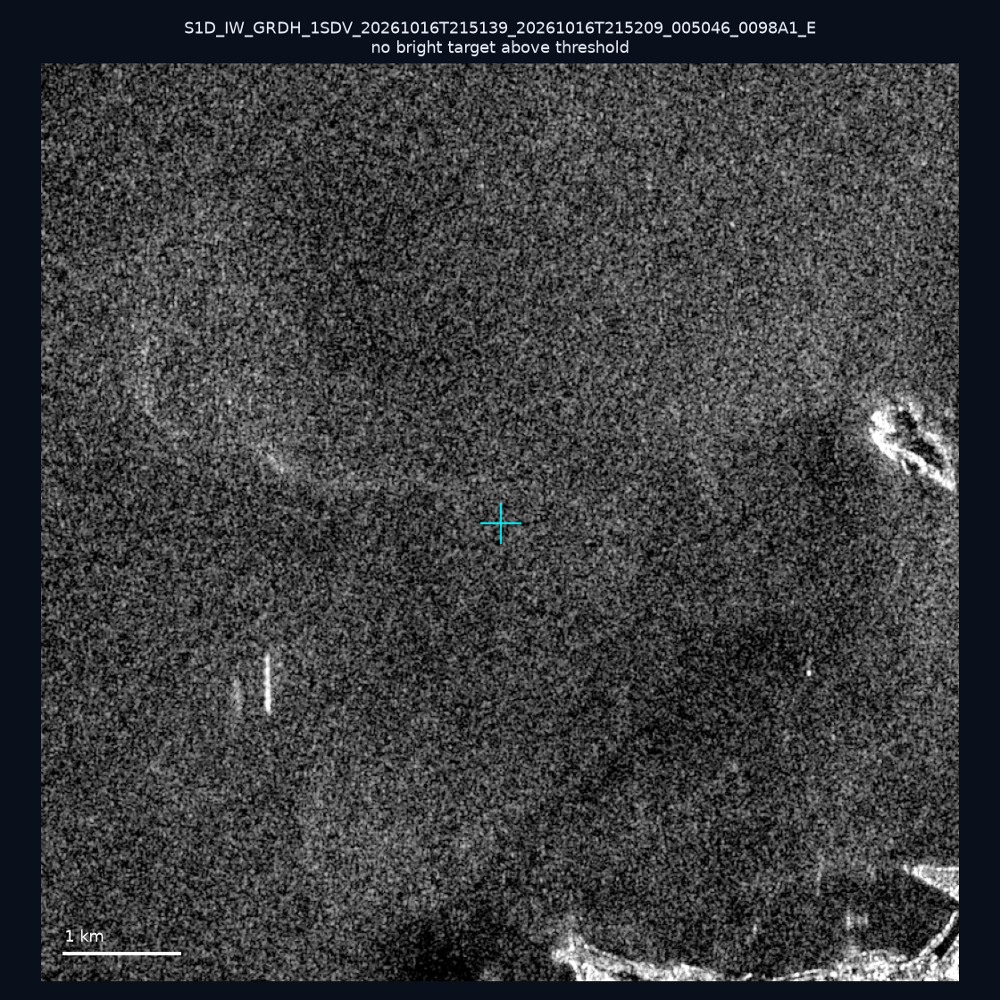
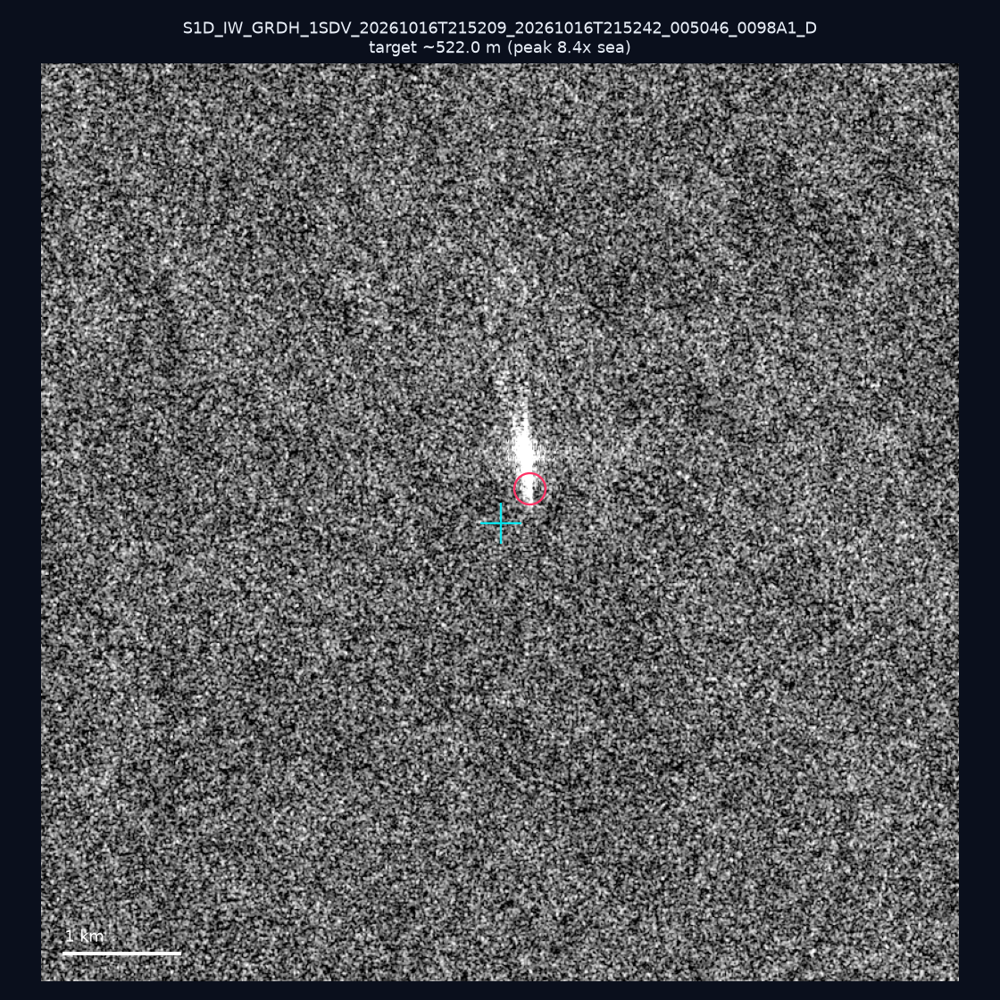
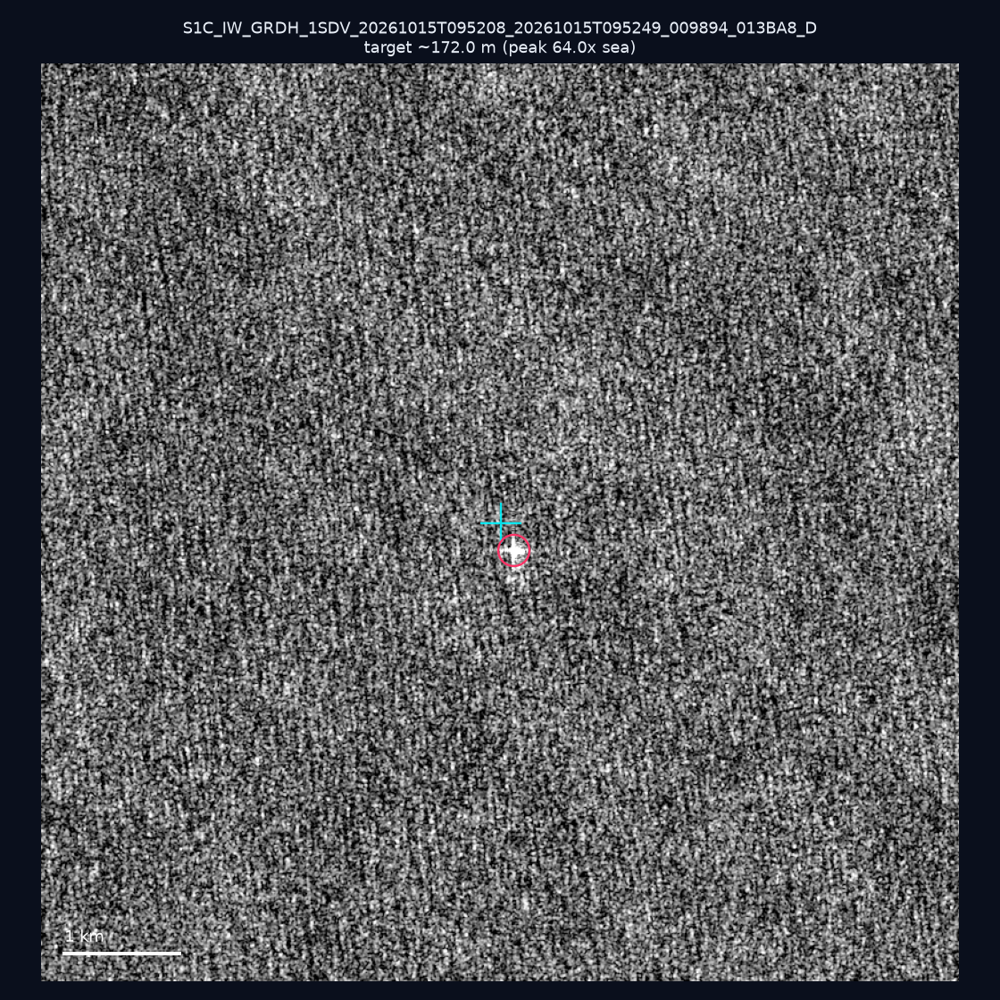

# 暗船 SAR 取證報告 — 2026-11-03

## 1. 總覽

- 執行時間：2026-11-03（GitHub Actions cron 自動執行）
- 線上比對摘要：暗偵測 10576 筆、殘餘暗船 6864 筆、假暗船剔除率 35.1%
- 本輪測試：10 筆
- 成功：10 筆
- 找到亮目標：6 筆
- 失敗：0 筆

## 2. 結果總表

| 日期 | 座標 | 海域 | 法域 | 成像時刻 | 判定 | 估計長度 | 峰值比 |
|------|------|------|------|----------|------|----------|--------|
| 2026-10-27 | 24.63, 122.1 | east | territorial_sea | 09:52:08 | ⚪ 無目標（雜訊或低RCS） | — | — |
| 2026-10-27 | 24.17, 122.08 | east | contiguous_zone | 09:52:08 | ✅ 確認實體目標 | ~106.3 m | 22.6× |
| 2026-10-27 | 25.06, 122.79 | east | eez | 09:52:08 | ✅ 確認實體目標 | ~382.8 m | 20.2× |
| 2026-10-24 | 23.26, 117.09 | southwest | eez | 10:16:50 | ✅ 確認實體目標 | ~211.9 m | 22.6× |
| 2026-10-24 | 23.17, 117.09 | southwest | eez | 10:16:50 | 🟡 弱目標 | ~58.3 m | 4.1× |
| 2026-10-16 | 23.35, 119.76 | southwest | internal_waters | 21:52:09 | ⚪ 無目標（雜訊或低RCS） | — | — |
| 2026-10-16 | 25.16, 121.84 | east | internal_waters | 21:51:39 | ⚪ 無目標（雜訊或低RCS） | — | — |
| 2026-10-16 | 25.18, 121.82 | east | internal_waters | 21:51:39 | ⚪ 無目標（雜訊或低RCS） | — | — |
| 2026-10-16 | 22.62, 119.73 | southwest | territorial_sea | 21:52:09 | 🟡 弱目標 | ~522.0 m | 8.4× |
| 2026-10-15 | 23.66, 123.83 | east | eez | 09:52:08 | ✅ 確認實體目標 | ~172.0 m | 64.0× |

## 3. 逐目標段落

### 2026-10-27 (24.63, 122.1)

⚪ 無目標（雜訊或低RCS）。

### 2026-10-27 (24.17, 122.08)

✅ 確認實體目標，估計長度 ~106.3 m，峰值 22.6× 海面背景（32 px）。

### 2026-10-27 (25.06, 122.79)

✅ 確認實體目標，估計長度 ~382.8 m，峰值 20.2× 海面背景（230 px）。

### 2026-10-24 (23.26, 117.09)

✅ 確認實體目標，估計長度 ~211.9 m，峰值 22.6× 海面背景（76 px）。

### 2026-10-24 (23.17, 117.09)

🟡 弱目標，估計長度 ~58.3 m，峰值 4.1× 海面背景（12 px）。

### 2026-10-16 (23.35, 119.76)

⚪ 無目標（雜訊或低RCS）。

### 2026-10-16 (25.16, 121.84)

⚪ 無目標（雜訊或低RCS）。

### 2026-10-16 (25.18, 121.82)

⚪ 無目標（雜訊或低RCS）。

### 2026-10-16 (22.62, 119.73)

🟡 弱目標，估計長度 ~522.0 m，峰值 8.4× 海面背景（391 px）。

### 2026-10-15 (23.66, 123.83)

✅ 確認實體目標，估計長度 ~172.0 m，峰值 64.0× 海面背景（75 px）。

## 4. 後續建議

- 值得人工深查（確認實體目標且長度 ≥ 50m）：
  - 2026-10-27 (24.17, 122.08) ~106.3 m — 建議比對周邊 AIS 船長
  - 2026-10-27 (25.06, 122.79) ~382.8 m — 建議比對周邊 AIS 船長
  - 2026-10-24 (23.26, 117.09) ~211.9 m — 建議比對周邊 AIS 船長
  - 2026-10-15 (23.66, 123.83) ~172.0 m — 建議比對周邊 AIS 船長
- 累積統計：全歷史 713 筆（有效 712 筆），確認實體目標 82 筆（11.5%）

> 所有結果是研判線索，不是法律認定；無目標 ≠ 誤報（小型木殼漁船 RCS 低，SAR 可能拍不到）。
