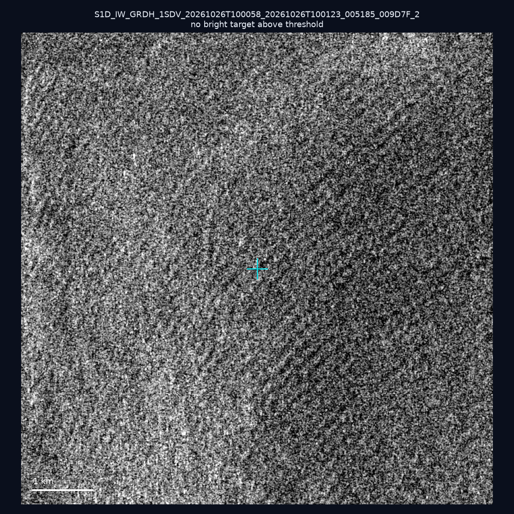
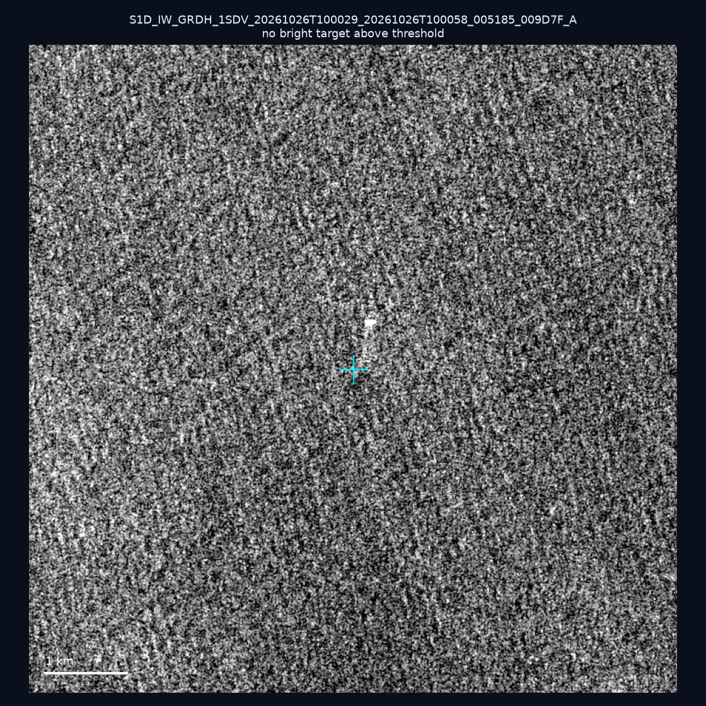
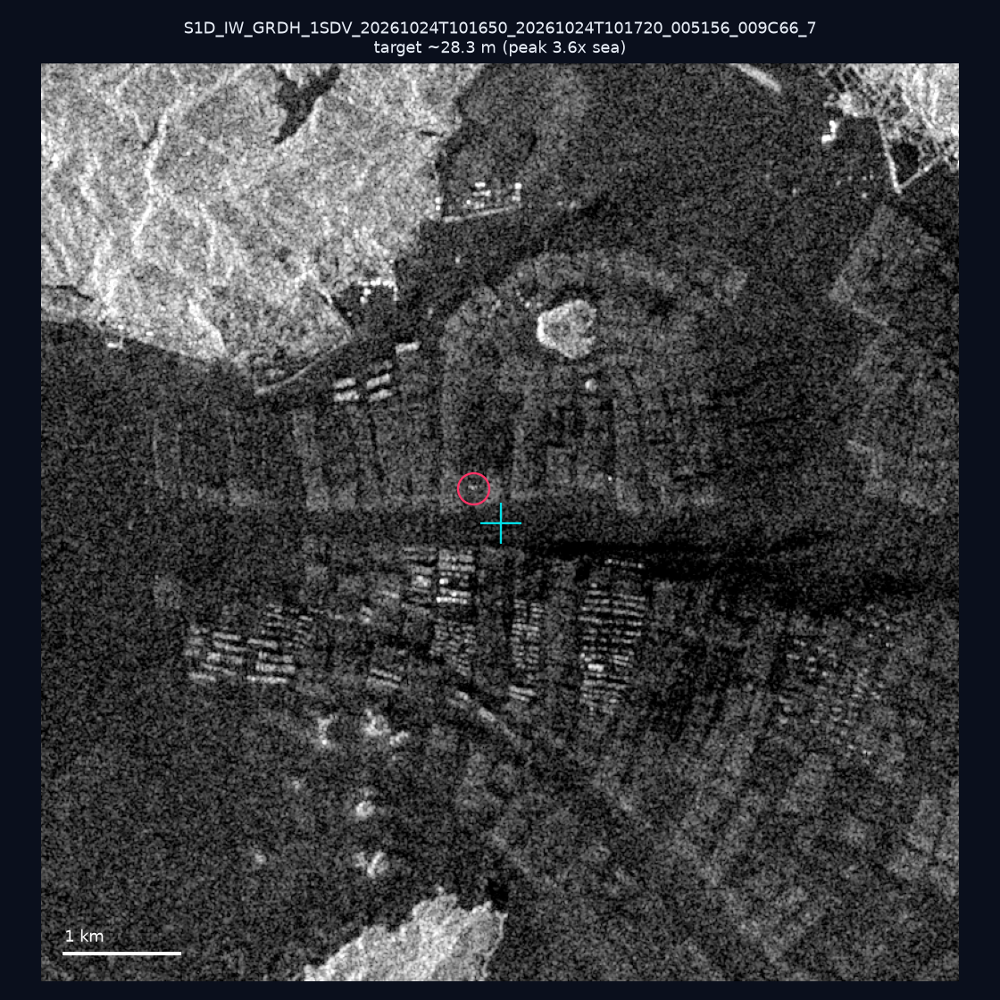
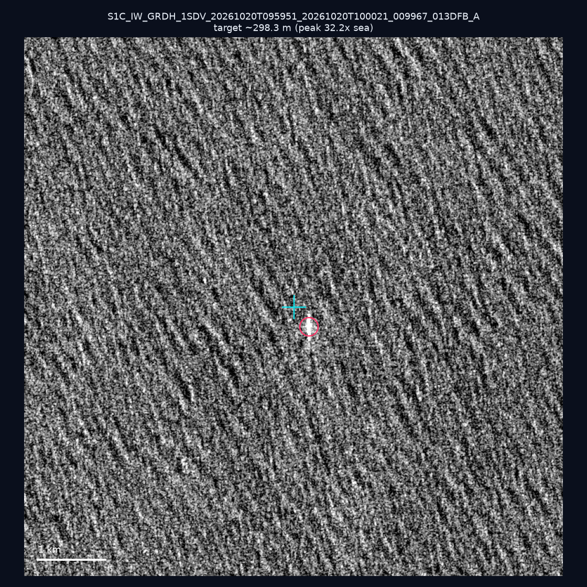
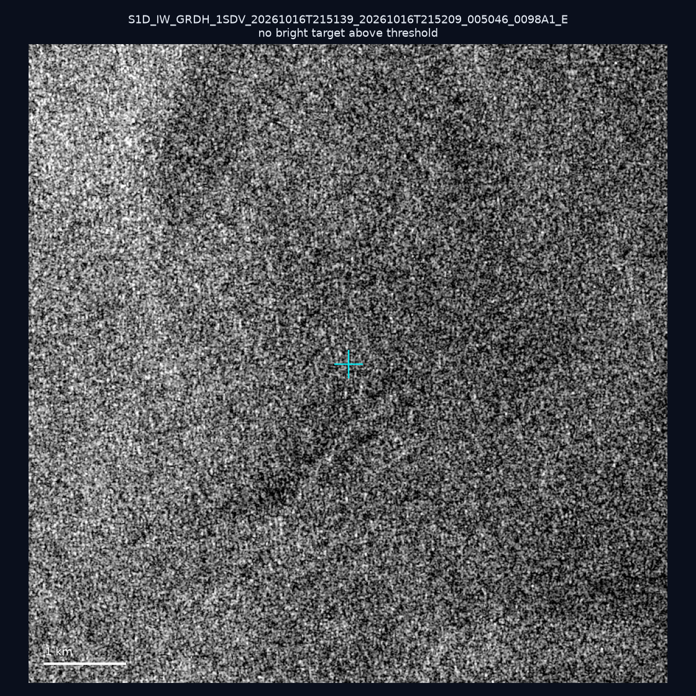
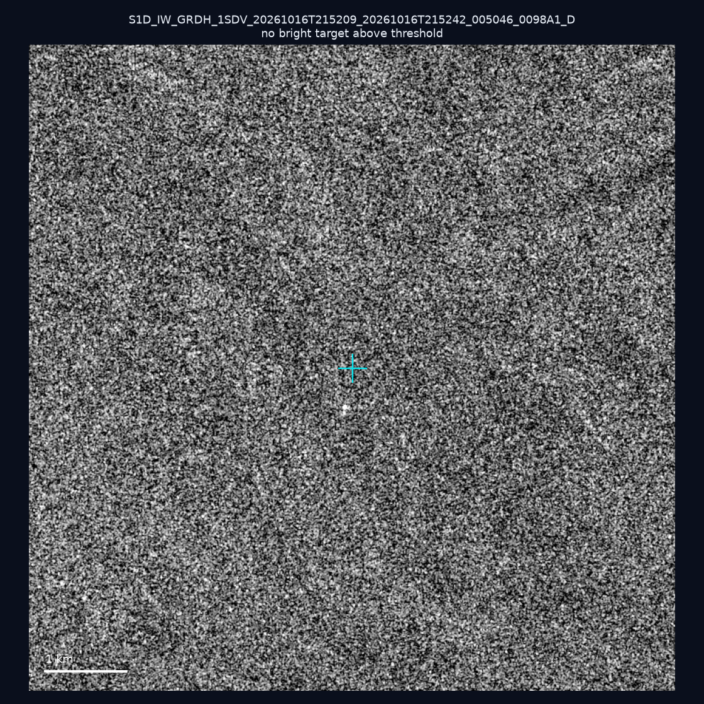
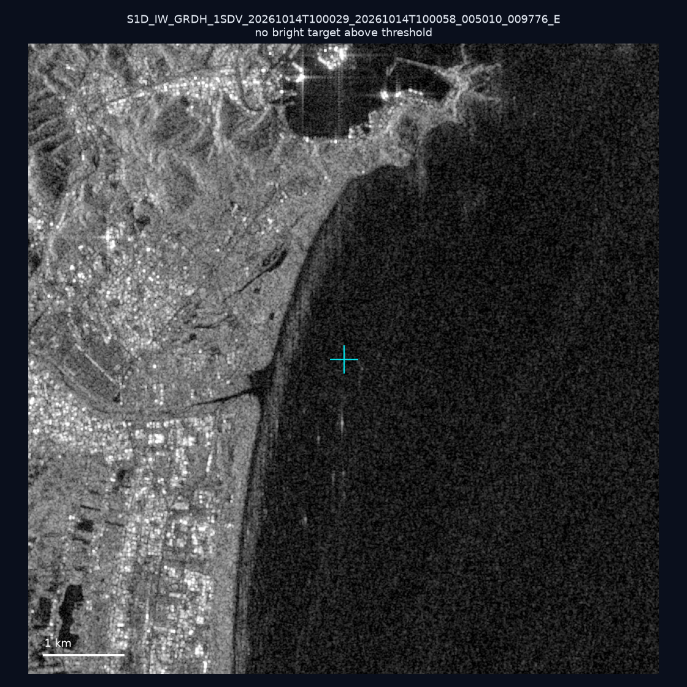
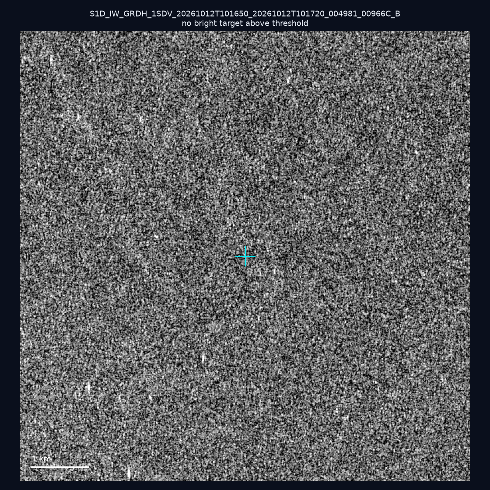
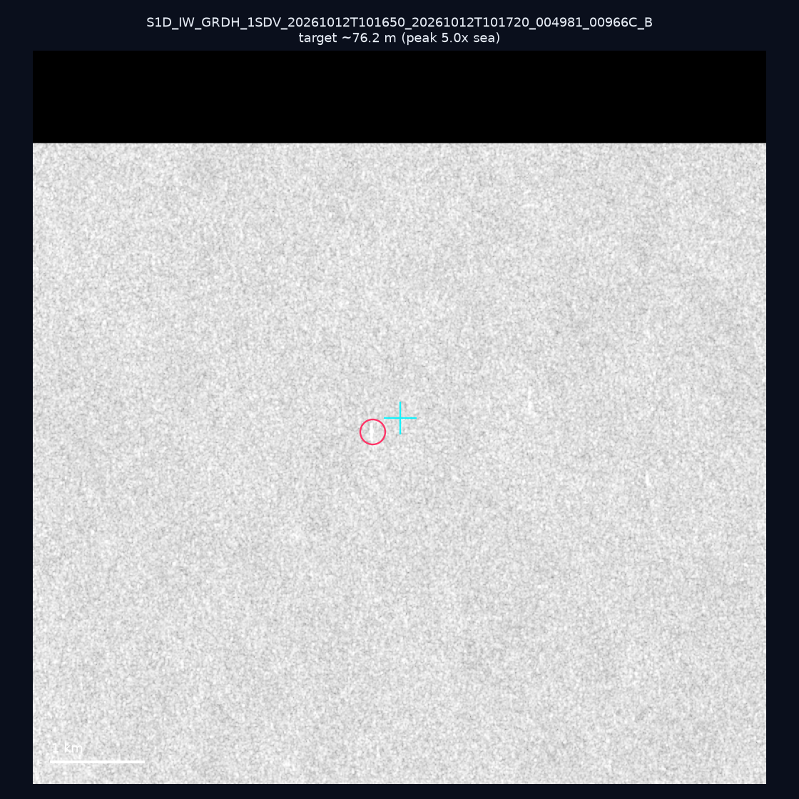
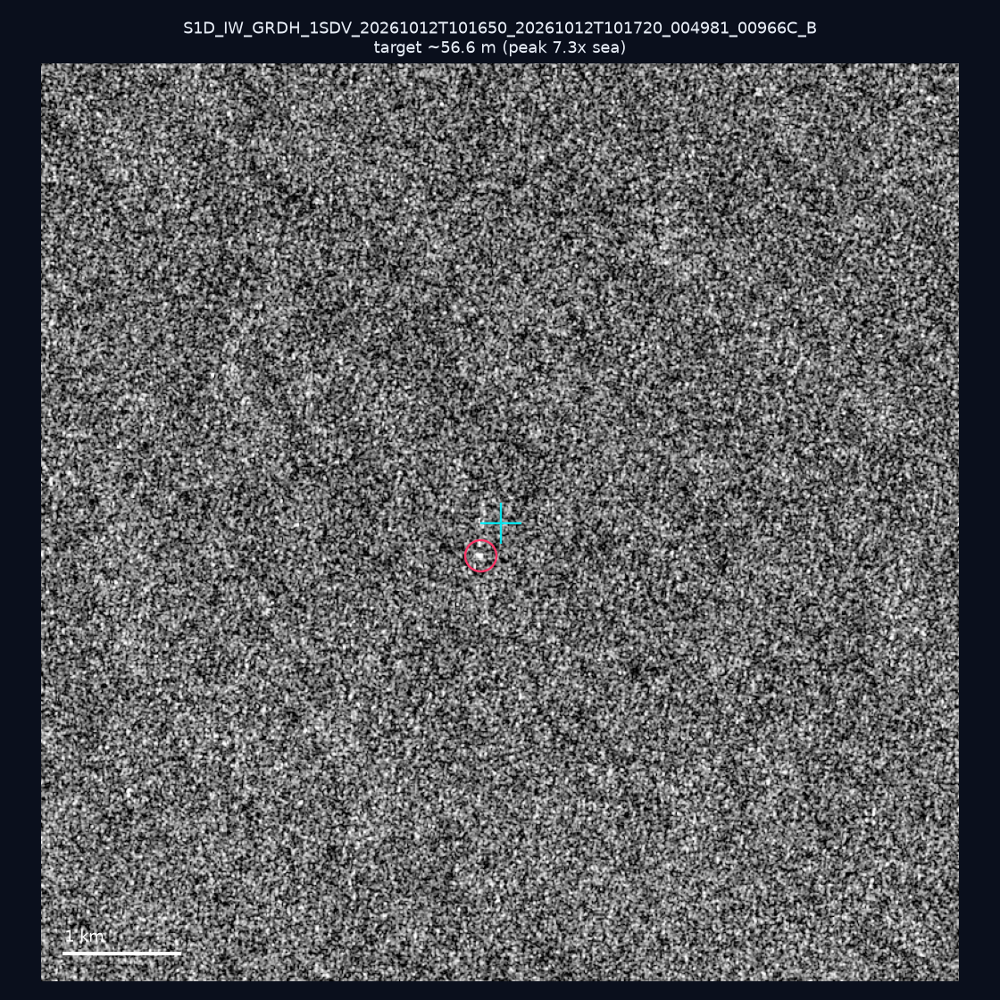

# 暗船 SAR 取證報告 — 2026-11-04

## 1. 總覽

- 執行時間：2026-11-04（GitHub Actions cron 自動執行）
- 線上比對摘要：暗偵測 9405 筆、殘餘暗船 6205 筆、假暗船剔除率 34.0%
- 本輪測試：10 筆
- 成功：10 筆
- 找到亮目標：4 筆
- 失敗：0 筆

## 2. 結果總表

| 日期 | 座標 | 海域 | 法域 | 成像時刻 | 判定 | 估計長度 | 峰值比 |
|------|------|------|------|----------|------|----------|--------|
| 2026-10-26 | 25.07, 121.98 | east | internal_waters | 10:00:58 | ⚪ 無目標（雜訊或低RCS） | — | — |
| 2026-10-26 | 23.27, 122.11 | east | eez | 10:00:29 | ⚪ 無目標（雜訊或低RCS） | — | — |
| 2026-10-24 | 23.48, 117.0 | southwest | eez | 10:16:50 | 🟡 弱目標 | ~28.3 m | 3.6× |
| 2026-10-20 | 22.78, 122.15 | east | eez | 09:59:51 | ✅ 確認實體目標 | ~298.3 m | 32.2× |
| 2026-10-16 | 24.65, 122.0 | east | territorial_sea | 21:51:39 | ⚪ 無目標（雜訊或低RCS） | — | — |
| 2026-10-16 | 22.58, 119.65 | southwest | contiguous_zone | 21:52:09 | ⚪ 無目標（雜訊或低RCS） | — | — |
| 2026-10-14 | 24.63, 121.86 | east | internal_waters | 10:00:29 | ⚪ 無目標（雜訊或低RCS） | — | — |
| 2026-10-12 | 23.02, 117.56 | southwest | eez | 10:16:50 | ⚪ 無目標（雜訊或低RCS） | — | — |
| 2026-10-12 | 22.77, 117.64 | southwest | eez | 10:16:50 | 🟡 弱目標 | ~76.2 m | 5.0× |
| 2026-10-12 | 23.29, 118.12 | southwest | eez | 10:16:50 | 🟡 弱目標 | ~56.6 m | 7.3× |

## 3. 逐目標段落

### 2026-10-26 (25.07, 121.98)

⚪ 無目標（雜訊或低RCS）。

### 2026-10-26 (23.27, 122.11)

⚪ 無目標（雜訊或低RCS）。

### 2026-10-24 (23.48, 117.0)

🟡 弱目標，估計長度 ~28.3 m，峰值 3.6× 海面背景（3 px）。

### 2026-10-20 (22.78, 122.15)

✅ 確認實體目標，估計長度 ~298.3 m，峰值 32.2× 海面背景（130 px）。

### 2026-10-16 (24.65, 122.0)

⚪ 無目標（雜訊或低RCS）。

### 2026-10-16 (22.58, 119.65)

⚪ 無目標（雜訊或低RCS）。

### 2026-10-14 (24.63, 121.86)

⚪ 無目標（雜訊或低RCS）。

### 2026-10-12 (23.02, 117.56)

⚪ 無目標（雜訊或低RCS）。

### 2026-10-12 (22.77, 117.64)

🟡 弱目標，估計長度 ~76.2 m，峰值 5.0× 海面背景（16 px）。

### 2026-10-12 (23.29, 118.12)

🟡 弱目標，估計長度 ~56.6 m，峰值 7.3× 海面背景（13 px）。

## 4. 後續建議

- 值得人工深查（確認實體目標且長度 ≥ 50m）：
  - 2026-10-20 (22.78, 122.15) ~298.3 m — 建議比對周邊 AIS 船長
- 累積統計：全歷史 723 筆（有效 722 筆），確認實體目標 83 筆（11.5%）

> 所有結果是研判線索，不是法律認定；無目標 ≠ 誤報（小型木殼漁船 RCS 低，SAR 可能拍不到）。
