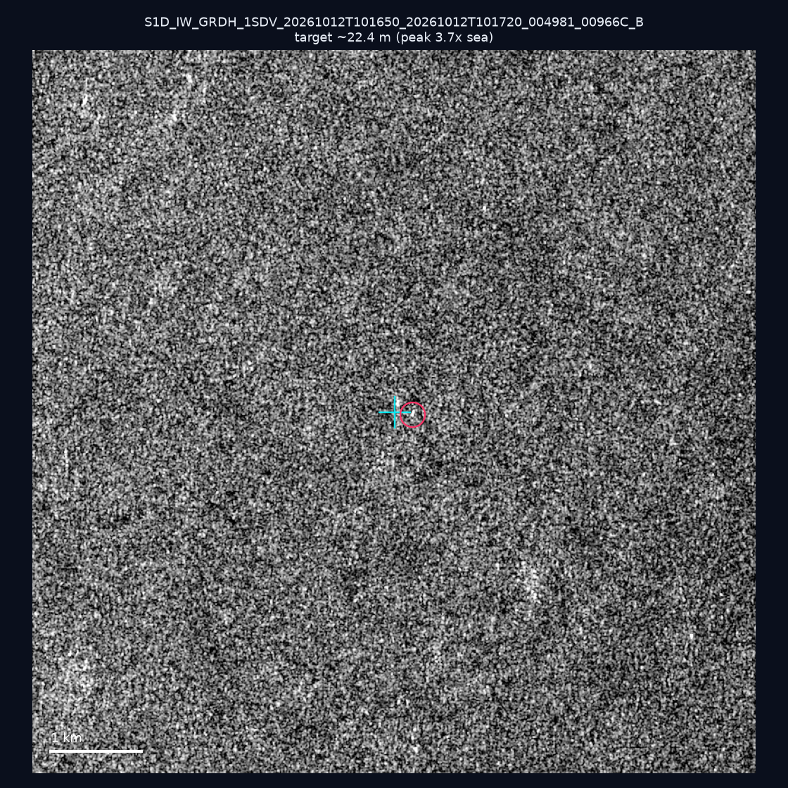
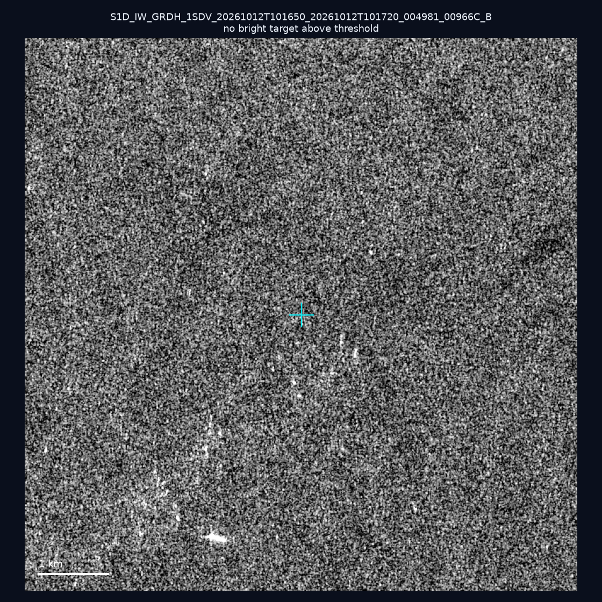
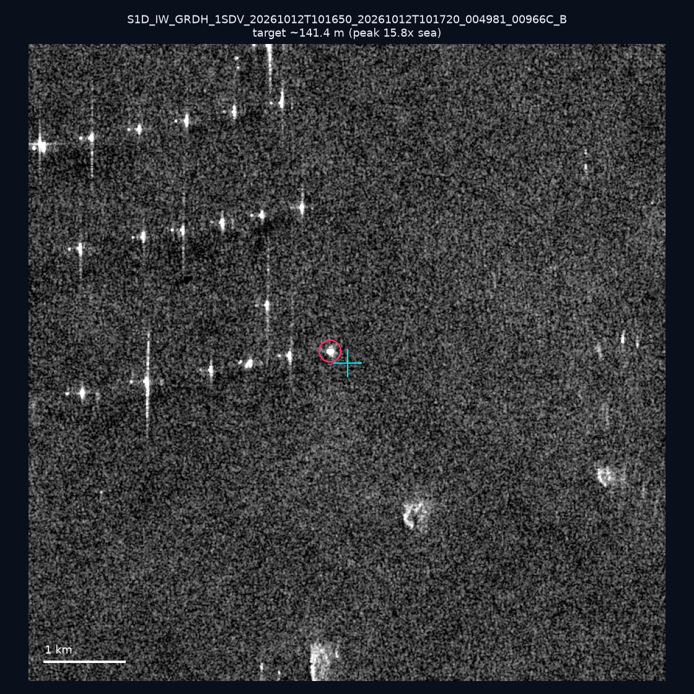
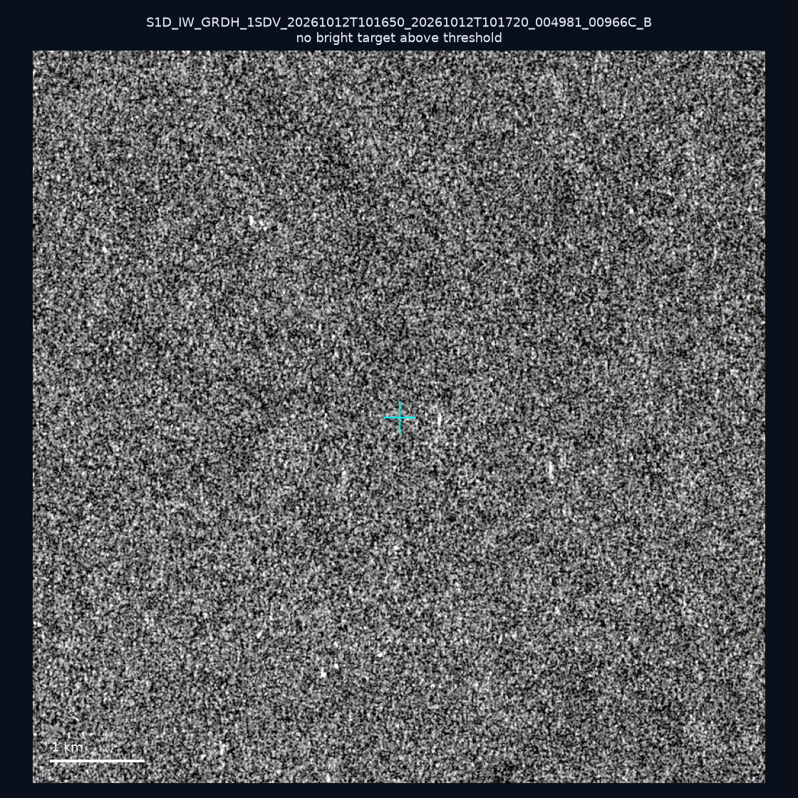
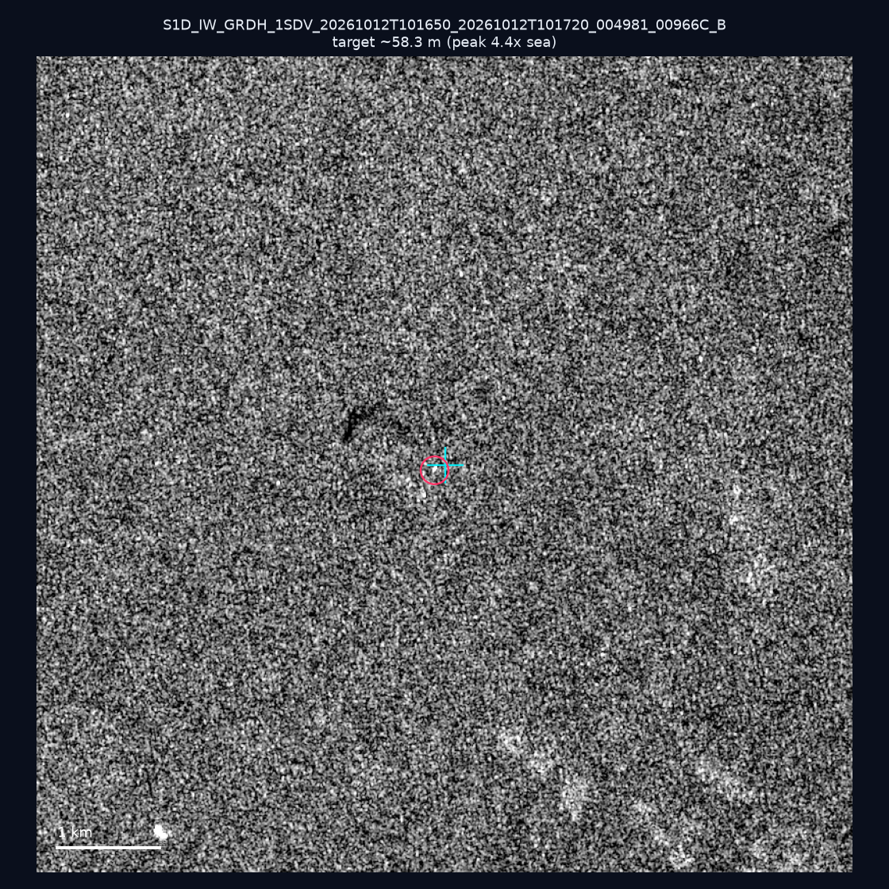
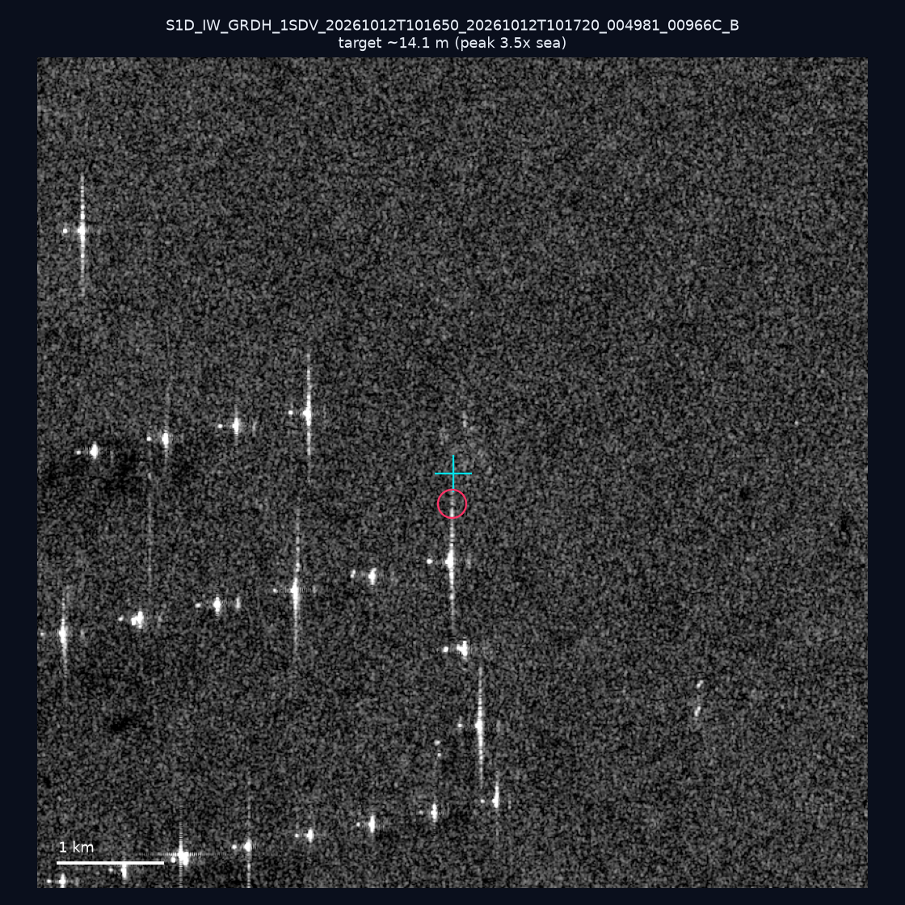
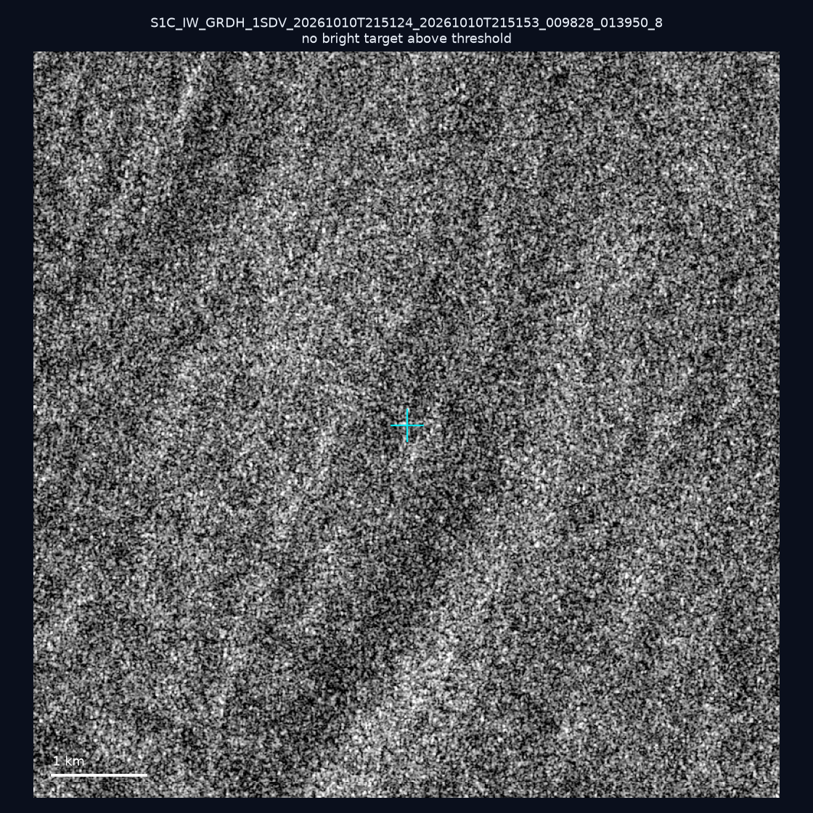
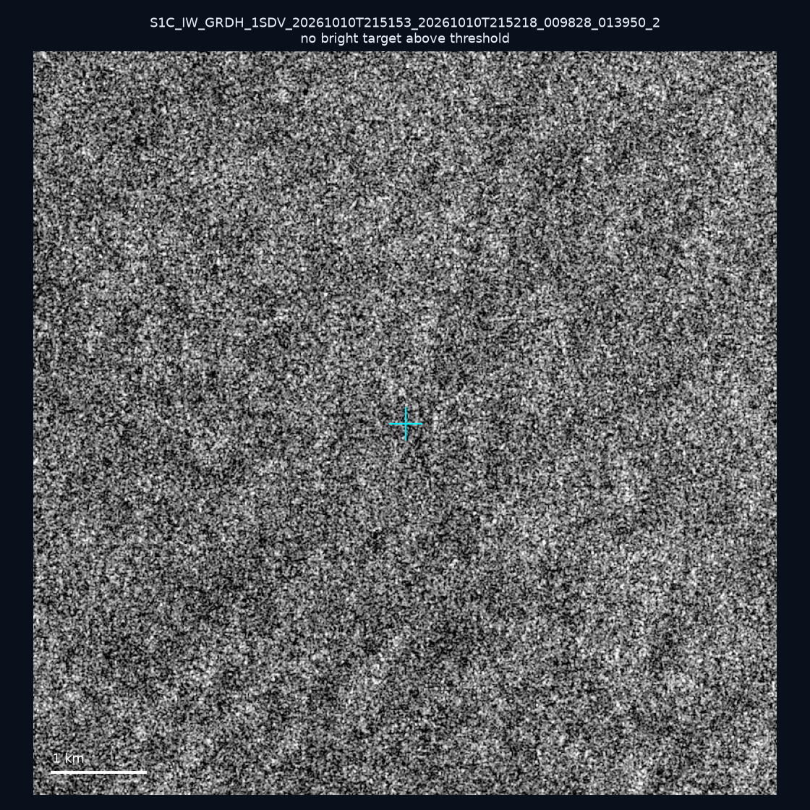
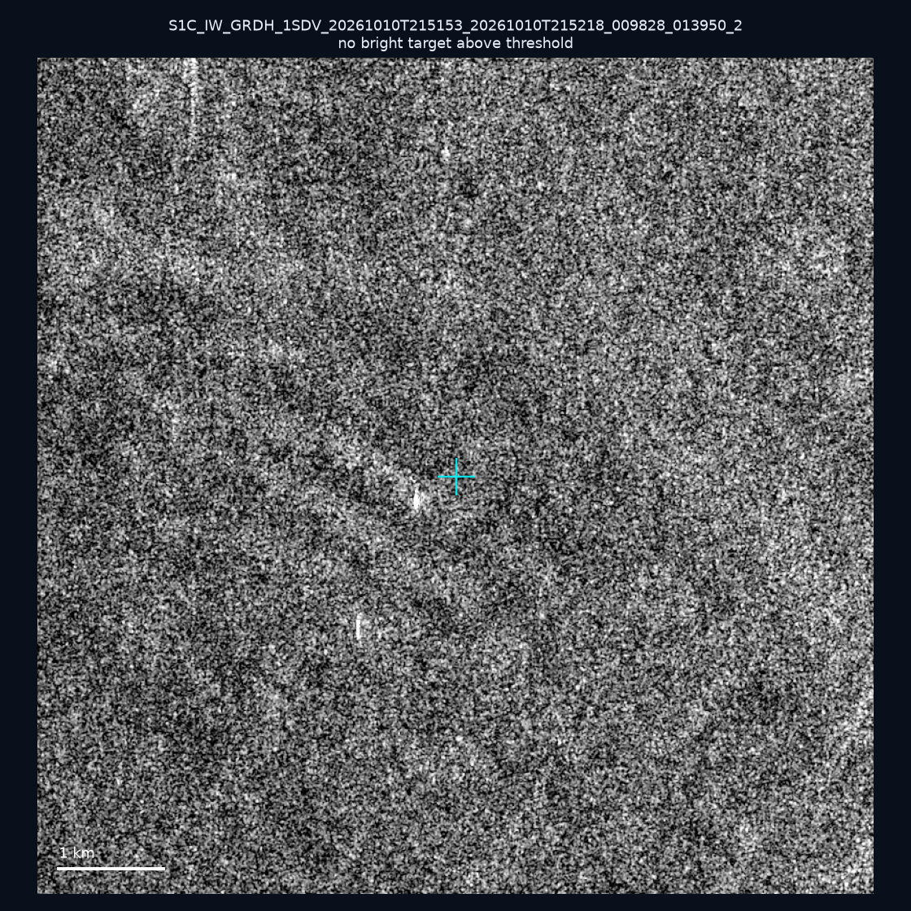
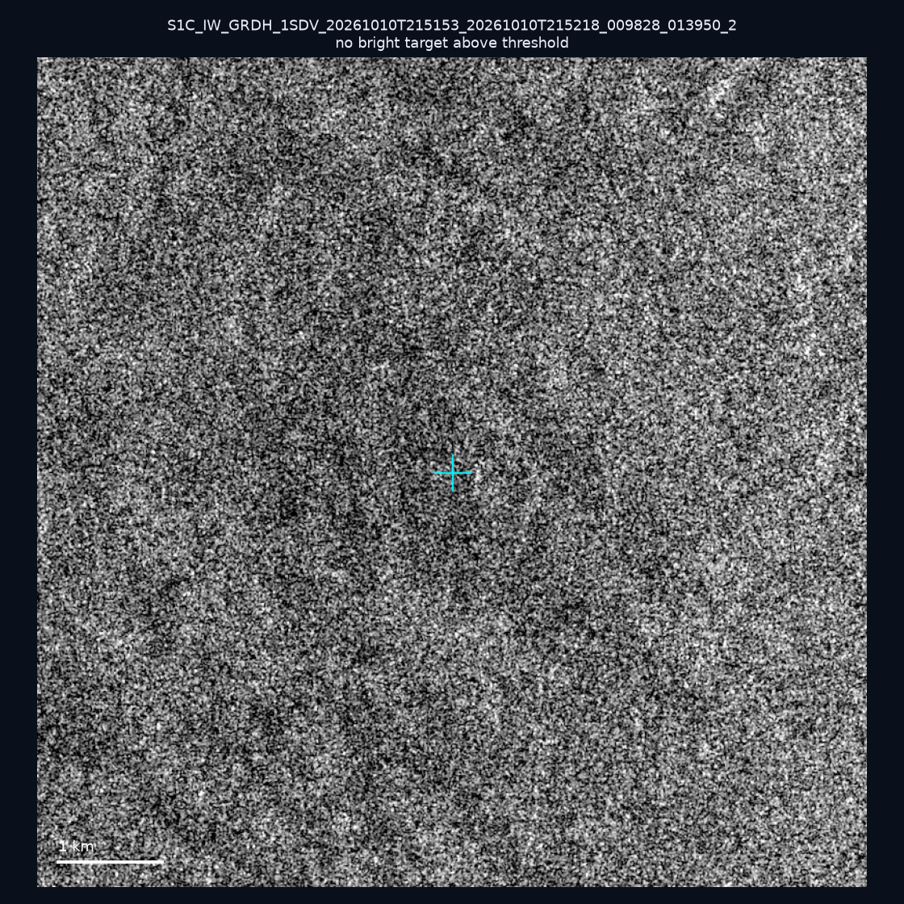

# 暗船 SAR 取證報告 — 2026-11-05

## 1. 總覽

- 執行時間：2026-11-05（GitHub Actions cron 自動執行）
- 線上比對摘要：暗偵測 9405 筆、殘餘暗船 6214 筆、假暗船剔除率 33.9%
- 本輪測試：10 筆
- 成功：10 筆
- 找到亮目標：4 筆
- 失敗：0 筆

## 2. 結果總表

| 日期 | 座標 | 海域 | 法域 | 成像時刻 | 判定 | 估計長度 | 峰值比 |
|------|------|------|------|----------|------|----------|--------|
| 2026-10-12 | 23.27, 117.17 | southwest | eez | 10:16:50 | 🟡 弱目標 | ~22.4 m | 3.7× |
| 2026-10-12 | 23.37, 117.28 | southwest | eez | 10:16:50 | ⚪ 無目標（雜訊或低RCS） | — | — |
| 2026-10-12 | 23.3, 117.09 | southwest | eez | 10:16:50 | ✅ 確認實體目標 | ~141.4 m | 15.8× |
| 2026-10-12 | 23.03, 117.62 | southwest | eez | 10:16:50 | ⚪ 無目標（雜訊或低RCS） | — | — |
| 2026-10-12 | 23.47, 117.21 | southwest | eez | 10:16:50 | 🟡 弱目標 | ~58.3 m | 4.4× |
| 2026-10-12 | 23.24, 117.09 | southwest | eez | 10:16:50 | 🟡 弱目標 | ~14.1 m | 3.5× |
| 2026-10-10 | 24.65, 122.13 | east | territorial_sea | 21:51:24 | ⚪ 無目標（雜訊或低RCS） | — | — |
| 2026-10-10 | 23.09, 119.78 | southwest | internal_waters | 21:51:53 | ⚪ 無目標（雜訊或低RCS） | — | — |
| 2026-10-10 | 23.09, 119.86 | southwest | internal_waters | 21:51:53 | ⚪ 無目標（雜訊或低RCS） | — | — |
| 2026-10-10 | 23.25, 119.89 | southwest | internal_waters | 21:51:53 | ⚪ 無目標（雜訊或低RCS） | — | — |

## 3. 逐目標段落

### 2026-10-12 (23.27, 117.17)

🟡 弱目標，估計長度 ~22.4 m，峰值 3.7× 海面背景（2 px）。

### 2026-10-12 (23.37, 117.28)

⚪ 無目標（雜訊或低RCS）。

### 2026-10-12 (23.3, 117.09)

✅ 確認實體目標，估計長度 ~141.4 m，峰值 15.8× 海面背景（70 px）。

### 2026-10-12 (23.03, 117.62)

⚪ 無目標（雜訊或低RCS）。

### 2026-10-12 (23.47, 117.21)

🟡 弱目標，估計長度 ~58.3 m，峰值 4.4× 海面背景（9 px）。

### 2026-10-12 (23.24, 117.09)

🟡 弱目標，估計長度 ~14.1 m，峰值 3.5× 海面背景（1 px）。

### 2026-10-10 (24.65, 122.13)

⚪ 無目標（雜訊或低RCS）。

### 2026-10-10 (23.09, 119.78)

⚪ 無目標（雜訊或低RCS）。

### 2026-10-10 (23.09, 119.86)

⚪ 無目標（雜訊或低RCS）。

### 2026-10-10 (23.25, 119.89)

⚪ 無目標（雜訊或低RCS）。

## 4. 後續建議

- 值得人工深查（確認實體目標且長度 ≥ 50m）：
  - 2026-10-12 (23.3, 117.09) ~141.4 m — 建議比對周邊 AIS 船長
- 累積統計：全歷史 733 筆（有效 732 筆），確認實體目標 84 筆（11.5%）

> 所有結果是研判線索，不是法律認定；無目標 ≠ 誤報（小型木殼漁船 RCS 低，SAR 可能拍不到）。
