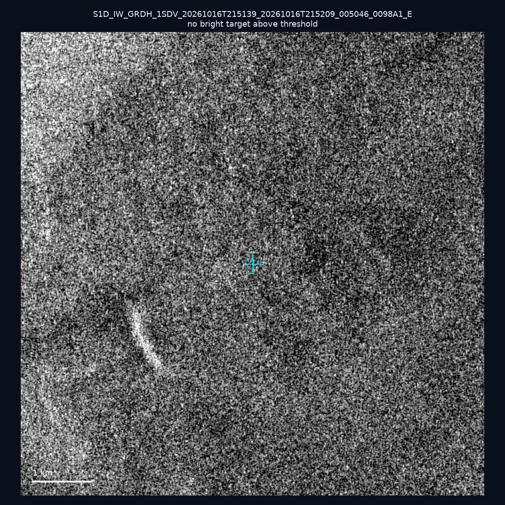
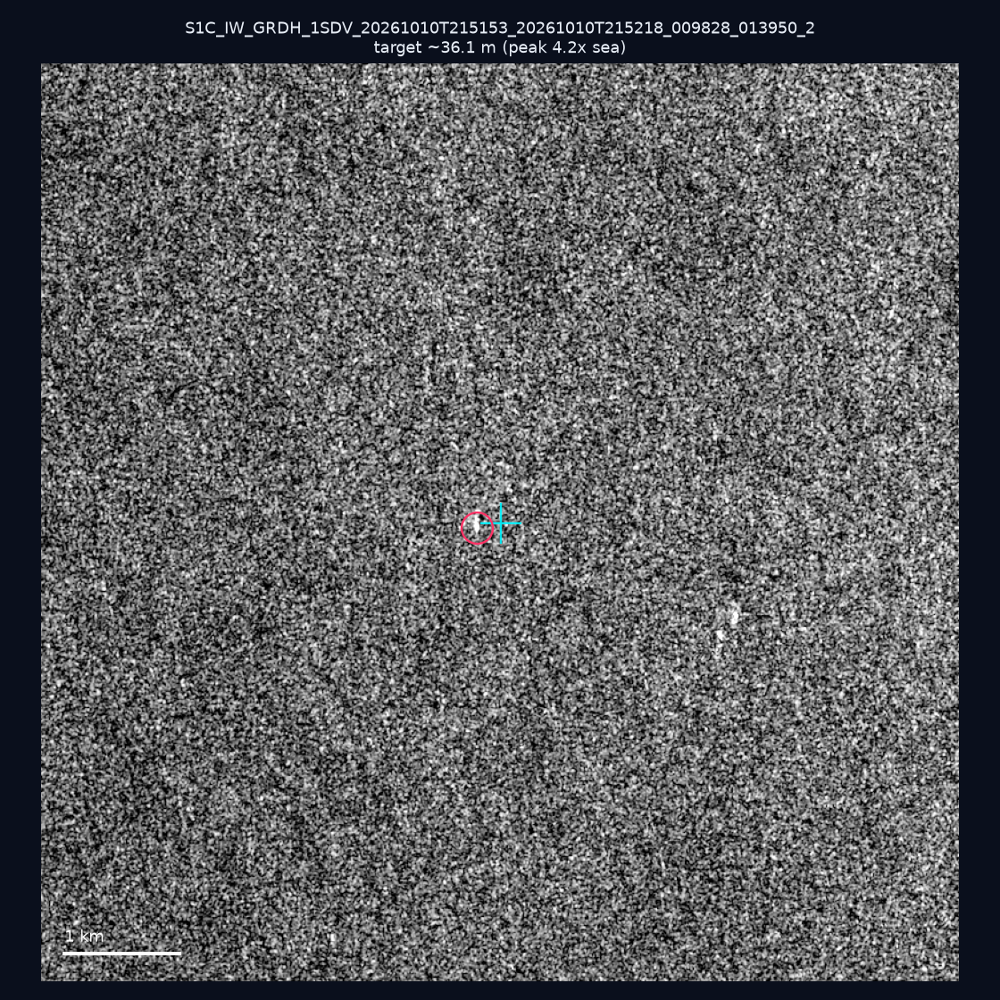
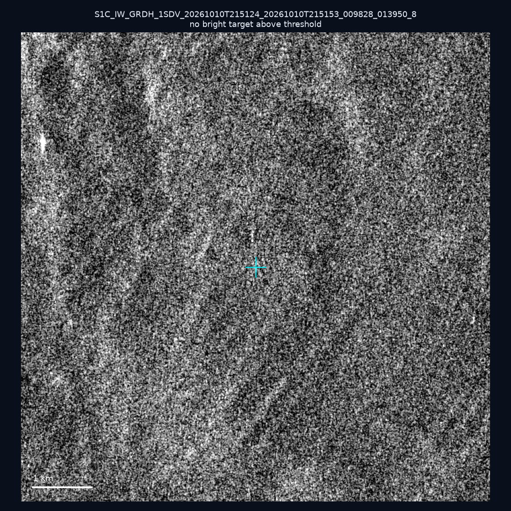
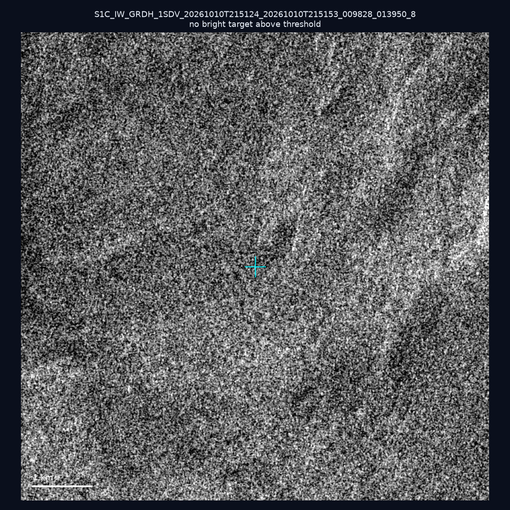
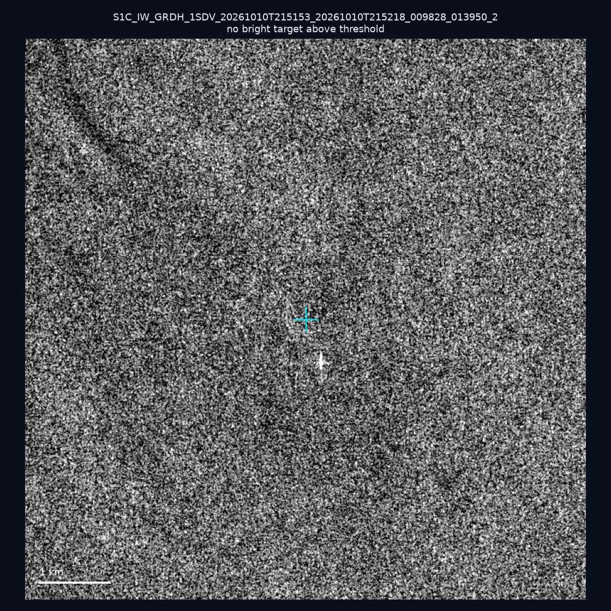
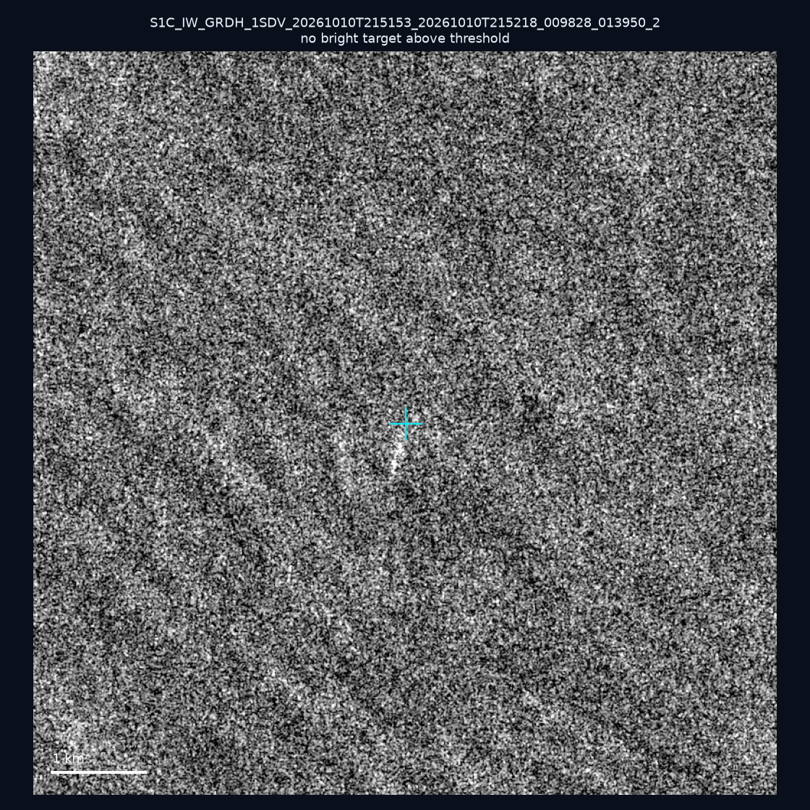
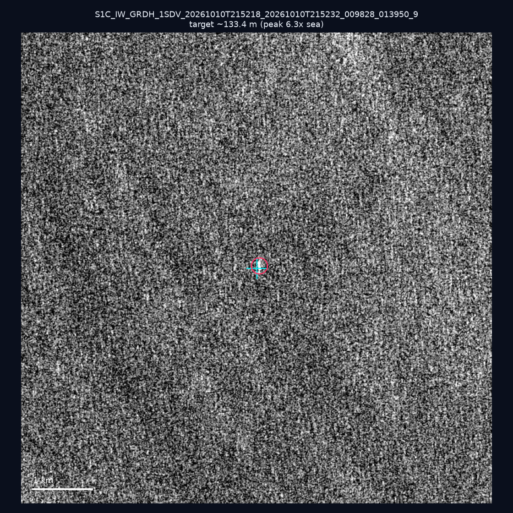
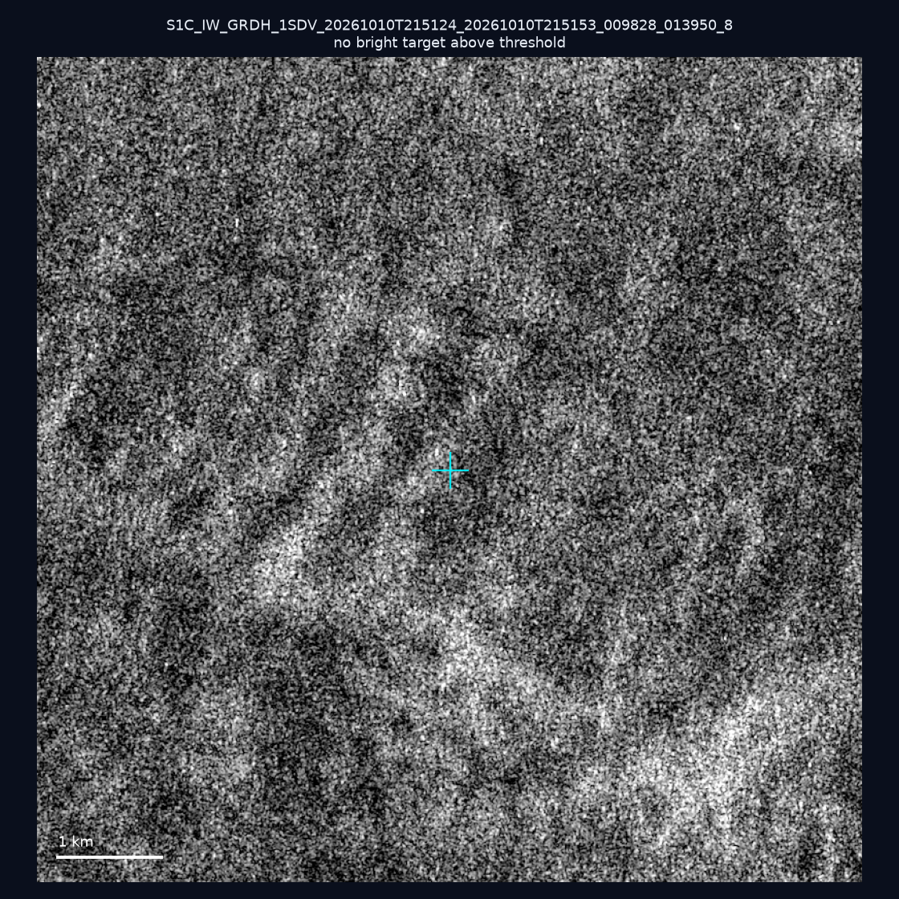
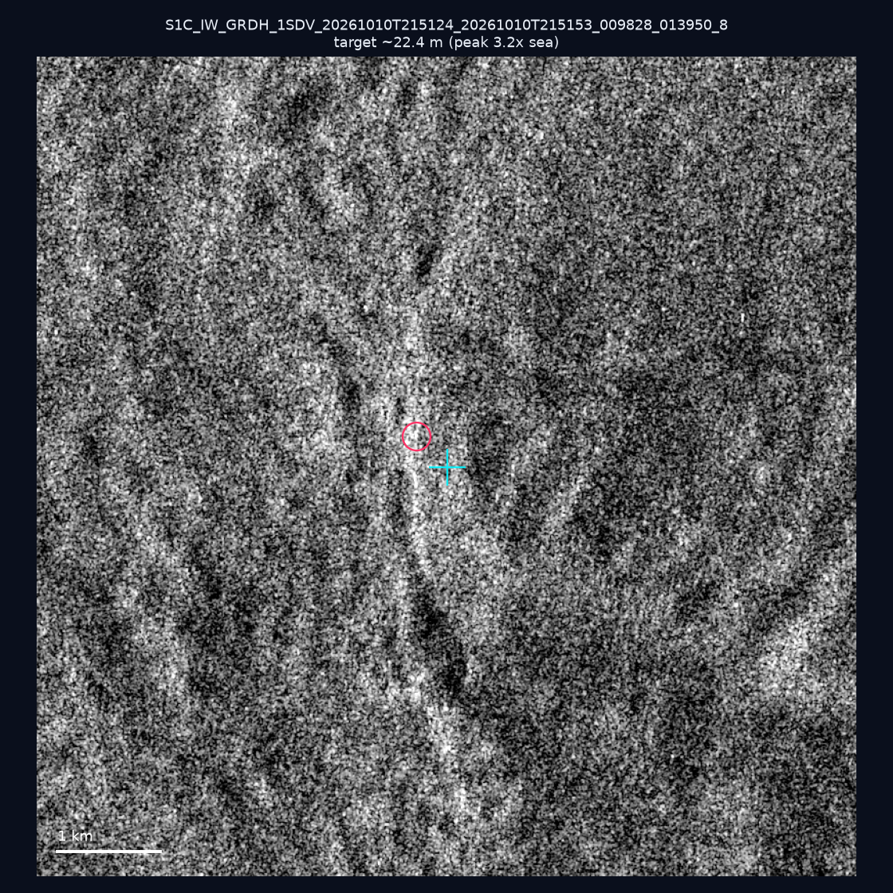

# 暗船 SAR 取證報告 — 2026-11-06

## 1. 總覽

- 執行時間：2026-11-06（GitHub Actions cron 自動執行）
- 線上比對摘要：暗偵測 9405 筆、殘餘暗船 6226 筆、假暗船剔除率 33.8%
- 本輪測試：10 筆
- 成功：9 筆
- 找到亮目標：3 筆
- 失敗：1 筆

## 2. 結果總表

| 日期 | 座標 | 海域 | 法域 | 成像時刻 | 判定 | 估計長度 | 峰值比 |
|------|------|------|------|----------|------|----------|--------|
| 2026-10-16 | 25.23, 121.9 | east | internal_waters | 21:51:39 | ⚪ 無目標（雜訊或低RCS） | — | — |
| 2026-10-10 | 22.73, 119.6 | southwest | contiguous_zone | 21:51:53 | 🟡 弱目標 | ~36.1 m | 4.2× |
| 2026-10-10 | 25.29, 121.76 | east | internal_waters | 21:51:24 | ⚪ 無目標（雜訊或低RCS） | — | — |
| 2026-10-10 | 25.1, 123.87 | east | eez | 09:44:02 | ❌ 失敗 | — | — |
| 2026-10-10 | 24.76, 121.91 | east | internal_waters | 21:51:24 | ⚪ 無目標（雜訊或低RCS） | — | — |
| 2026-10-10 | 22.67, 119.67 | southwest | contiguous_zone | 21:51:53 | ⚪ 無目標（雜訊或低RCS） | — | — |
| 2026-10-10 | 22.84, 119.83 | southwest | internal_waters | 21:51:53 | ⚪ 無目標（雜訊或低RCS） | — | — |
| 2026-10-10 | 21.8, 119.42 | southwest | eez | 21:52:18 | 🟡 弱目標 | ~133.4 m | 6.3× |
| 2026-10-10 | 25.21, 121.92 | east | internal_waters | 21:51:24 | ⚪ 無目標（雜訊或低RCS） | — | — |
| 2026-10-10 | 25.21, 121.97 | east | internal_waters | 21:51:24 | 🟡 弱目標 | ~22.4 m | 3.2× |

## 3. 逐目標段落

### 2026-10-16 (25.23, 121.9)

⚪ 無目標（雜訊或低RCS）。

### 2026-10-10 (22.73, 119.6)

🟡 弱目標，估計長度 ~36.1 m，峰值 4.2× 海面背景（6 px）。

### 2026-10-10 (25.29, 121.76)

⚪ 無目標（雜訊或低RCS）。

### 2026-10-10 (25.1, 123.87)
❌ 失敗：crash: rasterio.errors.RasterioIOError: HTTP response code: 403

### 2026-10-10 (24.76, 121.91)

⚪ 無目標（雜訊或低RCS）。

### 2026-10-10 (22.67, 119.67)

⚪ 無目標（雜訊或低RCS）。

### 2026-10-10 (22.84, 119.83)

⚪ 無目標（雜訊或低RCS）。

### 2026-10-10 (21.8, 119.42)

🟡 弱目標，估計長度 ~133.4 m，峰值 6.3× 海面背景（32 px）。

### 2026-10-10 (25.21, 121.92)

⚪ 無目標（雜訊或低RCS）。

### 2026-10-10 (25.21, 121.97)

🟡 弱目標，估計長度 ~22.4 m，峰值 3.2× 海面背景（2 px）。

## 4. 後續建議

- 累積統計：全歷史 743 筆（有效 741 筆），確認實體目標 84 筆（11.3%）

> 所有結果是研判線索，不是法律認定；無目標 ≠ 誤報（小型木殼漁船 RCS 低，SAR 可能拍不到）。
