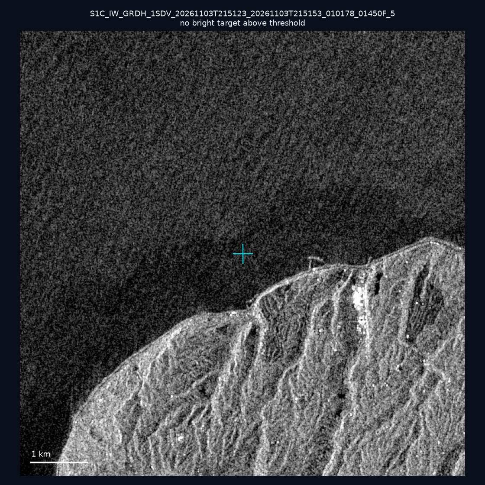
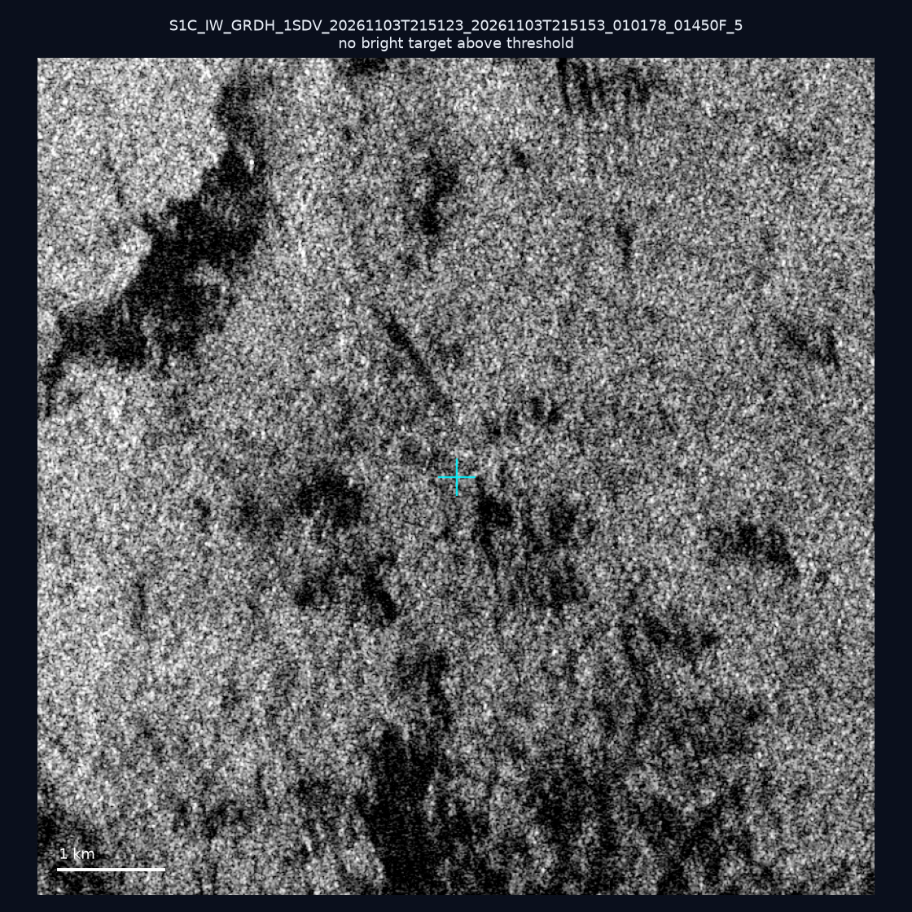
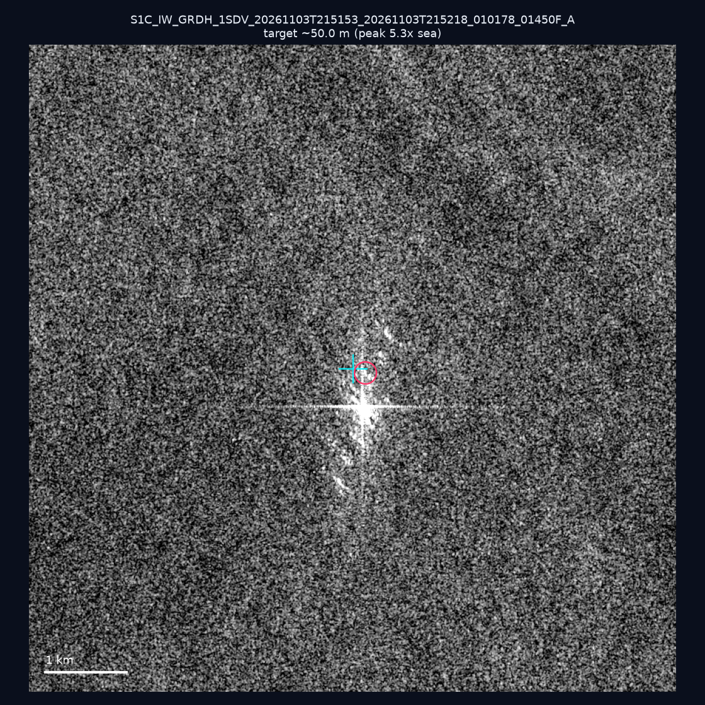
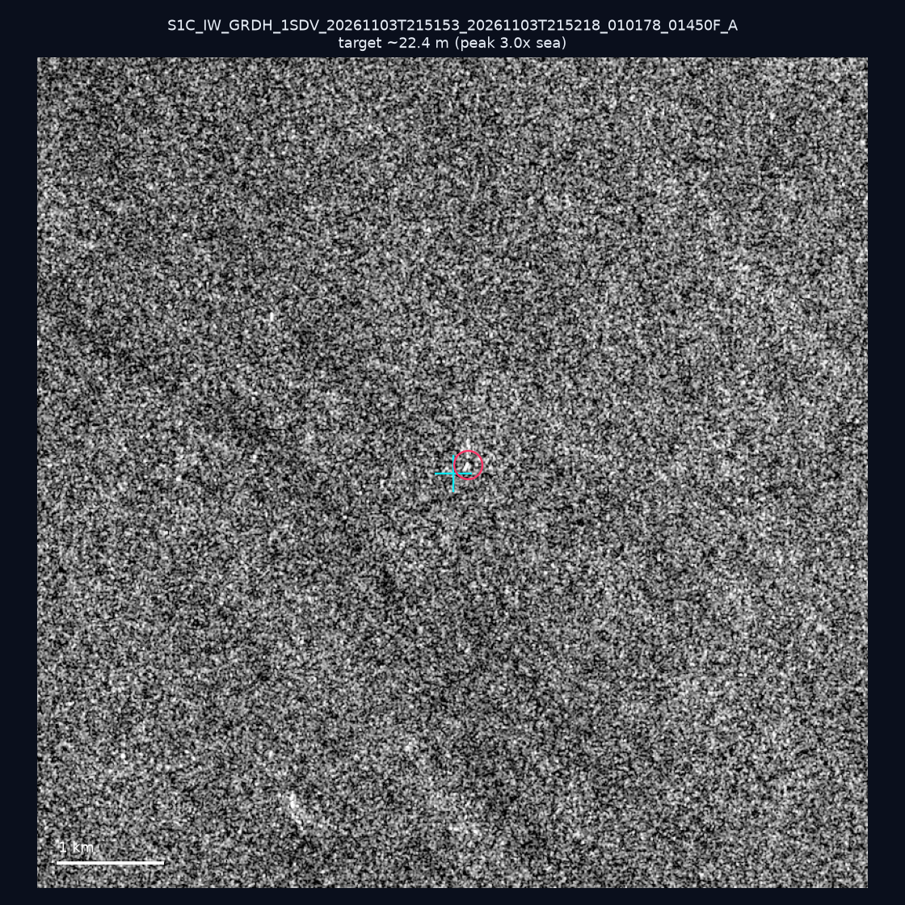
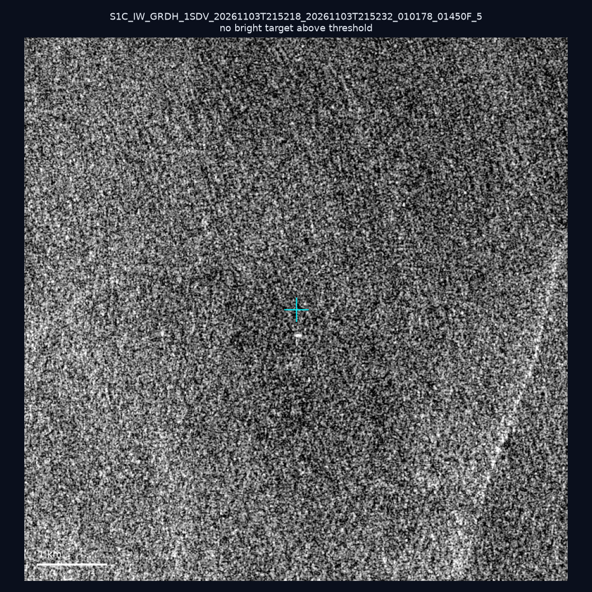
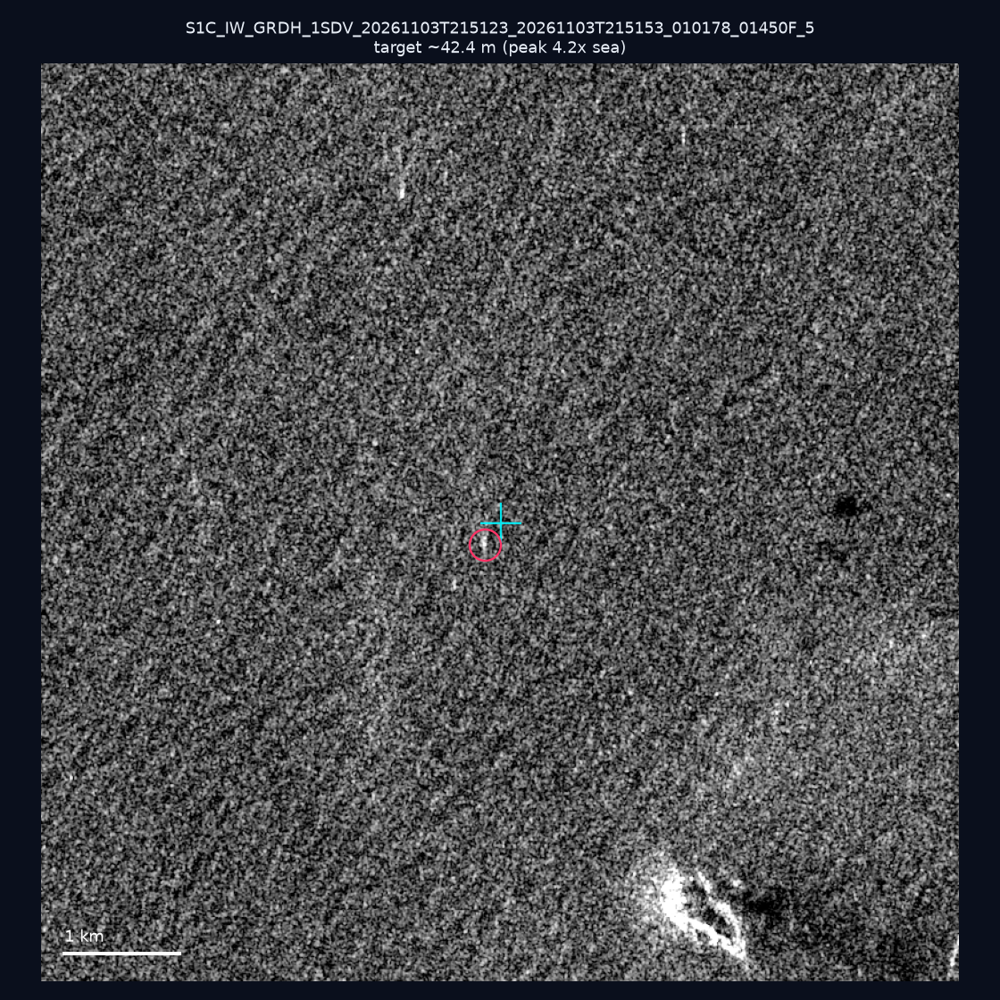
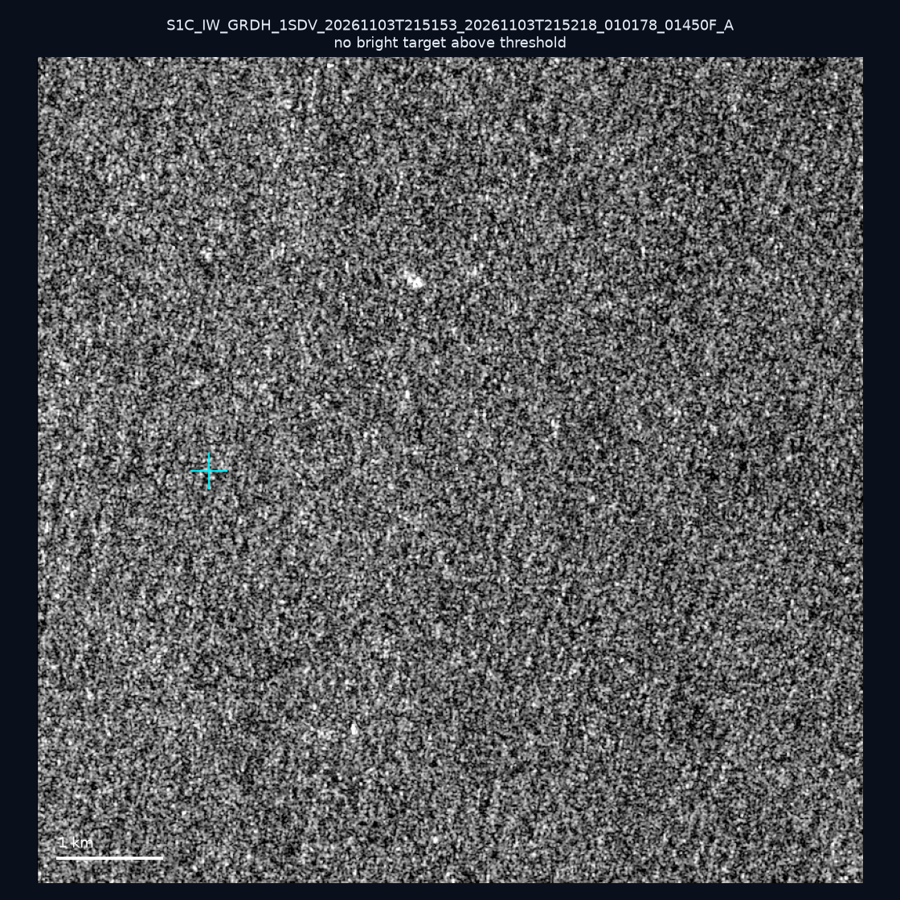
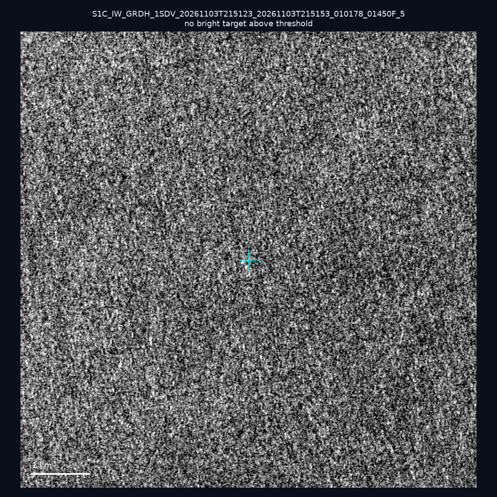
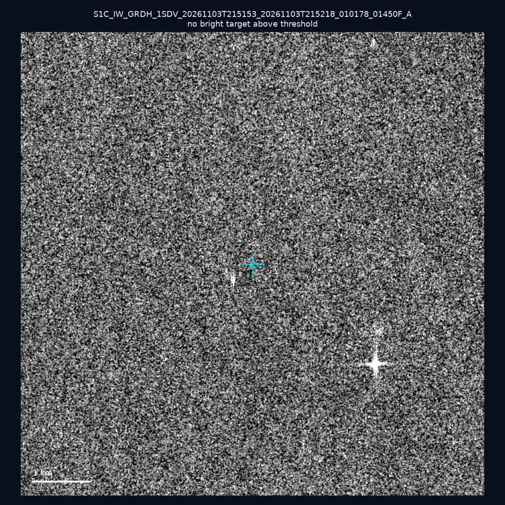
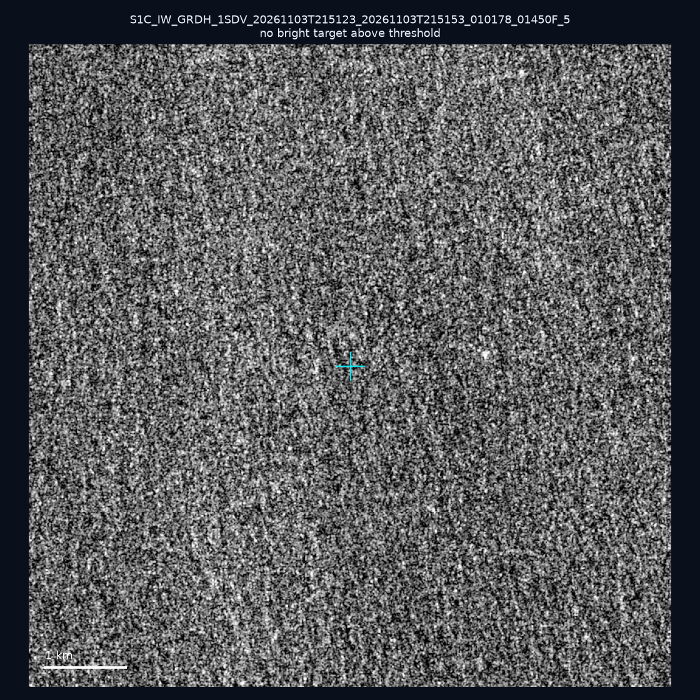

# 暗船 SAR 取證報告 — 2026-11-07

## 1. 總覽

- 執行時間：2026-11-07（GitHub Actions cron 自動執行）
- 線上比對摘要：暗偵測 33230 筆、殘餘暗船 18882 筆、假暗船剔除率 43.2%
- 本輪測試：10 筆
- 成功：10 筆
- 找到亮目標：3 筆
- 失敗：0 筆

## 2. 結果總表

| 日期 | 座標 | 海域 | 法域 | 成像時刻 | 判定 | 估計長度 | 峰值比 |
|------|------|------|------|----------|------|----------|--------|
| 2026-11-03 | 25.29, 121.61 | east | internal_waters | 21:51:23 | ⚪ 無目標（雜訊或低RCS） | — | — |
| 2026-11-03 | 24.88, 122.05 | east | territorial_sea | 21:51:23 | ⚪ 無目標（雜訊或低RCS） | — | — |
| 2026-11-03 | 23.21, 119.76 | southwest | internal_waters | 21:51:53 | 🟡 弱目標 | ~50.0 m | 5.3× |
| 2026-11-03 | 22.93, 119.69 | southwest | territorial_sea | 21:51:53 | 🟡 弱目標 | ~22.4 m | 3.0× |
| 2026-11-03 | 21.88, 120.8 | southwest | internal_waters | 21:52:18 | ⚪ 無目標（雜訊或低RCS） | — | — |
| 2026-11-03 | 25.22, 121.81 | east | internal_waters | 21:51:23 | 🟡 弱目標 | ~42.4 m | 4.2× |
| 2026-11-03 | 22.38, 121.74 | east | territorial_sea | 21:51:53 | ⚪ 無目標（雜訊或低RCS） | — | — |
| 2026-11-03 | 24.55, 122.04 | east | territorial_sea | 21:51:23 | ⚪ 無目標（雜訊或低RCS） | — | — |
| 2026-11-03 | 22.75, 120.01 | southwest | internal_waters | 21:51:53 | ⚪ 無目標（雜訊或低RCS） | — | — |
| 2026-11-03 | 24.33, 121.88 | east | territorial_sea | 21:51:23 | ⚪ 無目標（雜訊或低RCS） | — | — |

## 3. 逐目標段落

### 2026-11-03 (25.29, 121.61)

⚪ 無目標（雜訊或低RCS）。

### 2026-11-03 (24.88, 122.05)

⚪ 無目標（雜訊或低RCS）。

### 2026-11-03 (23.21, 119.76)

🟡 弱目標，估計長度 ~50.0 m，峰值 5.3× 海面背景（8 px）。

### 2026-11-03 (22.93, 119.69)

🟡 弱目標，估計長度 ~22.4 m，峰值 3.0× 海面背景（2 px）。

### 2026-11-03 (21.88, 120.8)

⚪ 無目標（雜訊或低RCS）。

### 2026-11-03 (25.22, 121.81)

🟡 弱目標，估計長度 ~42.4 m，峰值 4.2× 海面背景（6 px）。

### 2026-11-03 (22.38, 121.74)

⚪ 無目標（雜訊或低RCS）。

### 2026-11-03 (24.55, 122.04)

⚪ 無目標（雜訊或低RCS）。

### 2026-11-03 (22.75, 120.01)

⚪ 無目標（雜訊或低RCS）。

### 2026-11-03 (24.33, 121.88)

⚪ 無目標（雜訊或低RCS）。

## 4. 後續建議

- 累積統計：全歷史 753 筆（有效 751 筆），確認實體目標 84 筆（11.2%）

> 所有結果是研判線索，不是法律認定；無目標 ≠ 誤報（小型木殼漁船 RCS 低，SAR 可能拍不到）。
