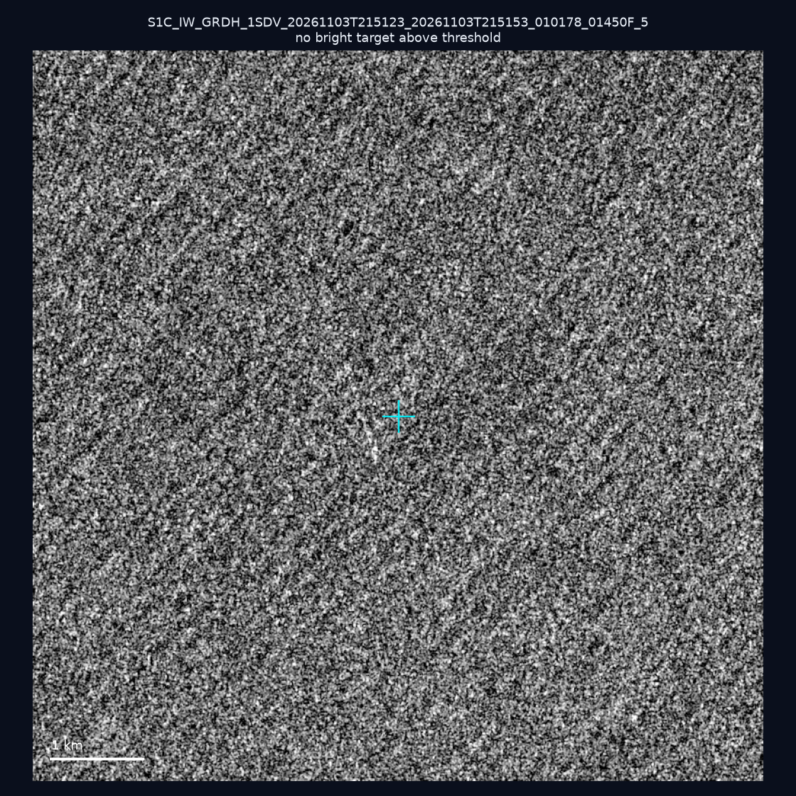
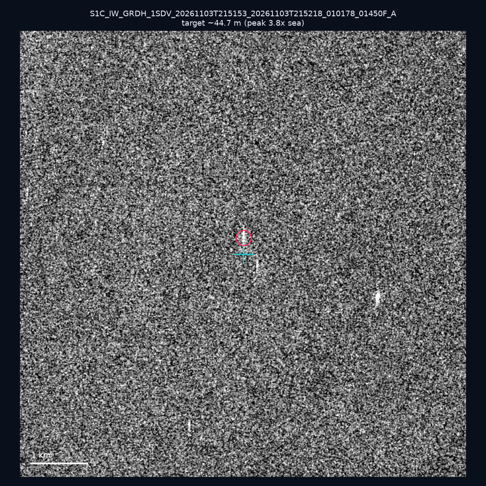
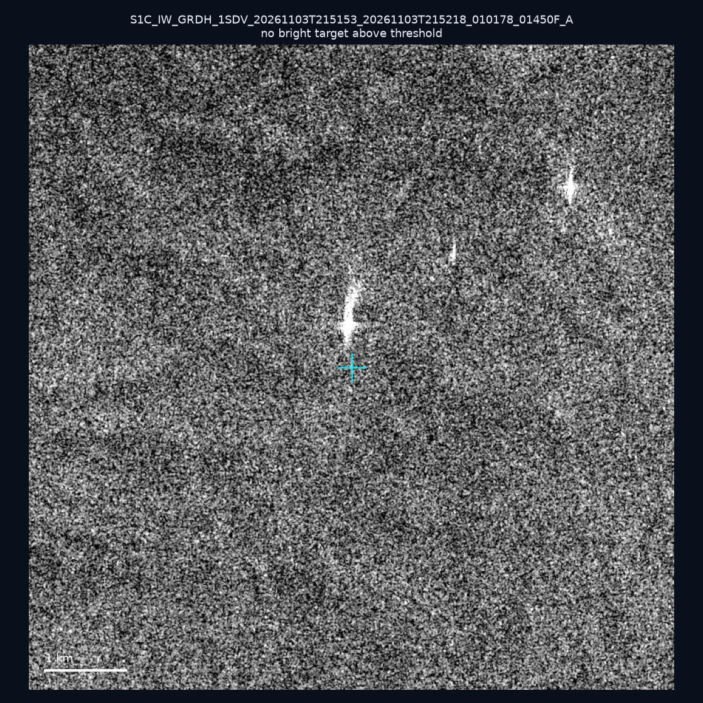
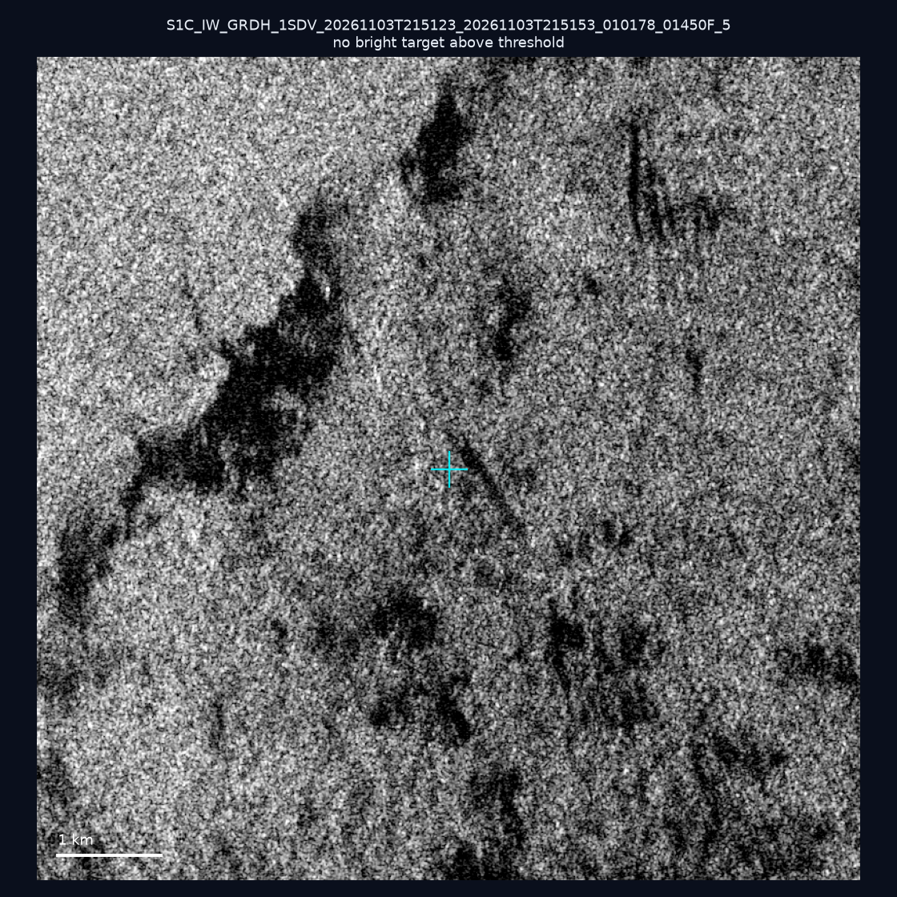
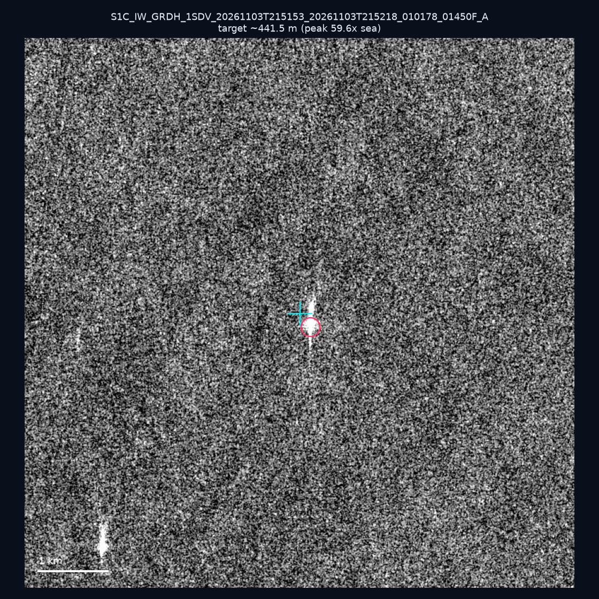
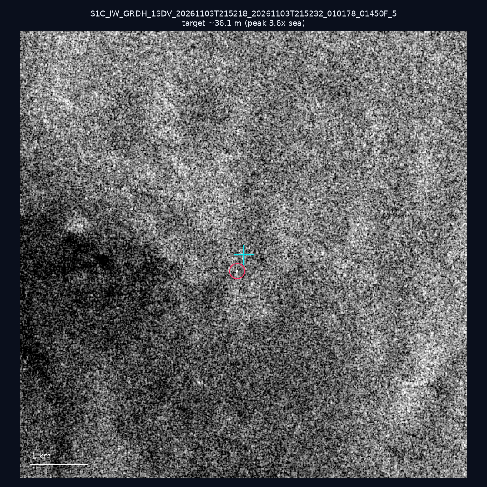
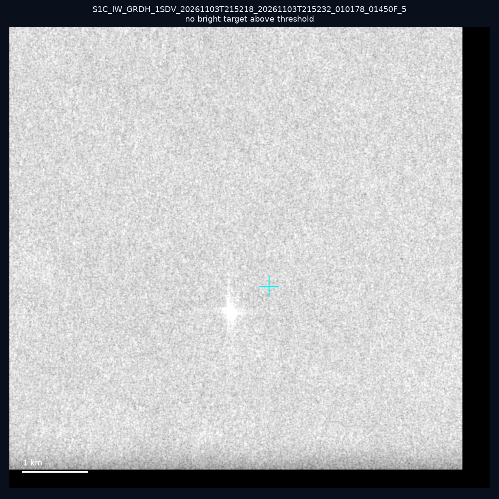
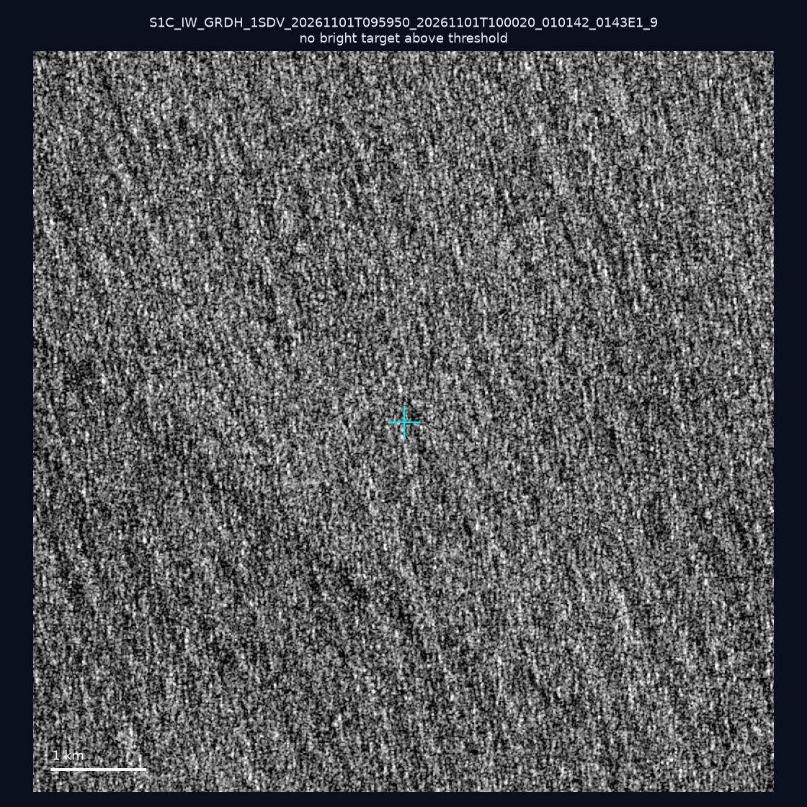
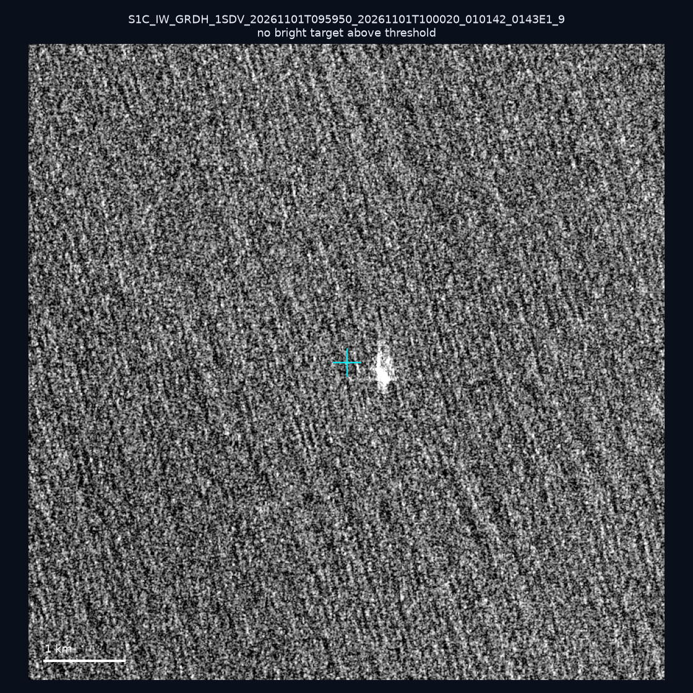
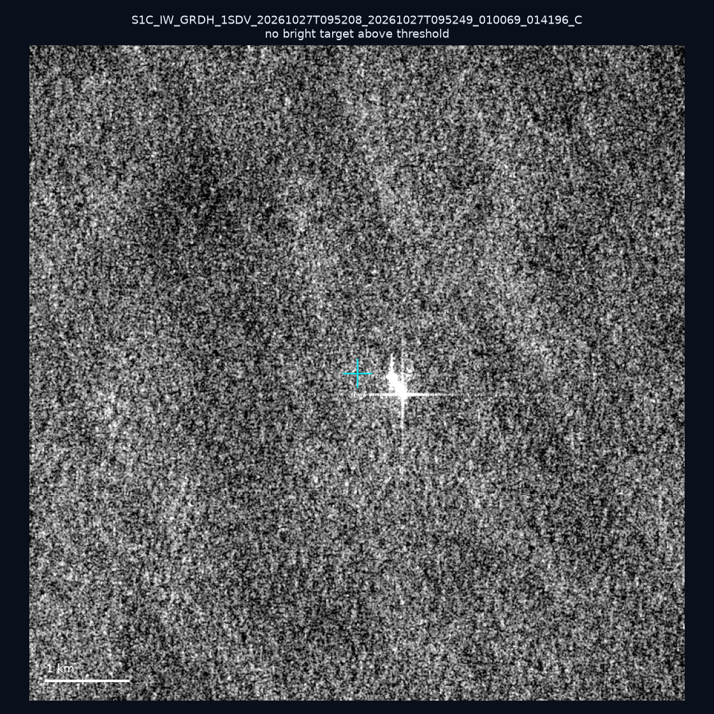

# 暗船 SAR 取證報告 — 2026-11-08

## 1. 總覽

- 執行時間：2026-11-08（GitHub Actions cron 自動執行）
- 線上比對摘要：暗偵測 32743 筆、殘餘暗船 18630 筆、假暗船剔除率 43.1%
- 本輪測試：10 筆
- 成功：10 筆
- 找到亮目標：3 筆
- 失敗：0 筆

## 2. 結果總表

| 日期 | 座標 | 海域 | 法域 | 成像時刻 | 判定 | 估計長度 | 峰值比 |
|------|------|------|------|----------|------|----------|--------|
| 2026-11-03 | 25.47, 121.88 | east | internal_waters | 21:51:23 | ⚪ 無目標（雜訊或低RCS） | — | — |
| 2026-11-03 | 22.88, 120.09 | southwest | internal_waters | 21:51:53 | 🟡 弱目標 | ~44.7 m | 3.8× |
| 2026-11-03 | 23.14, 119.9 | southwest | internal_waters | 21:51:53 | ⚪ 無目標（雜訊或低RCS） | — | — |
| 2026-11-03 | 24.89, 122.06 | east | territorial_sea | 21:51:23 | ⚪ 無目標（雜訊或低RCS） | — | — |
| 2026-11-03 | 23.44, 119.87 | southwest | internal_waters | 21:51:53 | ✅ 確認實體目標 | ~441.5 m | 59.6× |
| 2026-11-03 | 22.15, 120.63 | southwest | internal_waters | 21:52:18 | 🟡 弱目標 | ~36.1 m | 3.6× |
| 2026-11-03 | 21.75, 119.18 | southwest | eez | 21:52:18 | ⚪ 無目標（雜訊或低RCS） | — | — |
| 2026-11-01 | 23.02, 121.54 | east | territorial_sea | 09:59:50 | ⚪ 無目標（雜訊或低RCS） | — | — |
| 2026-11-01 | 22.87, 122.54 | east | eez | 09:59:50 | ⚪ 無目標（雜訊或低RCS） | — | — |
| 2026-10-27 | 25.27, 123.79 | east | eez | 09:52:08 | ⚪ 無目標（雜訊或低RCS） | — | — |

## 3. 逐目標段落

### 2026-11-03 (25.47, 121.88)

⚪ 無目標（雜訊或低RCS）。

### 2026-11-03 (22.88, 120.09)

🟡 弱目標，估計長度 ~44.7 m，峰值 3.8× 海面背景（7 px）。

### 2026-11-03 (23.14, 119.9)

⚪ 無目標（雜訊或低RCS）。

### 2026-11-03 (24.89, 122.06)

⚪ 無目標（雜訊或低RCS）。

### 2026-11-03 (23.44, 119.87)

✅ 確認實體目標，估計長度 ~441.5 m，峰值 59.6× 海面背景（205 px）。

### 2026-11-03 (22.15, 120.63)

🟡 弱目標，估計長度 ~36.1 m，峰值 3.6× 海面背景（6 px）。

### 2026-11-03 (21.75, 119.18)

⚪ 無目標（雜訊或低RCS）。

### 2026-11-01 (23.02, 121.54)

⚪ 無目標（雜訊或低RCS）。

### 2026-11-01 (22.87, 122.54)

⚪ 無目標（雜訊或低RCS）。

### 2026-10-27 (25.27, 123.79)

⚪ 無目標（雜訊或低RCS）。

## 4. 後續建議

- 值得人工深查（確認實體目標且長度 ≥ 50m）：
  - 2026-11-03 (23.44, 119.87) ~441.5 m — 建議比對周邊 AIS 船長
- 累積統計：全歷史 763 筆（有效 761 筆），確認實體目標 85 筆（11.2%）

> 所有結果是研判線索，不是法律認定；無目標 ≠ 誤報（小型木殼漁船 RCS 低，SAR 可能拍不到）。
