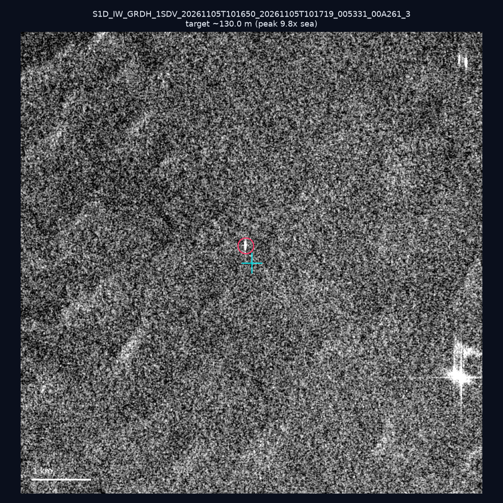
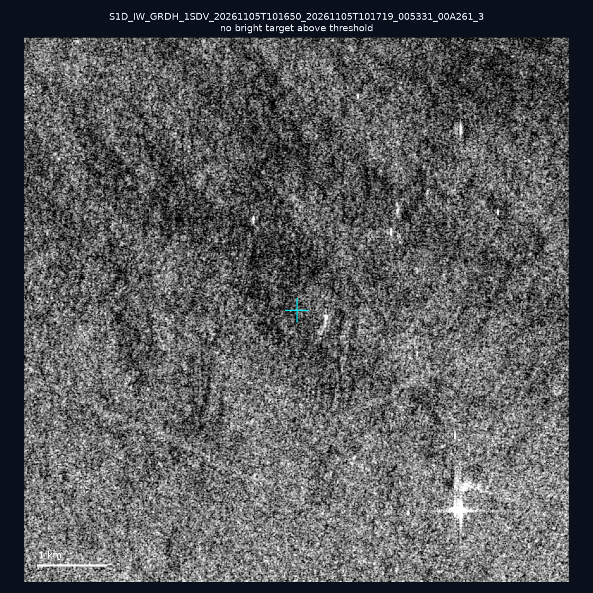
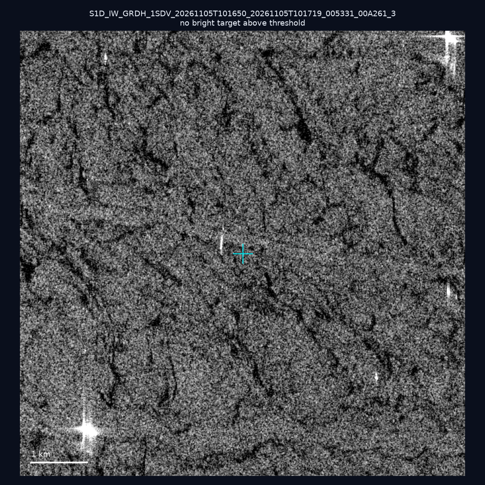
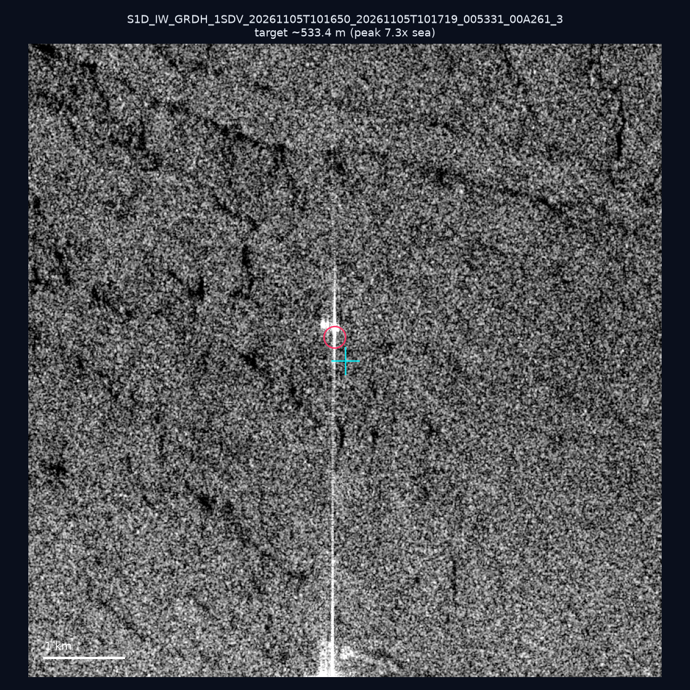
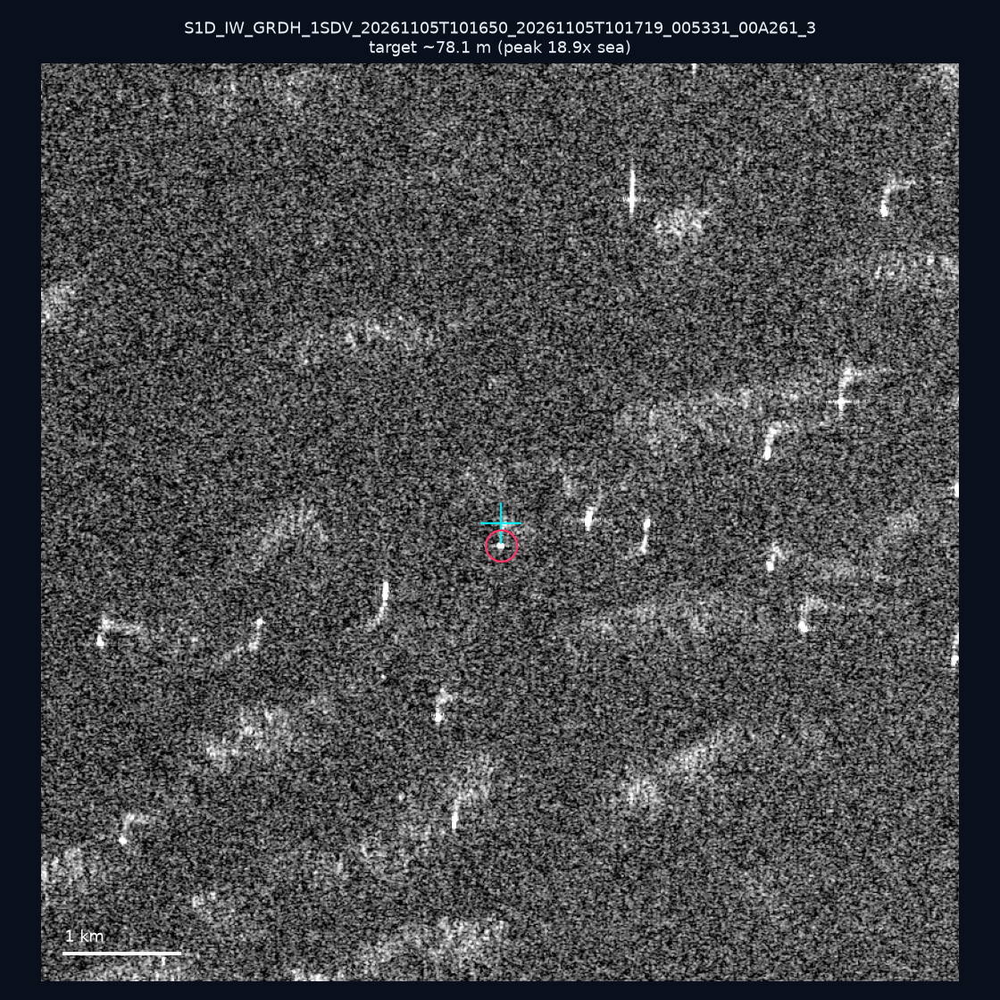
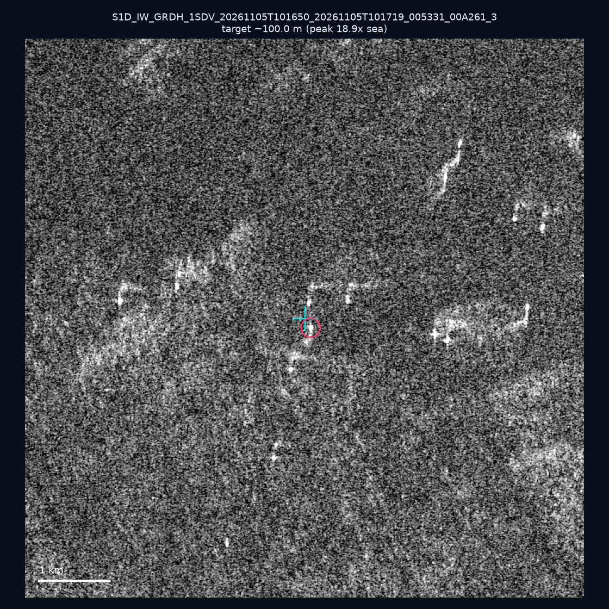
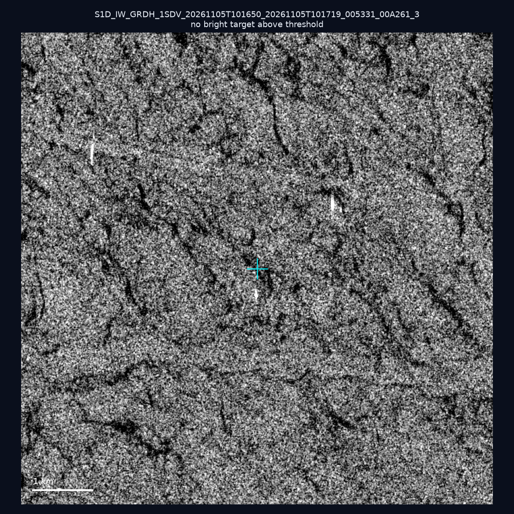
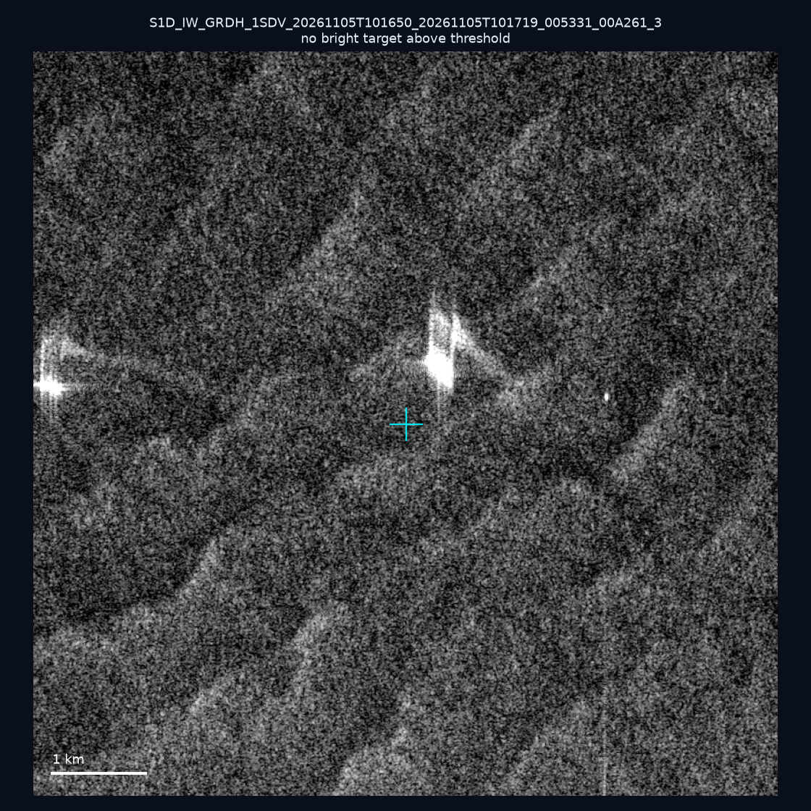
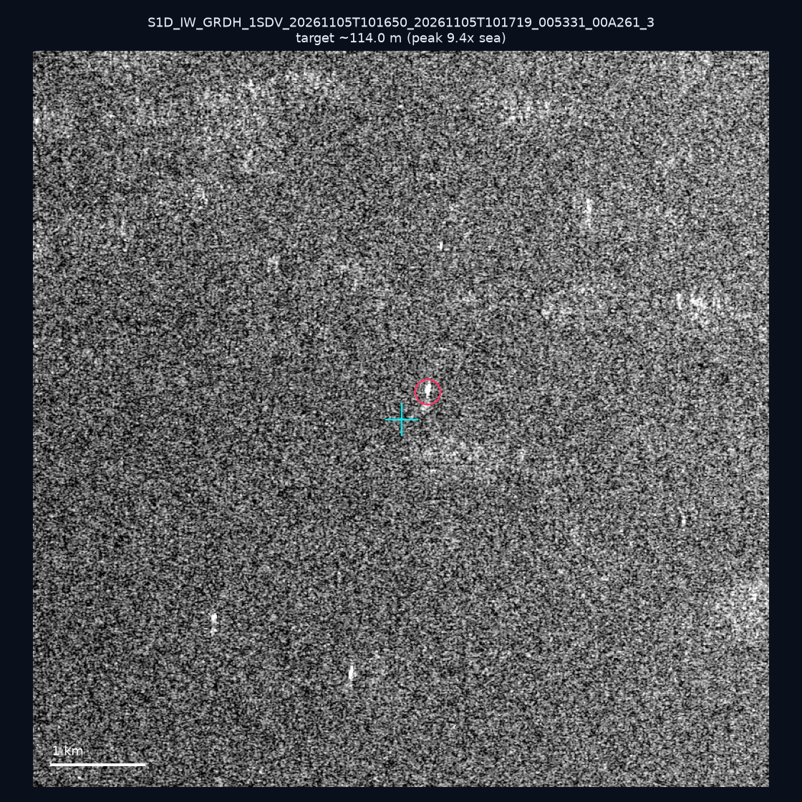
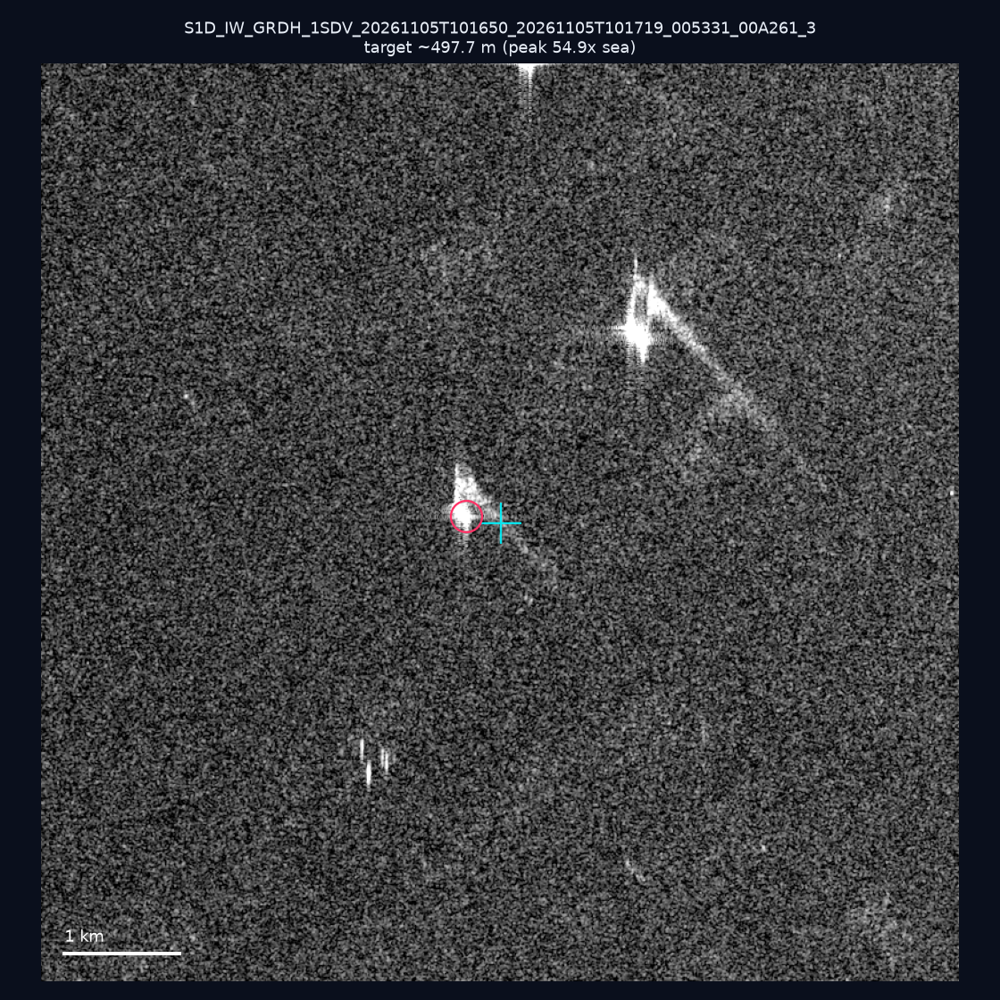

# 暗船 SAR 取證報告 — 2026-11-09

## 1. 總覽

- 執行時間：2026-11-09（GitHub Actions cron 自動執行）
- 線上比對摘要：暗偵測 33725 筆、殘餘暗船 19049 筆、假暗船剔除率 43.5%
- 本輪測試：10 筆
- 成功：10 筆
- 找到亮目標：6 筆
- 失敗：0 筆

## 2. 結果總表

| 日期 | 座標 | 海域 | 法域 | 成像時刻 | 判定 | 估計長度 | 峰值比 |
|------|------|------|------|----------|------|----------|--------|
| 2026-11-05 | 23.34, 117.64 | southwest | eez | 10:16:50 | 🟡 弱目標 | ~130.0 m | 9.8× |
| 2026-11-05 | 23.45, 117.95 | southwest | eez | 10:16:50 | ⚪ 無目標（雜訊或低RCS） | — | — |
| 2026-11-05 | 22.94, 117.36 | southwest | eez | 10:16:50 | ⚪ 無目標（雜訊或低RCS） | — | — |
| 2026-11-05 | 22.94, 117.2 | southwest | eez | 10:16:50 | 🟡 弱目標 | ~533.4 m | 7.3× |
| 2026-11-05 | 23.15, 118.17 | southwest | eez | 10:16:50 | ✅ 確認實體目標 | ~78.1 m | 18.9× |
| 2026-11-05 | 23.23, 118.1 | southwest | eez | 10:16:50 | ✅ 確認實體目標 | ~100.0 m | 18.9× |
| 2026-11-05 | 22.96, 117.38 | southwest | eez | 10:16:50 | ⚪ 無目標（雜訊或低RCS） | — | — |
| 2026-11-05 | 23.26, 117.86 | southwest | eez | 10:16:50 | ⚪ 無目標（雜訊或低RCS） | — | — |
| 2026-11-05 | 23.13, 118.36 | southwest | eez | 10:16:50 | 🟡 弱目標 | ~114.0 m | 9.4× |
| 2026-11-05 | 23.02, 117.65 | southwest | eez | 10:16:50 | ✅ 確認實體目標 | ~497.7 m | 54.9× |

## 3. 逐目標段落

### 2026-11-05 (23.34, 117.64)

🟡 弱目標，估計長度 ~130.0 m，峰值 9.8× 海面背景（38 px）。

### 2026-11-05 (23.45, 117.95)

⚪ 無目標（雜訊或低RCS）。

### 2026-11-05 (22.94, 117.36)

⚪ 無目標（雜訊或低RCS）。

### 2026-11-05 (22.94, 117.2)

🟡 弱目標，估計長度 ~533.4 m，峰值 7.3× 海面背景（162 px）。

### 2026-11-05 (23.15, 118.17)

✅ 確認實體目標，估計長度 ~78.1 m，峰值 18.9× 海面背景（24 px）。

### 2026-11-05 (23.23, 118.1)

✅ 確認實體目標，估計長度 ~100.0 m，峰值 18.9× 海面背景（32 px）。

### 2026-11-05 (22.96, 117.38)

⚪ 無目標（雜訊或低RCS）。

### 2026-11-05 (23.26, 117.86)

⚪ 無目標（雜訊或低RCS）。

### 2026-11-05 (23.13, 118.36)

🟡 弱目標，估計長度 ~114.0 m，峰值 9.4× 海面背景（33 px）。

### 2026-11-05 (23.02, 117.65)

✅ 確認實體目標，估計長度 ~497.7 m，峰值 54.9× 海面背景（357 px）。

## 4. 後續建議

- 值得人工深查（確認實體目標且長度 ≥ 50m）：
  - 2026-11-05 (23.15, 118.17) ~78.1 m — 建議比對周邊 AIS 船長
  - 2026-11-05 (23.23, 118.1) ~100.0 m — 建議比對周邊 AIS 船長
  - 2026-11-05 (23.02, 117.65) ~497.7 m — 建議比對周邊 AIS 船長
- 累積統計：全歷史 773 筆（有效 771 筆），確認實體目標 88 筆（11.4%）

> 所有結果是研判線索，不是法律認定；無目標 ≠ 誤報（小型木殼漁船 RCS 低，SAR 可能拍不到）。
