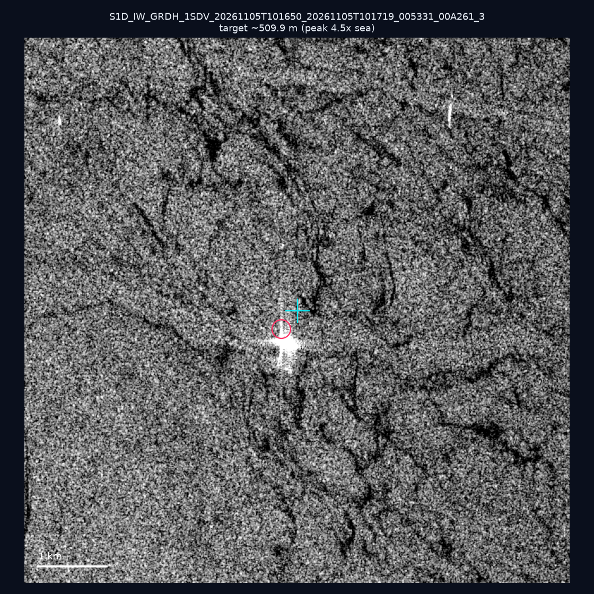
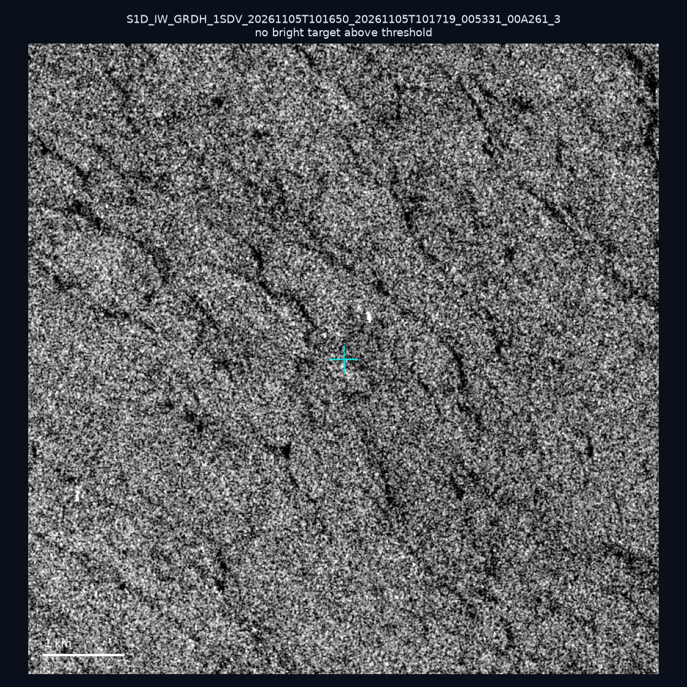
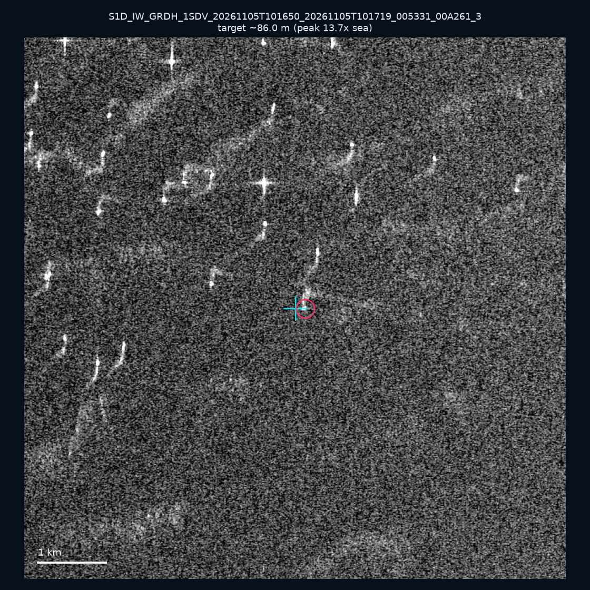
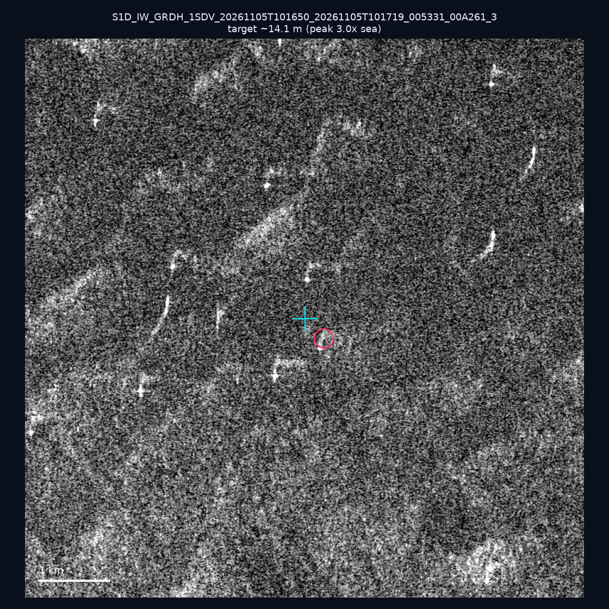
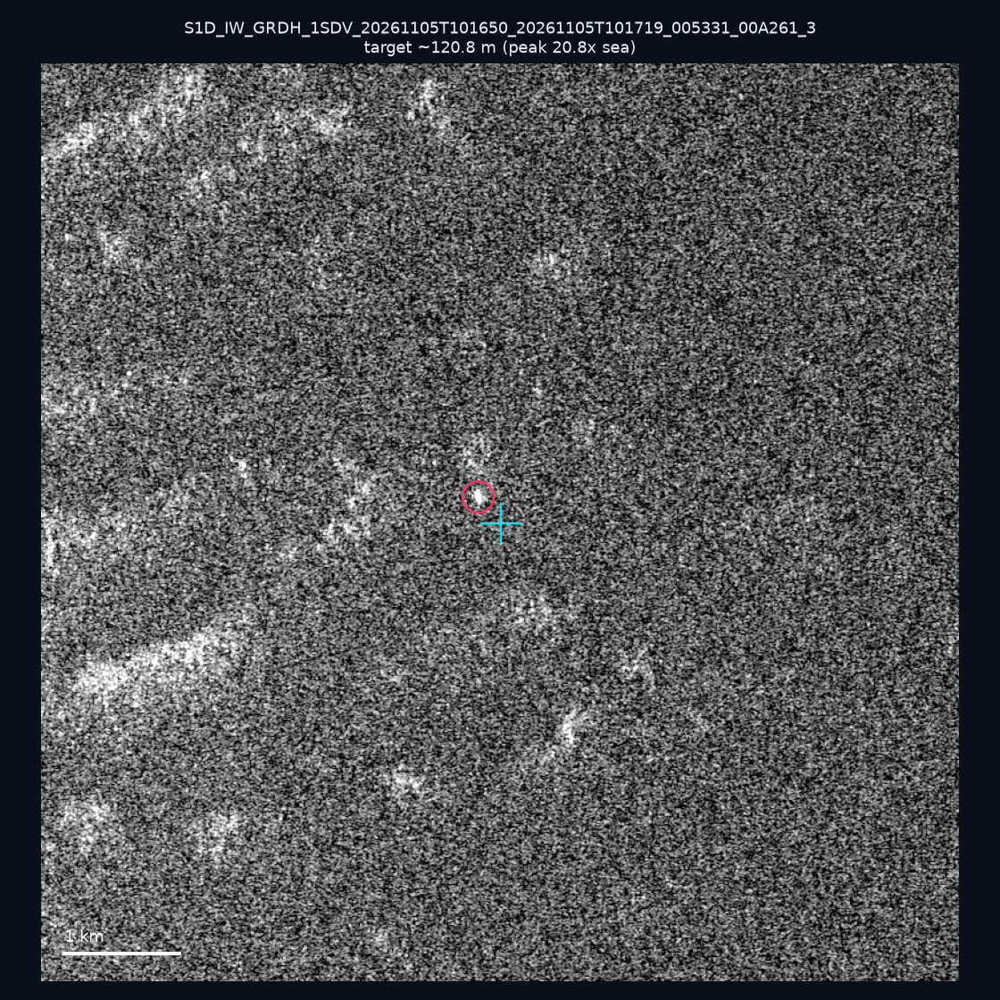
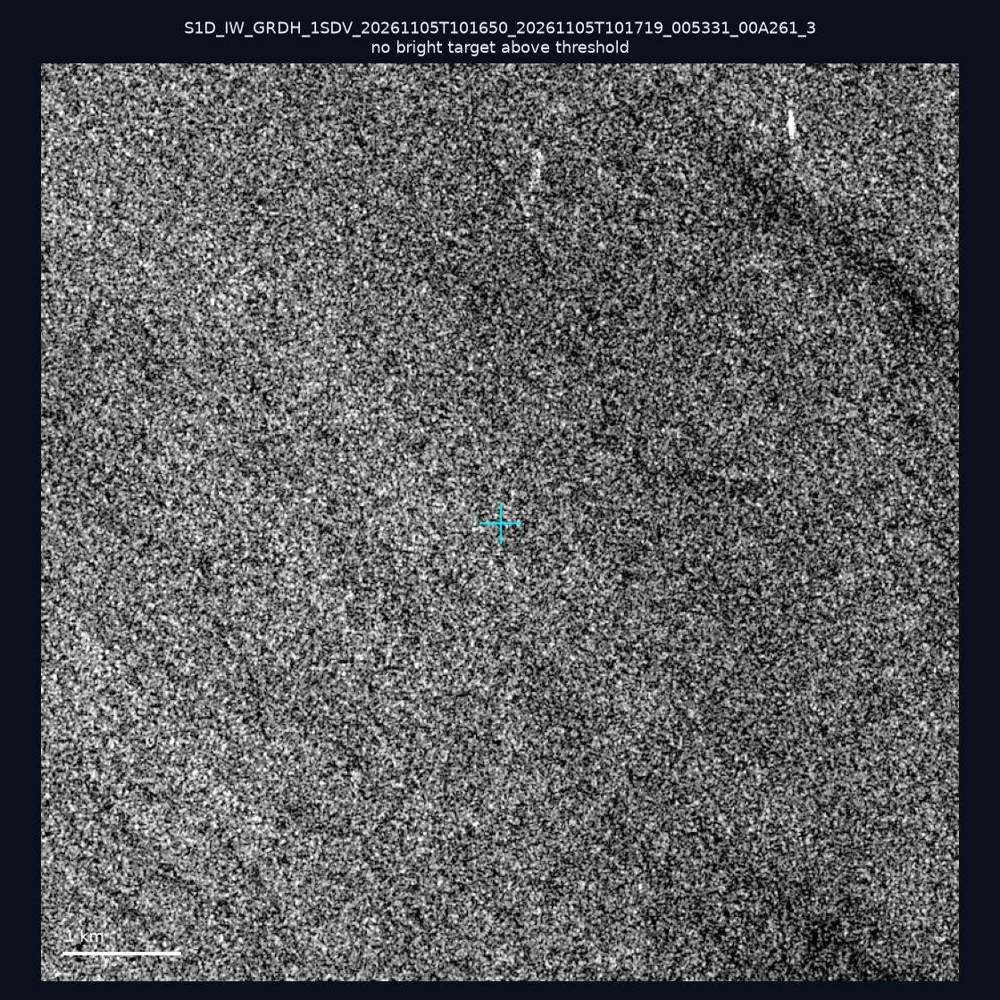
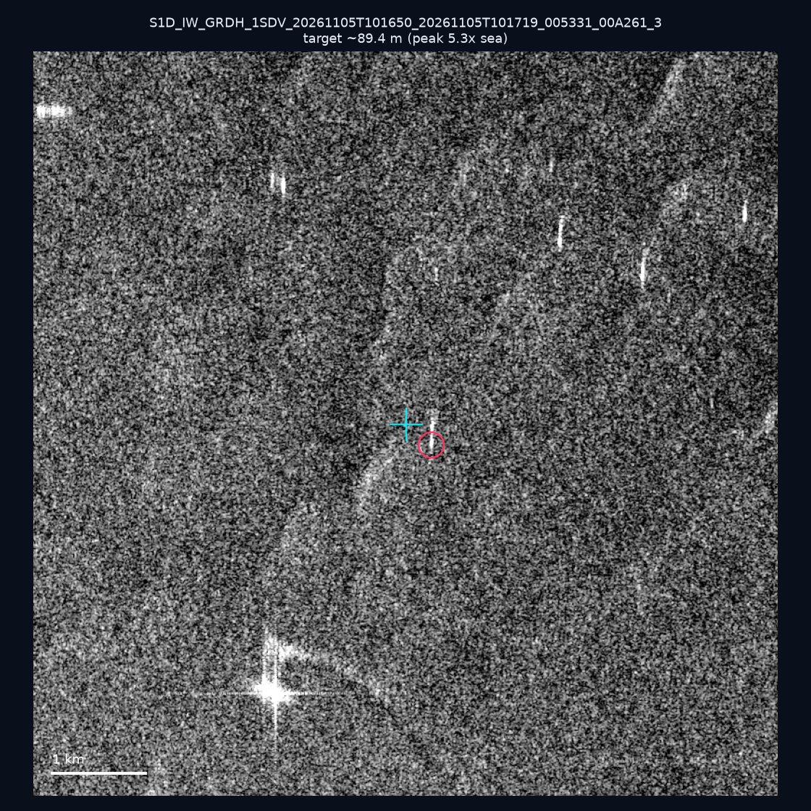
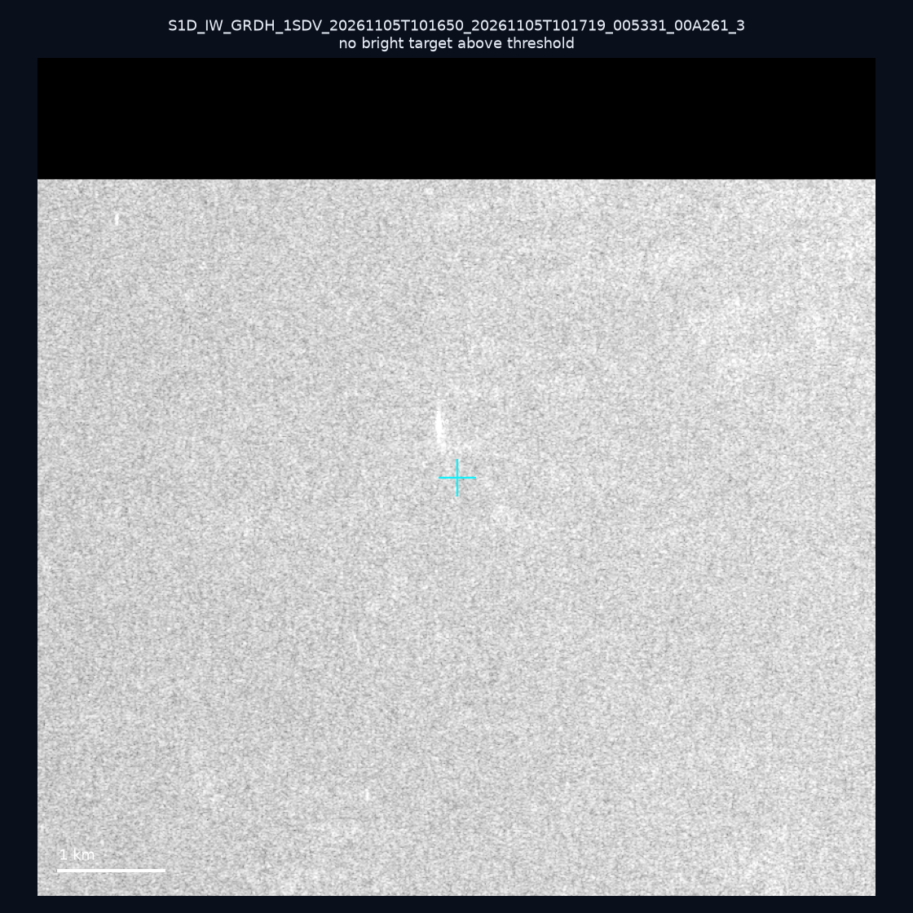
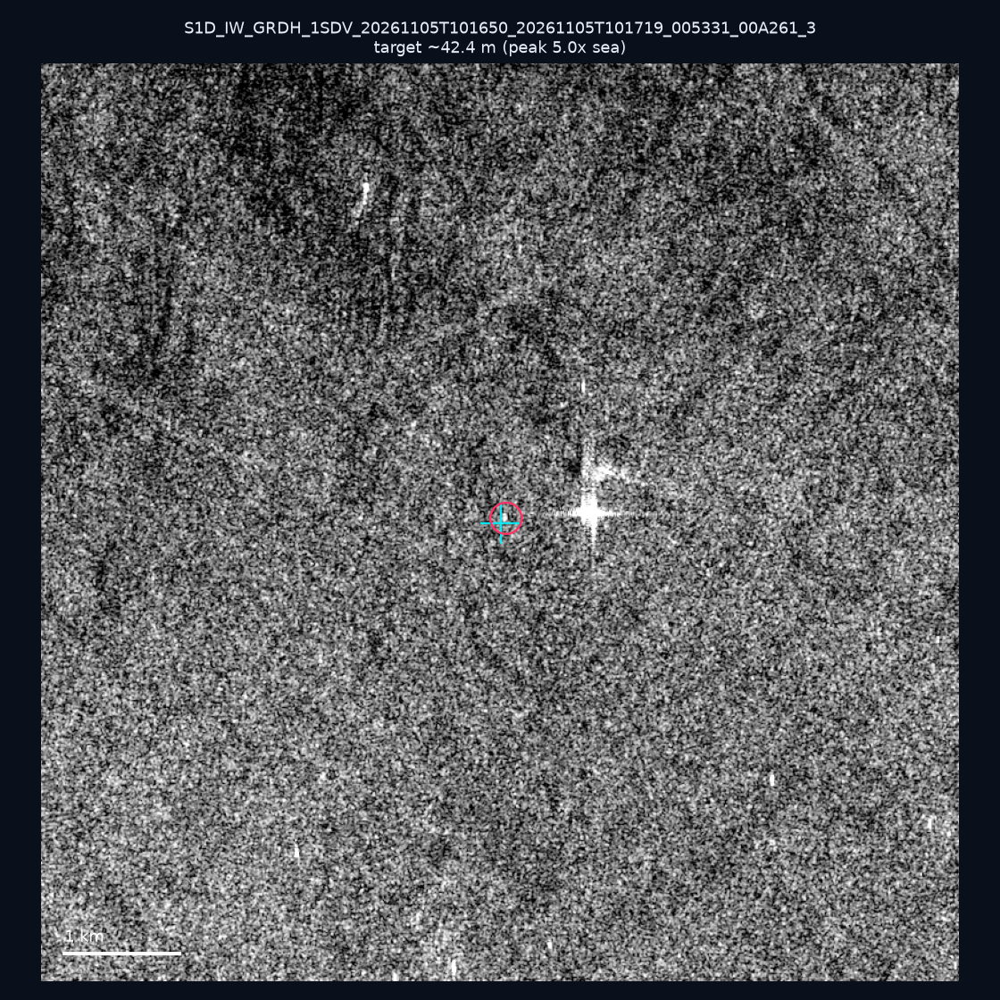
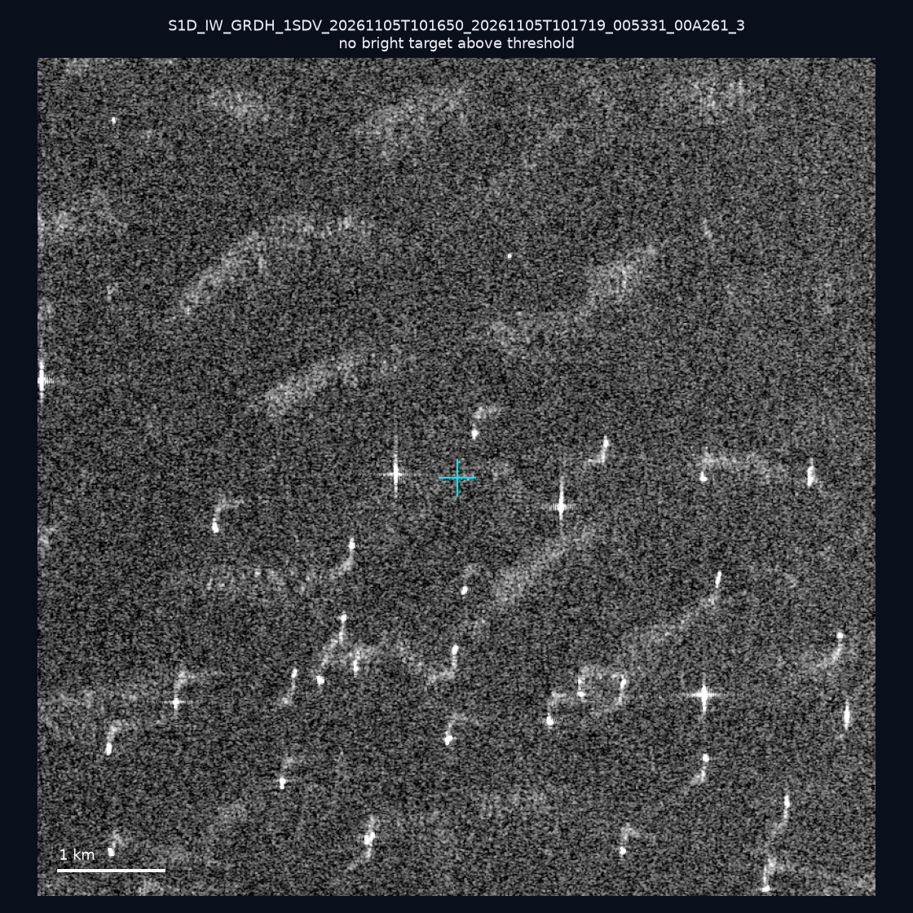

# 暗船 SAR 取證報告 — 2026-11-10

## 1. 總覽

- 執行時間：2026-11-10（GitHub Actions cron 自動執行）
- 線上比對摘要：暗偵測 27390 筆、殘餘暗船 14867 筆、假暗船剔除率 45.7%
- 本輪測試：10 筆
- 成功：10 筆
- 找到亮目標：6 筆
- 失敗：0 筆

## 2. 結果總表

| 日期 | 座標 | 海域 | 法域 | 成像時刻 | 判定 | 估計長度 | 峰值比 |
|------|------|------|------|----------|------|----------|--------|
| 2026-11-05 | 22.96, 117.33 | southwest | eez | 10:16:50 | 🟡 弱目標 | ~509.9 m | 4.5× |
| 2026-11-05 | 23.03, 117.38 | southwest | eez | 10:16:50 | ⚪ 無目標（雜訊或低RCS） | — | — |
| 2026-11-05 | 23.17, 118.25 | southwest | eez | 10:16:50 | ✅ 確認實體目標 | ~86.0 m | 13.7× |
| 2026-11-05 | 23.2, 118.01 | southwest | eez | 10:16:50 | 🟡 弱目標 | ~14.1 m | 3.0× |
| 2026-11-05 | 23.01, 117.94 | southwest | eez | 10:16:50 | ✅ 確認實體目標 | ~120.8 m | 20.8× |
| 2026-11-05 | 23.3, 117.37 | southwest | eez | 10:16:50 | ⚪ 無目標（雜訊或低RCS） | — | — |
| 2026-11-05 | 23.34, 117.69 | southwest | eez | 10:16:50 | 🟡 弱目標 | ~89.4 m | 5.3× |
| 2026-11-05 | 22.96, 118.43 | southwest | eez | 10:16:50 | ⚪ 無目標（雜訊或低RCS） | — | — |
| 2026-11-05 | 23.48, 117.96 | southwest | eez | 10:16:50 | 🟡 弱目標 | ~42.4 m | 5.0× |
| 2026-11-05 | 23.13, 118.23 | southwest | eez | 10:16:50 | ⚪ 無目標（雜訊或低RCS） | — | — |

## 3. 逐目標段落

### 2026-11-05 (22.96, 117.33)

🟡 弱目標，估計長度 ~509.9 m，峰值 4.5× 海面背景（522 px）。

### 2026-11-05 (23.03, 117.38)

⚪ 無目標（雜訊或低RCS）。

### 2026-11-05 (23.17, 118.25)

✅ 確認實體目標，估計長度 ~86.0 m，峰值 13.7× 海面背景（27 px）。

### 2026-11-05 (23.2, 118.01)

🟡 弱目標，估計長度 ~14.1 m，峰值 3.0× 海面背景（1 px）。

### 2026-11-05 (23.01, 117.94)

✅ 確認實體目標，估計長度 ~120.8 m，峰值 20.8× 海面背景（38 px）。

### 2026-11-05 (23.3, 117.37)

⚪ 無目標（雜訊或低RCS）。

### 2026-11-05 (23.34, 117.69)

🟡 弱目標，估計長度 ~89.4 m，峰值 5.3× 海面背景（17 px）。

### 2026-11-05 (22.96, 118.43)

⚪ 無目標（雜訊或低RCS）。

### 2026-11-05 (23.48, 117.96)

🟡 弱目標，估計長度 ~42.4 m，峰值 5.0× 海面背景（7 px）。

### 2026-11-05 (23.13, 118.23)

⚪ 無目標（雜訊或低RCS）。

## 4. 後續建議

- 值得人工深查（確認實體目標且長度 ≥ 50m）：
  - 2026-11-05 (23.17, 118.25) ~86.0 m — 建議比對周邊 AIS 船長
  - 2026-11-05 (23.01, 117.94) ~120.8 m — 建議比對周邊 AIS 船長
- 累積統計：全歷史 783 筆（有效 781 筆），確認實體目標 90 筆（11.5%）

> 所有結果是研判線索，不是法律認定；無目標 ≠ 誤報（小型木殼漁船 RCS 低，SAR 可能拍不到）。
