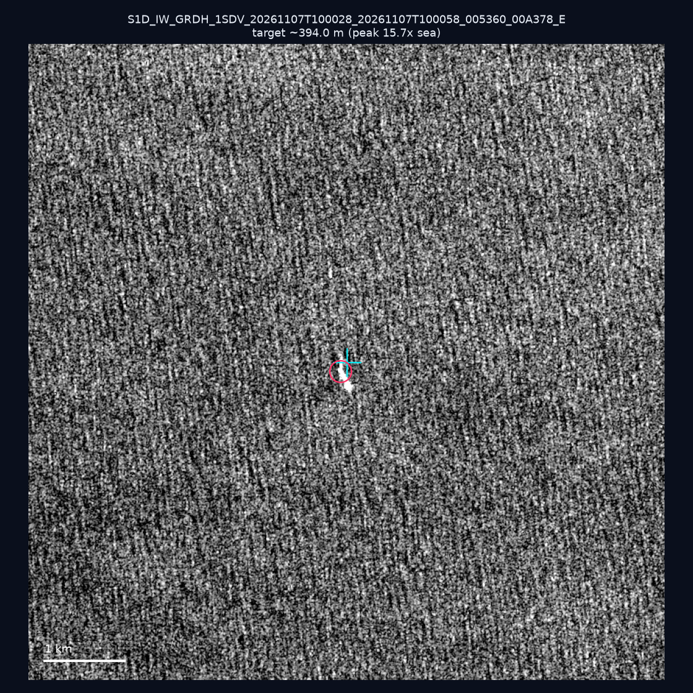
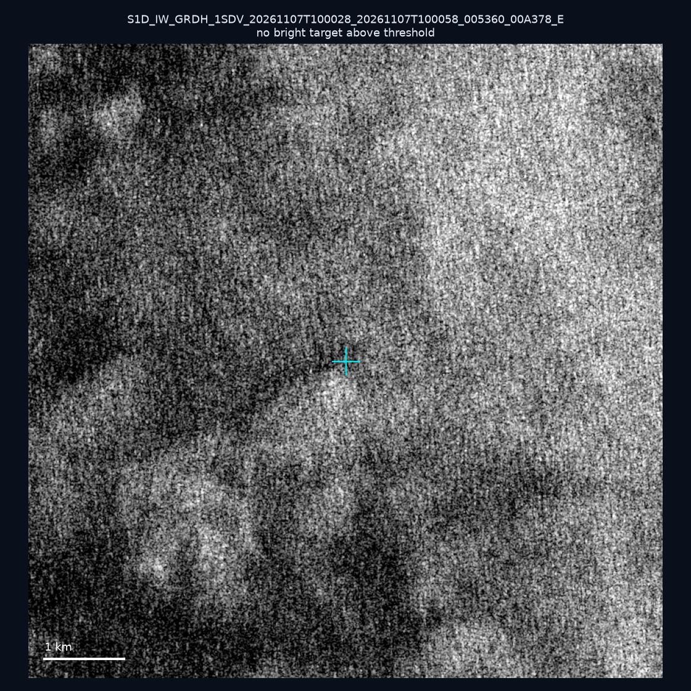
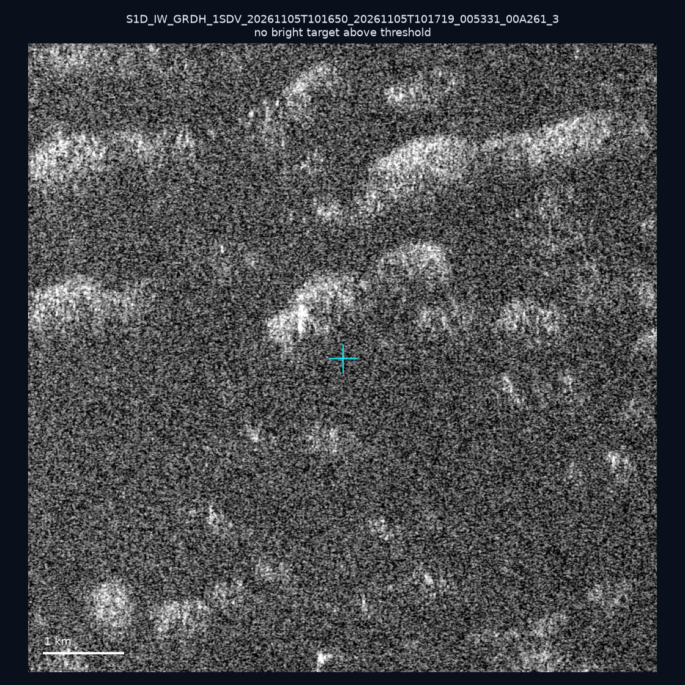
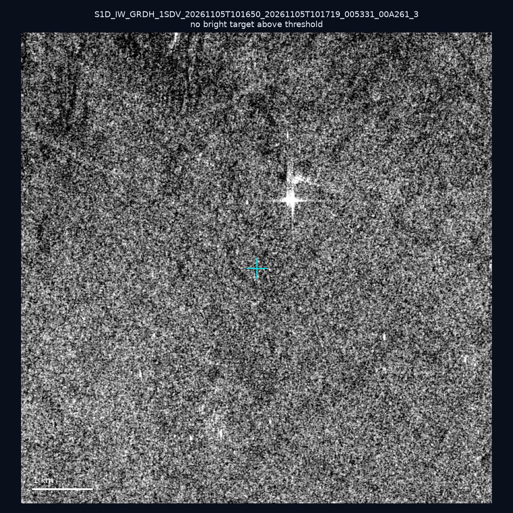
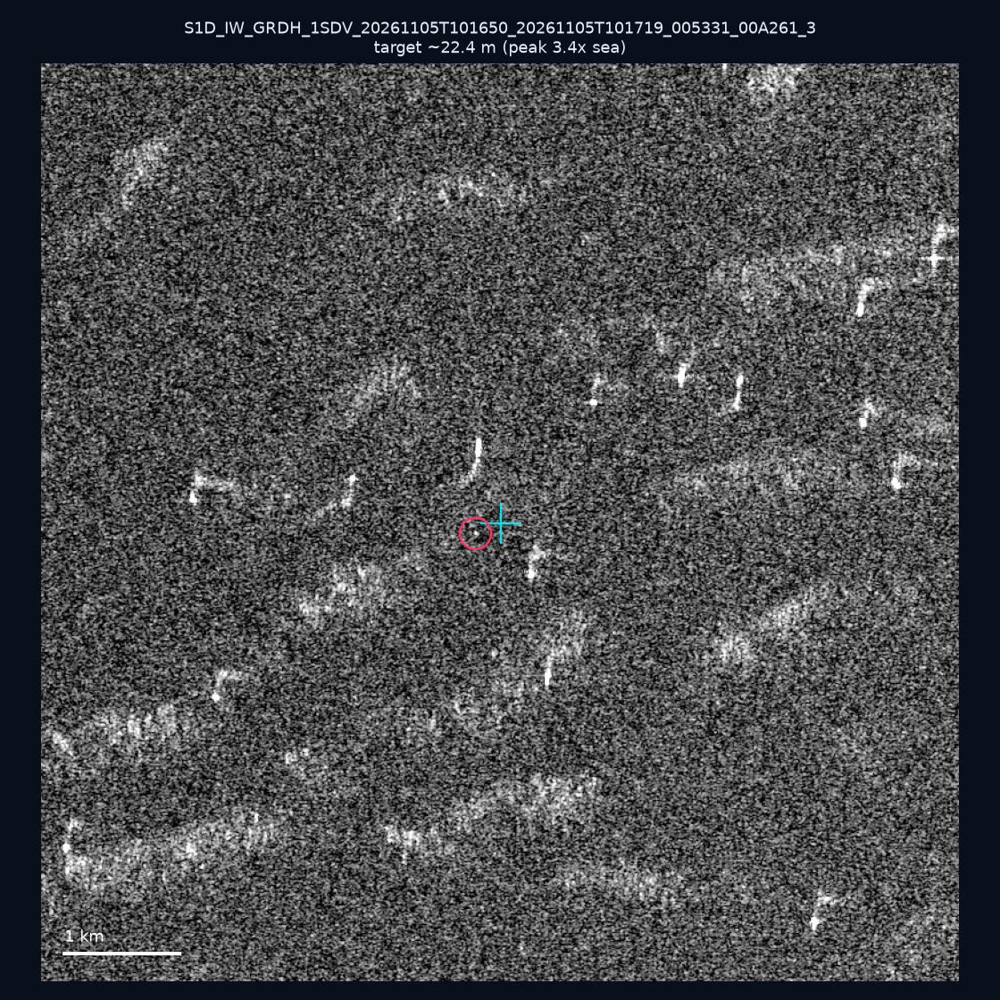
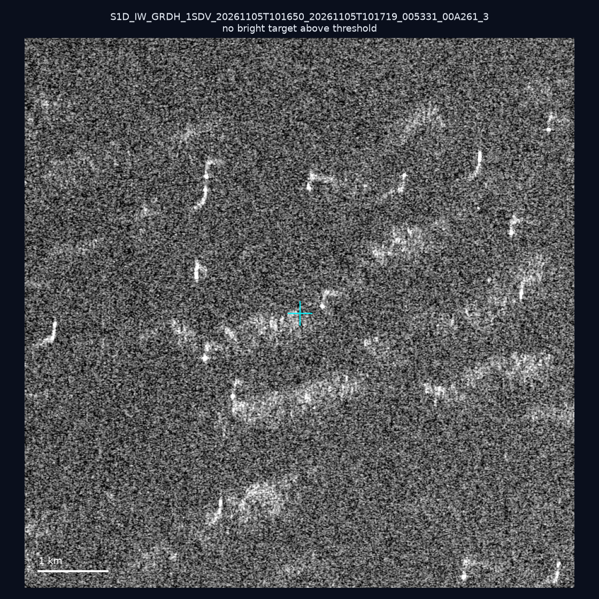
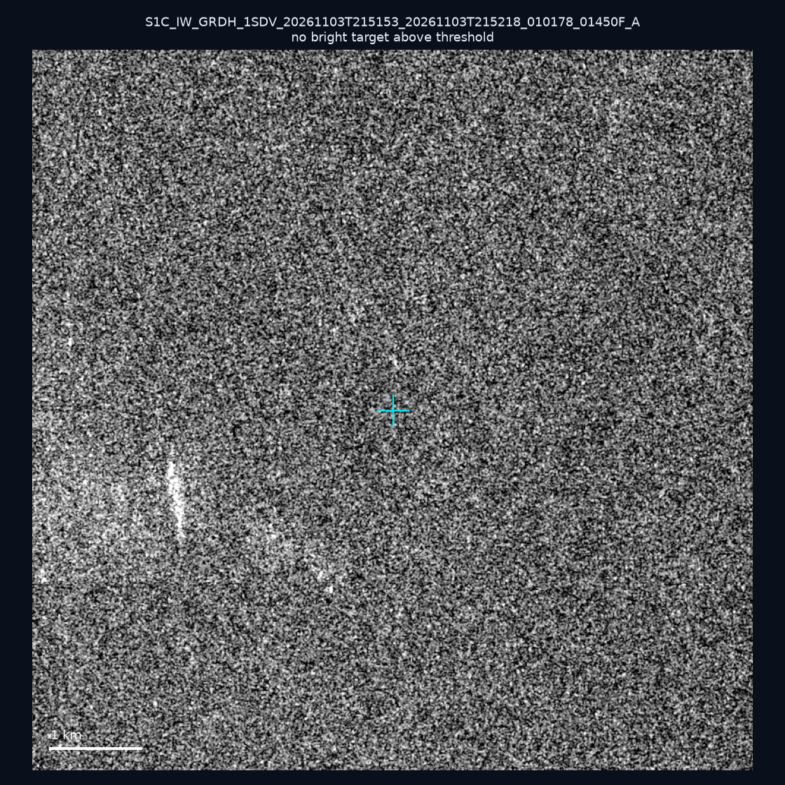
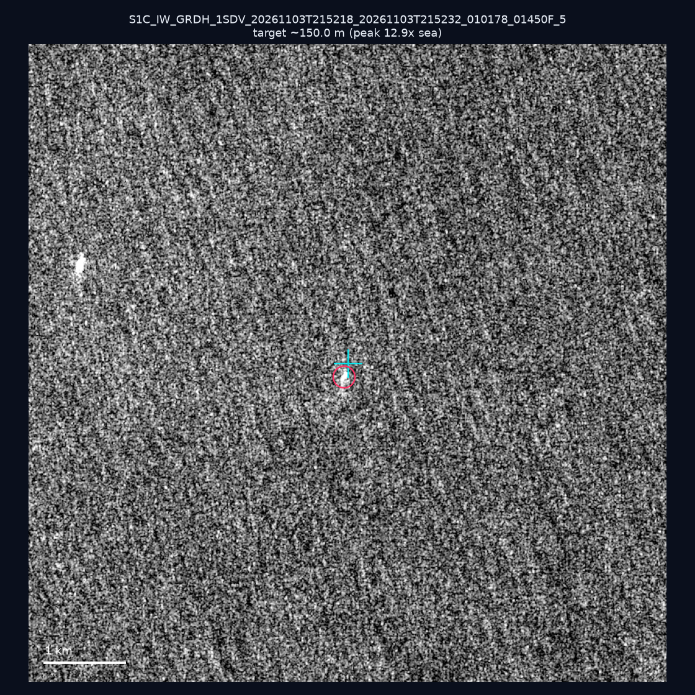
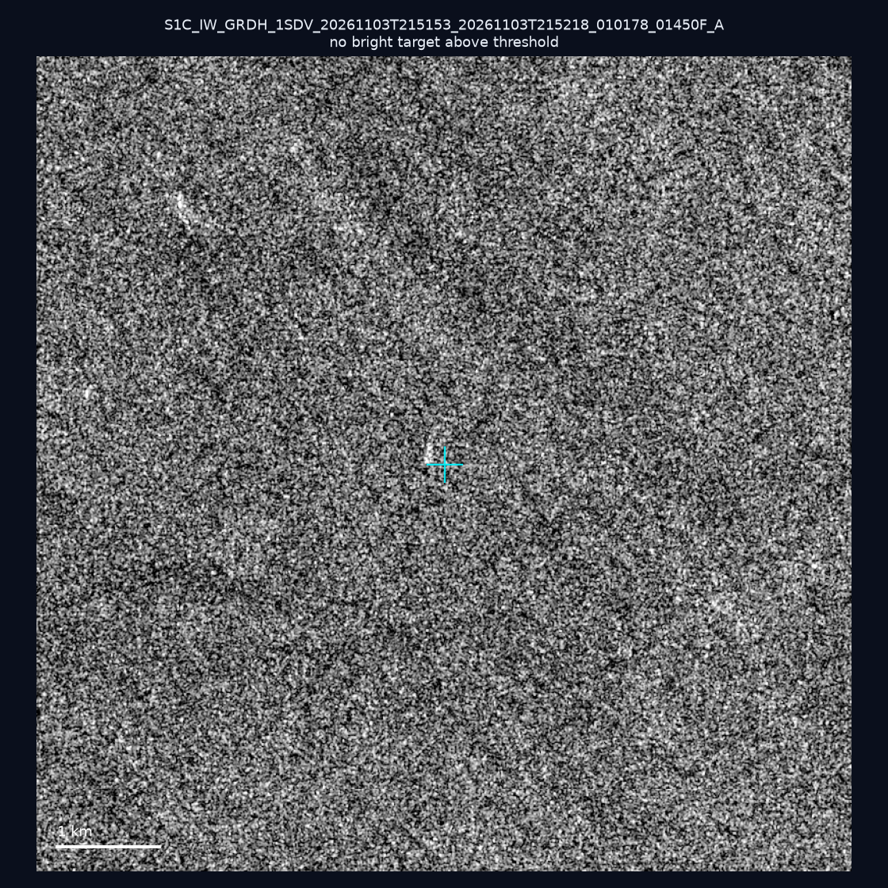
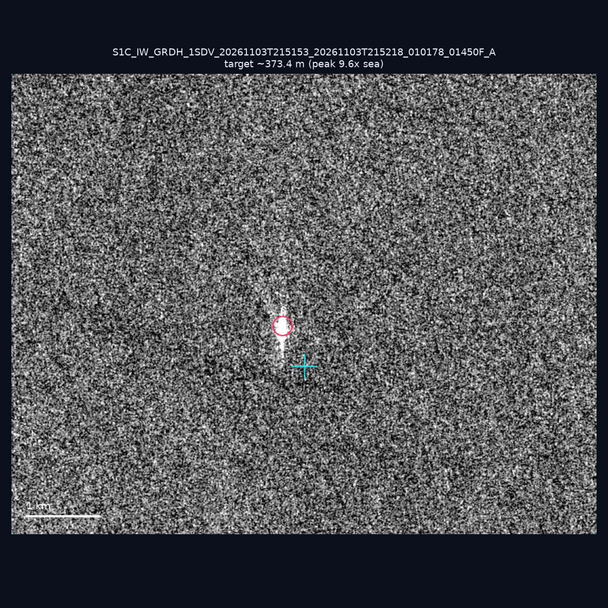

# 暗船 SAR 取證報告 — 2026-11-11

## 1. 總覽

- 執行時間：2026-11-11（GitHub Actions cron 自動執行）
- 線上比對摘要：暗偵測 26592 筆、殘餘暗船 14285 筆、假暗船剔除率 46.3%
- 本輪測試：10 筆
- 成功：10 筆
- 找到亮目標：4 筆
- 失敗：0 筆

## 2. 結果總表

| 日期 | 座標 | 海域 | 法域 | 成像時刻 | 判定 | 估計長度 | 峰值比 |
|------|------|------|------|----------|------|----------|--------|
| 2026-11-07 | 23.67, 121.96 | east | contiguous_zone | 10:00:28 | ✅ 確認實體目標 | ~394.0 m | 15.7× |
| 2026-11-07 | 24.27, 121.93 | east | territorial_sea | 10:00:28 | ⚪ 無目標（雜訊或低RCS） | — | — |
| 2026-11-05 | 22.93, 117.97 | southwest | eez | 10:16:50 | ⚪ 無目標（雜訊或低RCS） | — | — |
| 2026-11-05 | 23.49, 117.96 | southwest | eez | 10:16:50 | ⚪ 無目標（雜訊或低RCS） | — | — |
| 2026-11-05 | 23.16, 118.16 | southwest | eez | 10:16:50 | 🟡 弱目標 | ~22.4 m | 3.4× |
| 2026-11-05 | 23.17, 118.13 | southwest | eez | 10:16:50 | ⚪ 無目標（雜訊或低RCS） | — | — |
| 2026-11-03 | 23.32, 120.05 | southwest | internal_waters | 21:51:53 | ⚪ 無目標（雜訊或低RCS） | — | — |
| 2026-11-03 | 22.04, 119.63 | southwest | eez | 21:52:18 | ✅ 確認實體目標 | ~150.0 m | 12.9× |
| 2026-11-03 | 22.88, 119.67 | southwest | territorial_sea | 21:51:53 | ⚪ 無目標（雜訊或低RCS） | — | — |
| 2026-11-03 | 22.57, 119.49 | southwest | contiguous_zone | 21:51:53 | 🟡 弱目標 | ~373.4 m | 9.6× |

## 3. 逐目標段落

### 2026-11-07 (23.67, 121.96)

✅ 確認實體目標，估計長度 ~394.0 m，峰值 15.7× 海面背景（174 px）。

### 2026-11-07 (24.27, 121.93)

⚪ 無目標（雜訊或低RCS）。

### 2026-11-05 (22.93, 117.97)

⚪ 無目標（雜訊或低RCS）。

### 2026-11-05 (23.49, 117.96)

⚪ 無目標（雜訊或低RCS）。

### 2026-11-05 (23.16, 118.16)

🟡 弱目標，估計長度 ~22.4 m，峰值 3.4× 海面背景（2 px）。

### 2026-11-05 (23.17, 118.13)

⚪ 無目標（雜訊或低RCS）。

### 2026-11-03 (23.32, 120.05)

⚪ 無目標（雜訊或低RCS）。

### 2026-11-03 (22.04, 119.63)

✅ 確認實體目標，估計長度 ~150.0 m，峰值 12.9× 海面背景（54 px）。

### 2026-11-03 (22.88, 119.67)

⚪ 無目標（雜訊或低RCS）。

### 2026-11-03 (22.57, 119.49)

🟡 弱目標，估計長度 ~373.4 m，峰值 9.6× 海面背景（242 px）。

## 4. 後續建議

- 值得人工深查（確認實體目標且長度 ≥ 50m）：
  - 2026-11-07 (23.67, 121.96) ~394.0 m — 建議比對周邊 AIS 船長
  - 2026-11-03 (22.04, 119.63) ~150.0 m — 建議比對周邊 AIS 船長
- 累積統計：全歷史 793 筆（有效 791 筆），確認實體目標 92 筆（11.6%）

> 所有結果是研判線索，不是法律認定；無目標 ≠ 誤報（小型木殼漁船 RCS 低，SAR 可能拍不到）。
