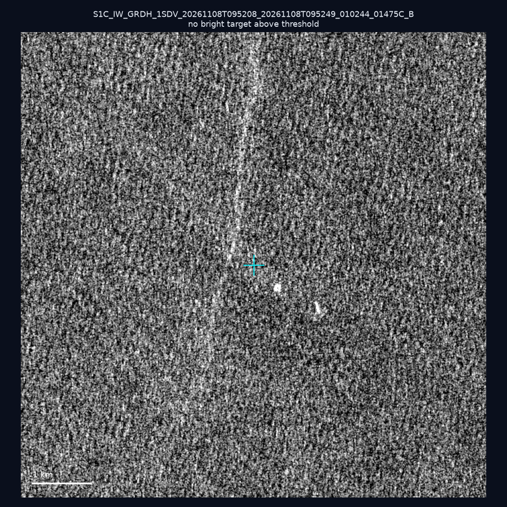
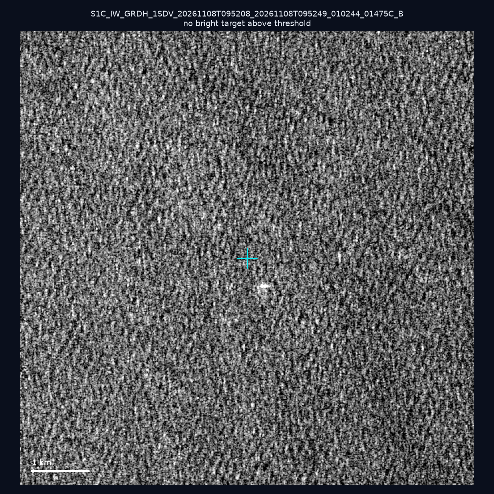
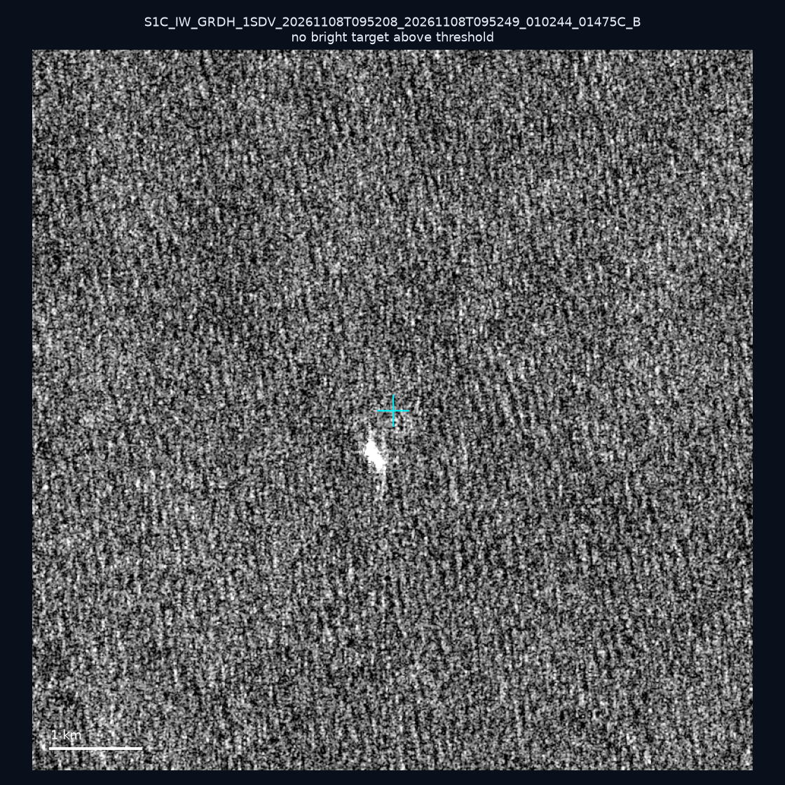
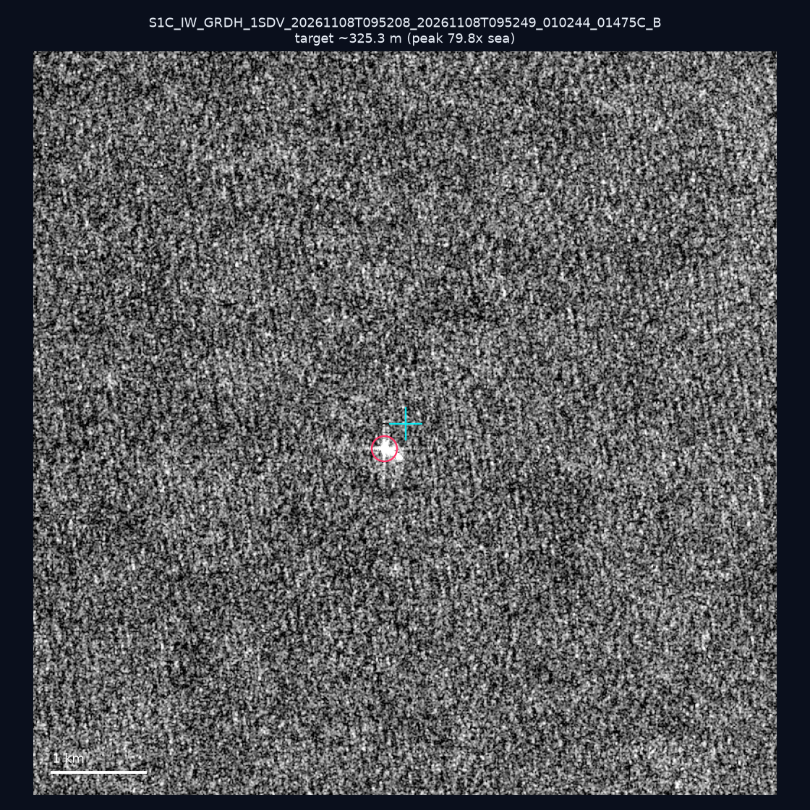
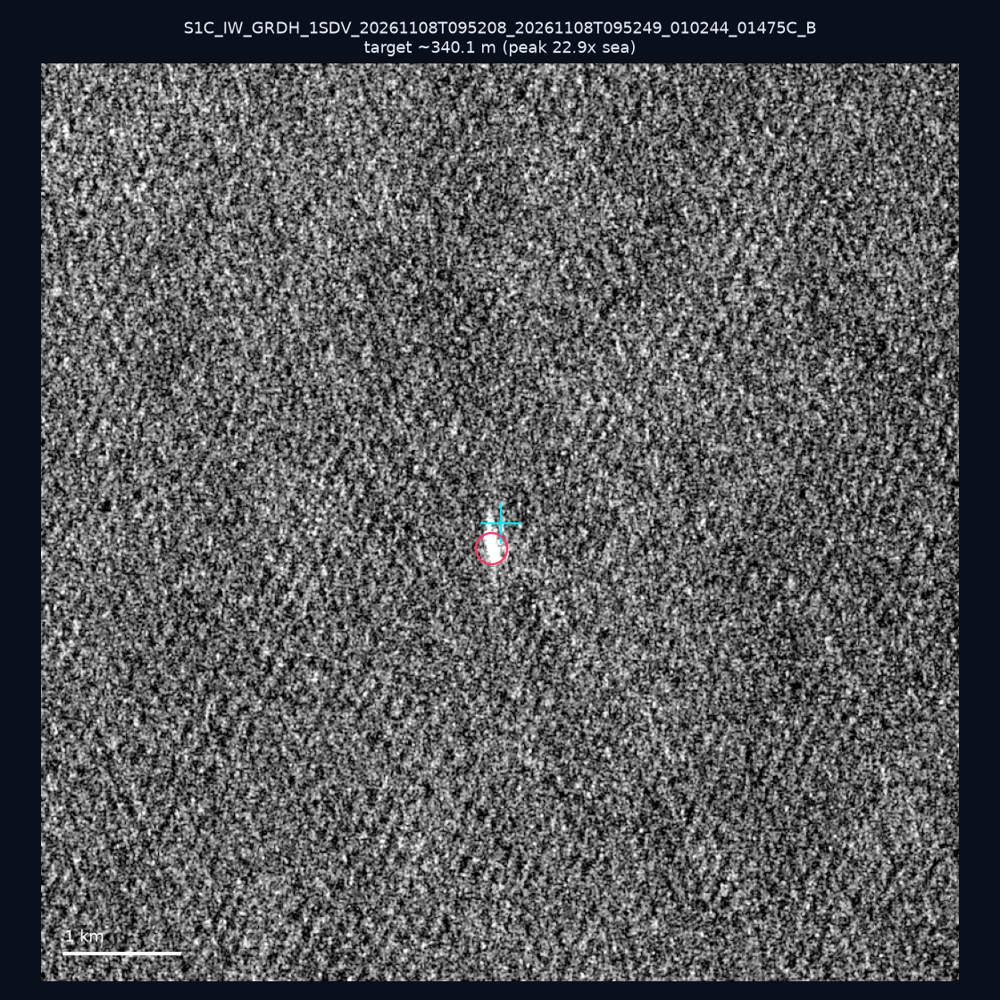
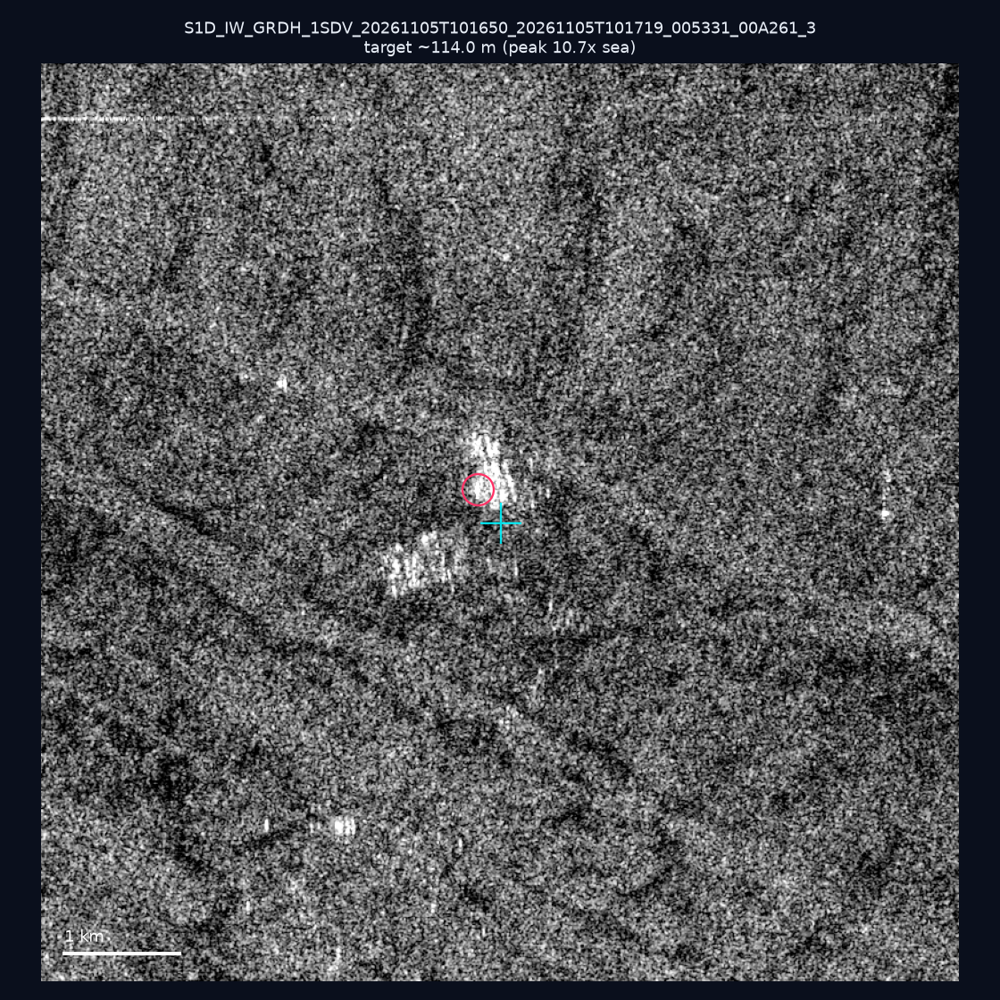
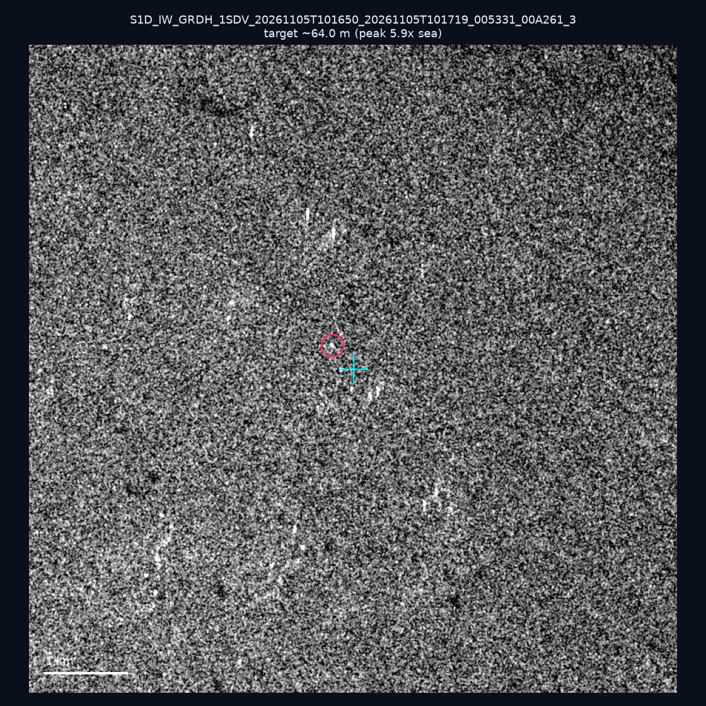
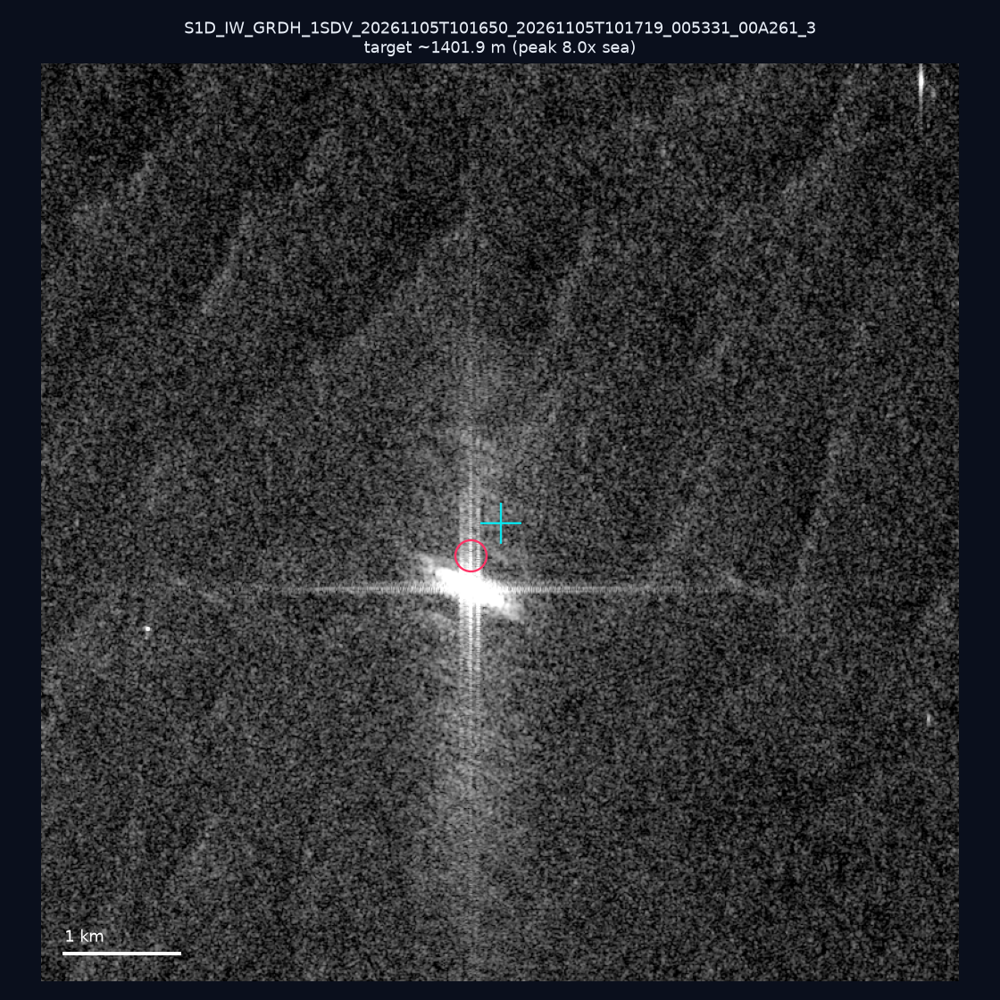
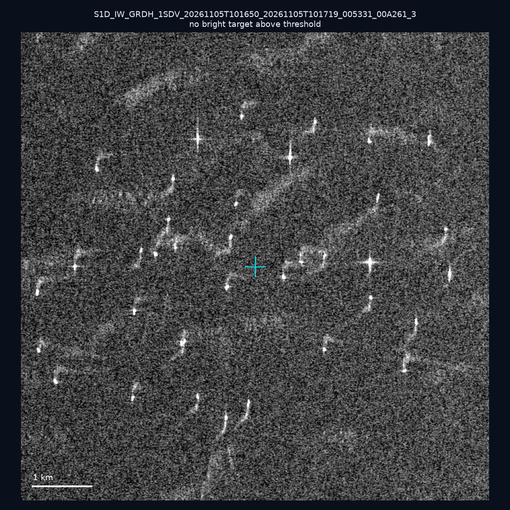
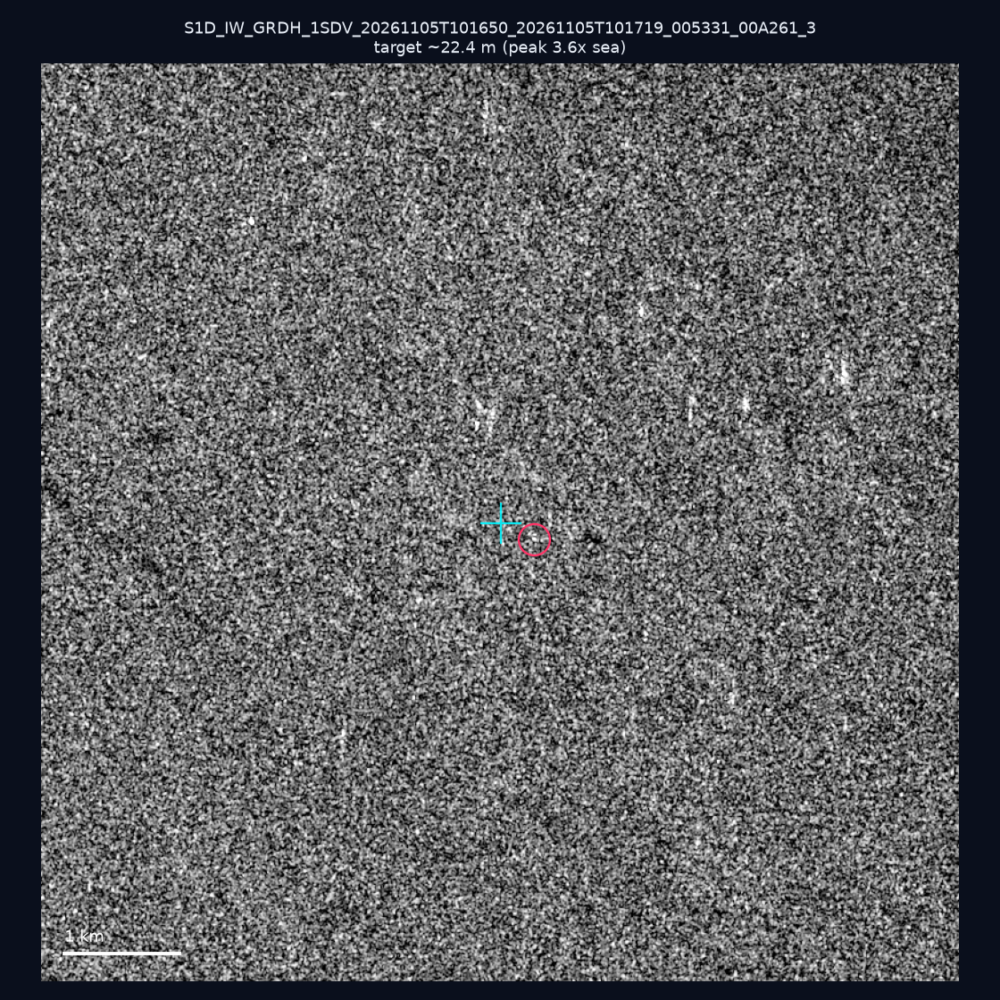

# 暗船 SAR 取證報告 — 2026-11-12

## 1. 總覽

- 執行時間：2026-11-12（GitHub Actions cron 自動執行）
- 線上比對摘要：暗偵測 27026 筆、殘餘暗船 14676 筆、假暗船剔除率 45.7%
- 本輪測試：10 筆
- 成功：10 筆
- 找到亮目標：6 筆
- 失敗：0 筆

## 2. 結果總表

| 日期 | 座標 | 海域 | 法域 | 成像時刻 | 判定 | 估計長度 | 峰值比 |
|------|------|------|------|----------|------|----------|--------|
| 2026-11-08 | 24.73, 122.44 | east | eez | 09:52:08 | ⚪ 無目標（雜訊或低RCS） | — | — |
| 2026-11-08 | 23.47, 122.24 | east | eez | 09:52:08 | ⚪ 無目標（雜訊或低RCS） | — | — |
| 2026-11-08 | 25.32, 122.65 | east | eez | 09:52:08 | ⚪ 無目標（雜訊或低RCS） | — | — |
| 2026-11-08 | 25.03, 124.09 | east | eez | 09:52:08 | ✅ 確認實體目標 | ~325.3 m | 79.8× |
| 2026-11-08 | 23.98, 122.57 | east | eez | 09:52:08 | ✅ 確認實體目標 | ~340.1 m | 22.9× |
| 2026-11-05 | 23.45, 118.1 | southwest | eez | 10:16:50 | ✅ 確認實體目標 | ~114.0 m | 10.7× |
| 2026-11-05 | 23.38, 117.32 | southwest | eez | 10:16:50 | 🟡 弱目標 | ~64.0 m | 5.9× |
| 2026-11-05 | 23.39, 117.82 | southwest | eez | 10:16:50 | 🟡 弱目標 | ~1401.9 m | 8.0× |
| 2026-11-05 | 23.15, 118.23 | southwest | eez | 10:16:50 | ⚪ 無目標（雜訊或低RCS） | — | — |
| 2026-11-05 | 23.49, 117.4 | southwest | eez | 10:16:50 | 🟡 弱目標 | ~22.4 m | 3.6× |

## 3. 逐目標段落

### 2026-11-08 (24.73, 122.44)

⚪ 無目標（雜訊或低RCS）。

### 2026-11-08 (23.47, 122.24)

⚪ 無目標（雜訊或低RCS）。

### 2026-11-08 (25.32, 122.65)

⚪ 無目標（雜訊或低RCS）。

### 2026-11-08 (25.03, 124.09)

✅ 確認實體目標，估計長度 ~325.3 m，峰值 79.8× 海面背景（169 px）。

### 2026-11-08 (23.98, 122.57)

✅ 確認實體目標，估計長度 ~340.1 m，峰值 22.9× 海面背景（205 px）。

### 2026-11-05 (23.45, 118.1)

✅ 確認實體目標，估計長度 ~114.0 m，峰值 10.7× 海面背景（30 px）。

### 2026-11-05 (23.38, 117.32)

🟡 弱目標，估計長度 ~64.0 m，峰值 5.9× 海面背景（15 px）。

### 2026-11-05 (23.39, 117.82)

🟡 弱目標，估計長度 ~1401.9 m，峰值 8.0× 海面背景（3150 px）。

### 2026-11-05 (23.15, 118.23)

⚪ 無目標（雜訊或低RCS）。

### 2026-11-05 (23.49, 117.4)

🟡 弱目標，估計長度 ~22.4 m，峰值 3.6× 海面背景（2 px）。

## 4. 後續建議

- 值得人工深查（確認實體目標且長度 ≥ 50m）：
  - 2026-11-08 (25.03, 124.09) ~325.3 m — 建議比對周邊 AIS 船長
  - 2026-11-08 (23.98, 122.57) ~340.1 m — 建議比對周邊 AIS 船長
  - 2026-11-05 (23.45, 118.1) ~114.0 m — 建議比對周邊 AIS 船長
- 累積統計：全歷史 803 筆（有效 801 筆），確認實體目標 95 筆（11.9%）

> 所有結果是研判線索，不是法律認定；無目標 ≠ 誤報（小型木殼漁船 RCS 低，SAR 可能拍不到）。
