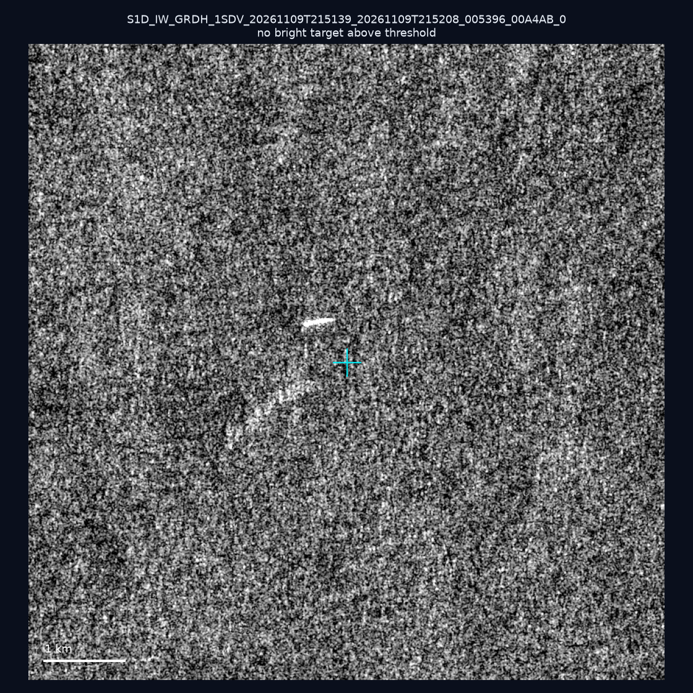
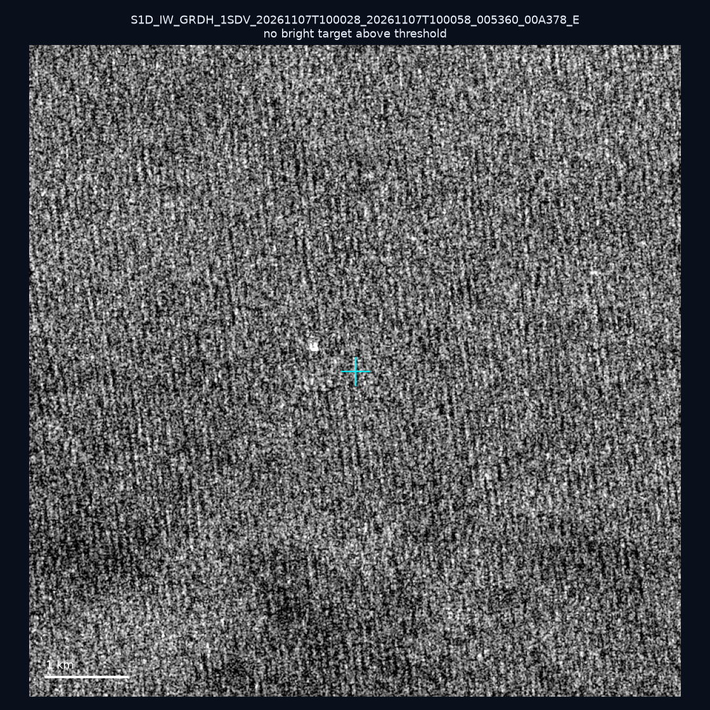
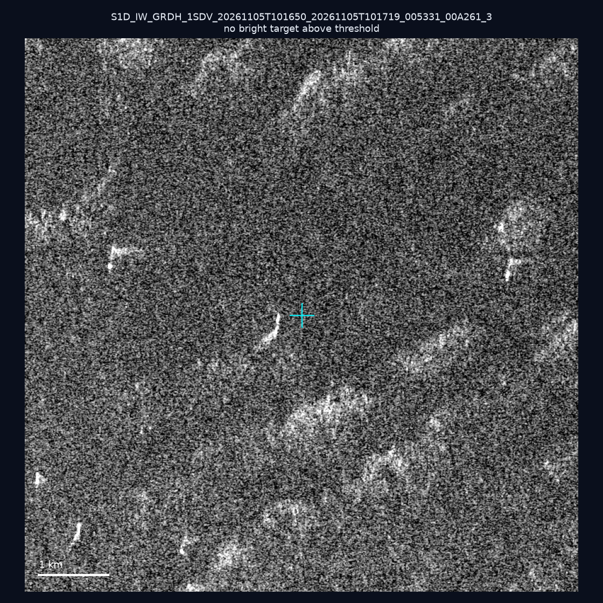
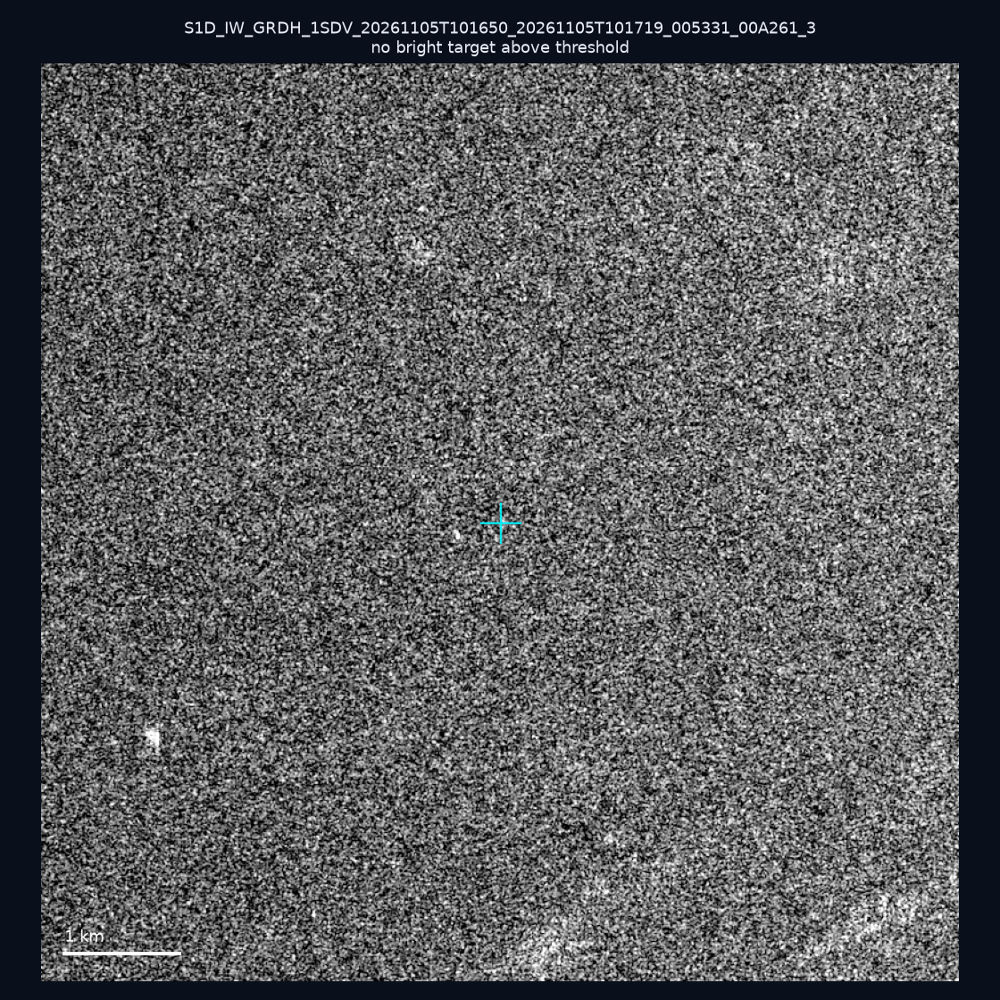
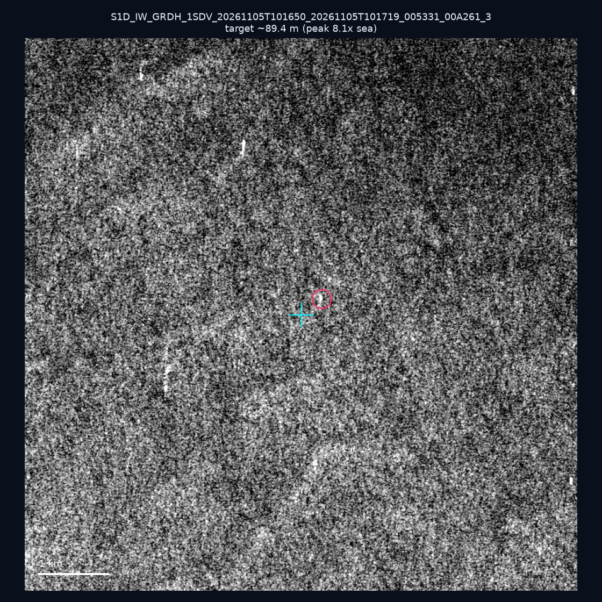
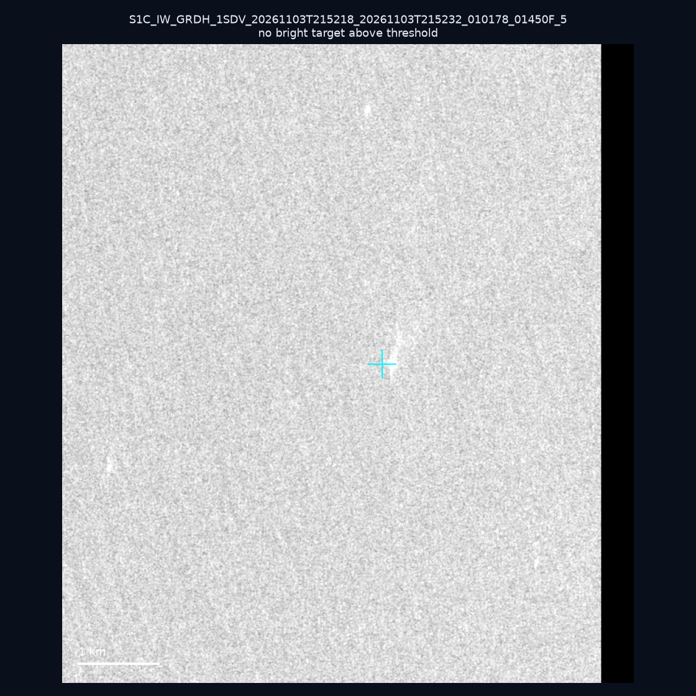
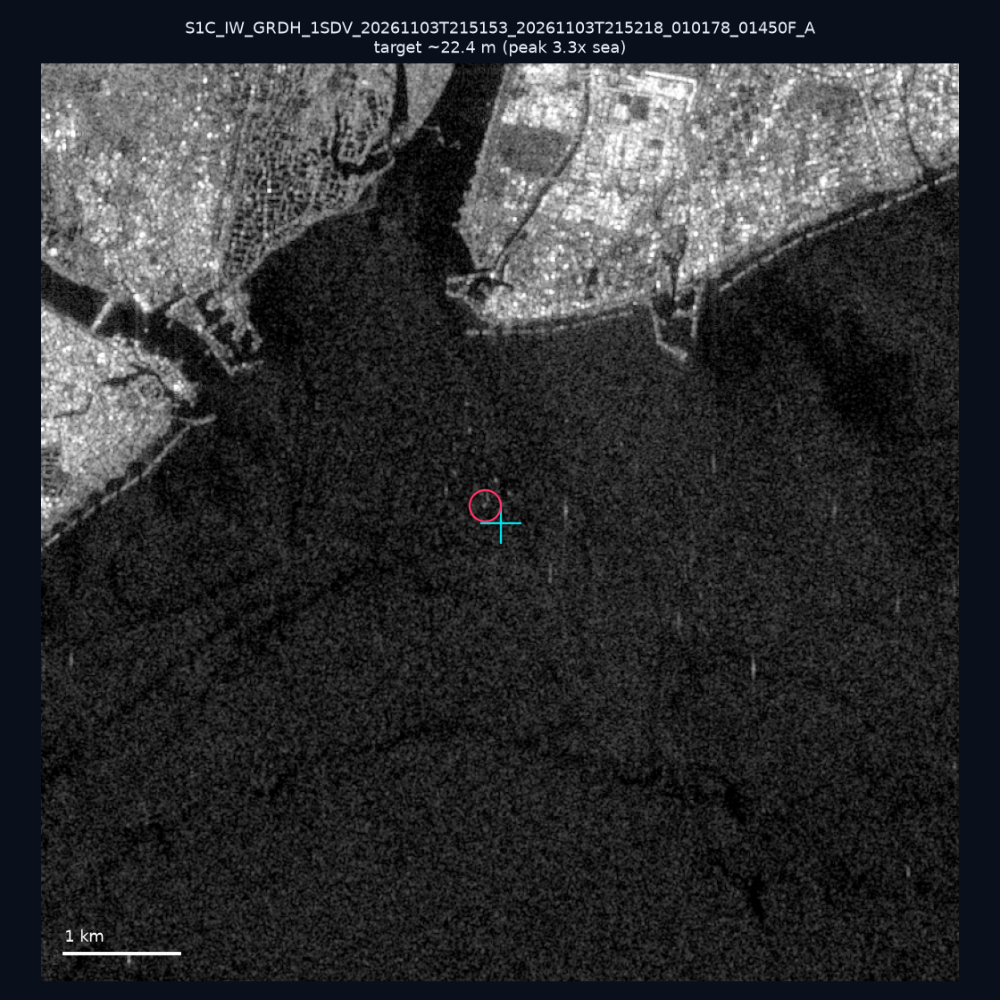
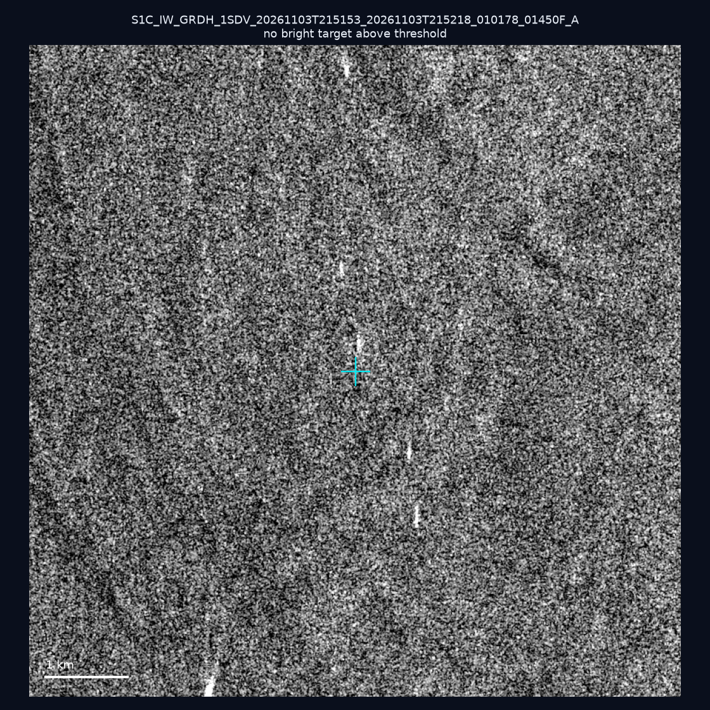
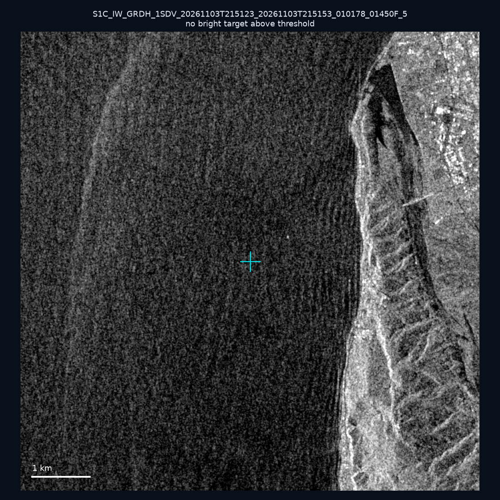
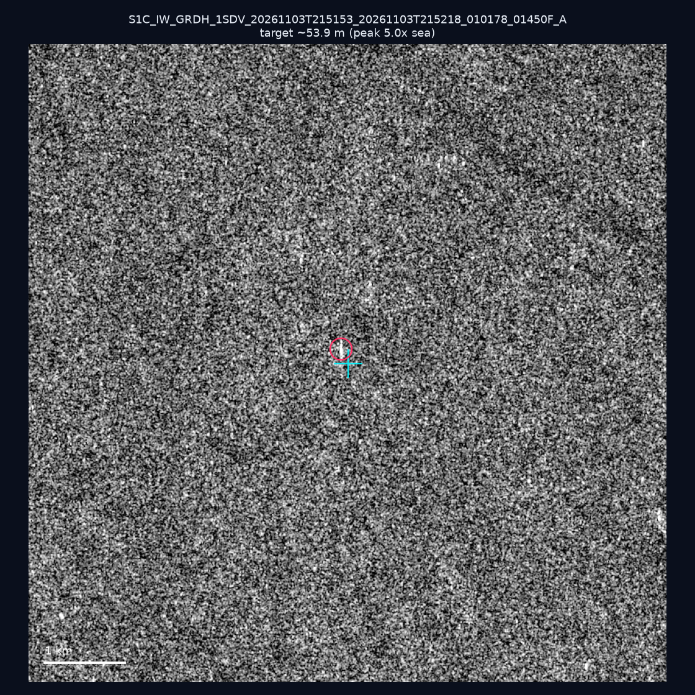

# 暗船 SAR 取證報告 — 2026-11-13

## 1. 總覽

- 執行時間：2026-11-13（GitHub Actions cron 自動執行）
- 線上比對摘要：暗偵測 25199 筆、殘餘暗船 13249 筆、假暗船剔除率 47.4%
- 本輪測試：10 筆
- 成功：10 筆
- 找到亮目標：3 筆
- 失敗：0 筆

## 2. 結果總表

| 日期 | 座標 | 海域 | 法域 | 成像時刻 | 判定 | 估計長度 | 峰值比 |
|------|------|------|------|----------|------|----------|--------|
| 2026-11-09 | 25.24, 122.07 | east | territorial_sea | 21:51:39 | ⚪ 無目標（雜訊或低RCS） | — | — |
| 2026-11-07 | 24.79, 122.12 | east | territorial_sea | 10:00:28 | ⚪ 無目標（雜訊或低RCS） | — | — |
| 2026-11-05 | 23.15, 117.93 | southwest | eez | 10:16:50 | ⚪ 無目標（雜訊或低RCS） | — | — |
| 2026-11-05 | 22.93, 117.7 | southwest | eez | 10:16:50 | ⚪ 無目標（雜訊或低RCS） | — | — |
| 2026-11-05 | 23.28, 118.04 | southwest | eez | 10:16:50 | 🟡 弱目標 | ~89.4 m | 8.1× |
| 2026-11-03 | 22.02, 119.23 | southwest | eez | 21:52:18 | ⚪ 無目標（雜訊或低RCS） | — | — |
| 2026-11-03 | 22.46, 120.41 | southwest | internal_waters | 21:51:53 | 🟡 弱目標 | ~22.4 m | 3.3× |
| 2026-11-03 | 23.26, 119.91 | southwest | internal_waters | 21:51:53 | ⚪ 無目標（雜訊或低RCS） | — | — |
| 2026-11-03 | 23.91, 121.62 | east | internal_waters | 21:51:23 | ⚪ 無目標（雜訊或低RCS） | — | — |
| 2026-11-03 | 22.91, 119.74 | southwest | internal_waters | 21:51:53 | 🟡 弱目標 | ~53.9 m | 5.0× |

## 3. 逐目標段落

### 2026-11-09 (25.24, 122.07)

⚪ 無目標（雜訊或低RCS）。

### 2026-11-07 (24.79, 122.12)

⚪ 無目標（雜訊或低RCS）。

### 2026-11-05 (23.15, 117.93)

⚪ 無目標（雜訊或低RCS）。

### 2026-11-05 (22.93, 117.7)

⚪ 無目標（雜訊或低RCS）。

### 2026-11-05 (23.28, 118.04)

🟡 弱目標，估計長度 ~89.4 m，峰值 8.1× 海面背景（25 px）。

### 2026-11-03 (22.02, 119.23)

⚪ 無目標（雜訊或低RCS）。

### 2026-11-03 (22.46, 120.41)

🟡 弱目標，估計長度 ~22.4 m，峰值 3.3× 海面背景（2 px）。

### 2026-11-03 (23.26, 119.91)

⚪ 無目標（雜訊或低RCS）。

### 2026-11-03 (23.91, 121.62)

⚪ 無目標（雜訊或低RCS）。

### 2026-11-03 (22.91, 119.74)

🟡 弱目標，估計長度 ~53.9 m，峰值 5.0× 海面背景（10 px）。

## 4. 後續建議

- 累積統計：全歷史 813 筆（有效 811 筆），確認實體目標 95 筆（11.7%）

> 所有結果是研判線索，不是法律認定；無目標 ≠ 誤報（小型木殼漁船 RCS 低，SAR 可能拍不到）。
