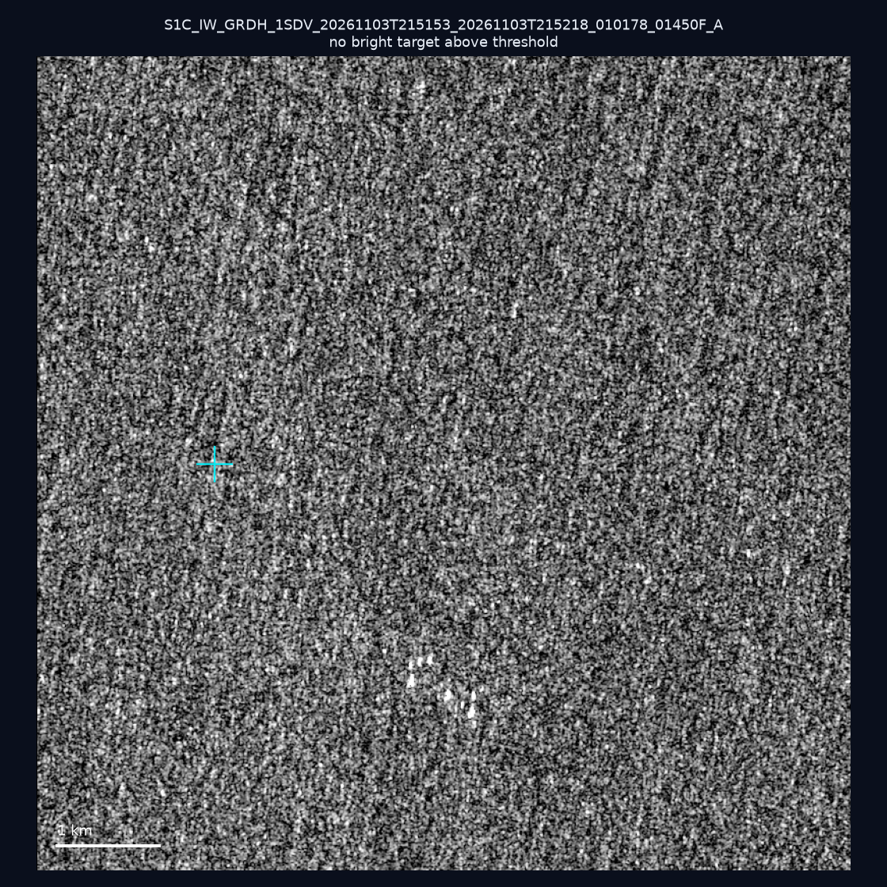
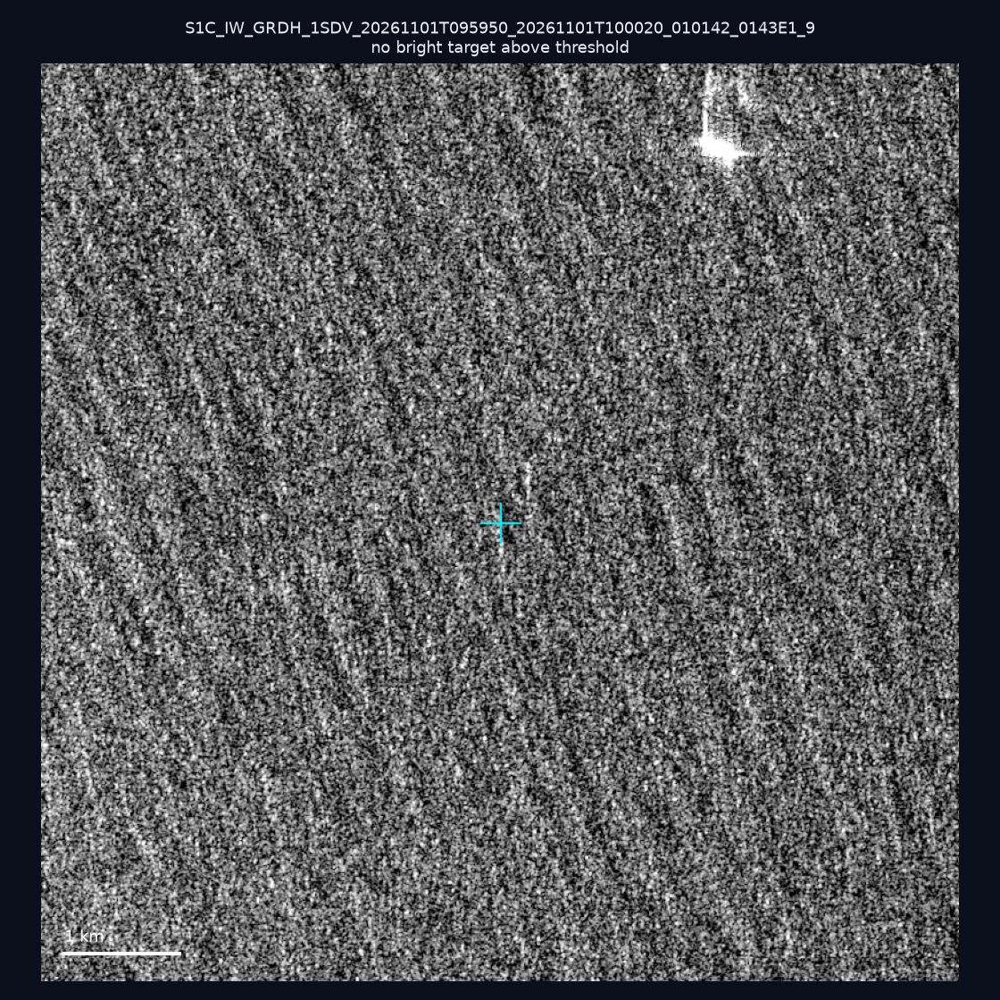
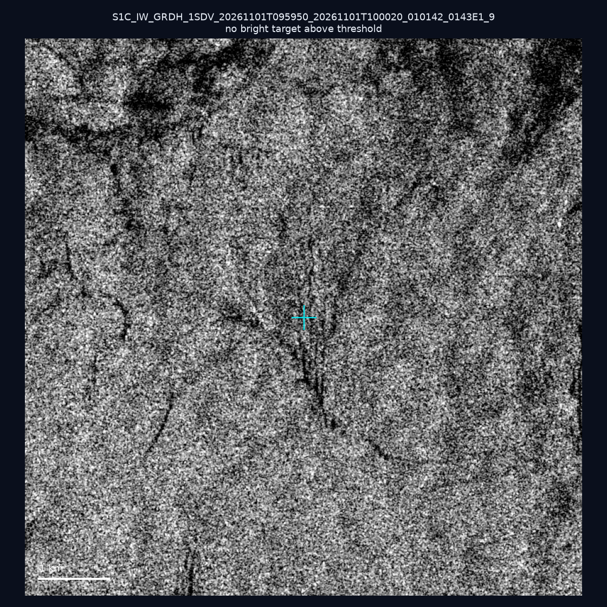
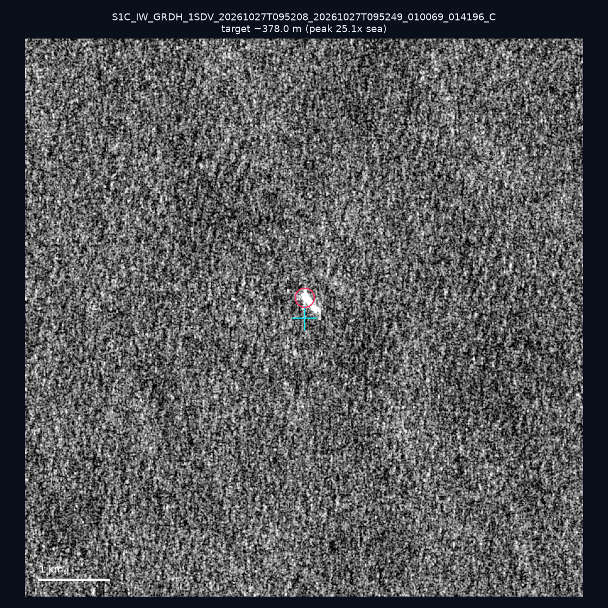
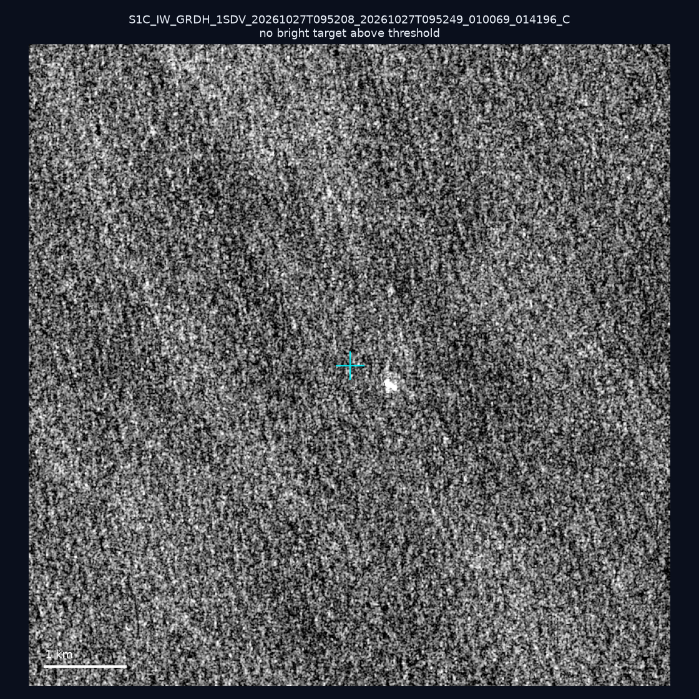
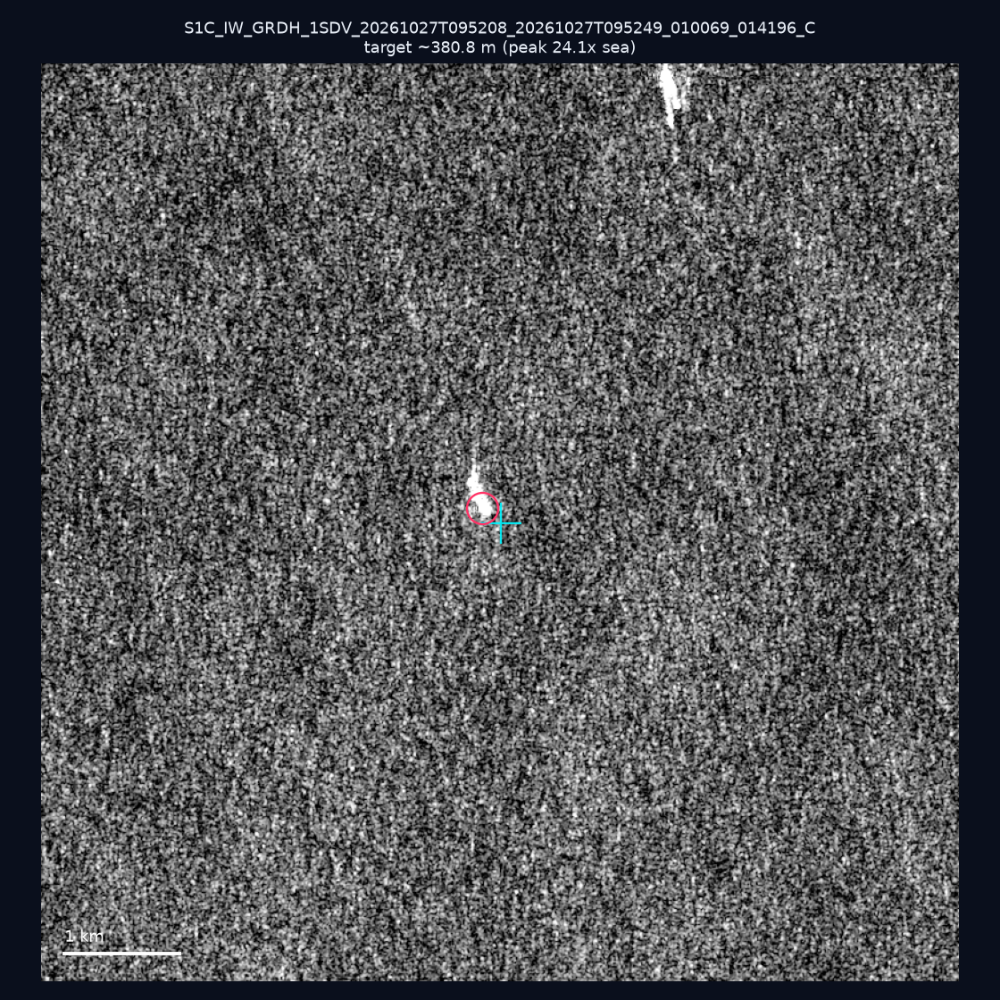
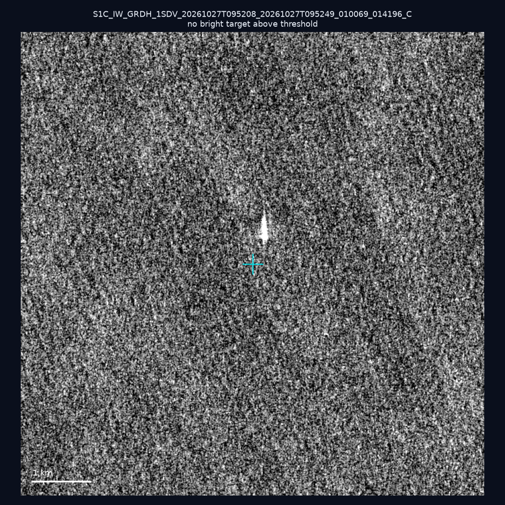
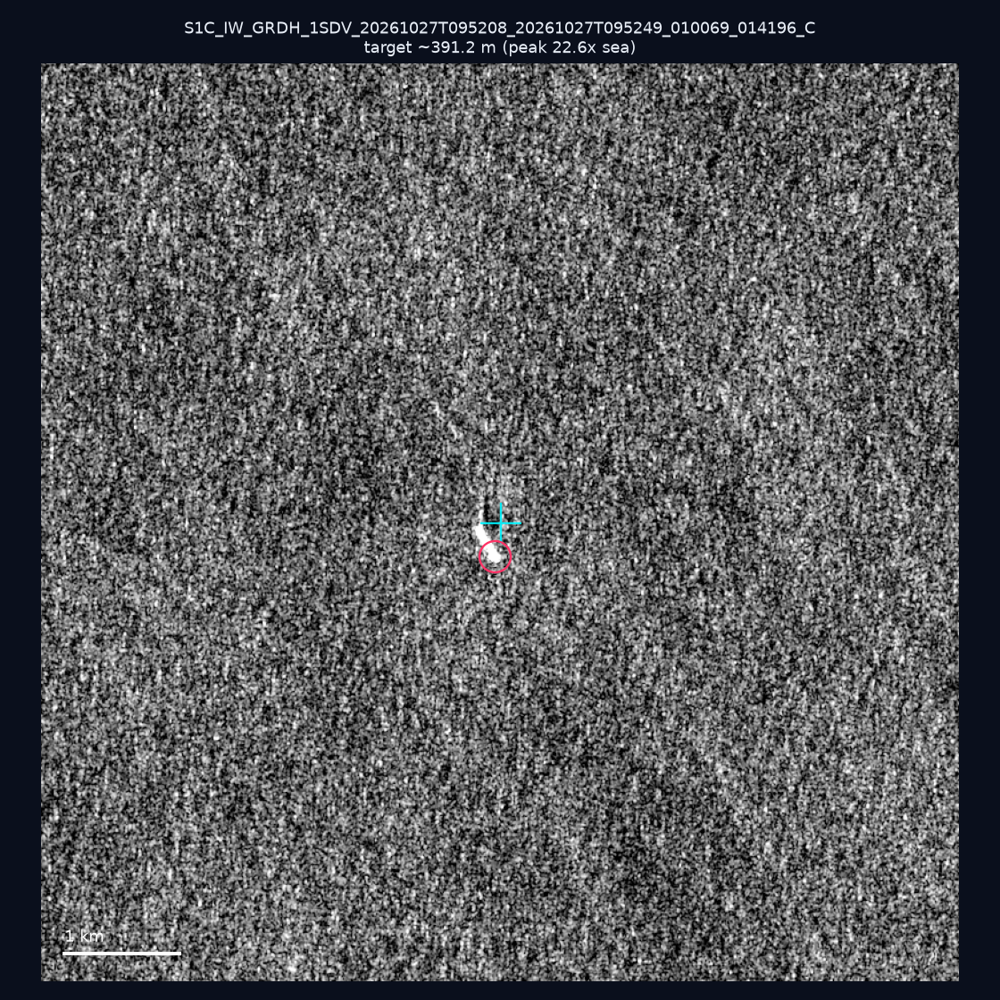
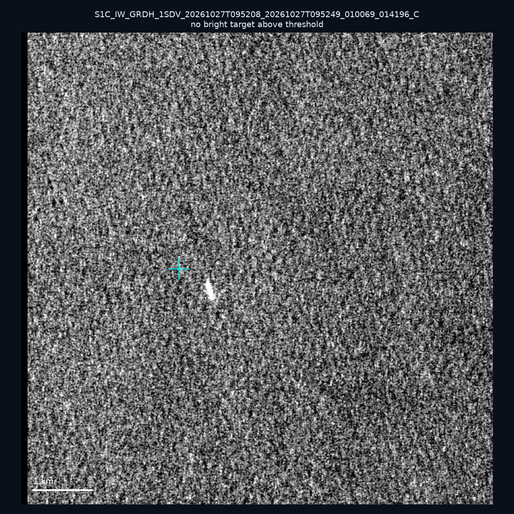
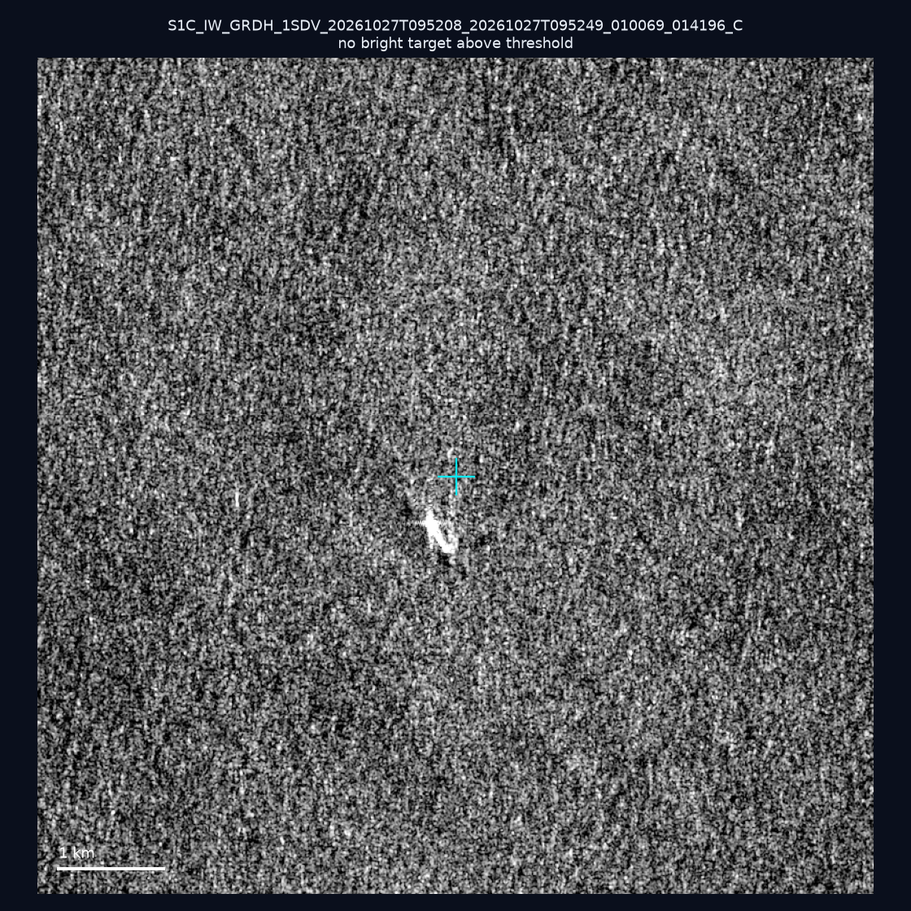

# 暗船 SAR 取證報告 — 2026-11-14

## 1. 總覽

- 執行時間：2026-11-14（GitHub Actions cron 自動執行）
- 線上比對摘要：暗偵測 25667 筆、殘餘暗船 13577 筆、假暗船剔除率 47.1%
- 本輪測試：10 筆
- 成功：10 筆
- 找到亮目標：3 筆
- 失敗：0 筆

## 2. 結果總表

| 日期 | 座標 | 海域 | 法域 | 成像時刻 | 判定 | 估計長度 | 峰值比 |
|------|------|------|------|----------|------|----------|--------|
| 2026-11-03 | 22.48, 121.76 | east | territorial_sea | 21:51:53 | ⚪ 無目標（雜訊或低RCS） | — | — |
| 2026-11-01 | 22.67, 122.09 | east | eez | 09:59:50 | ⚪ 無目標（雜訊或低RCS） | — | — |
| 2026-11-01 | 22.33, 120.53 | southwest | internal_waters | 09:59:50 | ⚪ 無目標（雜訊或低RCS） | — | — |
| 2026-10-27 | 24.85, 122.57 | east | eez | 09:52:08 | ✅ 確認實體目標 | ~378.0 m | 25.1× |
| 2026-10-27 | 23.42, 122.51 | east | eez | 09:52:08 | ⚪ 無目標（雜訊或低RCS） | — | — |
| 2026-10-27 | 25.09, 122.77 | east | eez | 09:52:08 | ✅ 確認實體目標 | ~380.8 m | 24.1× |
| 2026-10-27 | 24.15, 122.68 | east | eez | 09:52:08 | ⚪ 無目標（雜訊或低RCS） | — | — |
| 2026-10-27 | 24.74, 122.63 | east | eez | 09:52:08 | ✅ 確認實體目標 | ~391.2 m | 22.6× |
| 2026-10-27 | 23.98, 122.01 | east | contiguous_zone | 09:52:08 | ⚪ 無目標（雜訊或低RCS） | — | — |
| 2026-10-27 | 24.58, 122.34 | east | contiguous_zone | 09:52:08 | ⚪ 無目標（雜訊或低RCS） | — | — |

## 3. 逐目標段落

### 2026-11-03 (22.48, 121.76)

⚪ 無目標（雜訊或低RCS）。

### 2026-11-01 (22.67, 122.09)

⚪ 無目標（雜訊或低RCS）。

### 2026-11-01 (22.33, 120.53)

⚪ 無目標（雜訊或低RCS）。

### 2026-10-27 (24.85, 122.57)

✅ 確認實體目標，估計長度 ~378.0 m，峰值 25.1× 海面背景（227 px）。

### 2026-10-27 (23.42, 122.51)

⚪ 無目標（雜訊或低RCS）。

### 2026-10-27 (25.09, 122.77)

✅ 確認實體目標，估計長度 ~380.8 m，峰值 24.1× 海面背景（246 px）。

### 2026-10-27 (24.15, 122.68)

⚪ 無目標（雜訊或低RCS）。

### 2026-10-27 (24.74, 122.63)

✅ 確認實體目標，估計長度 ~391.2 m，峰值 22.6× 海面背景（199 px）。

### 2026-10-27 (23.98, 122.01)

⚪ 無目標（雜訊或低RCS）。

### 2026-10-27 (24.58, 122.34)

⚪ 無目標（雜訊或低RCS）。

## 4. 後續建議

- 值得人工深查（確認實體目標且長度 ≥ 50m）：
  - 2026-10-27 (24.85, 122.57) ~378.0 m — 建議比對周邊 AIS 船長
  - 2026-10-27 (25.09, 122.77) ~380.8 m — 建議比對周邊 AIS 船長
  - 2026-10-27 (24.74, 122.63) ~391.2 m — 建議比對周邊 AIS 船長
- 累積統計：全歷史 823 筆（有效 821 筆），確認實體目標 98 筆（11.9%）

> 所有結果是研判線索，不是法律認定；無目標 ≠ 誤報（小型木殼漁船 RCS 低，SAR 可能拍不到）。
