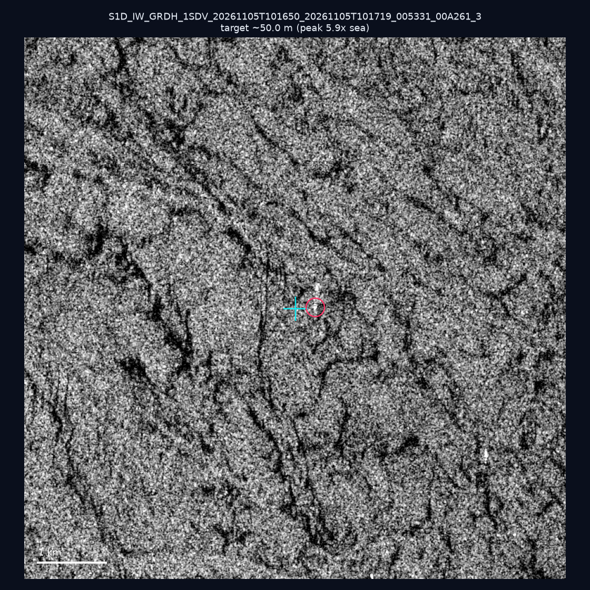
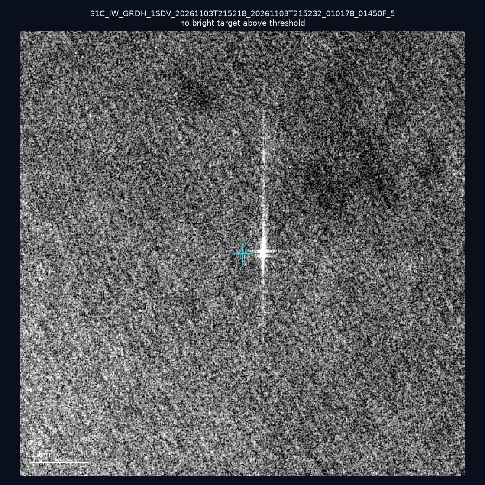
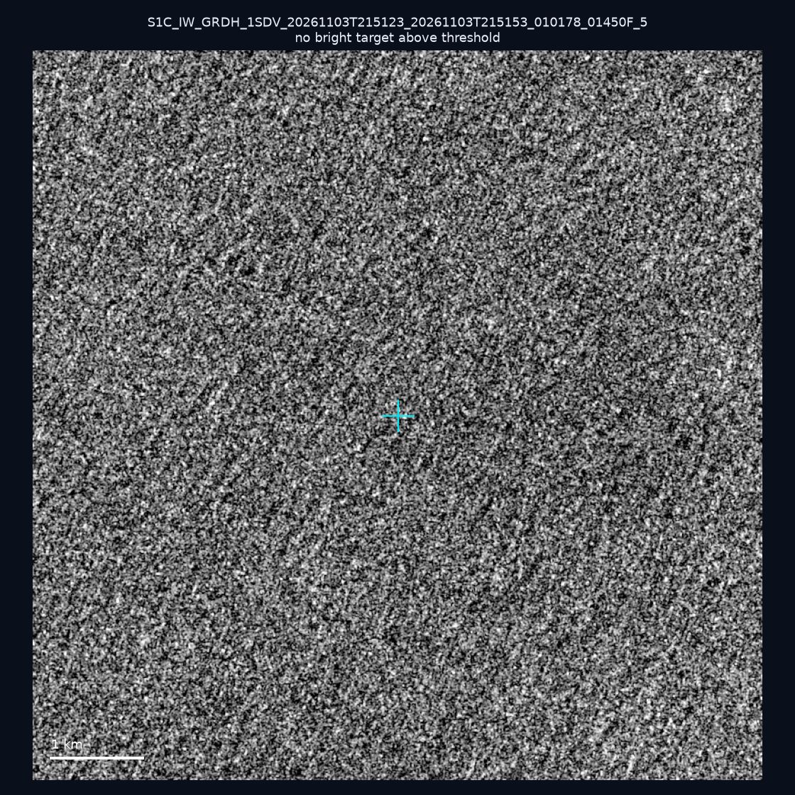
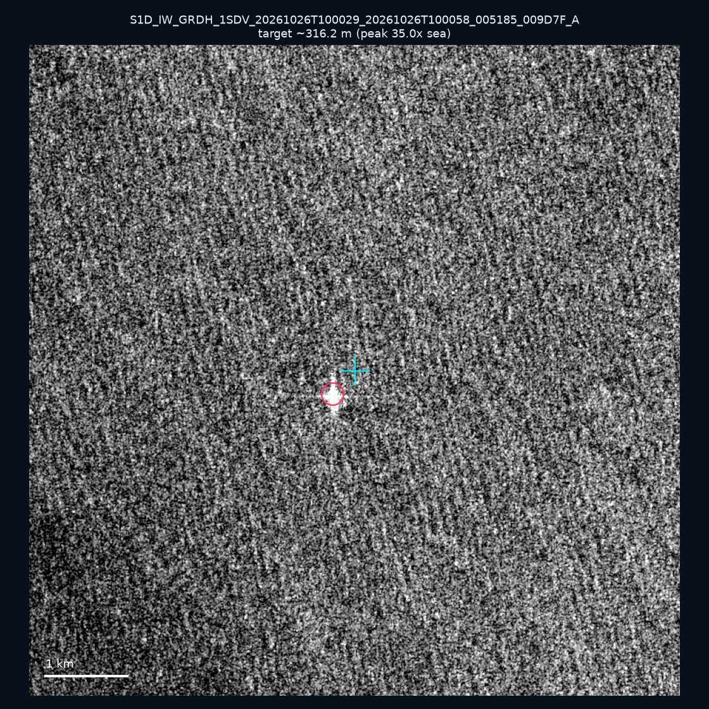
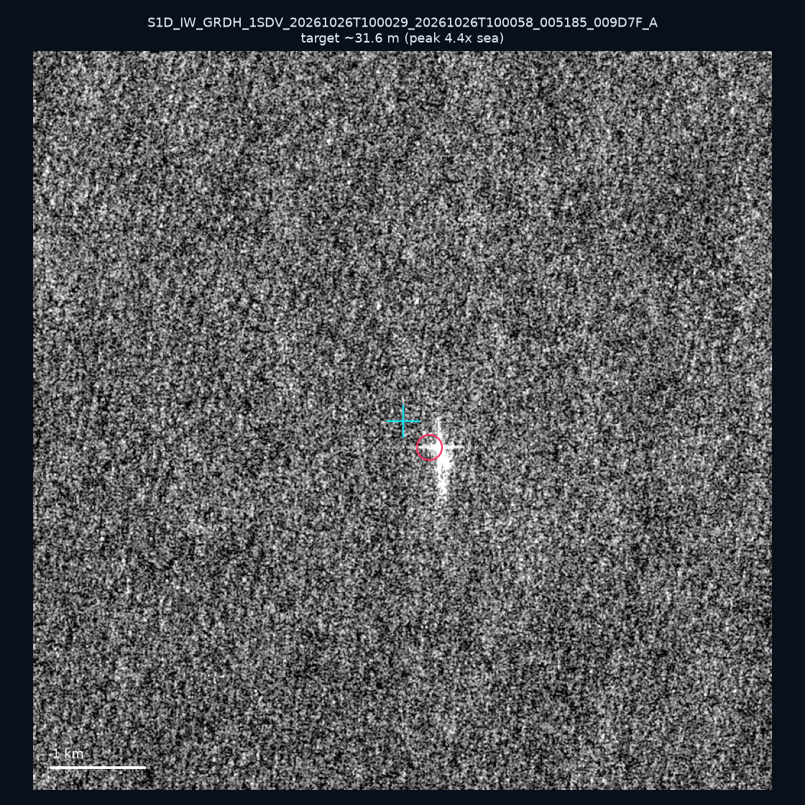
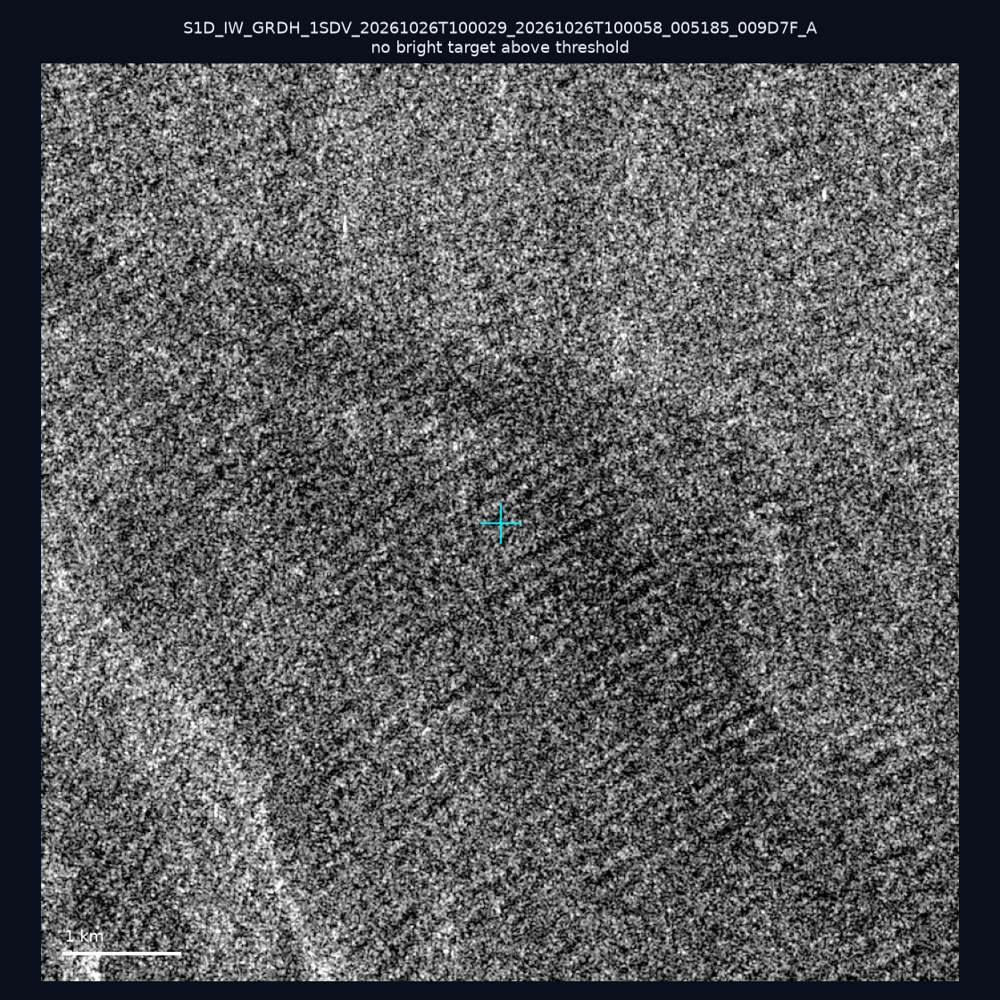
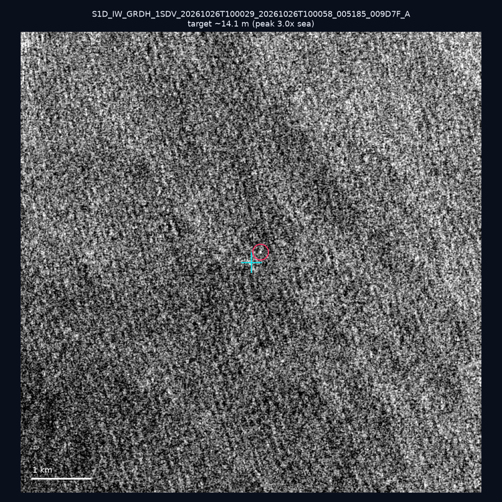
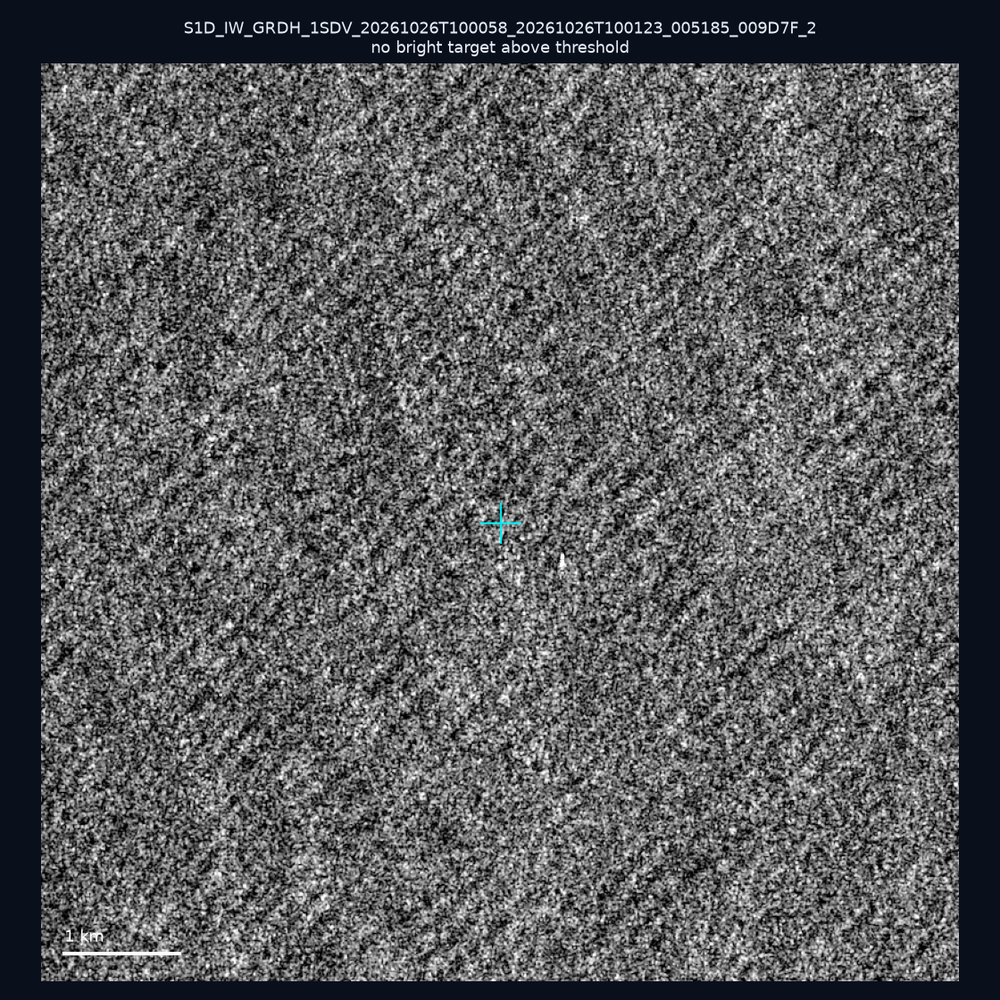
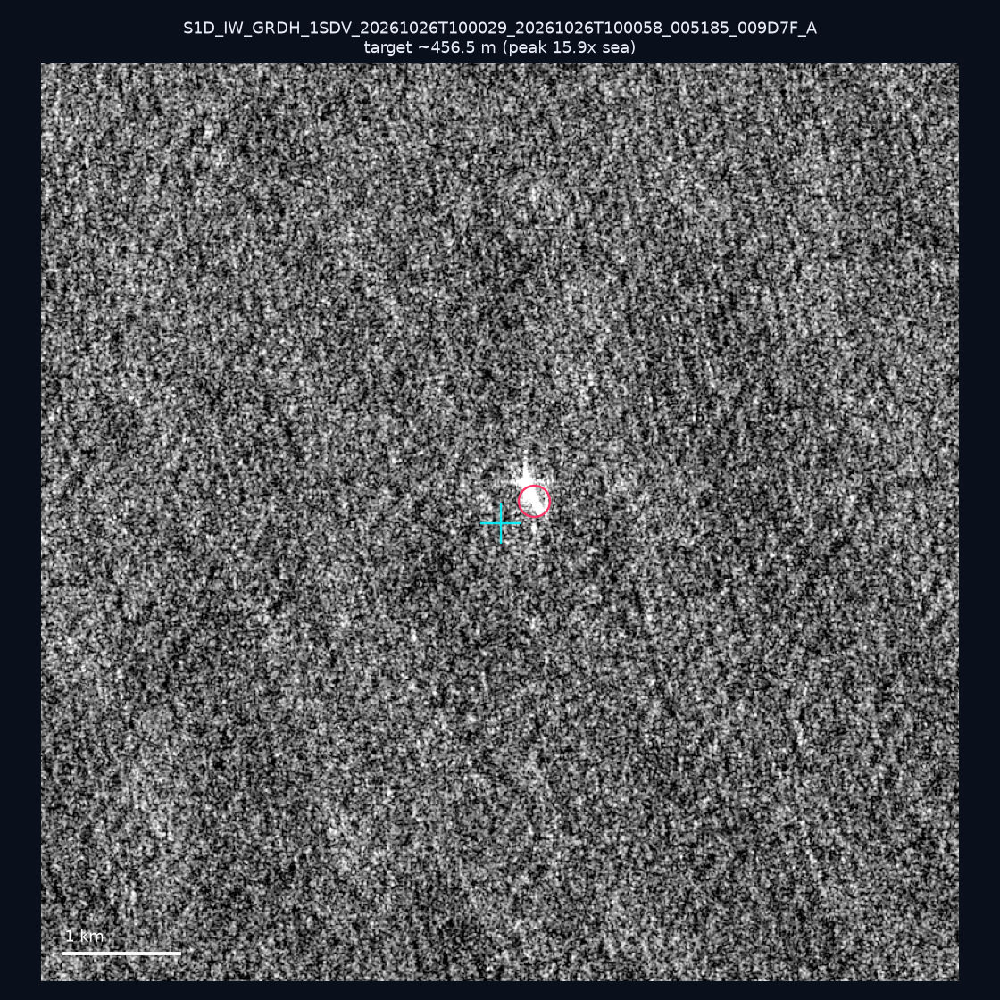
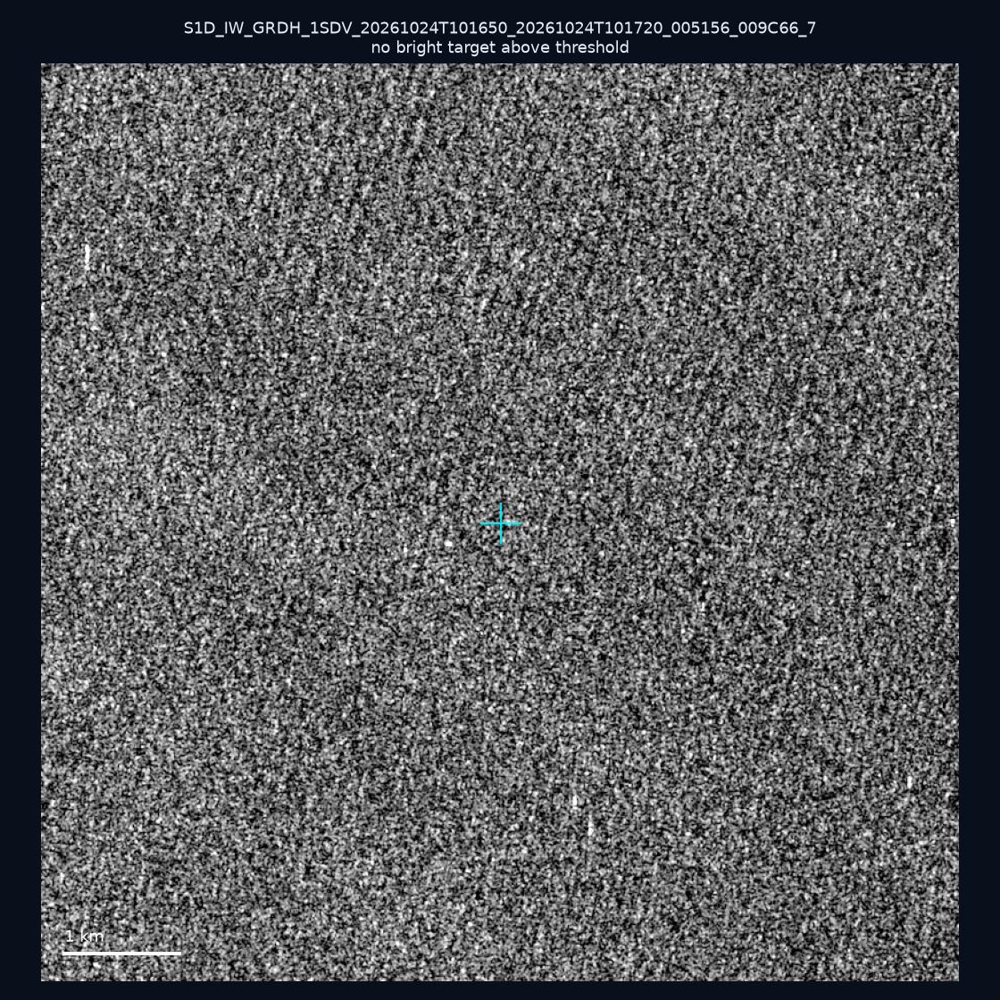

# 暗船 SAR 取證報告 — 2026-11-15

## 1. 總覽

- 執行時間：2026-11-15（GitHub Actions cron 自動執行）
- 線上比對摘要：暗偵測 24039 筆、殘餘暗船 12857 筆、假暗船剔除率 46.5%
- 本輪測試：10 筆
- 成功：10 筆
- 找到亮目標：5 筆
- 失敗：0 筆

## 2. 結果總表

| 日期 | 座標 | 海域 | 法域 | 成像時刻 | 判定 | 估計長度 | 峰值比 |
|------|------|------|------|----------|------|----------|--------|
| 2026-11-05 | 22.88, 117.32 | southwest | eez | 10:16:50 | 🟡 弱目標 | ~50.0 m | 5.9× |
| 2026-11-03 | 22.03, 120.09 | southwest | contiguous_zone | 21:52:18 | ⚪ 無目標（雜訊或低RCS） | — | — |
| 2026-11-03 | 25.42, 122.13 | east | territorial_sea | 21:51:23 | ⚪ 無目標（雜訊或低RCS） | — | — |
| 2026-10-26 | 23.37, 122.25 | east | eez | 10:00:29 | ✅ 確認實體目標 | ~316.2 m | 35.0× |
| 2026-10-26 | 24.6, 122.21 | east | contiguous_zone | 10:00:29 | 🟡 弱目標 | ~31.6 m | 4.4× |
| 2026-10-26 | 24.8, 122.0 | east | territorial_sea | 10:00:29 | ⚪ 無目標（雜訊或低RCS） | — | — |
| 2026-10-26 | 24.06, 121.68 | east | internal_waters | 10:00:29 | 🟡 弱目標 | ~14.1 m | 3.0× |
| 2026-10-26 | 25.21, 122.0 | east | internal_waters | 10:00:58 | ⚪ 無目標（雜訊或低RCS） | — | — |
| 2026-10-26 | 23.91, 122.12 | east | contiguous_zone | 10:00:29 | ✅ 確認實體目標 | ~456.5 m | 15.9× |
| 2026-10-24 | 23.04, 117.05 | southwest | eez | 10:16:50 | ⚪ 無目標（雜訊或低RCS） | — | — |

## 3. 逐目標段落

### 2026-11-05 (22.88, 117.32)

🟡 弱目標，估計長度 ~50.0 m，峰值 5.9× 海面背景（11 px）。

### 2026-11-03 (22.03, 120.09)

⚪ 無目標（雜訊或低RCS）。

### 2026-11-03 (25.42, 122.13)

⚪ 無目標（雜訊或低RCS）。

### 2026-10-26 (23.37, 122.25)

✅ 確認實體目標，估計長度 ~316.2 m，峰值 35.0× 海面背景（192 px）。

### 2026-10-26 (24.6, 122.21)

🟡 弱目標，估計長度 ~31.6 m，峰值 4.4× 海面背景（3 px）。

### 2026-10-26 (24.8, 122.0)

⚪ 無目標（雜訊或低RCS）。

### 2026-10-26 (24.06, 121.68)

🟡 弱目標，估計長度 ~14.1 m，峰值 3.0× 海面背景（1 px）。

### 2026-10-26 (25.21, 122.0)

⚪ 無目標（雜訊或低RCS）。

### 2026-10-26 (23.91, 122.12)

✅ 確認實體目標，估計長度 ~456.5 m，峰值 15.9× 海面背景（293 px）。

### 2026-10-24 (23.04, 117.05)

⚪ 無目標（雜訊或低RCS）。

## 4. 後續建議

- 值得人工深查（確認實體目標且長度 ≥ 50m）：
  - 2026-10-26 (23.37, 122.25) ~316.2 m — 建議比對周邊 AIS 船長
  - 2026-10-26 (23.91, 122.12) ~456.5 m — 建議比對周邊 AIS 船長
- 累積統計：全歷史 833 筆（有效 831 筆），確認實體目標 100 筆（12.0%）

> 所有結果是研判線索，不是法律認定；無目標 ≠ 誤報（小型木殼漁船 RCS 低，SAR 可能拍不到）。
