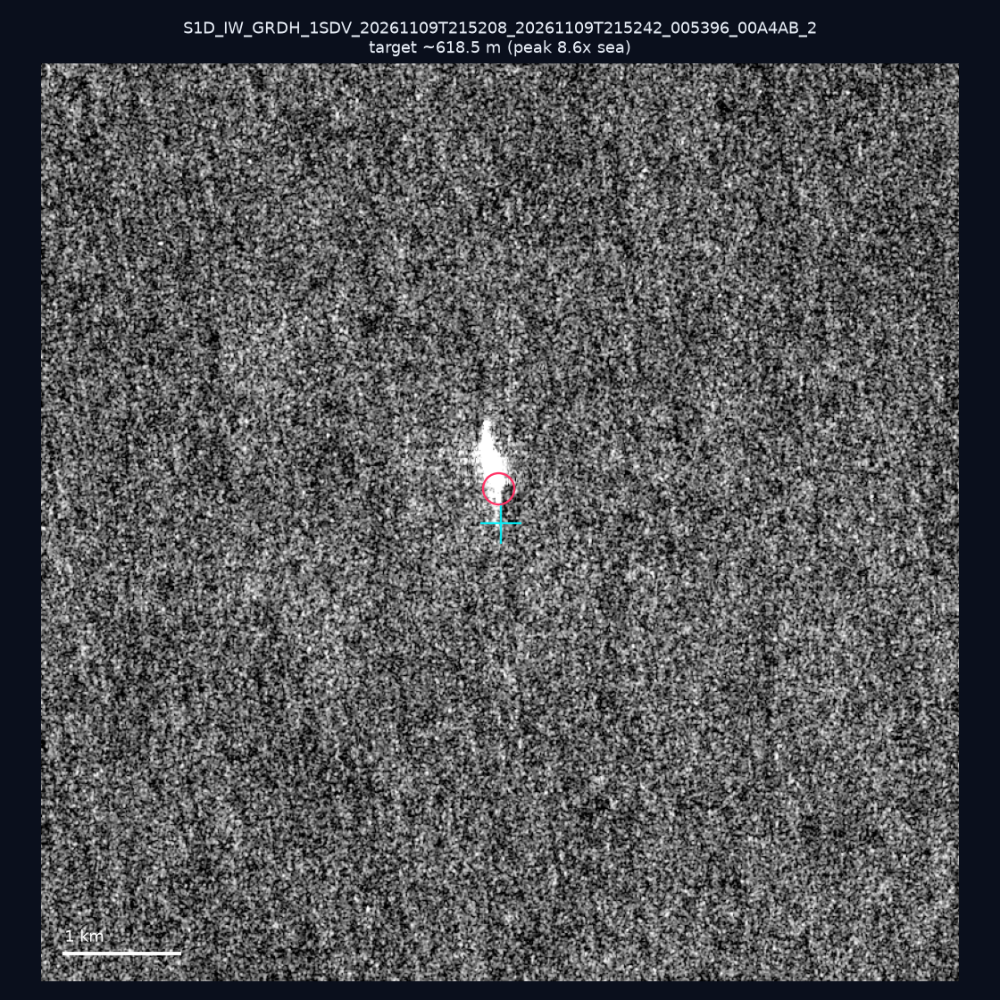
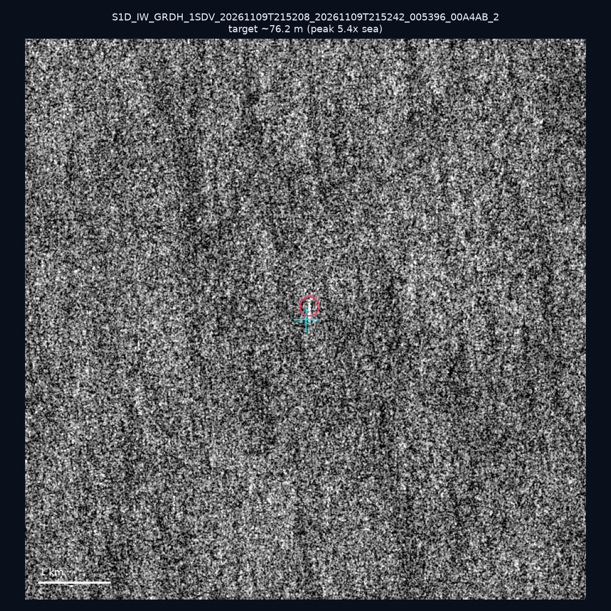
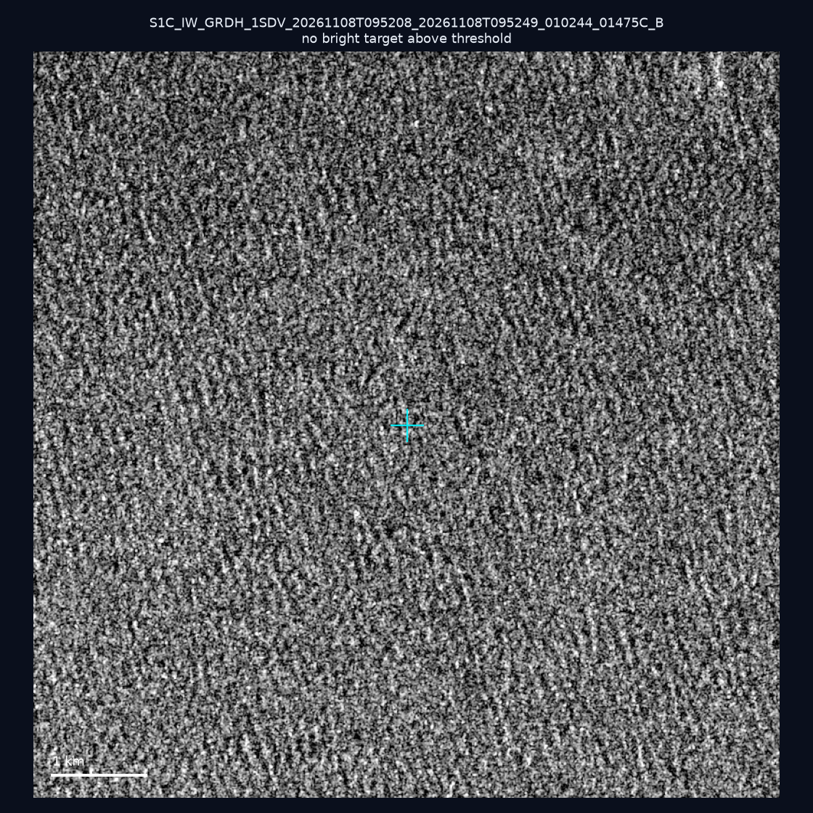
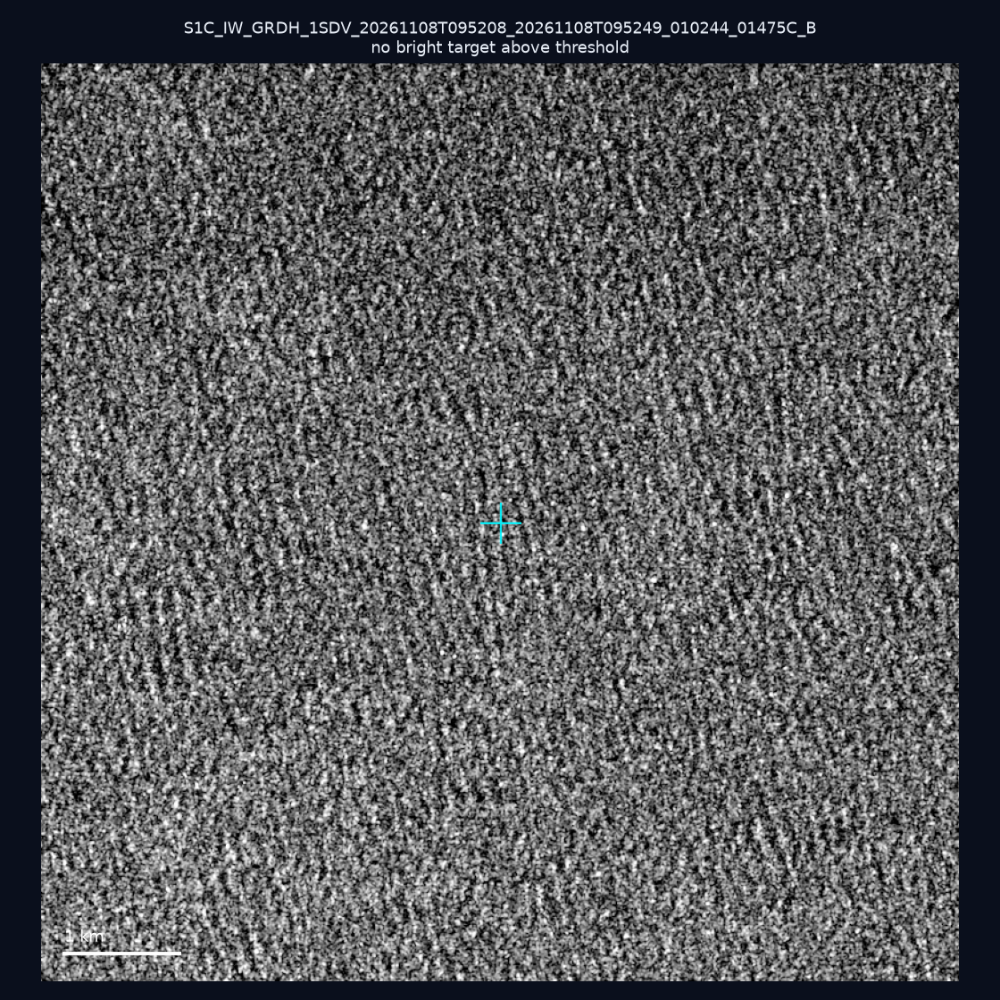
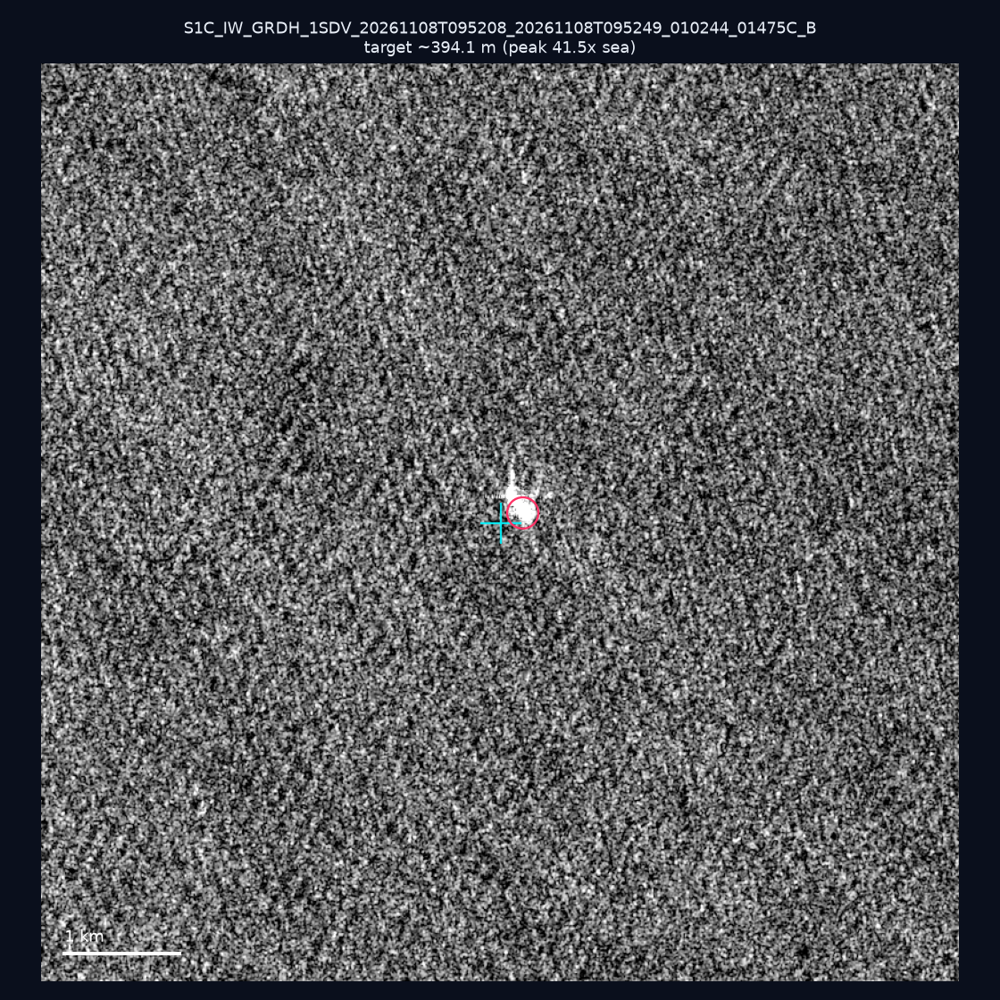
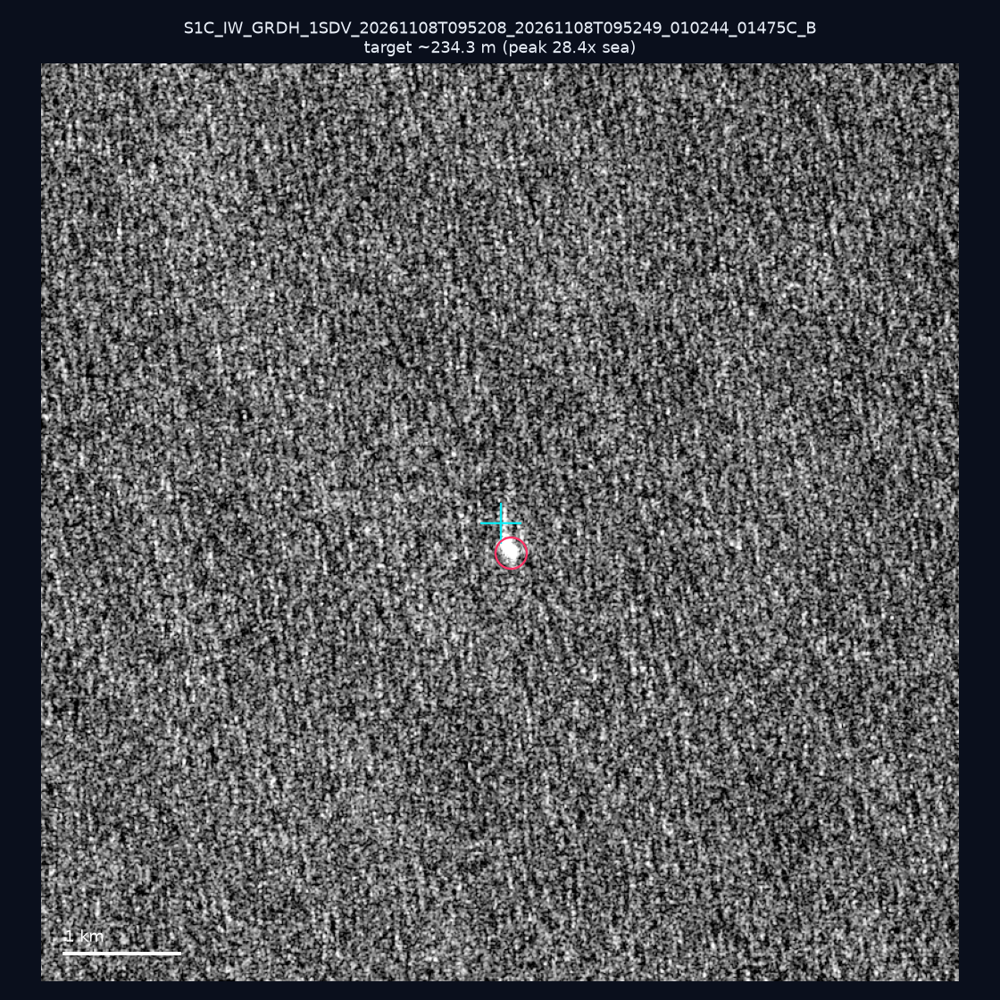
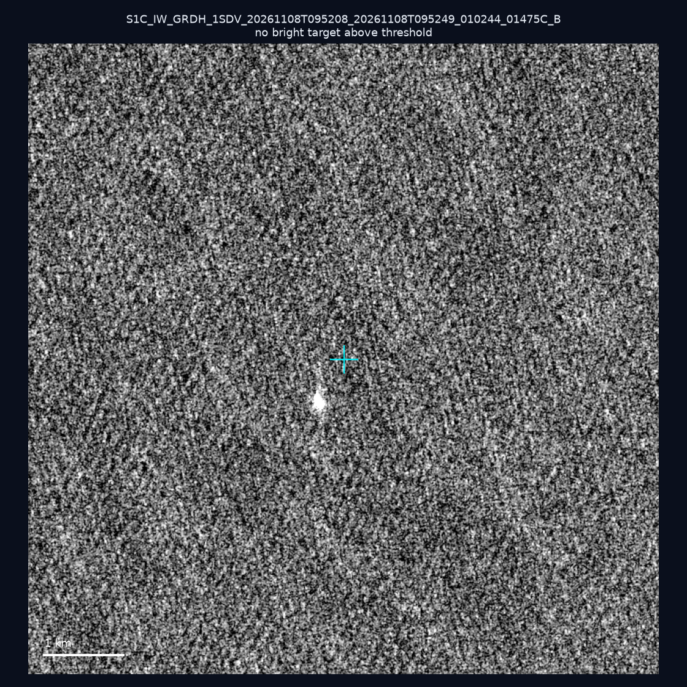
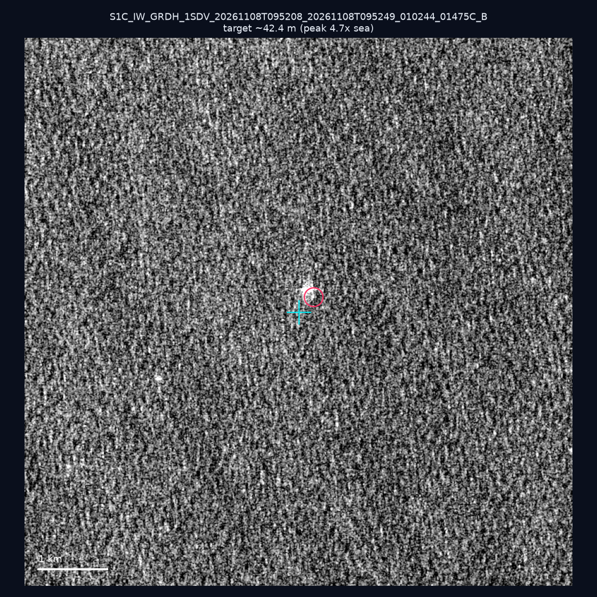
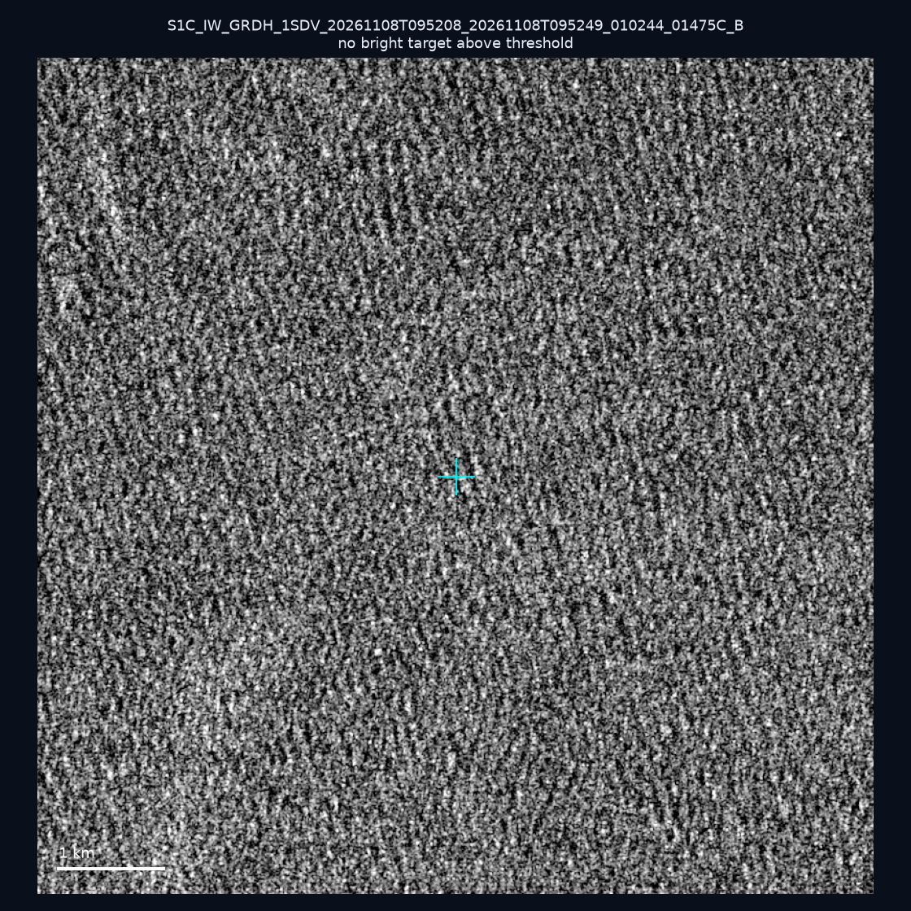
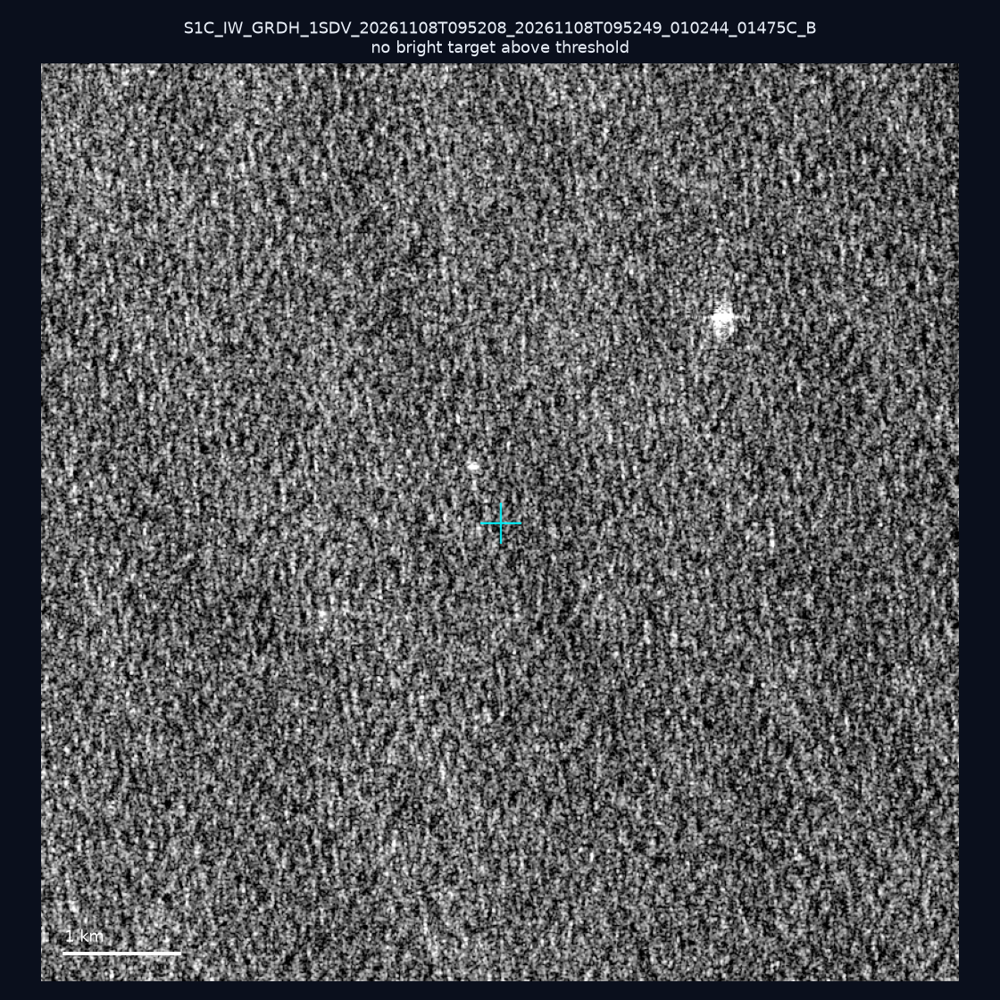

# 暗船 SAR 取證報告 — 2026-11-16

## 1. 總覽

- 執行時間：2026-11-16（GitHub Actions cron 自動執行）
- 線上比對摘要：暗偵測 23538 筆、殘餘暗船 12429 筆、假暗船剔除率 47.2%
- 本輪測試：10 筆
- 成功：10 筆
- 找到亮目標：5 筆
- 失敗：0 筆

## 2. 結果總表

| 日期 | 座標 | 海域 | 法域 | 成像時刻 | 判定 | 估計長度 | 峰值比 |
|------|------|------|------|----------|------|----------|--------|
| 2026-11-09 | 21.93, 119.27 | southwest | eez | 21:52:08 | 🟡 弱目標 | ~618.5 m | 8.6× |
| 2026-11-09 | 23.06, 119.49 | southwest | territorial_sea | 21:52:08 | 🟡 弱目標 | ~76.2 m | 5.4× |
| 2026-11-08 | 25.29, 121.94 | east | internal_waters | 09:52:08 | ⚪ 無目標（雜訊或低RCS） | — | — |
| 2026-11-08 | 25.29, 121.9 | east | internal_waters | 09:52:08 | ⚪ 無目標（雜訊或低RCS） | — | — |
| 2026-11-08 | 24.04, 123.17 | east | eez | 09:52:08 | ✅ 確認實體目標 | ~394.1 m | 41.5× |
| 2026-11-08 | 23.67, 122.98 | east | eez | 09:52:08 | ✅ 確認實體目標 | ~234.3 m | 28.4× |
| 2026-11-08 | 23.98, 123.07 | east | eez | 09:52:08 | ⚪ 無目標（雜訊或低RCS） | — | — |
| 2026-11-08 | 23.44, 122.57 | east | eez | 09:52:08 | 🟡 弱目標 | ~42.4 m | 4.7× |
| 2026-11-08 | 25.32, 121.87 | east | internal_waters | 09:52:08 | ⚪ 無目標（雜訊或低RCS） | — | — |
| 2026-11-08 | 23.45, 122.55 | east | eez | 09:52:08 | ⚪ 無目標（雜訊或低RCS） | — | — |

## 3. 逐目標段落

### 2026-11-09 (21.93, 119.27)

🟡 弱目標，估計長度 ~618.5 m，峰值 8.6× 海面背景（621 px）。

### 2026-11-09 (23.06, 119.49)

🟡 弱目標，估計長度 ~76.2 m，峰值 5.4× 海面背景（16 px）。

### 2026-11-08 (25.29, 121.94)

⚪ 無目標（雜訊或低RCS）。

### 2026-11-08 (25.29, 121.9)

⚪ 無目標（雜訊或低RCS）。

### 2026-11-08 (24.04, 123.17)

✅ 確認實體目標，估計長度 ~394.1 m，峰值 41.5× 海面背景（273 px）。

### 2026-11-08 (23.67, 122.98)

✅ 確認實體目標，估計長度 ~234.3 m，峰值 28.4× 海面背景（159 px）。

### 2026-11-08 (23.98, 123.07)

⚪ 無目標（雜訊或低RCS）。

### 2026-11-08 (23.44, 122.57)

🟡 弱目標，估計長度 ~42.4 m，峰值 4.7× 海面背景（6 px）。

### 2026-11-08 (25.32, 121.87)

⚪ 無目標（雜訊或低RCS）。

### 2026-11-08 (23.45, 122.55)

⚪ 無目標（雜訊或低RCS）。

## 4. 後續建議

- 值得人工深查（確認實體目標且長度 ≥ 50m）：
  - 2026-11-08 (24.04, 123.17) ~394.1 m — 建議比對周邊 AIS 船長
  - 2026-11-08 (23.67, 122.98) ~234.3 m — 建議比對周邊 AIS 船長
- 累積統計：全歷史 843 筆（有效 841 筆），確認實體目標 102 筆（12.1%）

> 所有結果是研判線索，不是法律認定；無目標 ≠ 誤報（小型木殼漁船 RCS 低，SAR 可能拍不到）。
