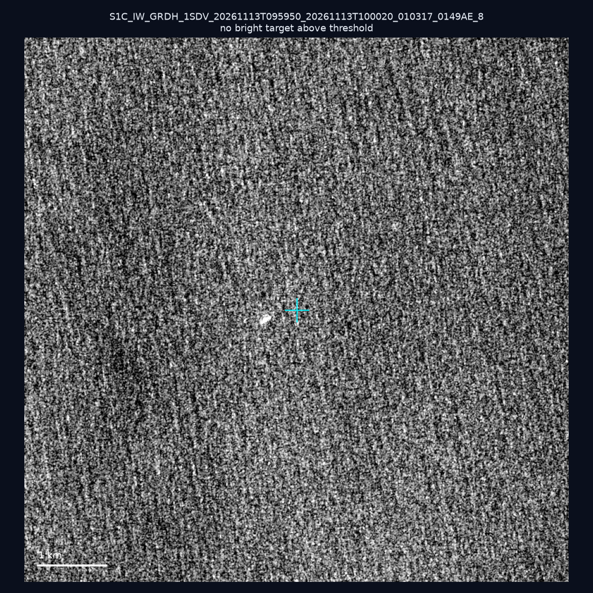
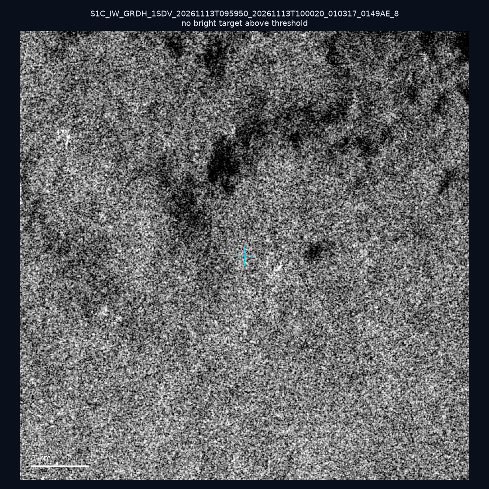
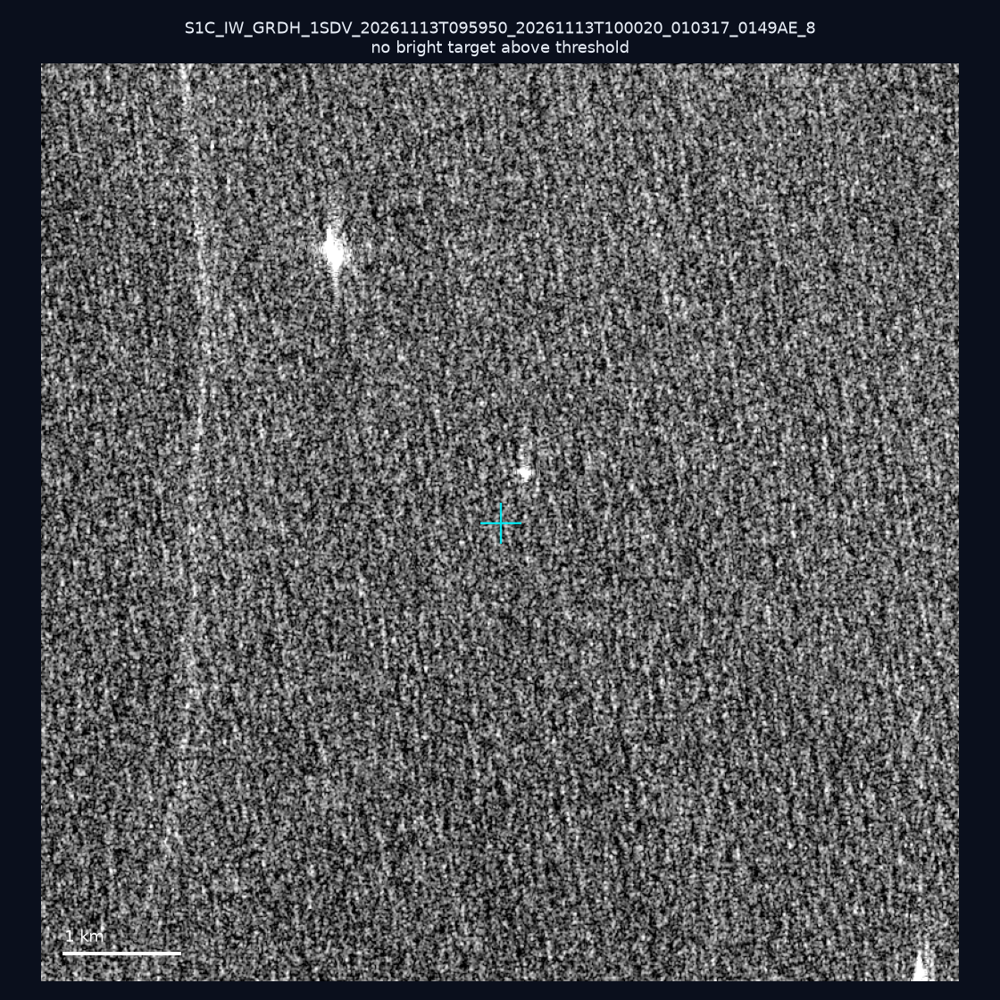
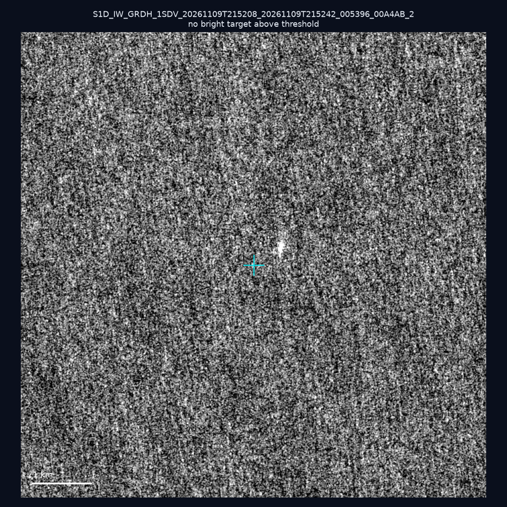
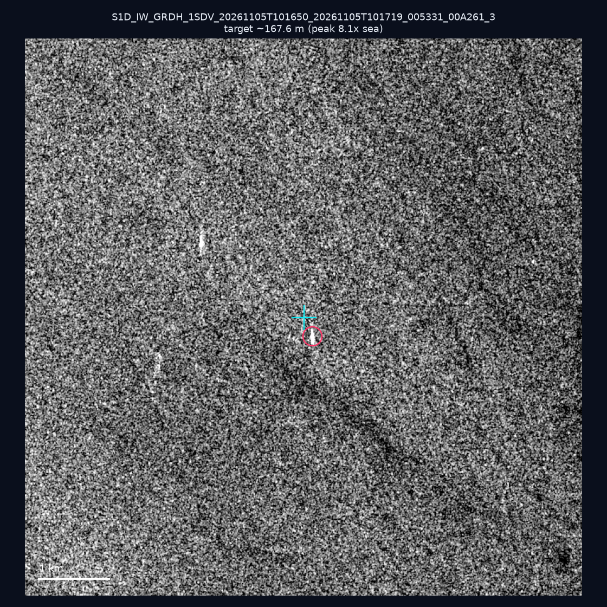
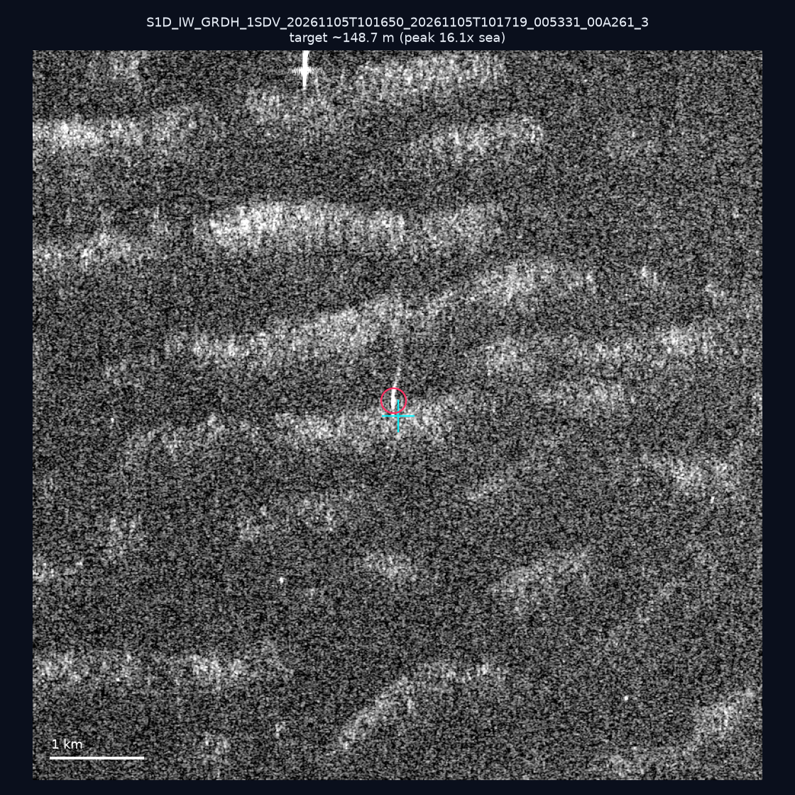
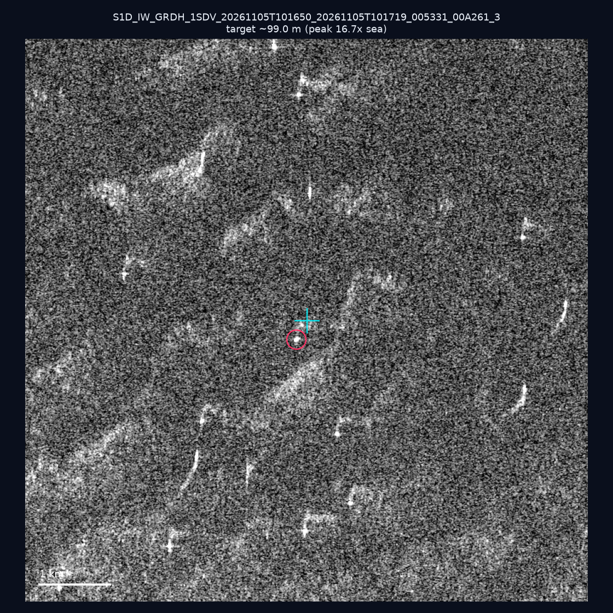
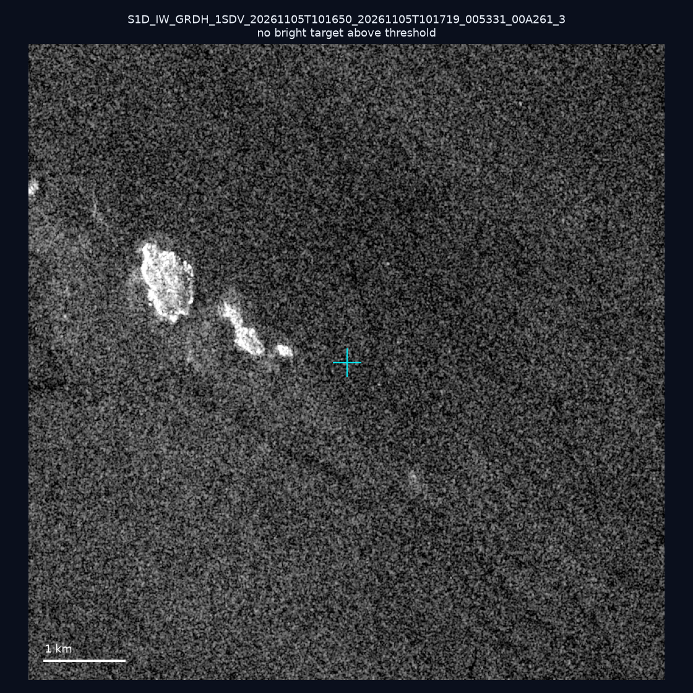
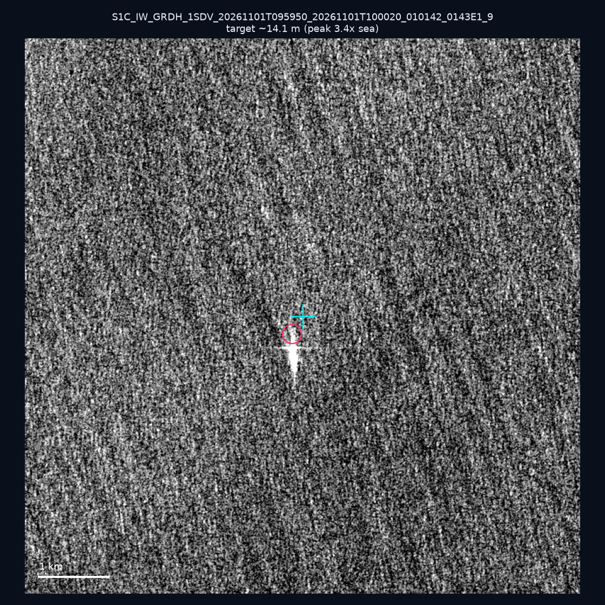
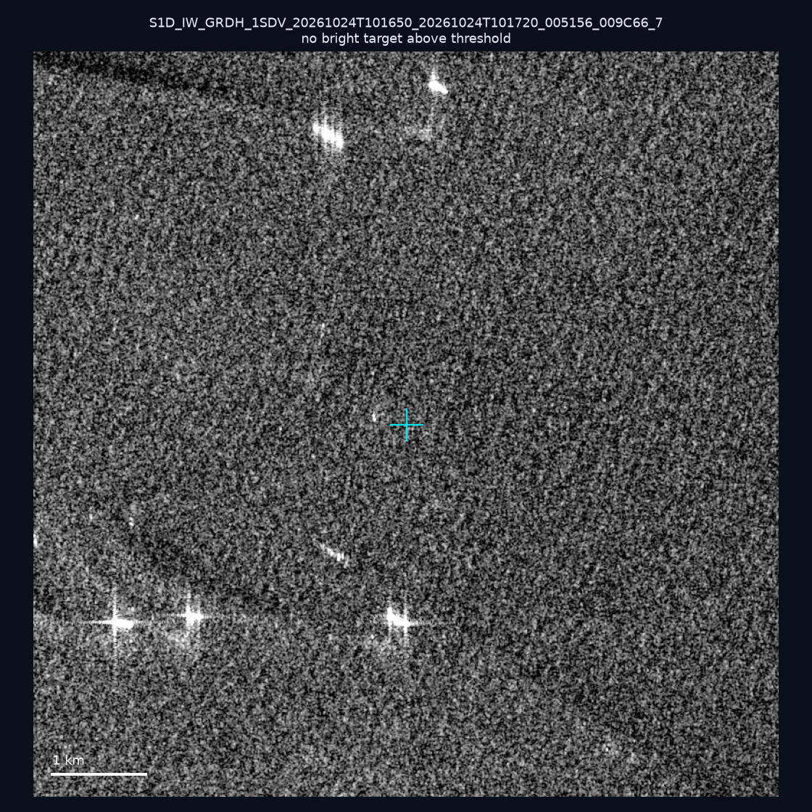

# 暗船 SAR 取證報告 — 2026-11-17

## 1. 總覽

- 執行時間：2026-11-17（GitHub Actions cron 自動執行）
- 線上比對摘要：暗偵測 22995 筆、殘餘暗船 12141 筆、假暗船剔除率 47.2%
- 本輪測試：10 筆
- 成功：10 筆
- 找到亮目標：4 筆
- 失敗：0 筆

## 2. 結果總表

| 日期 | 座標 | 海域 | 法域 | 成像時刻 | 判定 | 估計長度 | 峰值比 |
|------|------|------|------|----------|------|----------|--------|
| 2026-11-13 | 22.74, 122.5 | east | eez | 09:59:50 | ⚪ 無目標（雜訊或低RCS） | — | — |
| 2026-11-13 | 22.32, 120.5 | southwest | internal_waters | 09:59:50 | ⚪ 無目標（雜訊或低RCS） | — | — |
| 2026-11-13 | 22.66, 121.69 | east | territorial_sea | 09:59:50 | ⚪ 無目標（雜訊或低RCS） | — | — |
| 2026-11-09 | 21.91, 119.82 | southwest | eez | 21:52:08 | ⚪ 無目標（雜訊或低RCS） | — | — |
| 2026-11-05 | 23.27, 117.4 | southwest | eez | 10:16:50 | 🟡 弱目標 | ~167.6 m | 8.1× |
| 2026-11-05 | 23.08, 118.22 | southwest | eez | 10:16:50 | ✅ 確認實體目標 | ~148.7 m | 16.1× |
| 2026-11-05 | 23.18, 118.01 | southwest | eez | 10:16:50 | ✅ 確認實體目標 | ~99.0 m | 16.7× |
| 2026-11-05 | 23.29, 117.32 | southwest | eez | 10:16:50 | ⚪ 無目標（雜訊或低RCS） | — | — |
| 2026-11-01 | 22.83, 121.64 | east | territorial_sea | 09:59:50 | 🟡 弱目標 | ~14.1 m | 3.4× |
| 2026-10-24 | 22.88, 117.17 | southwest | eez | 10:16:50 | ⚪ 無目標（雜訊或低RCS） | — | — |

## 3. 逐目標段落

### 2026-11-13 (22.74, 122.5)

⚪ 無目標（雜訊或低RCS）。

### 2026-11-13 (22.32, 120.5)

⚪ 無目標（雜訊或低RCS）。

### 2026-11-13 (22.66, 121.69)

⚪ 無目標（雜訊或低RCS）。

### 2026-11-09 (21.91, 119.82)

⚪ 無目標（雜訊或低RCS）。

### 2026-11-05 (23.27, 117.4)

🟡 弱目標，估計長度 ~167.6 m，峰值 8.1× 海面背景（55 px）。

### 2026-11-05 (23.08, 118.22)

✅ 確認實體目標，估計長度 ~148.7 m，峰值 16.1× 海面背景（46 px）。

### 2026-11-05 (23.18, 118.01)

✅ 確認實體目標，估計長度 ~99.0 m，峰值 16.7× 海面背景（32 px）。

### 2026-11-05 (23.29, 117.32)

⚪ 無目標（雜訊或低RCS）。

### 2026-11-01 (22.83, 121.64)

🟡 弱目標，估計長度 ~14.1 m，峰值 3.4× 海面背景（1 px）。

### 2026-10-24 (22.88, 117.17)

⚪ 無目標（雜訊或低RCS）。

## 4. 後續建議

- 值得人工深查（確認實體目標且長度 ≥ 50m）：
  - 2026-11-05 (23.08, 118.22) ~148.7 m — 建議比對周邊 AIS 船長
  - 2026-11-05 (23.18, 118.01) ~99.0 m — 建議比對周邊 AIS 船長
- 累積統計：全歷史 853 筆（有效 851 筆），確認實體目標 104 筆（12.2%）

> 所有結果是研判線索，不是法律認定；無目標 ≠ 誤報（小型木殼漁船 RCS 低，SAR 可能拍不到）。
