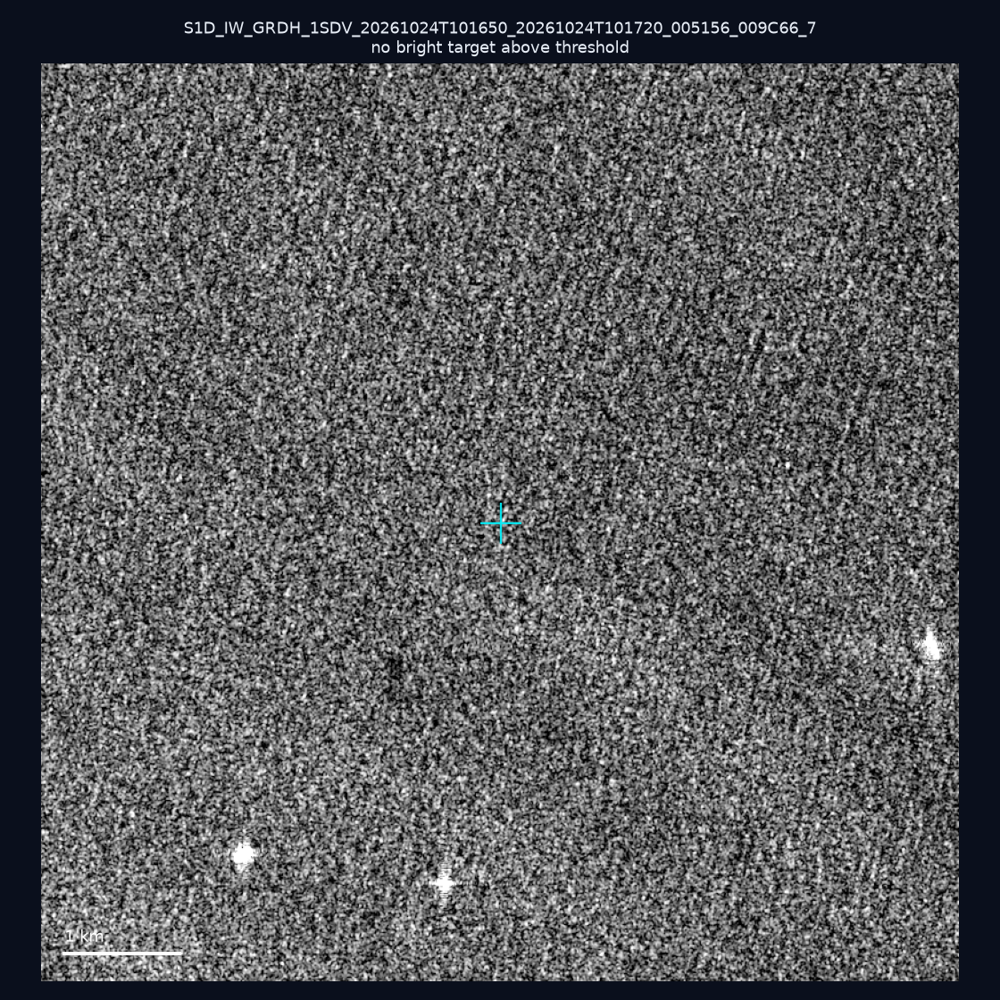
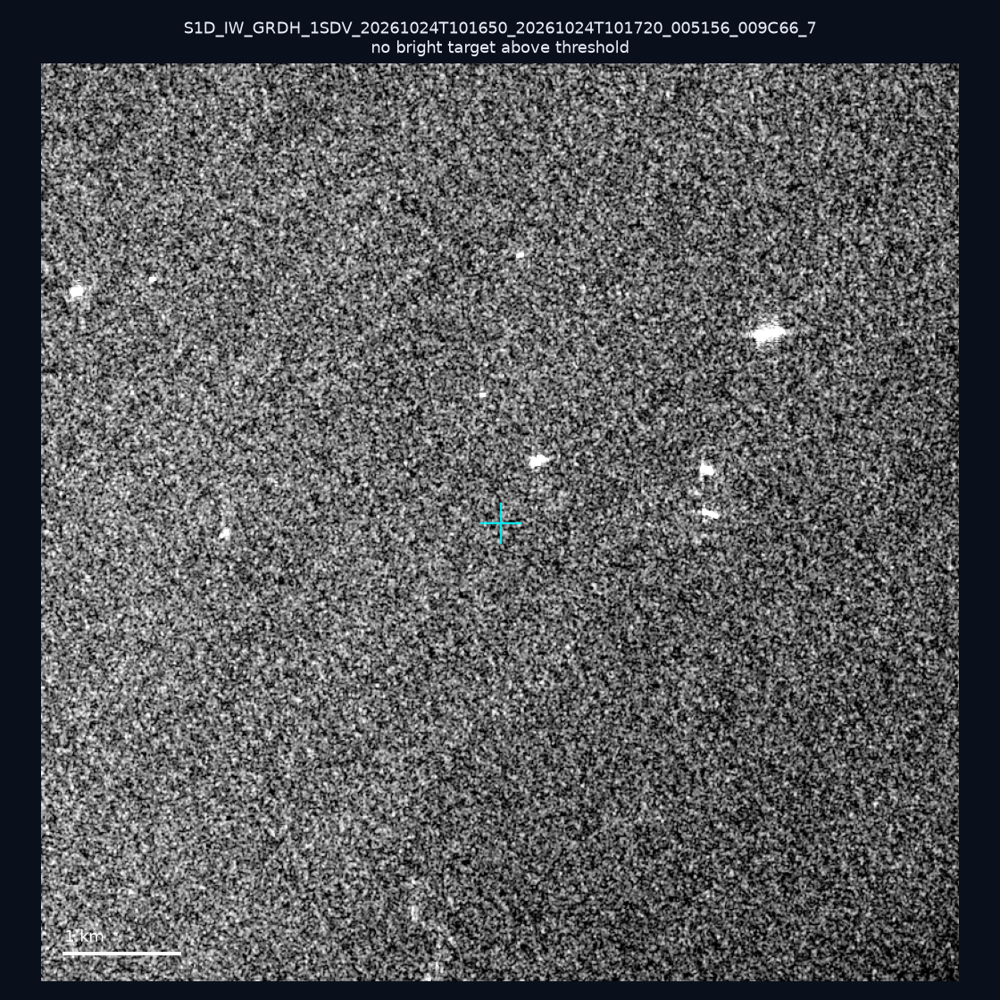
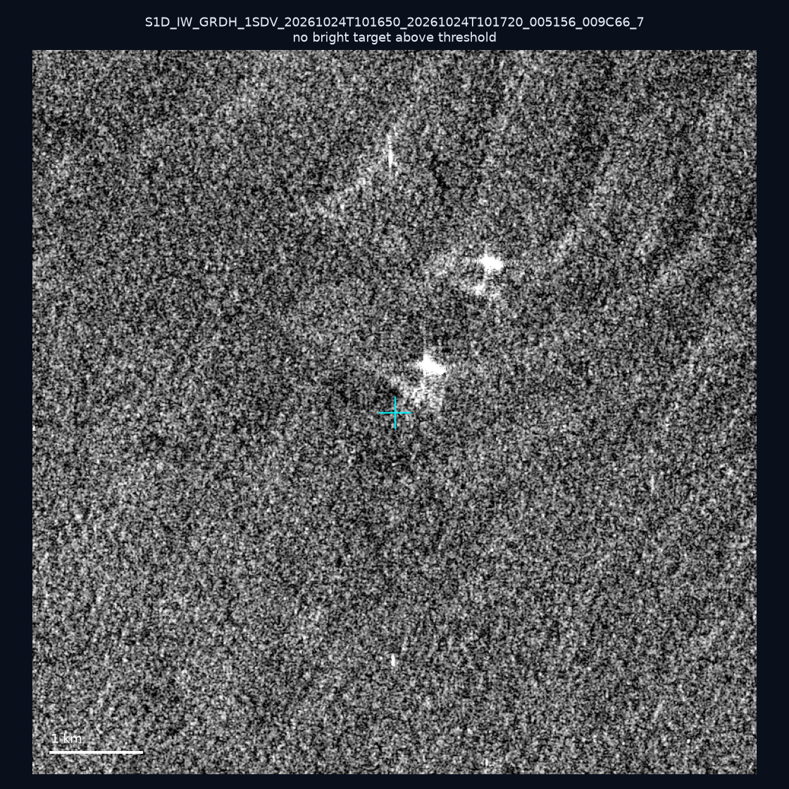
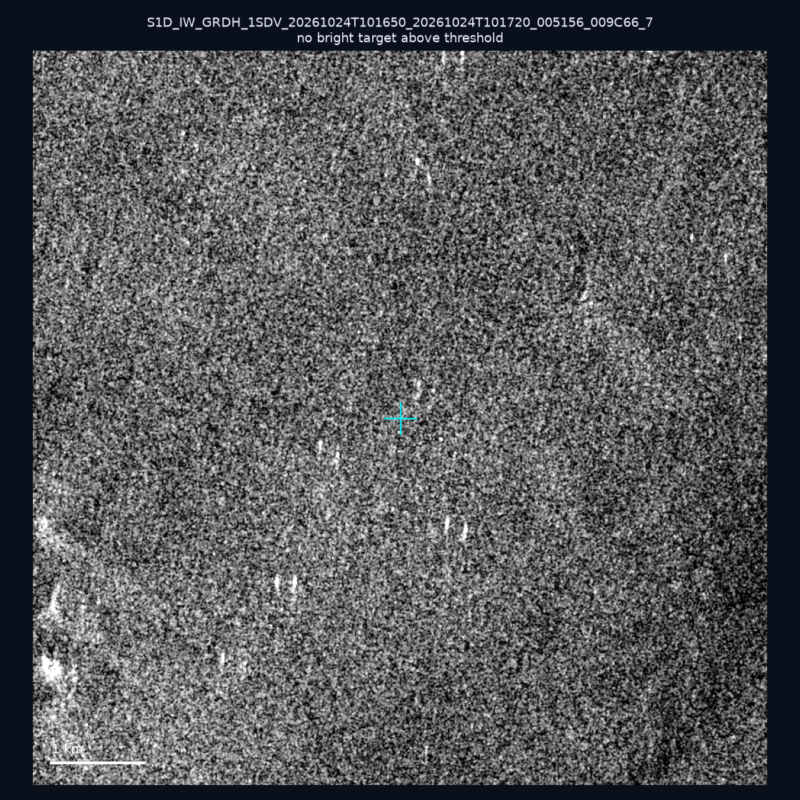
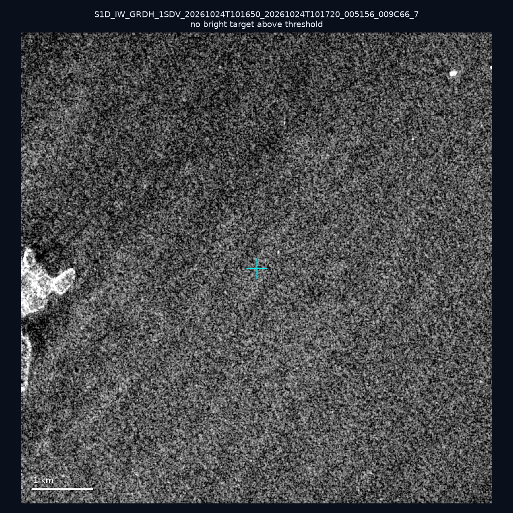
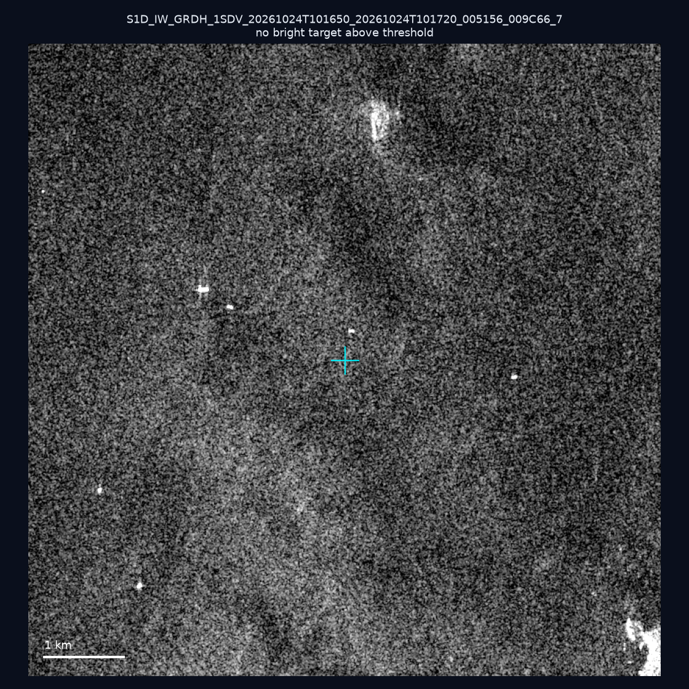
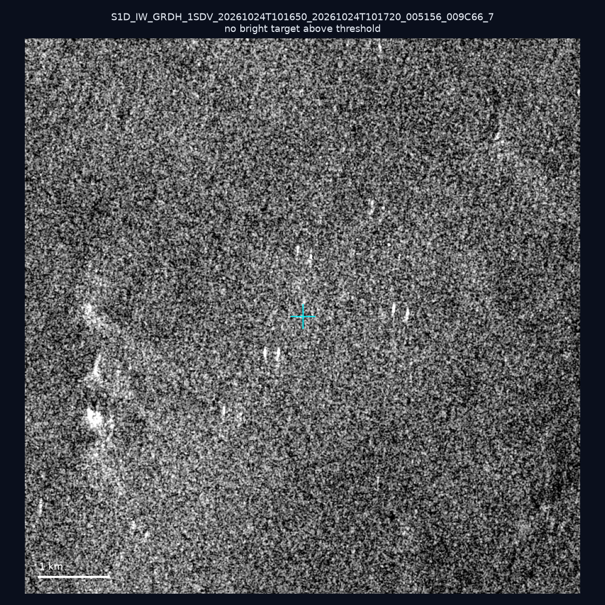
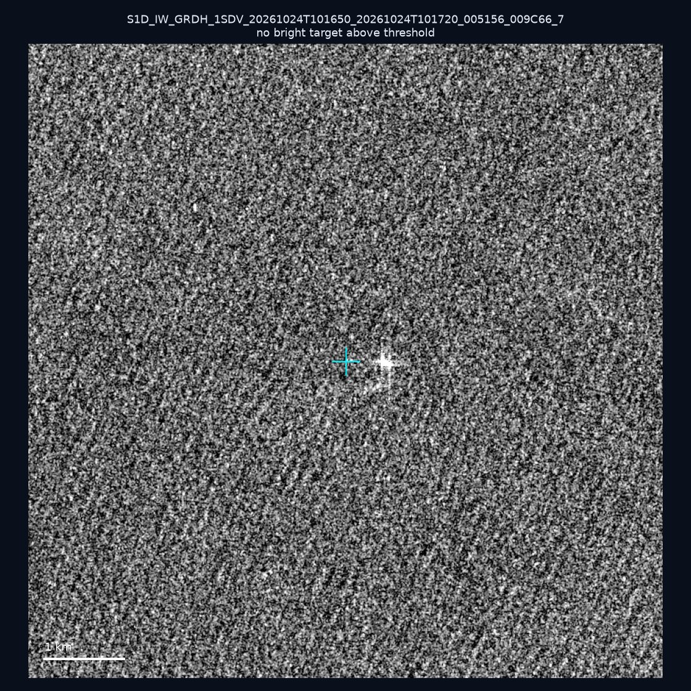
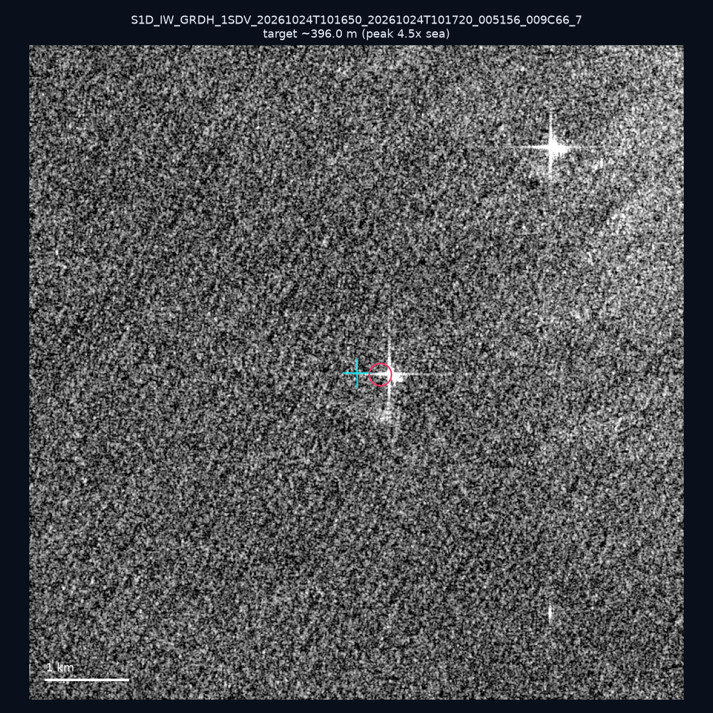
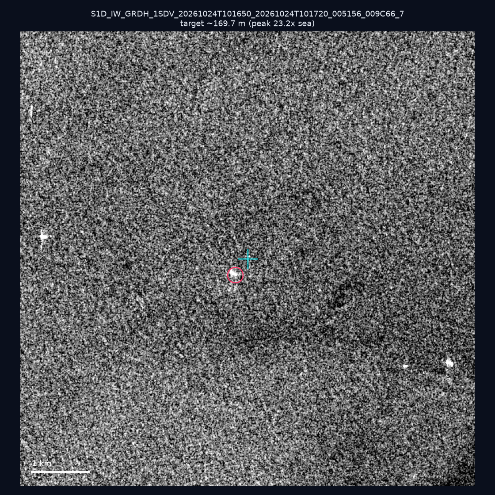

# 暗船 SAR 取證報告 — 2026-11-18

## 1. 總覽

- 執行時間：2026-11-18（GitHub Actions cron 自動執行）
- 線上比對摘要：暗偵測 29506 筆、殘餘暗船 14003 筆、假暗船剔除率 52.5%
- 本輪測試：10 筆
- 成功：10 筆
- 找到亮目標：2 筆
- 失敗：0 筆

## 2. 結果總表

| 日期 | 座標 | 海域 | 法域 | 成像時刻 | 判定 | 估計長度 | 峰值比 |
|------|------|------|------|----------|------|----------|--------|
| 2026-10-24 | 23.1, 117.13 | southwest | eez | 10:16:50 | ⚪ 無目標（雜訊或低RCS） | — | — |
| 2026-10-24 | 23.45, 117.25 | southwest | eez | 10:16:50 | ⚪ 無目標（雜訊或低RCS） | — | — |
| 2026-10-24 | 23.42, 117.83 | southwest | eez | 10:16:50 | ⚪ 無目標（雜訊或低RCS） | — | — |
| 2026-10-24 | 23.3, 117.16 | southwest | eez | 10:16:50 | ⚪ 無目標（雜訊或低RCS） | — | — |
| 2026-10-24 | 23.45, 117.18 | southwest | eez | 10:16:50 | ⚪ 無目標（雜訊或低RCS） | — | — |
| 2026-10-24 | 23.36, 117.07 | southwest | eez | 10:16:50 | ⚪ 無目標（雜訊或低RCS） | — | — |
| 2026-10-24 | 23.31, 117.15 | southwest | eez | 10:16:50 | ⚪ 無目標（雜訊或低RCS） | — | — |
| 2026-10-24 | 23.08, 117.23 | southwest | eez | 10:16:50 | ⚪ 無目標（雜訊或低RCS） | — | — |
| 2026-10-24 | 23.5, 118.13 | southwest | eez | 10:16:50 | 🟡 弱目標 | ~396.0 m | 4.5× |
| 2026-10-24 | 23.5, 117.38 | southwest | eez | 10:16:50 | ✅ 確認實體目標 | ~169.7 m | 23.2× |

## 3. 逐目標段落

### 2026-10-24 (23.1, 117.13)

⚪ 無目標（雜訊或低RCS）。

### 2026-10-24 (23.45, 117.25)

⚪ 無目標（雜訊或低RCS）。

### 2026-10-24 (23.42, 117.83)

⚪ 無目標（雜訊或低RCS）。

### 2026-10-24 (23.3, 117.16)

⚪ 無目標（雜訊或低RCS）。

### 2026-10-24 (23.45, 117.18)

⚪ 無目標（雜訊或低RCS）。

### 2026-10-24 (23.36, 117.07)

⚪ 無目標（雜訊或低RCS）。

### 2026-10-24 (23.31, 117.15)

⚪ 無目標（雜訊或低RCS）。

### 2026-10-24 (23.08, 117.23)

⚪ 無目標（雜訊或低RCS）。

### 2026-10-24 (23.5, 118.13)

🟡 弱目標，估計長度 ~396.0 m，峰值 4.5× 海面背景（210 px）。

### 2026-10-24 (23.5, 117.38)

✅ 確認實體目標，估計長度 ~169.7 m，峰值 23.2× 海面背景（67 px）。

## 4. 後續建議

- 值得人工深查（確認實體目標且長度 ≥ 50m）：
  - 2026-10-24 (23.5, 117.38) ~169.7 m — 建議比對周邊 AIS 船長
- 累積統計：全歷史 863 筆（有效 861 筆），確認實體目標 105 筆（12.2%）

> 所有結果是研判線索，不是法律認定；無目標 ≠ 誤報（小型木殼漁船 RCS 低，SAR 可能拍不到）。
