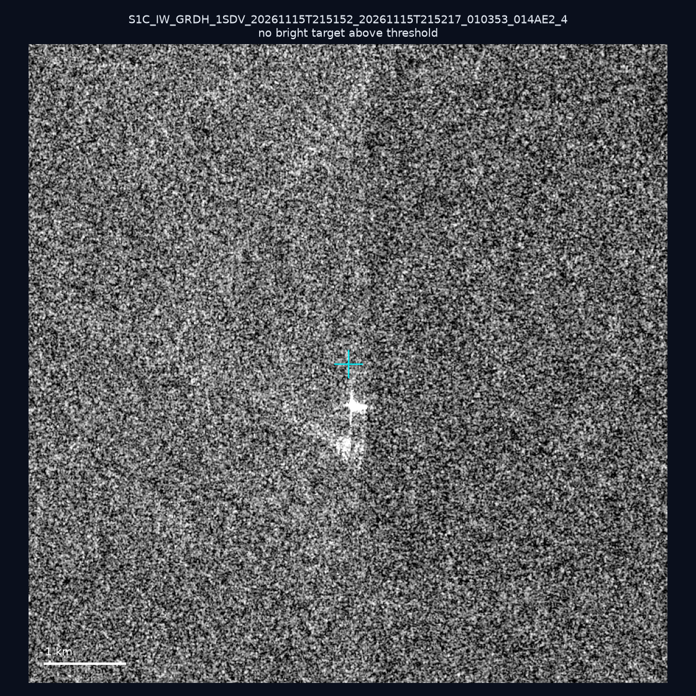
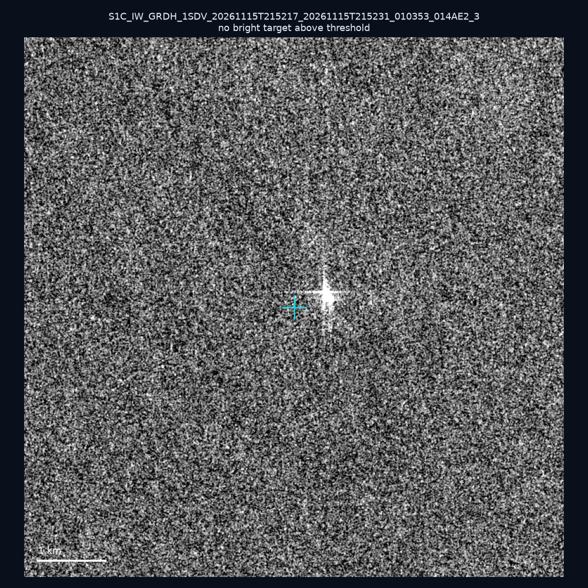
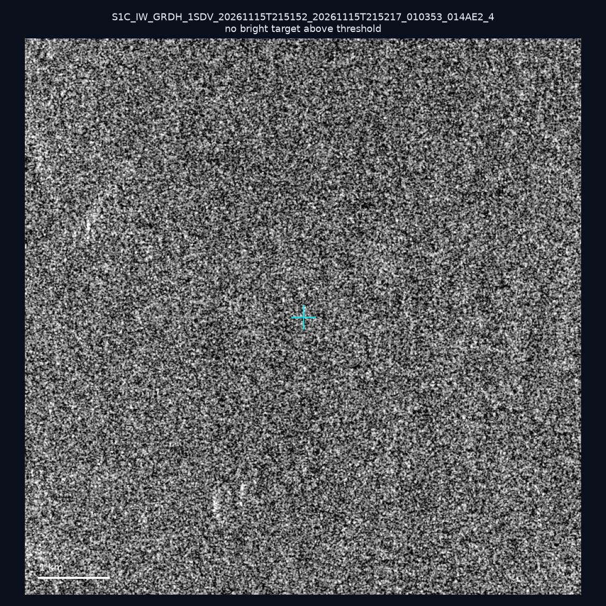
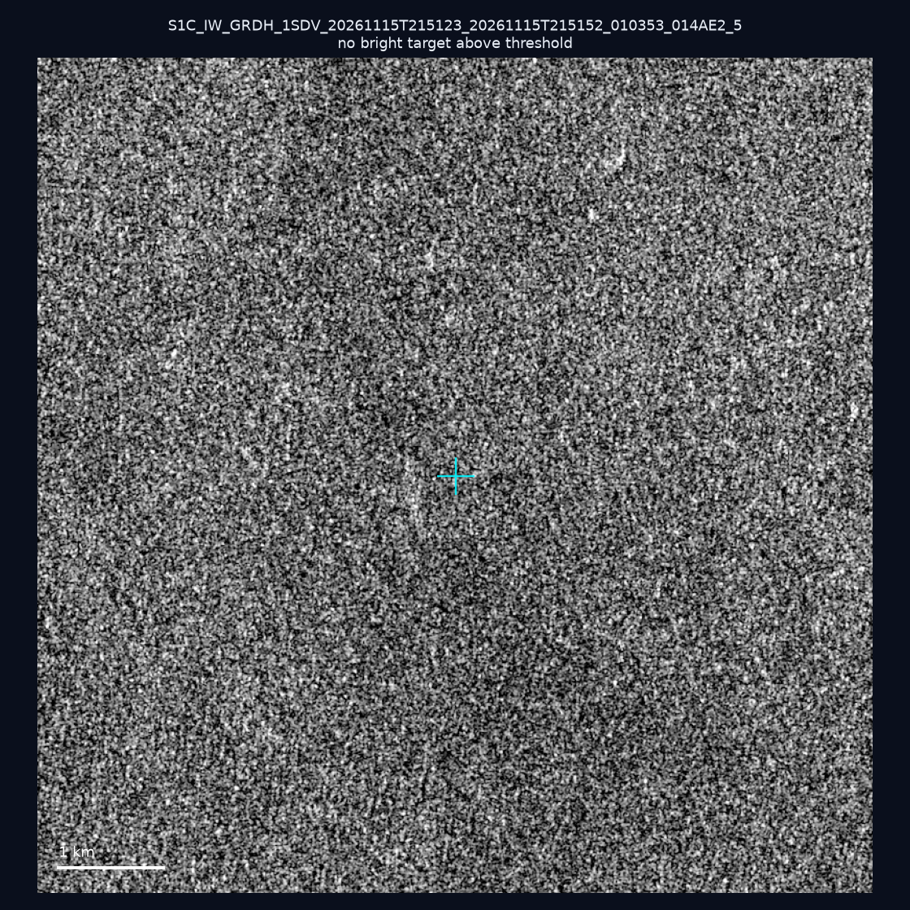
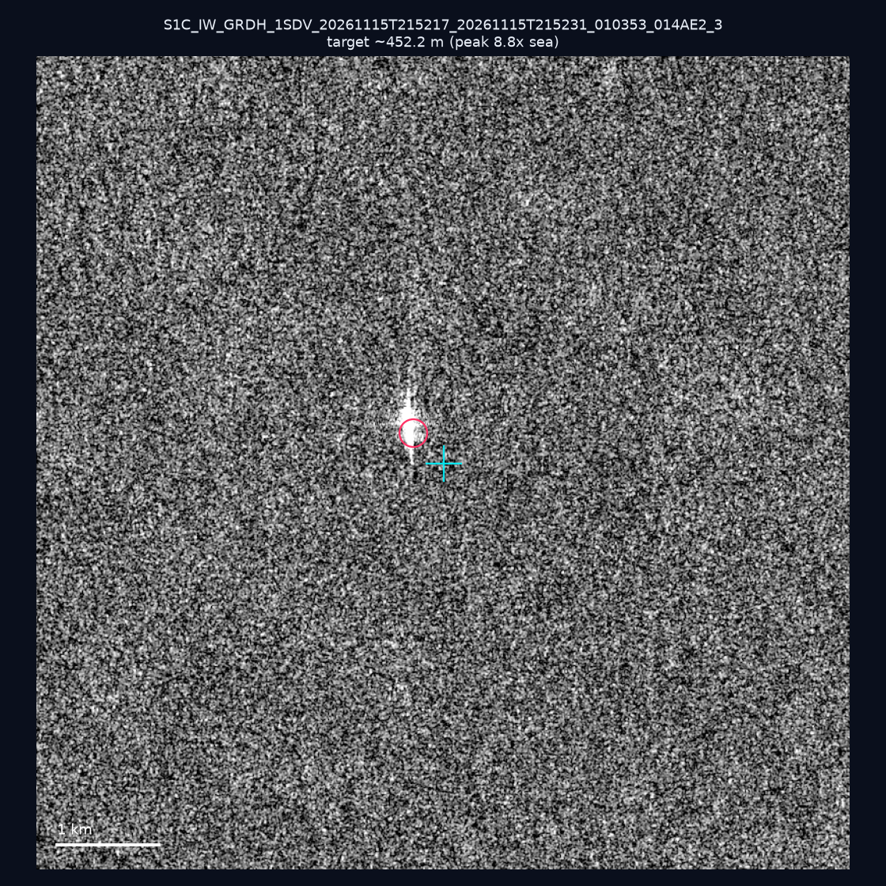
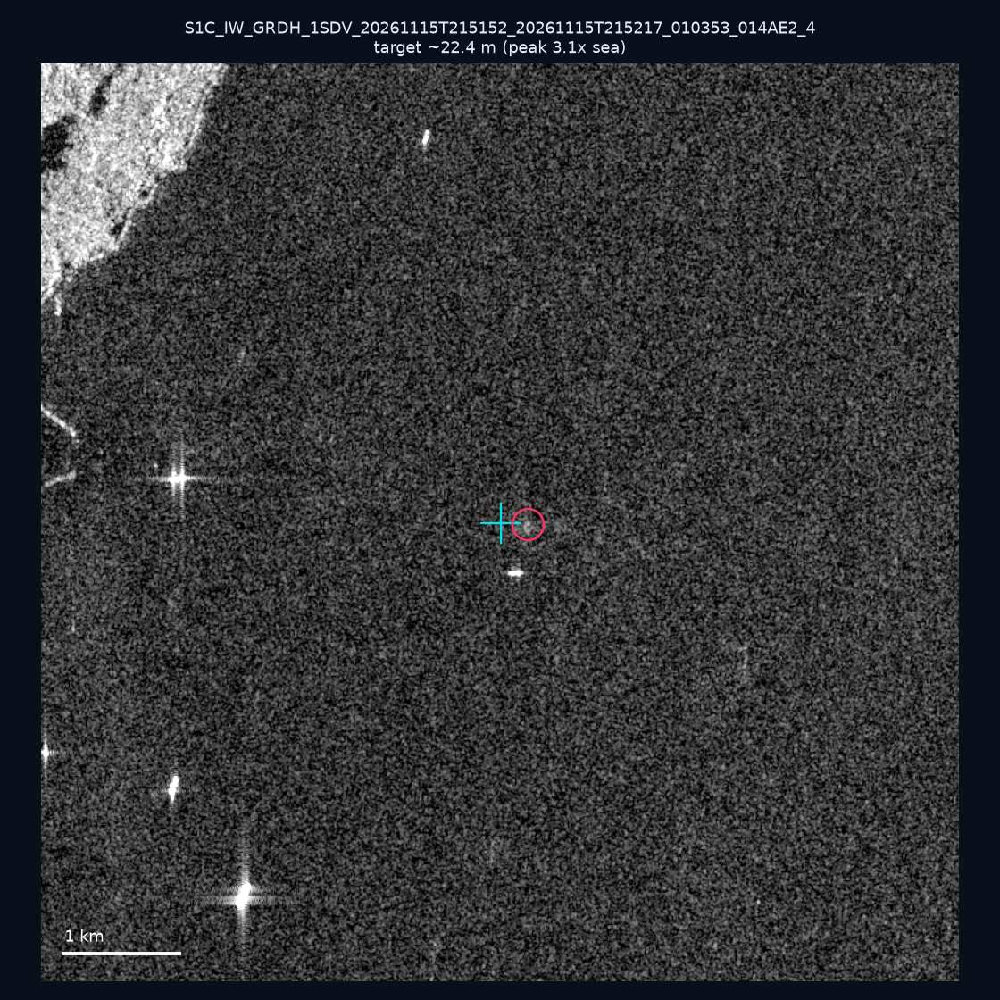
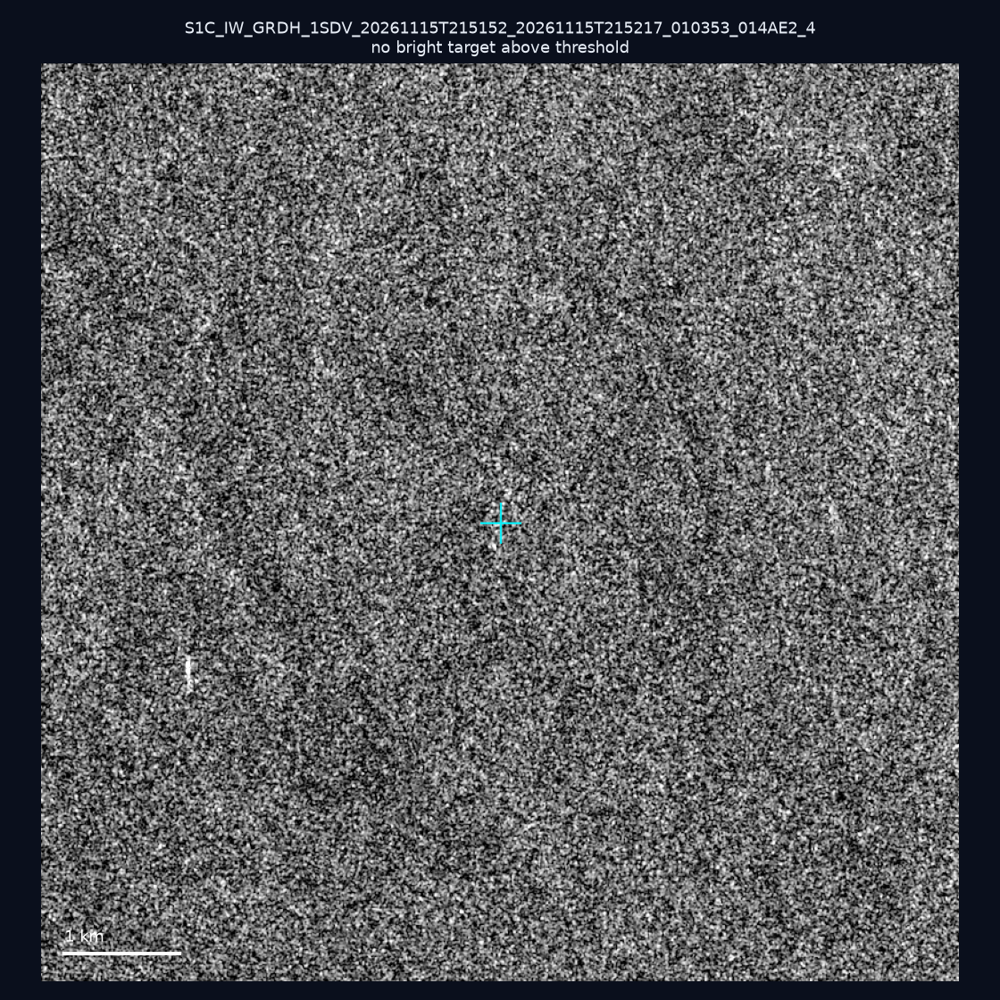
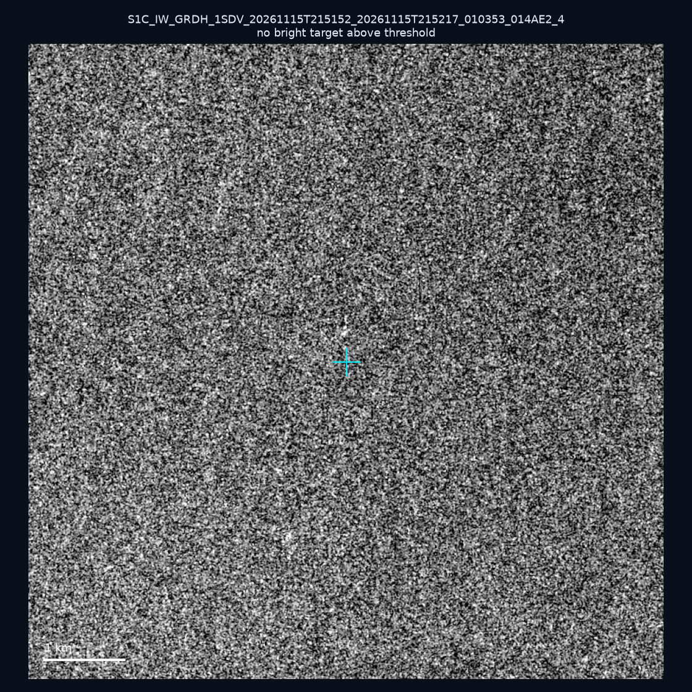
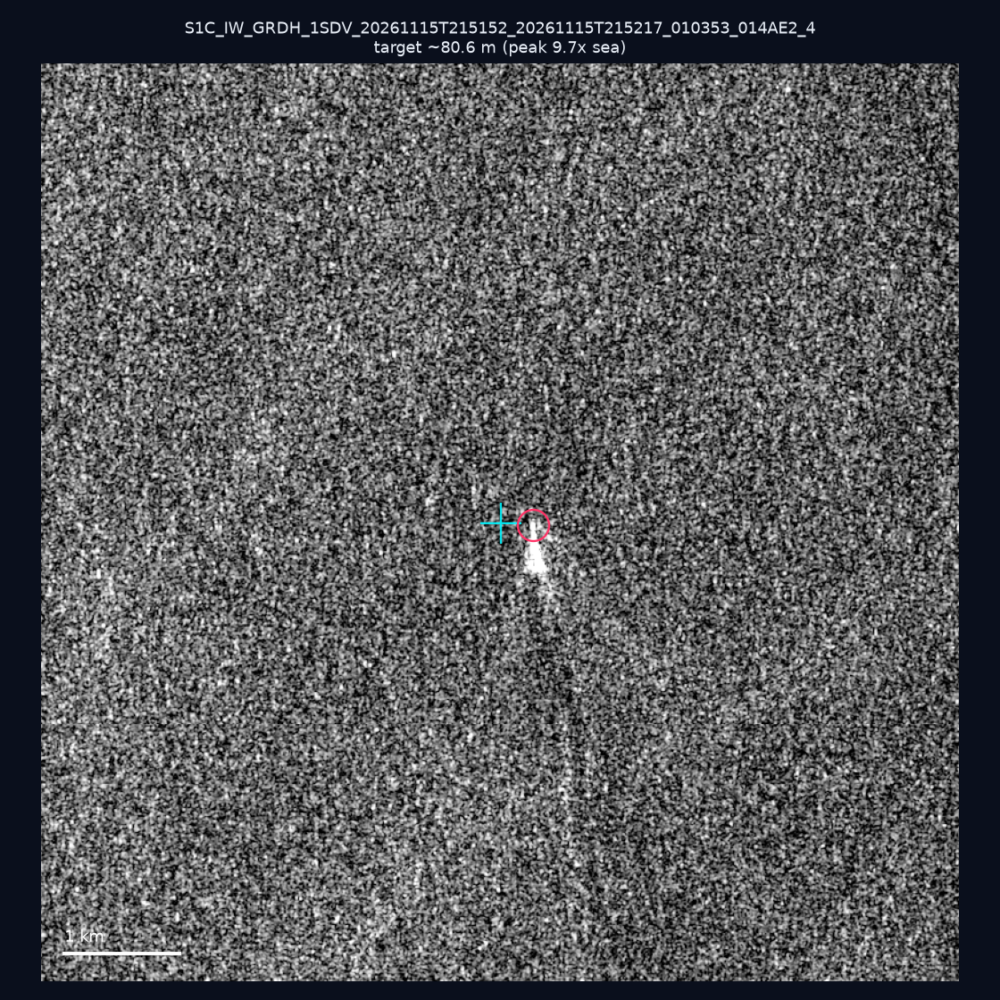
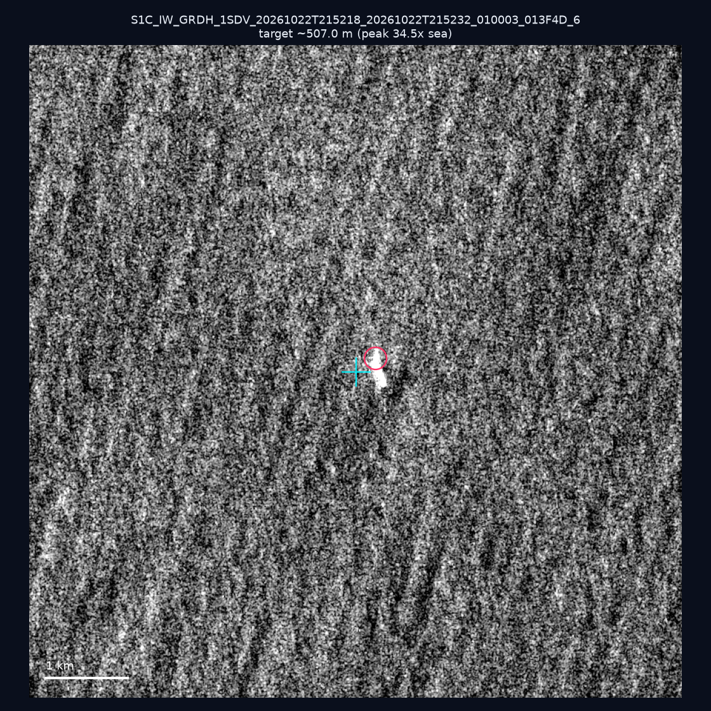

# 暗船 SAR 取證報告 — 2026-11-19

## 1. 總覽

- 執行時間：2026-11-19（GitHub Actions cron 自動執行）
- 線上比對摘要：暗偵測 31010 筆、殘餘暗船 14559 筆、假暗船剔除率 53.1%
- 本輪測試：10 筆
- 成功：10 筆
- 找到亮目標：4 筆
- 失敗：0 筆

## 2. 結果總表

| 日期 | 座標 | 海域 | 法域 | 成像時刻 | 判定 | 估計長度 | 峰值比 |
|------|------|------|------|----------|------|----------|--------|
| 2026-11-15 | 22.52, 120.08 | southwest | territorial_sea | 21:51:52 | ⚪ 無目標（雜訊或低RCS） | — | — |
| 2026-11-15 | 22.22, 119.77 | southwest | eez | 21:52:17 | ⚪ 無目標（雜訊或低RCS） | — | — |
| 2026-11-15 | 23.22, 120.03 | southwest | internal_waters | 21:51:52 | ⚪ 無目標（雜訊或低RCS） | — | — |
| 2026-11-15 | 24.89, 121.98 | east | territorial_sea | 21:51:23 | ⚪ 無目標（雜訊或低RCS） | — | — |
| 2026-11-15 | 22.43, 119.36 | southwest | eez | 21:52:17 | 🟡 弱目標 | ~452.2 m | 8.8× |
| 2026-11-15 | 22.62, 120.22 | southwest | internal_waters | 21:51:52 | 🟡 弱目標 | ~22.4 m | 3.1× |
| 2026-11-15 | 22.96, 119.64 | southwest | territorial_sea | 21:51:52 | ⚪ 無目標（雜訊或低RCS） | — | — |
| 2026-11-15 | 22.82, 120.05 | southwest | internal_waters | 21:51:52 | ⚪ 無目標（雜訊或低RCS） | — | — |
| 2026-11-15 | 22.63, 121.72 | east | territorial_sea | 21:51:52 | 🟡 弱目標 | ~80.6 m | 9.7× |
| 2026-10-22 | 21.79, 119.45 | southwest | eez | 21:52:18 | ✅ 確認實體目標 | ~507.0 m | 34.5× |

## 3. 逐目標段落

### 2026-11-15 (22.52, 120.08)

⚪ 無目標（雜訊或低RCS）。

### 2026-11-15 (22.22, 119.77)

⚪ 無目標（雜訊或低RCS）。

### 2026-11-15 (23.22, 120.03)

⚪ 無目標（雜訊或低RCS）。

### 2026-11-15 (24.89, 121.98)

⚪ 無目標（雜訊或低RCS）。

### 2026-11-15 (22.43, 119.36)

🟡 弱目標，估計長度 ~452.2 m，峰值 8.8× 海面背景（285 px）。

### 2026-11-15 (22.62, 120.22)

🟡 弱目標，估計長度 ~22.4 m，峰值 3.1× 海面背景（2 px）。

### 2026-11-15 (22.96, 119.64)

⚪ 無目標（雜訊或低RCS）。

### 2026-11-15 (22.82, 120.05)

⚪ 無目標（雜訊或低RCS）。

### 2026-11-15 (22.63, 121.72)

🟡 弱目標，估計長度 ~80.6 m，峰值 9.7× 海面背景（21 px）。

### 2026-10-22 (21.79, 119.45)

✅ 確認實體目標，估計長度 ~507.0 m，峰值 34.5× 海面背景（326 px）。

## 4. 後續建議

- 值得人工深查（確認實體目標且長度 ≥ 50m）：
  - 2026-10-22 (21.79, 119.45) ~507.0 m — 建議比對周邊 AIS 船長
- 累積統計：全歷史 873 筆（有效 871 筆），確認實體目標 106 筆（12.2%）

> 所有結果是研判線索，不是法律認定；無目標 ≠ 誤報（小型木殼漁船 RCS 低，SAR 可能拍不到）。
