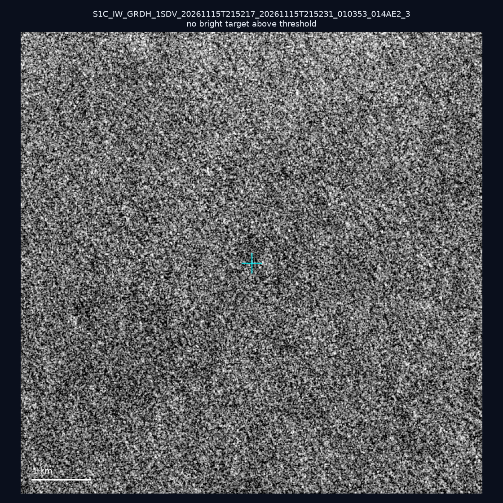
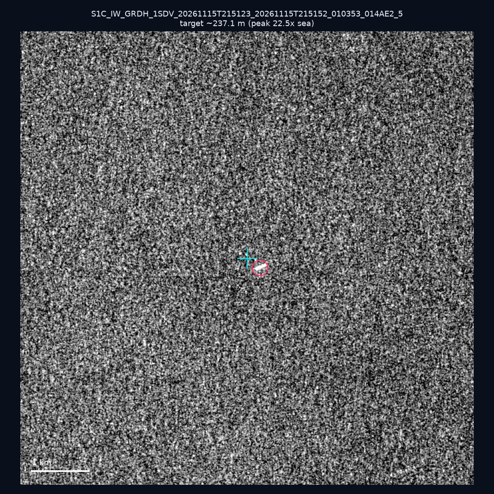
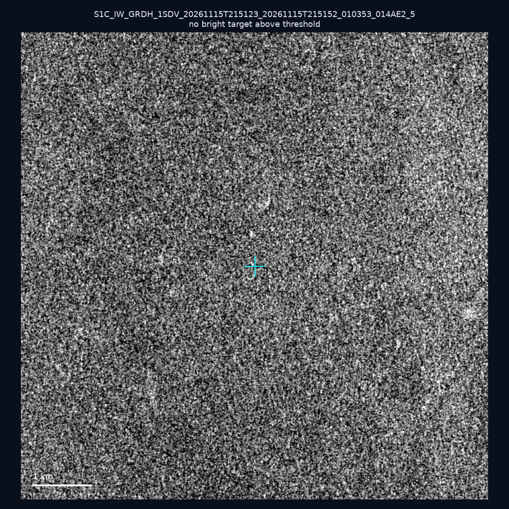
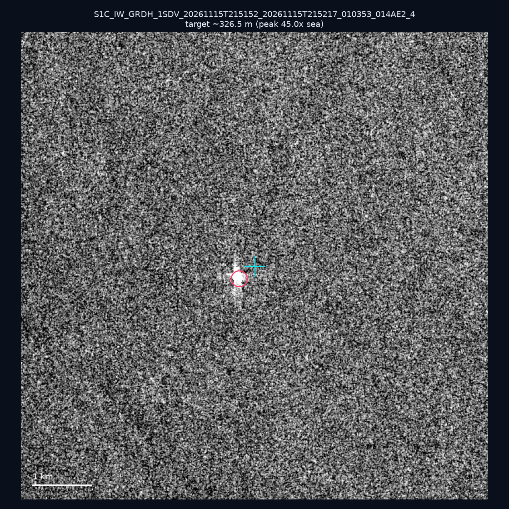
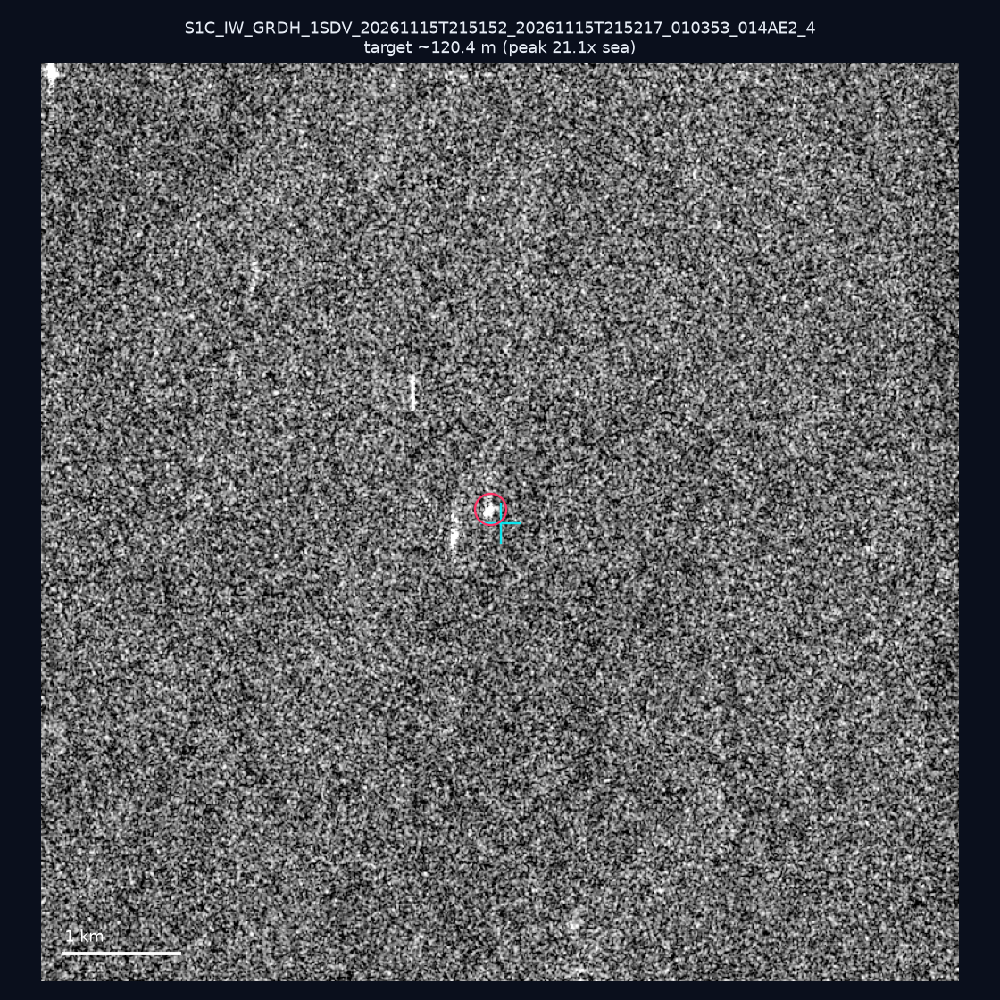
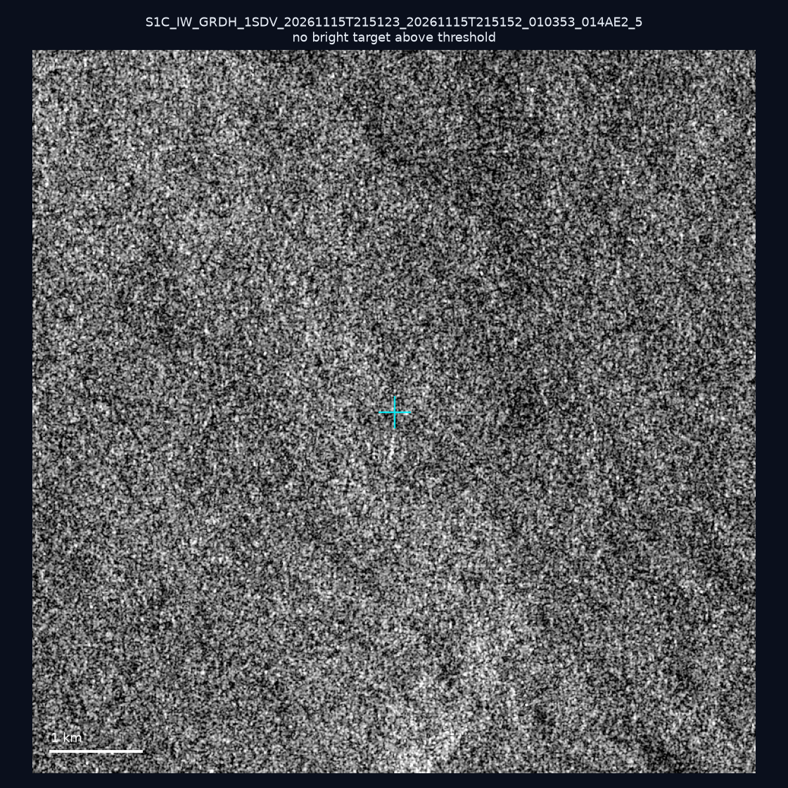
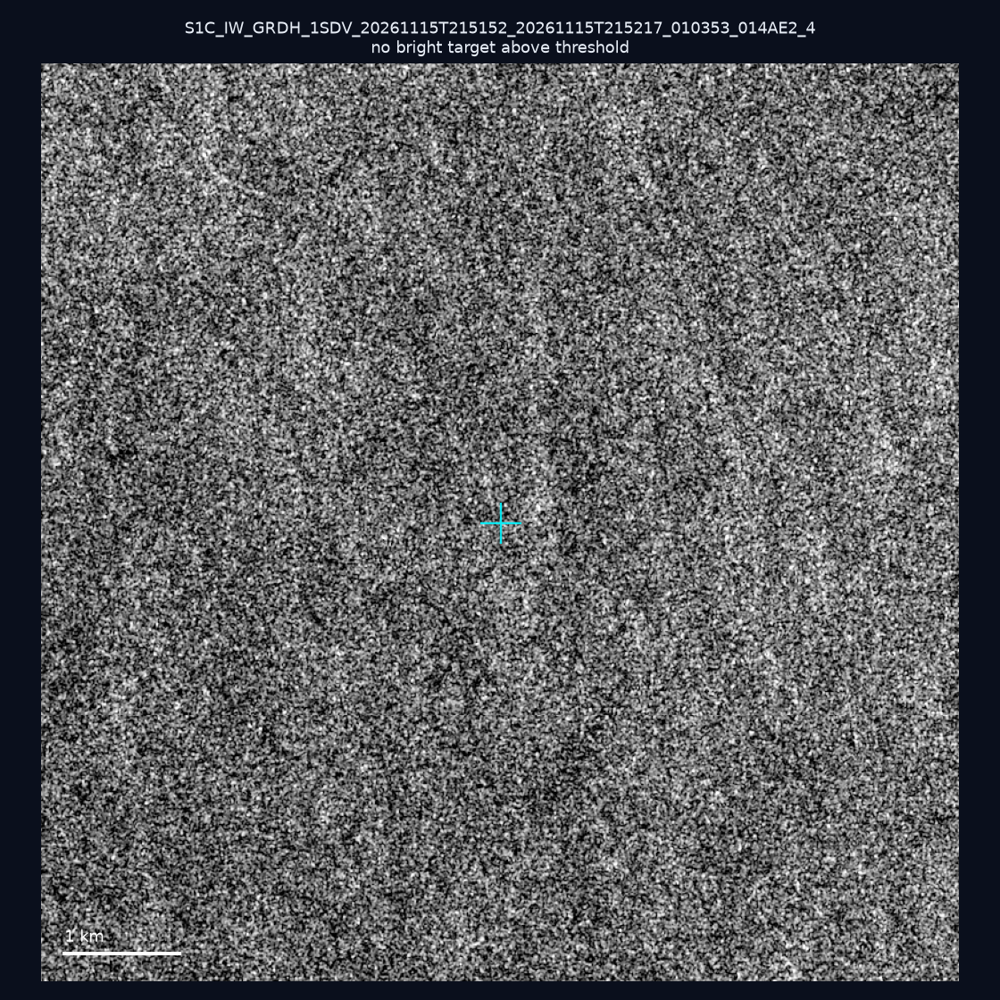
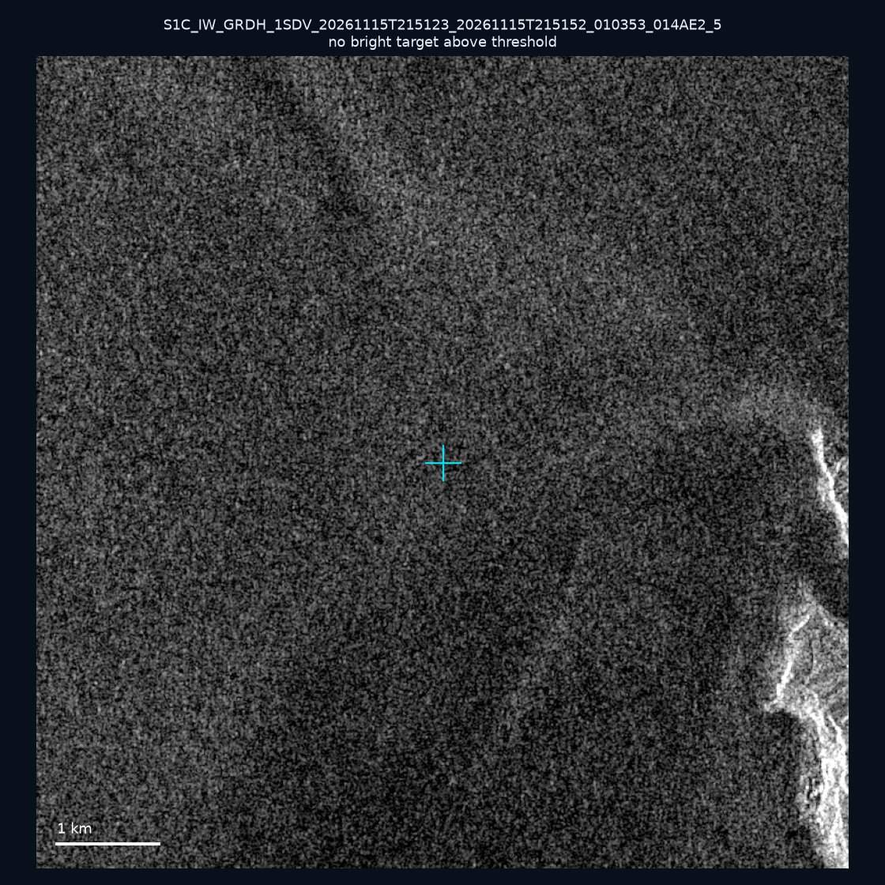
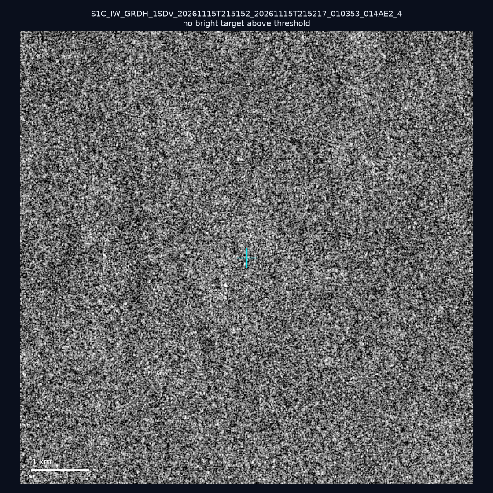
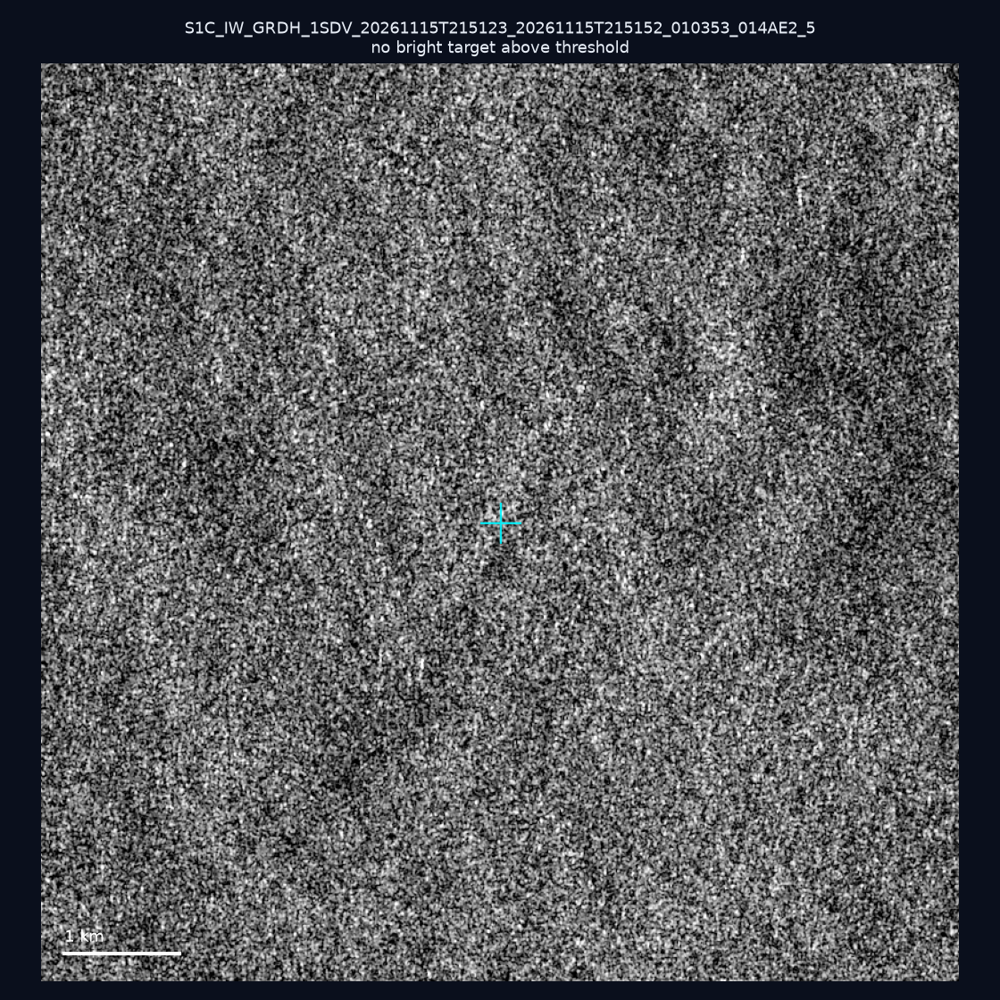

# 暗船 SAR 取證報告 — 2026-11-20

## 1. 總覽

- 執行時間：2026-11-20（GitHub Actions cron 自動執行）
- 線上比對摘要：暗偵測 31021 筆、殘餘暗船 14619 筆、假暗船剔除率 52.9%
- 本輪測試：10 筆
- 成功：10 筆
- 找到亮目標：3 筆
- 失敗：0 筆

## 2. 結果總表

| 日期 | 座標 | 海域 | 法域 | 成像時刻 | 判定 | 估計長度 | 峰值比 |
|------|------|------|------|----------|------|----------|--------|
| 2026-11-15 | 22.04, 120.5 | southwest | territorial_sea | 21:52:17 | ⚪ 無目標（雜訊或低RCS） | — | — |
| 2026-11-15 | 23.76, 121.87 | east | contiguous_zone | 21:51:23 | ✅ 確認實體目標 | ~237.1 m | 22.5× |
| 2026-11-15 | 24.91, 121.97 | east | internal_waters | 21:51:23 | ⚪ 無目標（雜訊或低RCS） | — | — |
| 2026-11-15 | 22.88, 119.54 | southwest | territorial_sea | 21:51:52 | ✅ 確認實體目標 | ~326.5 m | 45.0× |
| 2026-11-15 | 22.65, 120.14 | southwest | internal_waters | 21:51:52 | ✅ 確認實體目標 | ~120.4 m | 21.1× |
| 2026-11-15 | 25.22, 121.94 | east | internal_waters | 21:51:23 | ⚪ 無目標（雜訊或低RCS） | — | — |
| 2026-11-15 | 23.38, 119.68 | southwest | internal_waters | 21:51:52 | ⚪ 無目標（雜訊或低RCS） | — | — |
| 2026-11-15 | 25.12, 121.96 | east | internal_waters | 21:51:23 | ⚪ 無目標（雜訊或低RCS） | — | — |
| 2026-11-15 | 22.77, 119.53 | southwest | contiguous_zone | 21:51:52 | ⚪ 無目標（雜訊或低RCS） | — | — |
| 2026-11-15 | 25.46, 121.73 | east | territorial_sea | 21:51:23 | ⚪ 無目標（雜訊或低RCS） | — | — |

## 3. 逐目標段落

### 2026-11-15 (22.04, 120.5)

⚪ 無目標（雜訊或低RCS）。

### 2026-11-15 (23.76, 121.87)

✅ 確認實體目標，估計長度 ~237.1 m，峰值 22.5× 海面背景（92 px）。

### 2026-11-15 (24.91, 121.97)

⚪ 無目標（雜訊或低RCS）。

### 2026-11-15 (22.88, 119.54)

✅ 確認實體目標，估計長度 ~326.5 m，峰值 45.0× 海面背景（229 px）。

### 2026-11-15 (22.65, 120.14)

✅ 確認實體目標，估計長度 ~120.4 m，峰值 21.1× 海面背景（40 px）。

### 2026-11-15 (25.22, 121.94)

⚪ 無目標（雜訊或低RCS）。

### 2026-11-15 (23.38, 119.68)

⚪ 無目標（雜訊或低RCS）。

### 2026-11-15 (25.12, 121.96)

⚪ 無目標（雜訊或低RCS）。

### 2026-11-15 (22.77, 119.53)

⚪ 無目標（雜訊或低RCS）。

### 2026-11-15 (25.46, 121.73)

⚪ 無目標（雜訊或低RCS）。

## 4. 後續建議

- 值得人工深查（確認實體目標且長度 ≥ 50m）：
  - 2026-11-15 (23.76, 121.87) ~237.1 m — 建議比對周邊 AIS 船長
  - 2026-11-15 (22.88, 119.54) ~326.5 m — 建議比對周邊 AIS 船長
  - 2026-11-15 (22.65, 120.14) ~120.4 m — 建議比對周邊 AIS 船長
- 累積統計：全歷史 883 筆（有效 881 筆），確認實體目標 109 筆（12.4%）

> 所有結果是研判線索，不是法律認定；無目標 ≠ 誤報（小型木殼漁船 RCS 低，SAR 可能拍不到）。
