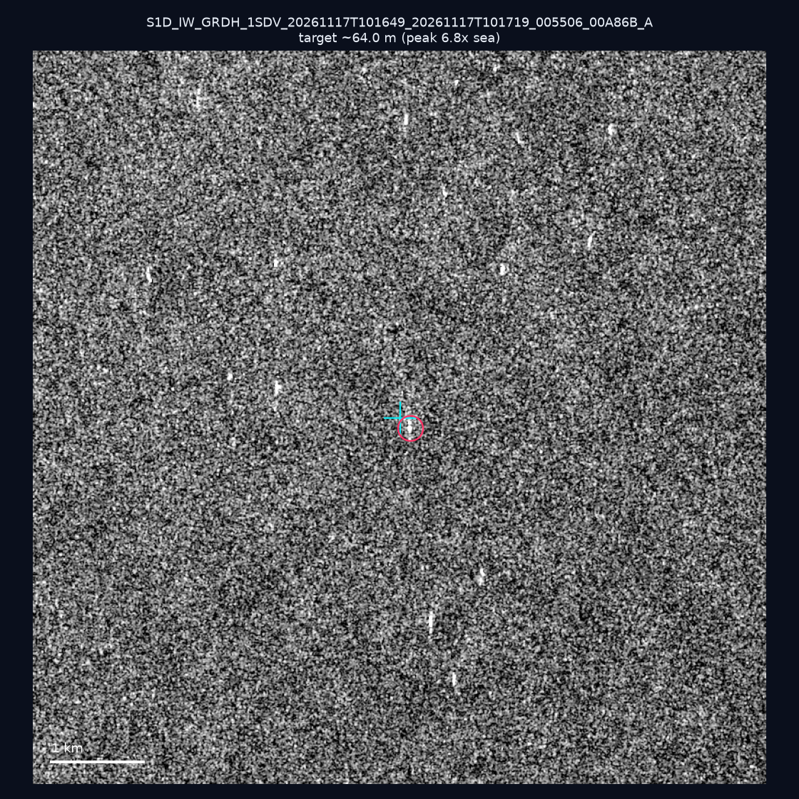
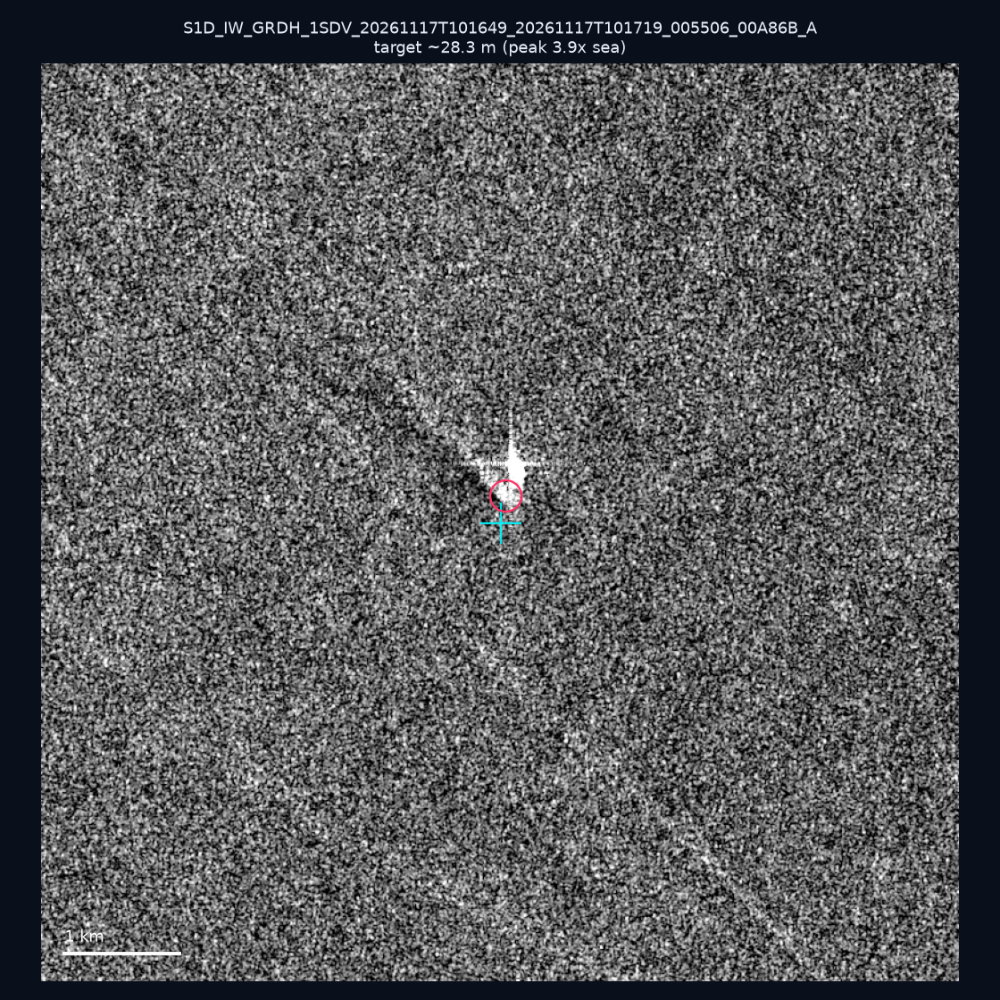
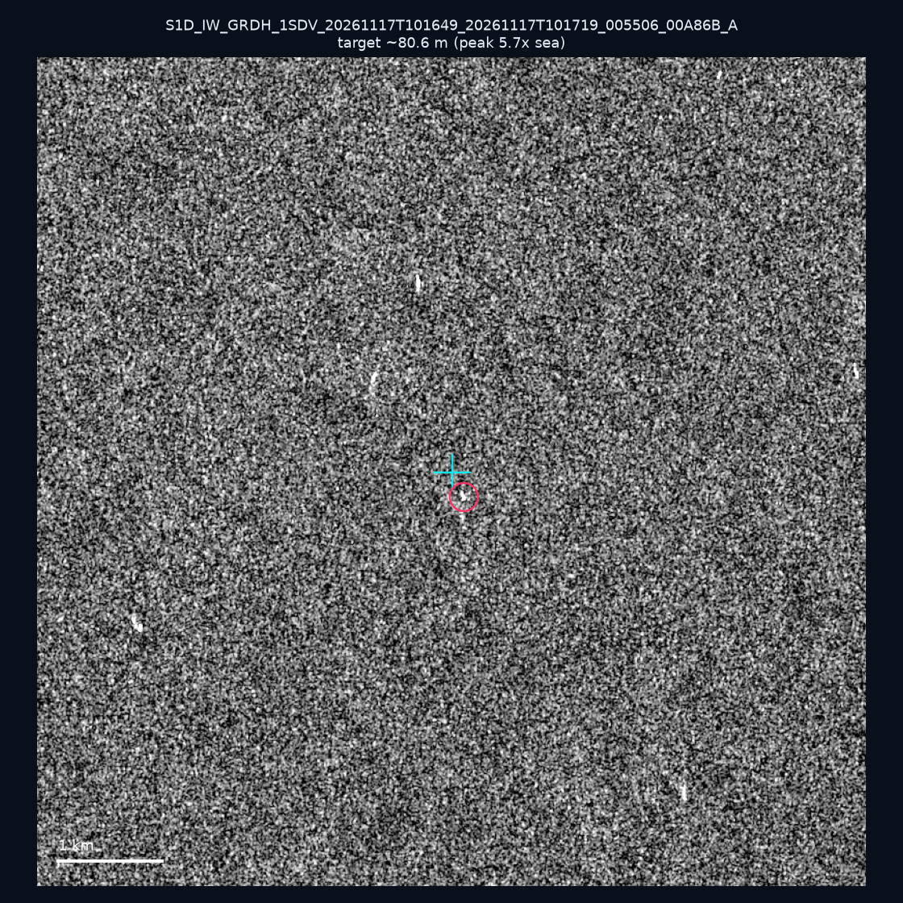
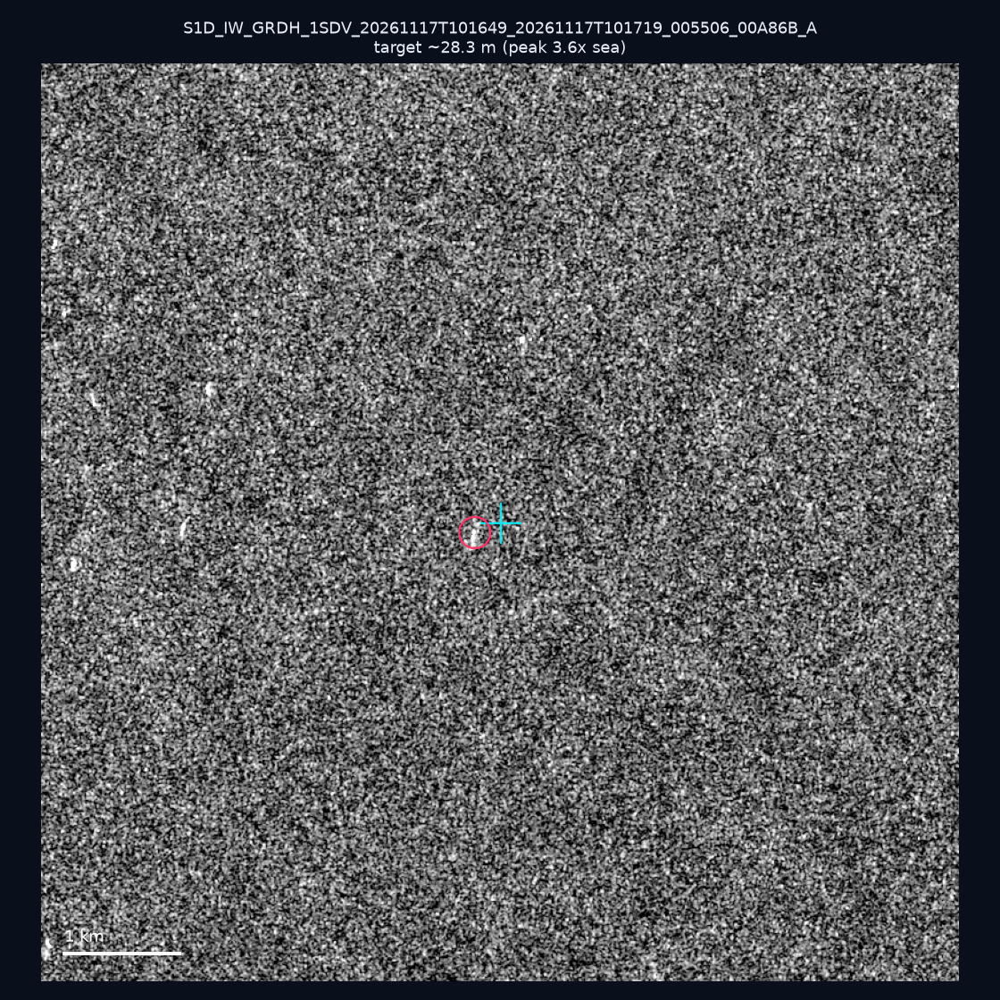
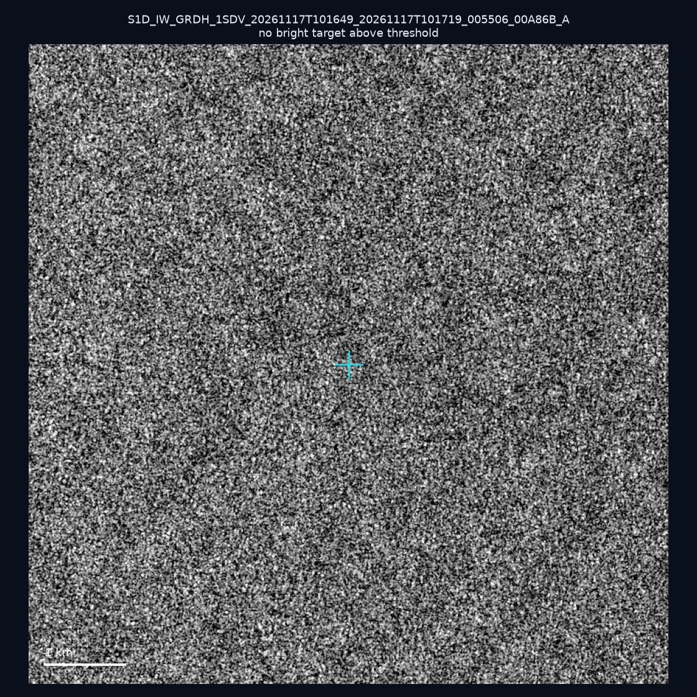
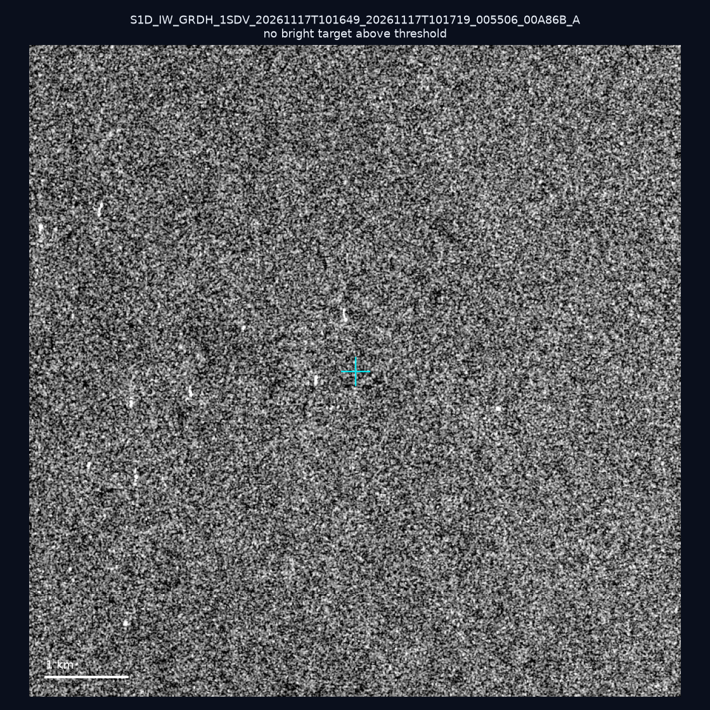
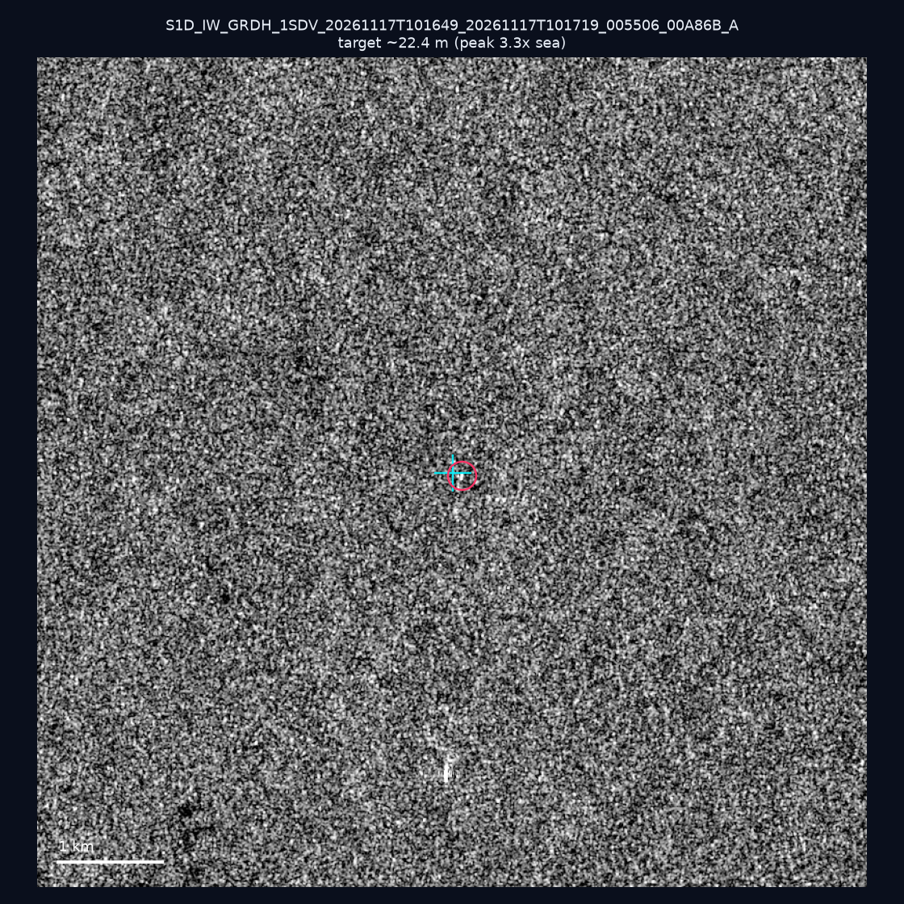
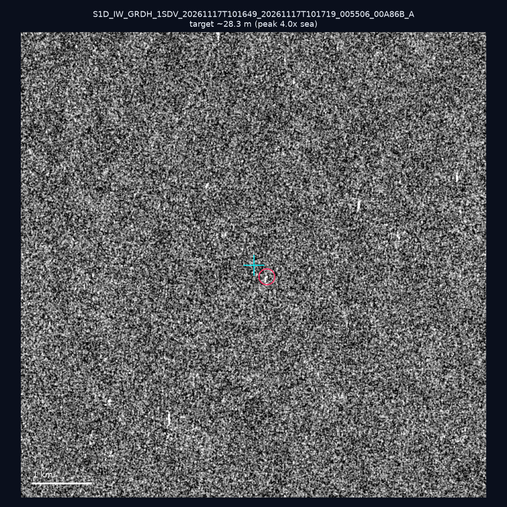
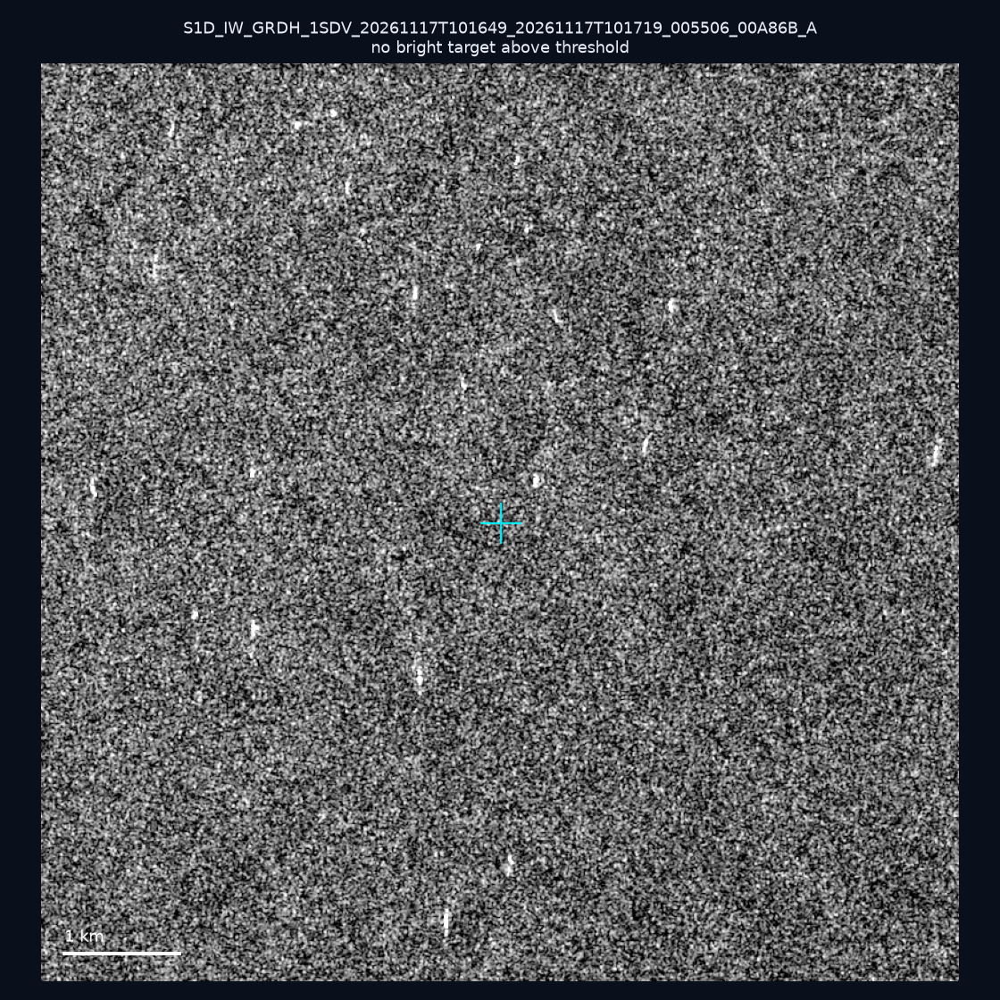
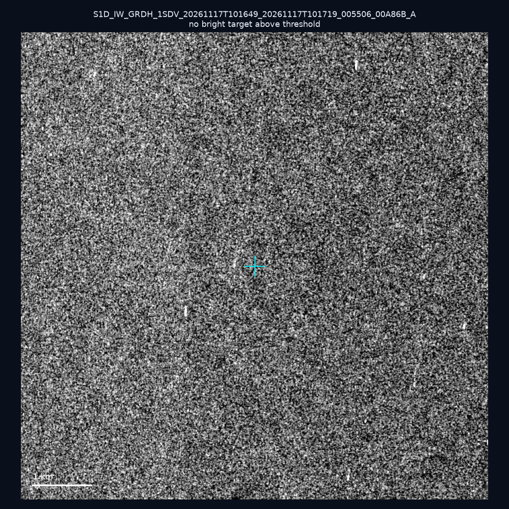

# 暗船 SAR 取證報告 — 2026-11-21

## 1. 總覽

- 執行時間：2026-11-21（GitHub Actions cron 自動執行）
- 線上比對摘要：暗偵測 32318 筆、殘餘暗船 15511 筆、假暗船剔除率 52.0%
- 本輪測試：10 筆
- 成功：10 筆
- 找到亮目標：6 筆
- 失敗：0 筆

## 2. 結果總表

| 日期 | 座標 | 海域 | 法域 | 成像時刻 | 判定 | 估計長度 | 峰值比 |
|------|------|------|------|----------|------|----------|--------|
| 2026-11-17 | 22.9, 117.82 | southwest | eez | 10:16:49 | 🟡 弱目標 | ~64.0 m | 6.8× |
| 2026-11-17 | 22.84, 117.28 | southwest | eez | 10:16:49 | 🟡 弱目標 | ~28.3 m | 3.9× |
| 2026-11-17 | 23.0, 117.64 | southwest | eez | 10:16:49 | 🟡 弱目標 | ~80.6 m | 5.7× |
| 2026-11-17 | 22.89, 117.87 | southwest | eez | 10:16:49 | 🟡 弱目標 | ~28.3 m | 3.6× |
| 2026-11-17 | 22.92, 117.05 | southwest | eez | 10:16:49 | ⚪ 無目標（雜訊或低RCS） | — | — |
| 2026-11-17 | 23.25, 118.4 | southwest | eez | 10:16:49 | ⚪ 無目標（雜訊或低RCS） | — | — |
| 2026-11-17 | 22.94, 117.11 | southwest | eez | 10:16:49 | 🟡 弱目標 | ~22.4 m | 3.3× |
| 2026-11-17 | 22.88, 117.68 | southwest | eez | 10:16:49 | 🟡 弱目標 | ~28.3 m | 4.0× |
| 2026-11-17 | 22.89, 117.83 | southwest | eez | 10:16:49 | ⚪ 無目標（雜訊或低RCS） | — | — |
| 2026-11-17 | 23.09, 117.73 | southwest | eez | 10:16:49 | ⚪ 無目標（雜訊或低RCS） | — | — |

## 3. 逐目標段落

### 2026-11-17 (22.9, 117.82)

🟡 弱目標，估計長度 ~64.0 m，峰值 6.8× 海面背景（15 px）。

### 2026-11-17 (22.84, 117.28)

🟡 弱目標，估計長度 ~28.3 m，峰值 3.9× 海面背景（4 px）。

### 2026-11-17 (23.0, 117.64)

🟡 弱目標，估計長度 ~80.6 m，峰值 5.7× 海面背景（16 px）。

### 2026-11-17 (22.89, 117.87)

🟡 弱目標，估計長度 ~28.3 m，峰值 3.6× 海面背景（3 px）。

### 2026-11-17 (22.92, 117.05)

⚪ 無目標（雜訊或低RCS）。

### 2026-11-17 (23.25, 118.4)

⚪ 無目標（雜訊或低RCS）。

### 2026-11-17 (22.94, 117.11)

🟡 弱目標，估計長度 ~22.4 m，峰值 3.3× 海面背景（2 px）。

### 2026-11-17 (22.88, 117.68)

🟡 弱目標，估計長度 ~28.3 m，峰值 4.0× 海面背景（4 px）。

### 2026-11-17 (22.89, 117.83)

⚪ 無目標（雜訊或低RCS）。

### 2026-11-17 (23.09, 117.73)

⚪ 無目標（雜訊或低RCS）。

## 4. 後續建議

- 累積統計：全歷史 893 筆（有效 891 筆），確認實體目標 109 筆（12.2%）

> 所有結果是研判線索，不是法律認定；無目標 ≠ 誤報（小型木殼漁船 RCS 低，SAR 可能拍不到）。
