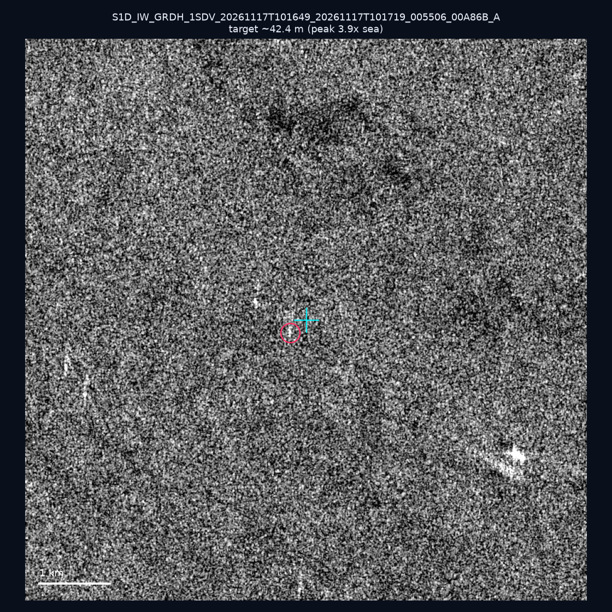
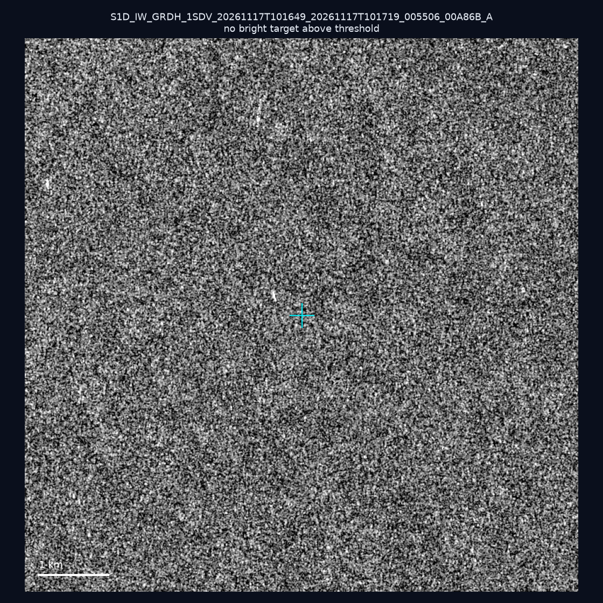
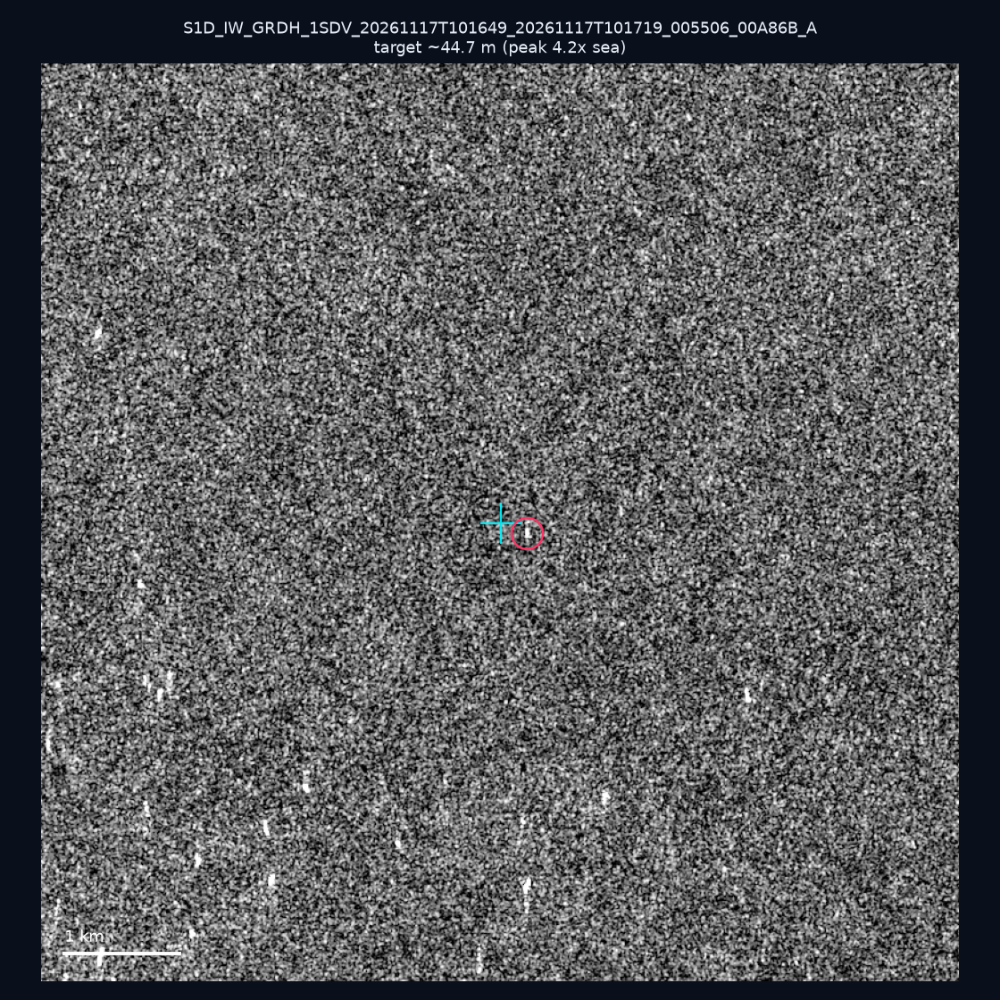
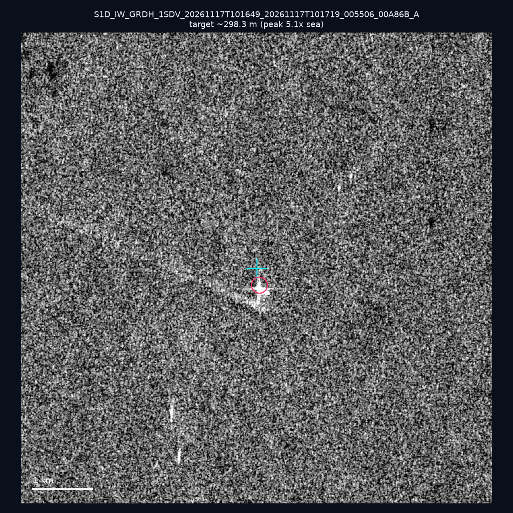
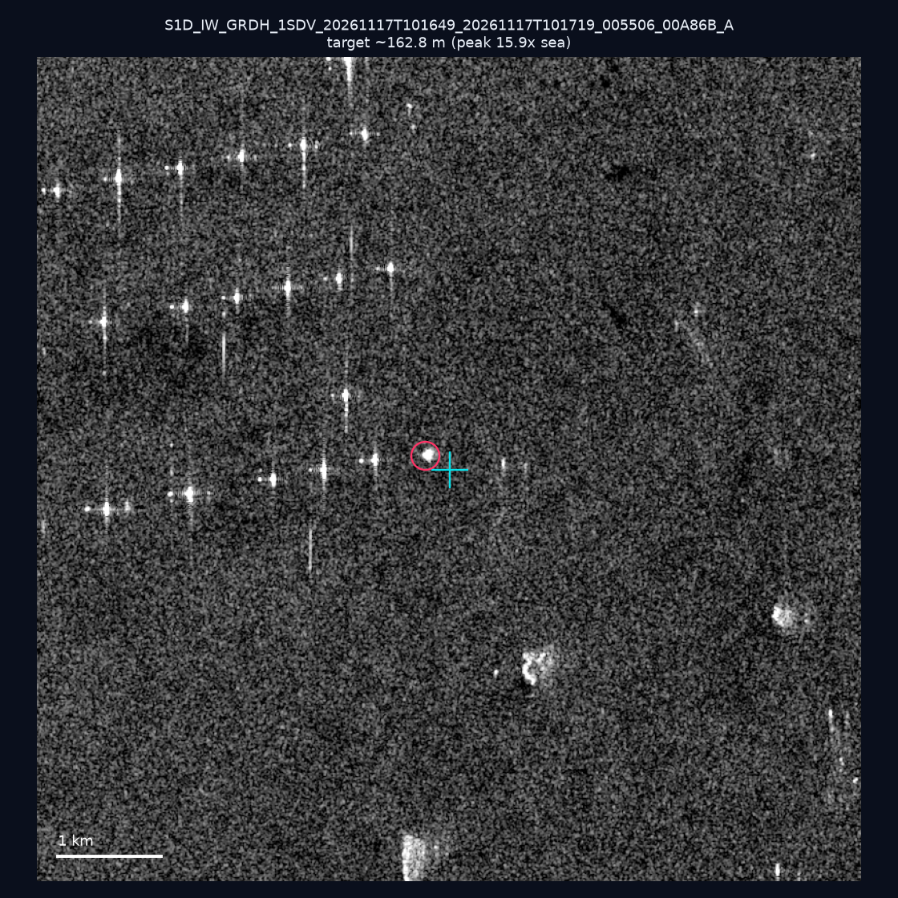
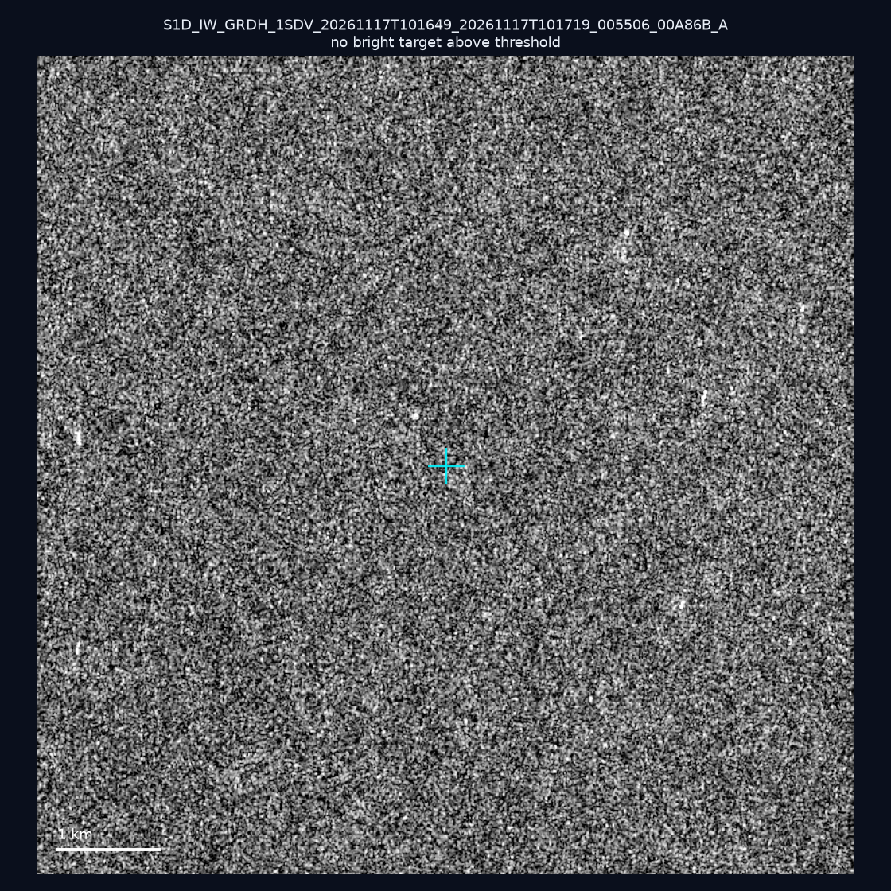
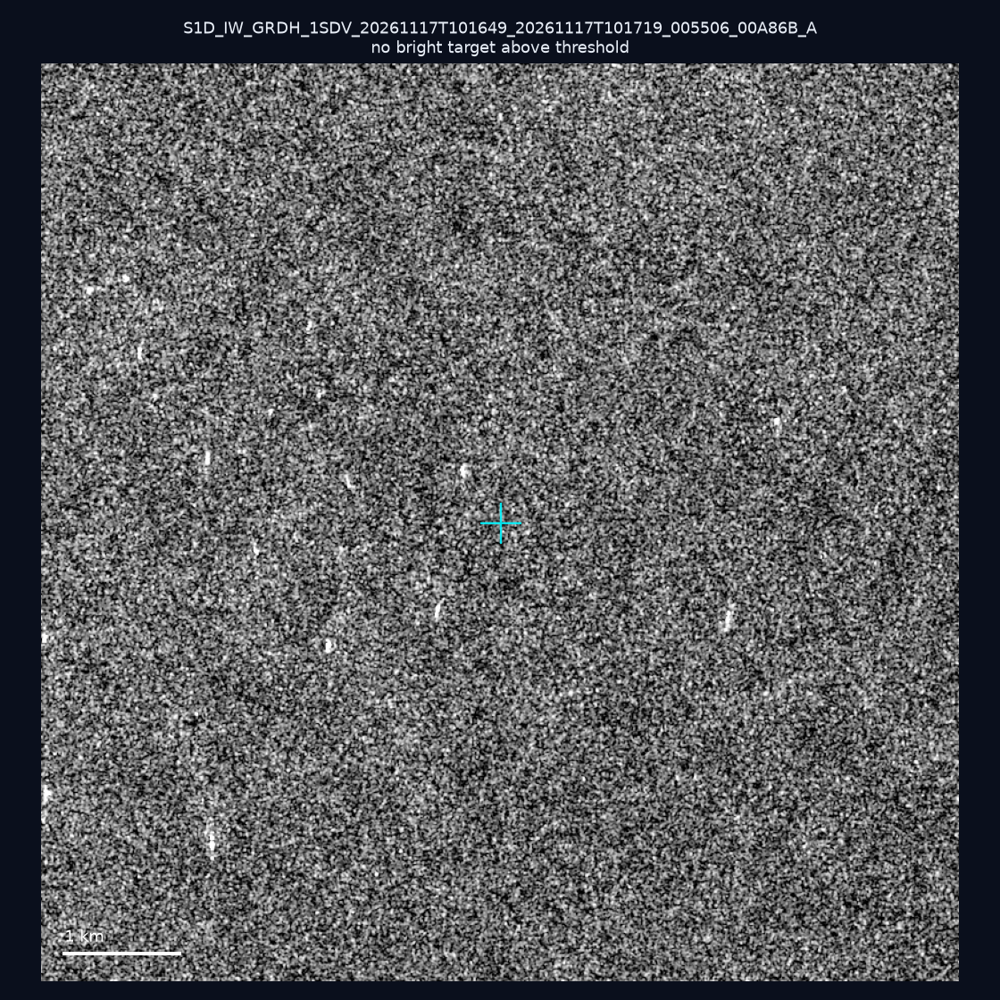
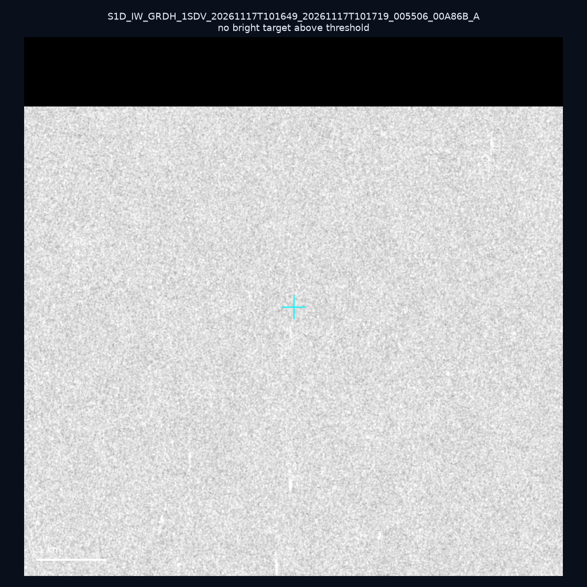
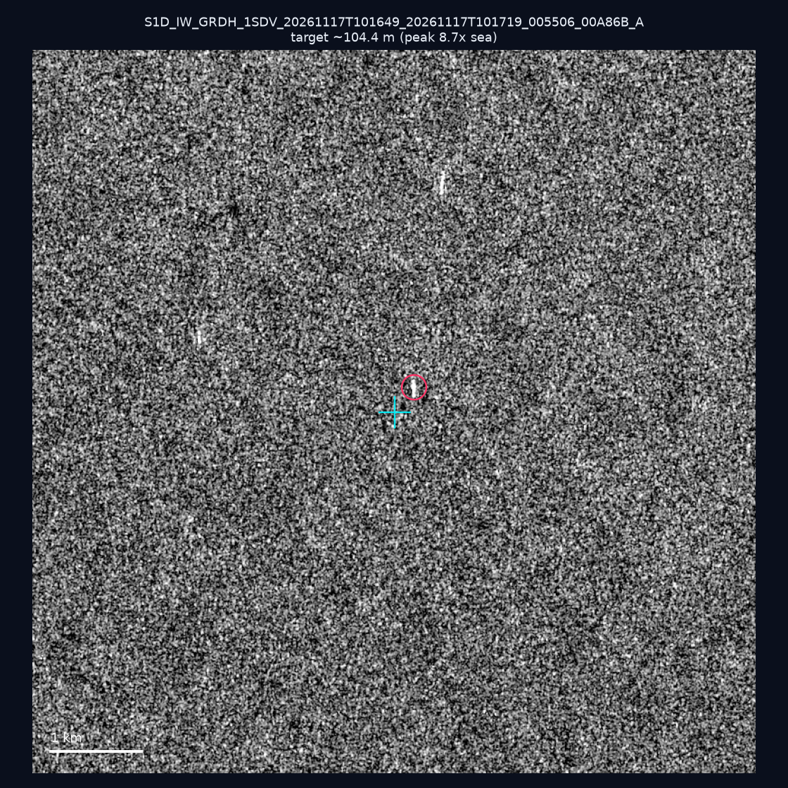
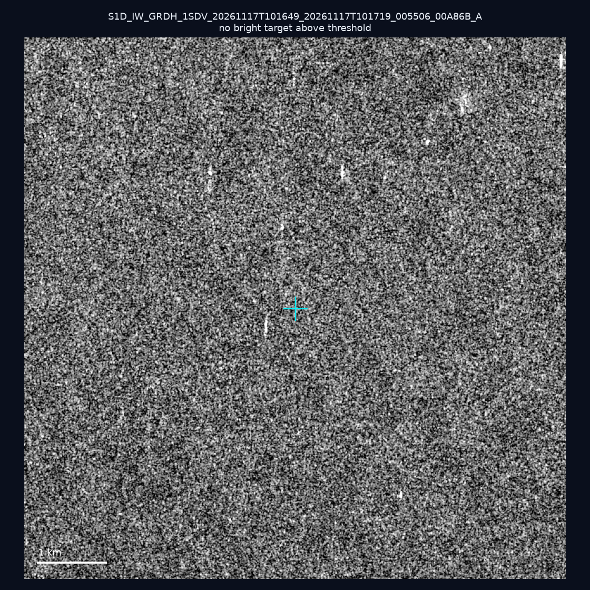

# 暗船 SAR 取證報告 — 2026-11-22

## 1. 總覽

- 執行時間：2026-11-22（GitHub Actions cron 自動執行）
- 線上比對摘要：暗偵測 29724 筆、殘餘暗船 14678 筆、假暗船剔除率 50.6%
- 本輪測試：10 筆
- 成功：10 筆
- 找到亮目標：5 筆
- 失敗：0 筆

## 2. 結果總表

| 日期 | 座標 | 海域 | 法域 | 成像時刻 | 判定 | 估計長度 | 峰值比 |
|------|------|------|------|----------|------|----------|--------|
| 2026-11-17 | 23.33, 117.32 | southwest | eez | 10:16:49 | 🟡 弱目標 | ~42.4 m | 3.9× |
| 2026-11-17 | 23.04, 117.32 | southwest | eez | 10:16:49 | ⚪ 無目標（雜訊或低RCS） | — | — |
| 2026-11-17 | 23.12, 117.94 | southwest | eez | 10:16:49 | 🟡 弱目標 | ~44.7 m | 4.2× |
| 2026-11-17 | 23.01, 117.11 | southwest | eez | 10:16:49 | 🟡 弱目標 | ~298.3 m | 5.1× |
| 2026-11-17 | 23.3, 117.09 | southwest | eez | 10:16:49 | ✅ 確認實體目標 | ~162.8 m | 15.9× |
| 2026-11-17 | 23.04, 117.69 | southwest | eez | 10:16:49 | ⚪ 無目標（雜訊或低RCS） | — | — |
| 2026-11-17 | 22.88, 117.85 | southwest | eez | 10:16:49 | ⚪ 無目標（雜訊或低RCS） | — | — |
| 2026-11-17 | 22.76, 117.58 | southwest | eez | 10:16:49 | ⚪ 無目標（雜訊或低RCS） | — | — |
| 2026-11-17 | 22.93, 117.5 | southwest | eez | 10:16:49 | 🟡 弱目標 | ~104.4 m | 8.7× |
| 2026-11-17 | 23.04, 118.05 | southwest | eez | 10:16:49 | ⚪ 無目標（雜訊或低RCS） | — | — |

## 3. 逐目標段落

### 2026-11-17 (23.33, 117.32)

🟡 弱目標，估計長度 ~42.4 m，峰值 3.9× 海面背景（5 px）。

### 2026-11-17 (23.04, 117.32)

⚪ 無目標（雜訊或低RCS）。

### 2026-11-17 (23.12, 117.94)

🟡 弱目標，估計長度 ~44.7 m，峰值 4.2× 海面背景（7 px）。

### 2026-11-17 (23.01, 117.11)

🟡 弱目標，估計長度 ~298.3 m，峰值 5.1× 海面背景（169 px）。

### 2026-11-17 (23.3, 117.09)

✅ 確認實體目標，估計長度 ~162.8 m，峰值 15.9× 海面背景（89 px）。

### 2026-11-17 (23.04, 117.69)

⚪ 無目標（雜訊或低RCS）。

### 2026-11-17 (22.88, 117.85)

⚪ 無目標（雜訊或低RCS）。

### 2026-11-17 (22.76, 117.58)

⚪ 無目標（雜訊或低RCS）。

### 2026-11-17 (22.93, 117.5)

🟡 弱目標，估計長度 ~104.4 m，峰值 8.7× 海面背景（28 px）。

### 2026-11-17 (23.04, 118.05)

⚪ 無目標（雜訊或低RCS）。

## 4. 後續建議

- 值得人工深查（確認實體目標且長度 ≥ 50m）：
  - 2026-11-17 (23.3, 117.09) ~162.8 m — 建議比對周邊 AIS 船長
- 累積統計：全歷史 903 筆（有效 901 筆），確認實體目標 110 筆（12.2%）

> 所有結果是研判線索，不是法律認定；無目標 ≠ 誤報（小型木殼漁船 RCS 低，SAR 可能拍不到）。
