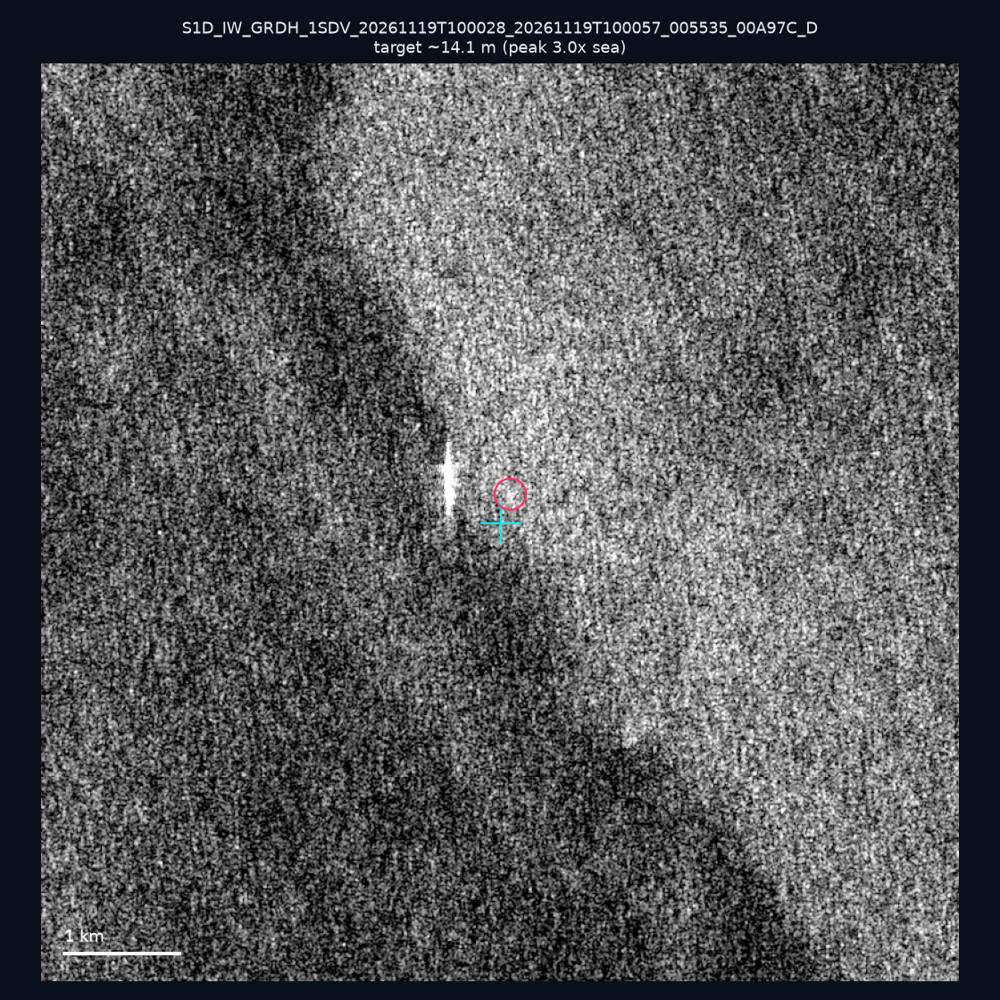
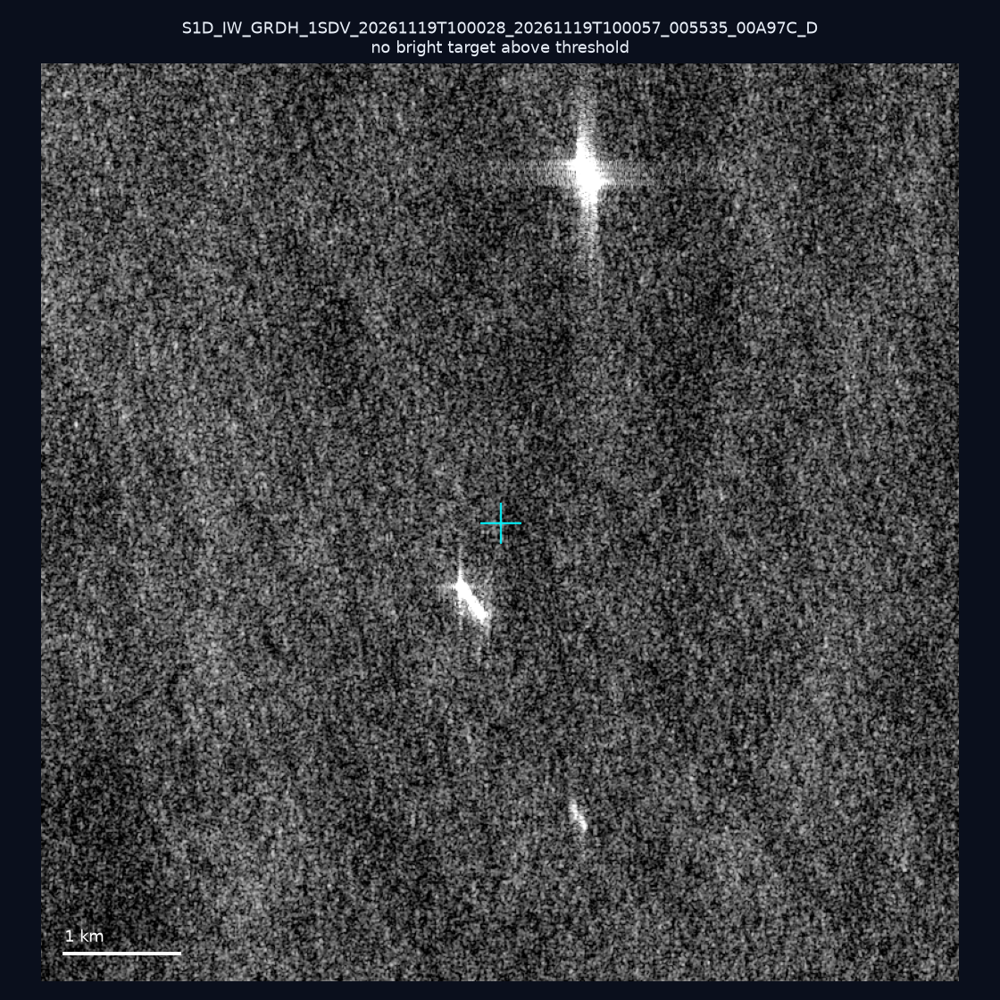
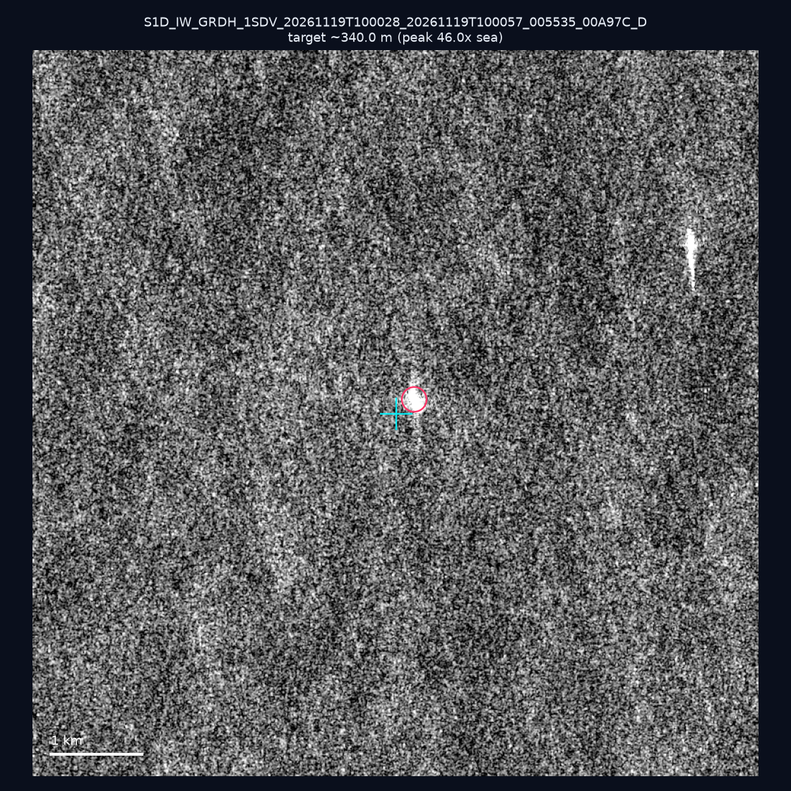
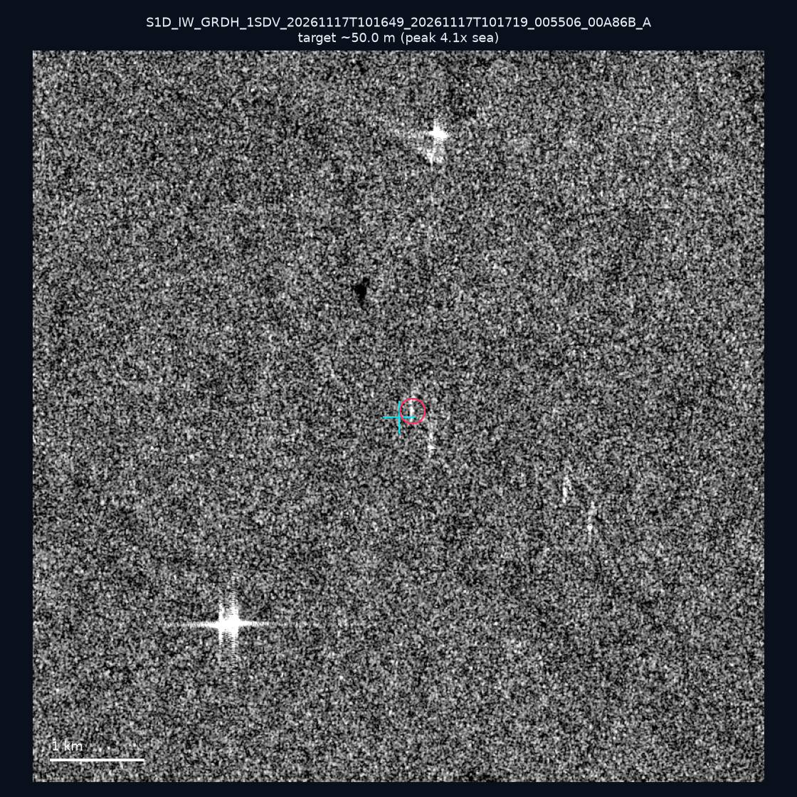
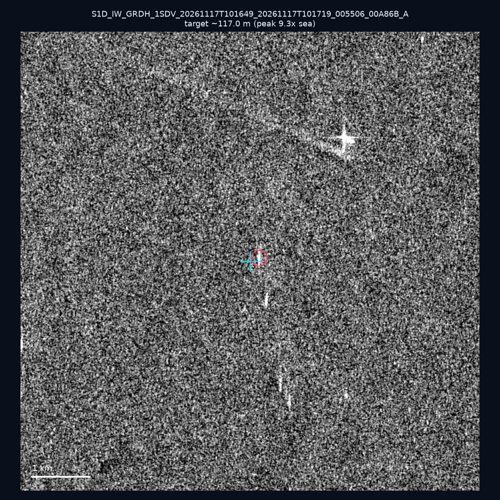
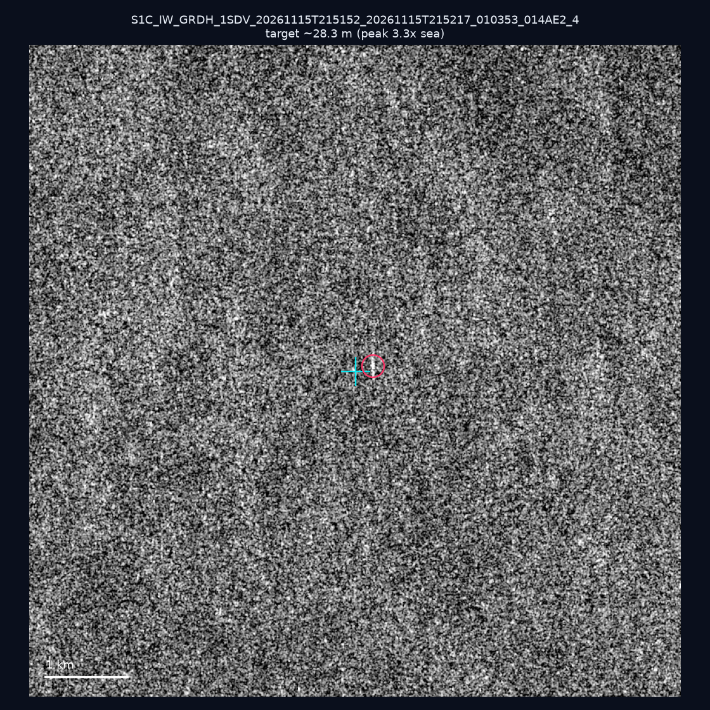
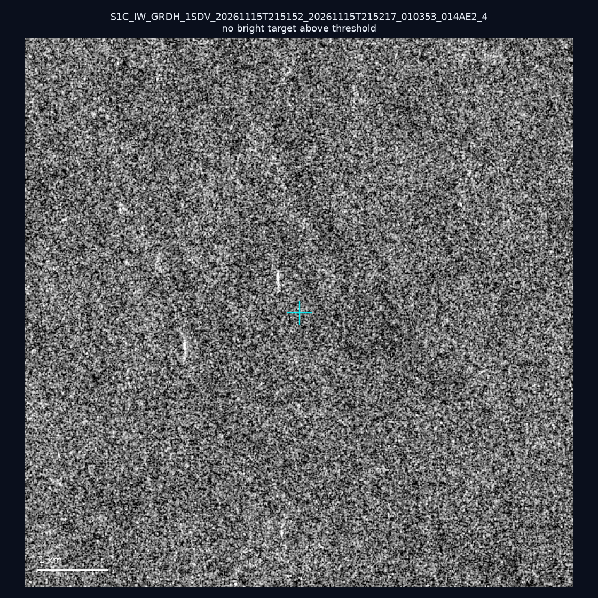
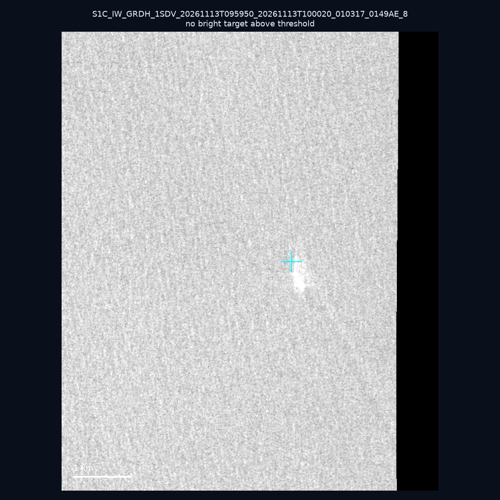
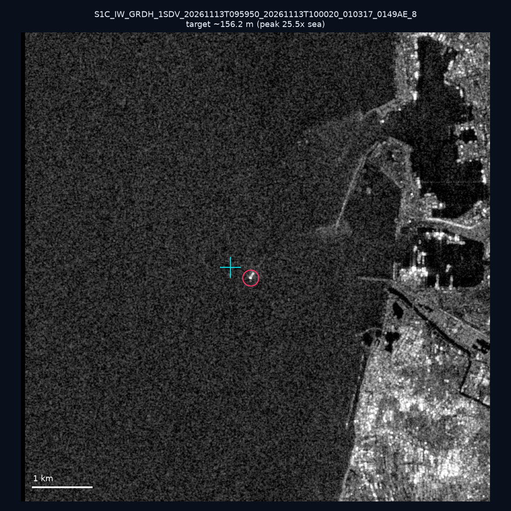
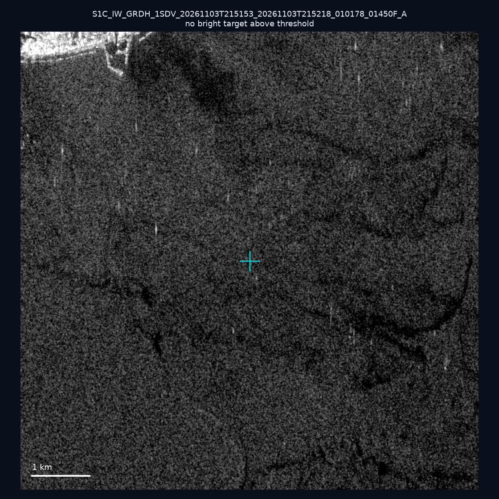

# 暗船 SAR 取證報告 — 2026-11-23

## 1. 總覽

- 執行時間：2026-11-23（GitHub Actions cron 自動執行）
- 線上比對摘要：暗偵測 29954 筆、殘餘暗船 14755 筆、假暗船剔除率 50.7%
- 本輪測試：10 筆
- 成功：10 筆
- 找到亮目標：6 筆
- 失敗：0 筆

## 2. 結果總表

| 日期 | 座標 | 海域 | 法域 | 成像時刻 | 判定 | 估計長度 | 峰值比 |
|------|------|------|------|----------|------|----------|--------|
| 2026-11-19 | 23.36, 122.02 | east | eez | 10:00:28 | 🟡 弱目標 | ~14.1 m | 3.0× |
| 2026-11-19 | 23.67, 122.04 | east | eez | 10:00:28 | ⚪ 無目標（雜訊或低RCS） | — | — |
| 2026-11-19 | 24.23, 122.31 | east | eez | 10:00:28 | ✅ 確認實體目標 | ~340.0 m | 46.0× |
| 2026-11-17 | 23.32, 117.27 | southwest | eez | 10:16:49 | 🟡 弱目標 | ~50.0 m | 4.1× |
| 2026-11-17 | 23.03, 117.09 | southwest | eez | 10:16:49 | 🟡 弱目標 | ~117.0 m | 9.3× |
| 2026-11-15 | 23.15, 119.74 | southwest | internal_waters | 21:51:52 | 🟡 弱目標 | ~28.3 m | 3.3× |
| 2026-11-15 | 22.94, 119.66 | southwest | territorial_sea | 21:51:52 | ⚪ 無目標（雜訊或低RCS） | — | — |
| 2026-11-13 | 23.11, 122.59 | east | eez | 09:59:50 | ⚪ 無目標（雜訊或低RCS） | — | — |
| 2026-11-13 | 22.71, 120.23 | southwest | internal_waters | 09:59:50 | ✅ 確認實體目標 | ~156.2 m | 25.5× |
| 2026-11-03 | 22.45, 120.37 | southwest | internal_waters | 21:51:53 | ⚪ 無目標（雜訊或低RCS） | — | — |

## 3. 逐目標段落

### 2026-11-19 (23.36, 122.02)

🟡 弱目標，估計長度 ~14.1 m，峰值 3.0× 海面背景（1 px）。

### 2026-11-19 (23.67, 122.04)

⚪ 無目標（雜訊或低RCS）。

### 2026-11-19 (24.23, 122.31)

✅ 確認實體目標，估計長度 ~340.0 m，峰值 46.0× 海面背景（225 px）。

### 2026-11-17 (23.32, 117.27)

🟡 弱目標，估計長度 ~50.0 m，峰值 4.1× 海面背景（7 px）。

### 2026-11-17 (23.03, 117.09)

🟡 弱目標，估計長度 ~117.0 m，峰值 9.3× 海面背景（32 px）。

### 2026-11-15 (23.15, 119.74)

🟡 弱目標，估計長度 ~28.3 m，峰值 3.3× 海面背景（4 px）。

### 2026-11-15 (22.94, 119.66)

⚪ 無目標（雜訊或低RCS）。

### 2026-11-13 (23.11, 122.59)

⚪ 無目標（雜訊或低RCS）。

### 2026-11-13 (22.71, 120.23)

✅ 確認實體目標，估計長度 ~156.2 m，峰值 25.5× 海面背景（58 px）。

### 2026-11-03 (22.45, 120.37)

⚪ 無目標（雜訊或低RCS）。

## 4. 後續建議

- 值得人工深查（確認實體目標且長度 ≥ 50m）：
  - 2026-11-19 (24.23, 122.31) ~340.0 m — 建議比對周邊 AIS 船長
  - 2026-11-13 (22.71, 120.23) ~156.2 m — 建議比對周邊 AIS 船長
- 累積統計：全歷史 913 筆（有效 911 筆），確認實體目標 112 筆（12.3%）

> 所有結果是研判線索，不是法律認定；無目標 ≠ 誤報（小型木殼漁船 RCS 低，SAR 可能拍不到）。
