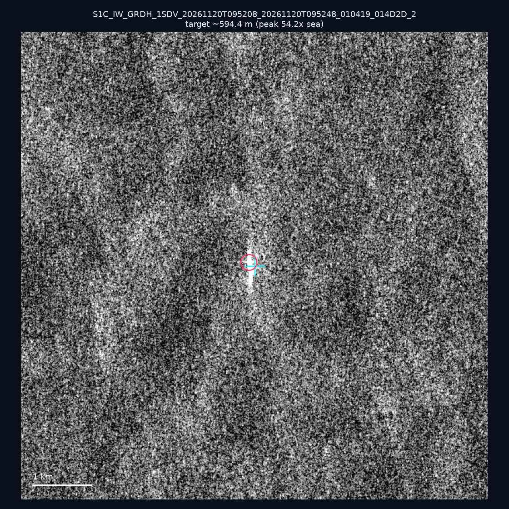
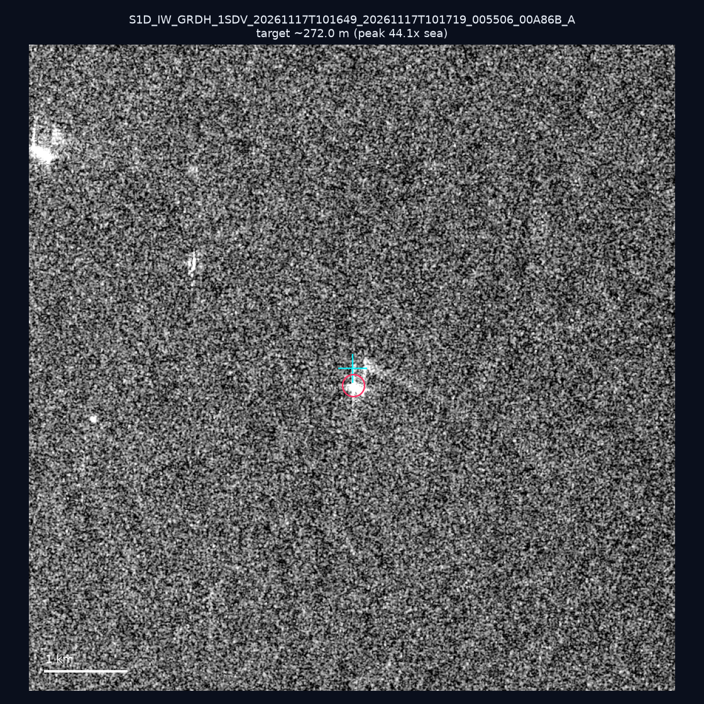
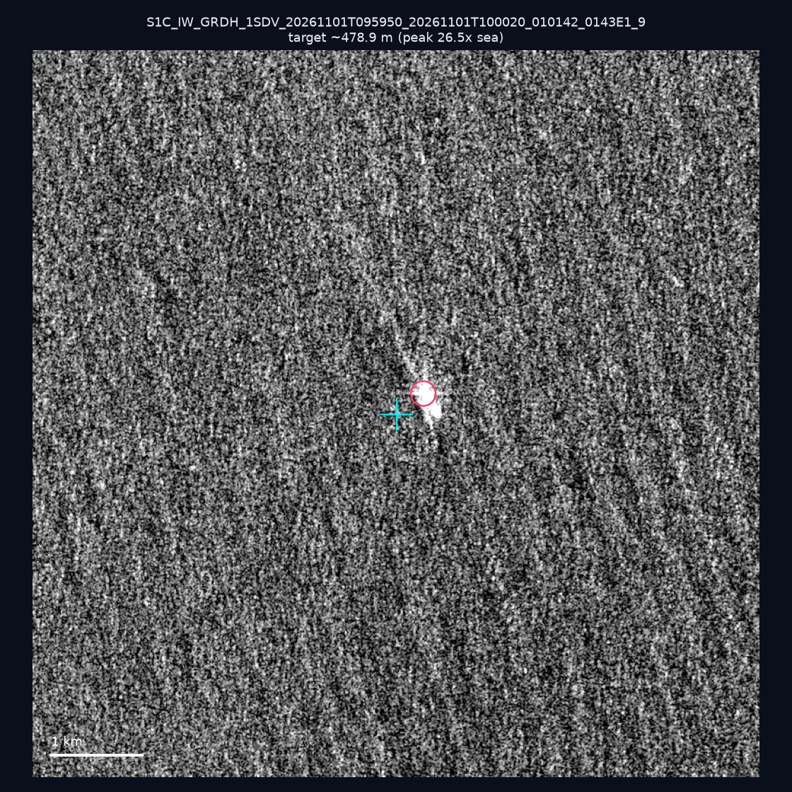
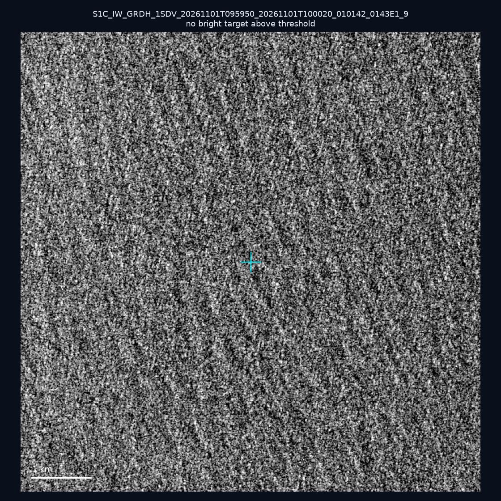
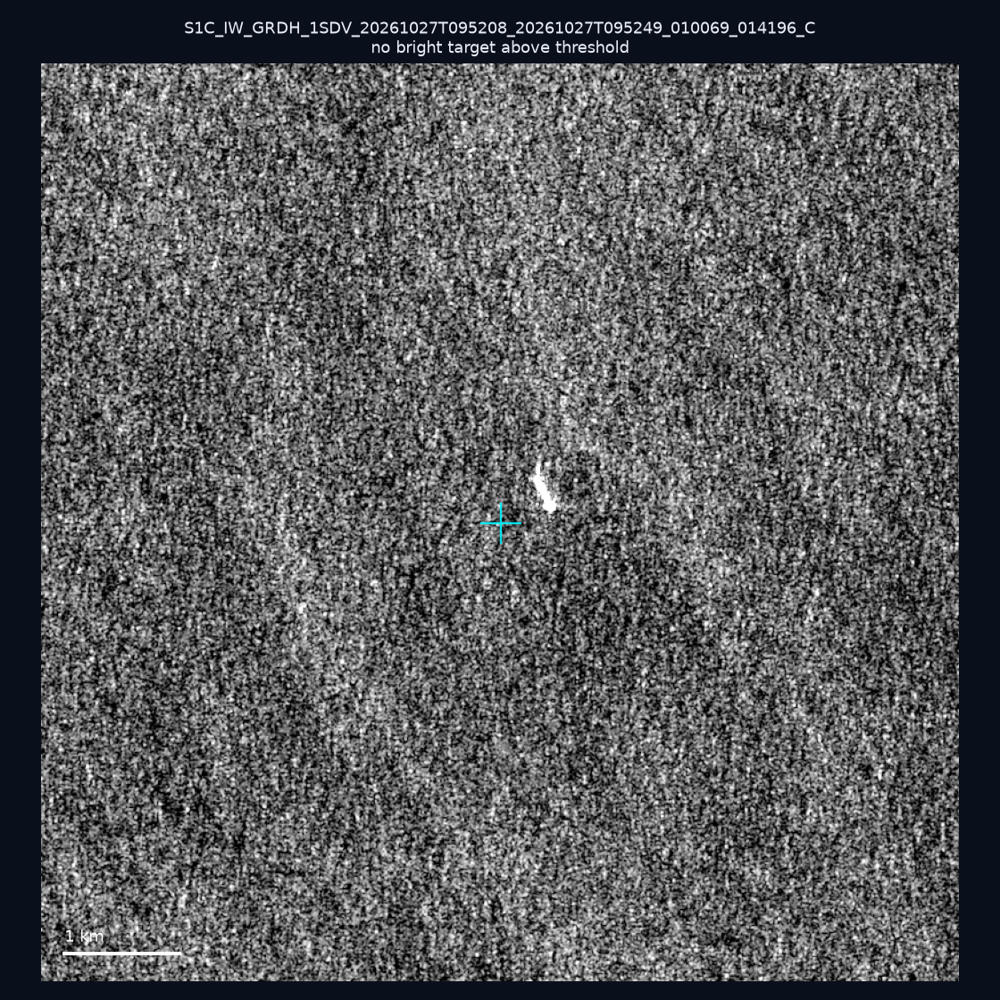
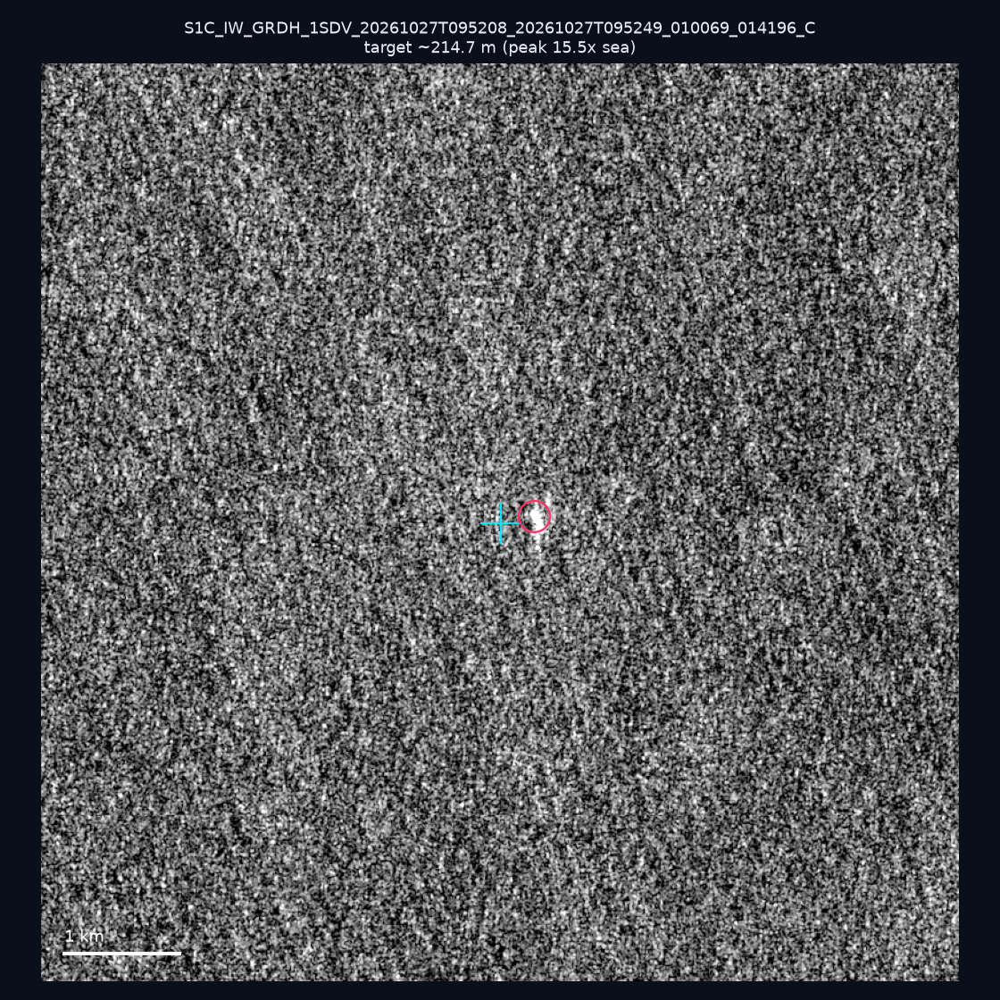
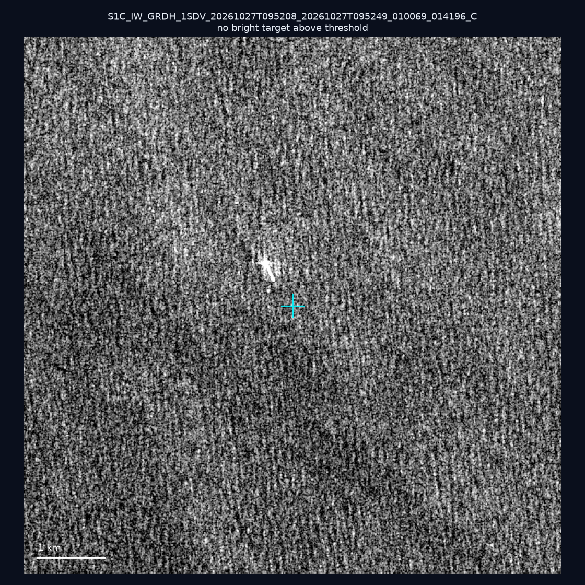
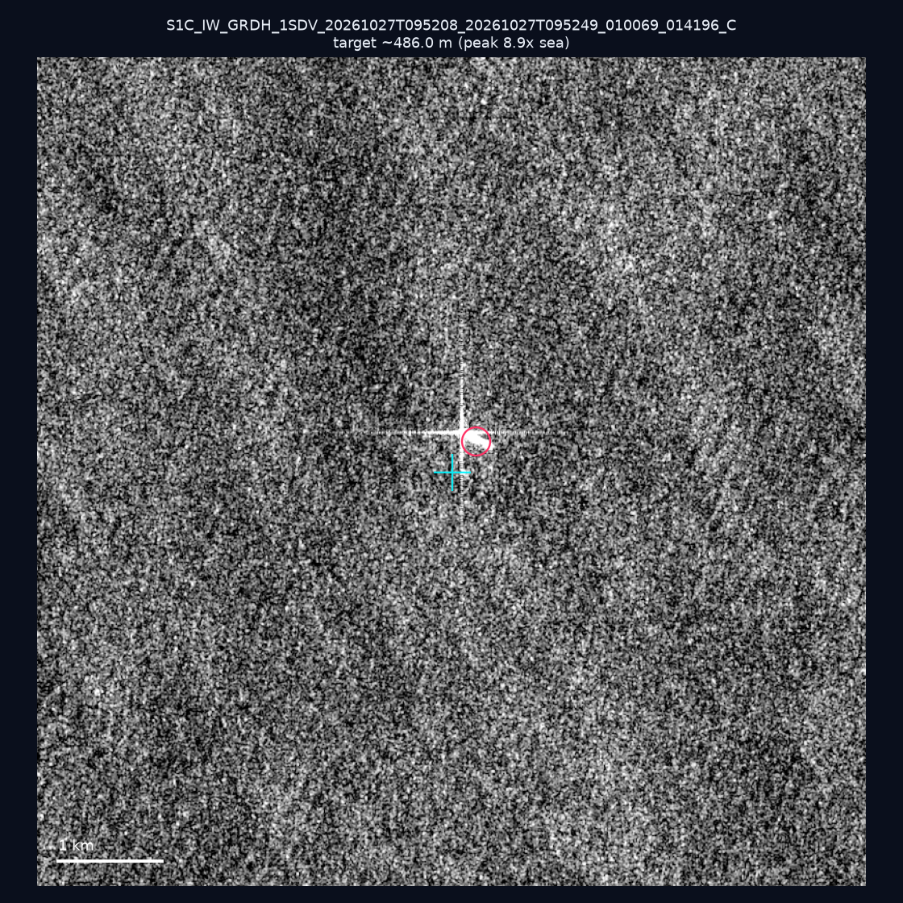
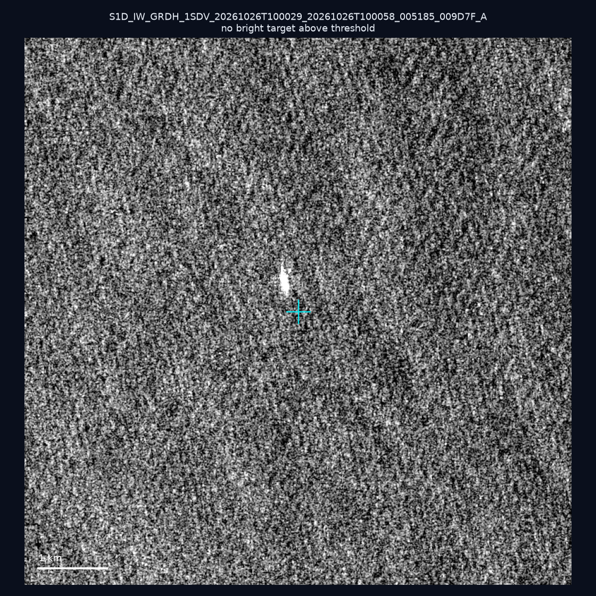
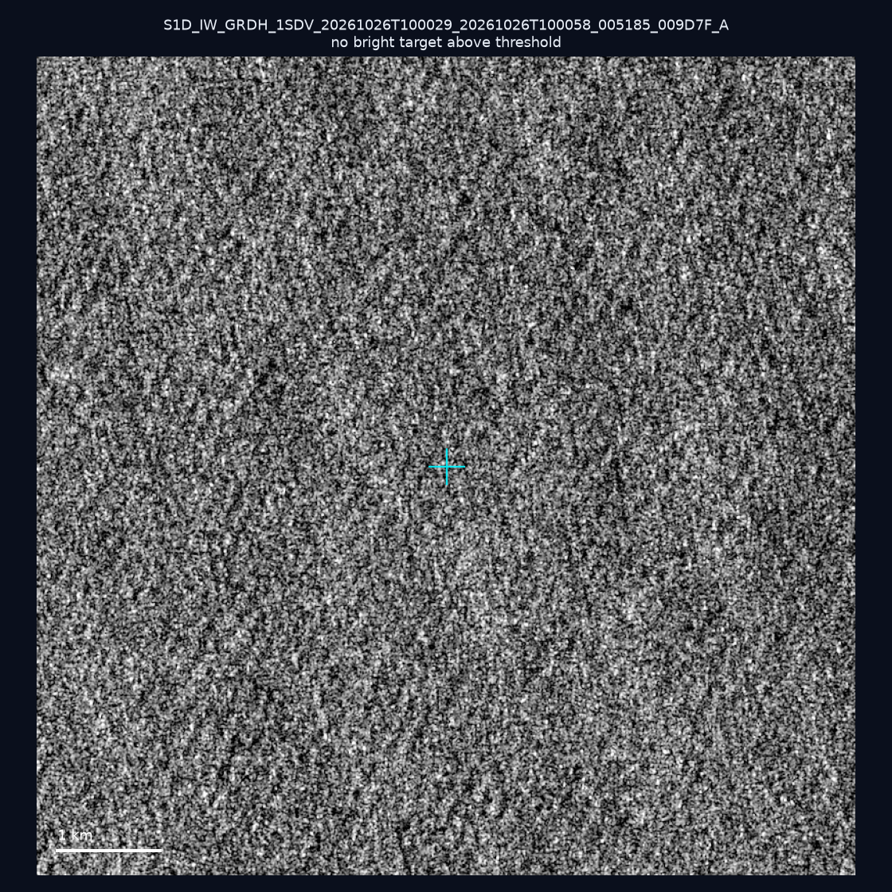

# 暗船 SAR 取證報告 — 2026-11-24

## 1. 總覽

- 執行時間：2026-11-24（GitHub Actions cron 自動執行）
- 線上比對摘要：暗偵測 30481 筆、殘餘暗船 15093 筆、假暗船剔除率 50.5%
- 本輪測試：10 筆
- 成功：10 筆
- 找到亮目標：5 筆
- 失敗：0 筆

## 2. 結果總表

| 日期 | 座標 | 海域 | 法域 | 成像時刻 | 判定 | 估計長度 | 峰值比 |
|------|------|------|------|----------|------|----------|--------|
| 2026-11-20 | 24.48, 123.32 | east | eez | 09:52:08 | ✅ 確認實體目標 | ~594.4 m | 54.2× |
| 2026-11-17 | 23.48, 117.77 | southwest | eez | 10:16:49 | ✅ 確認實體目標 | ~272.0 m | 44.1× |
| 2026-11-01 | 22.2, 122.01 | east | contiguous_zone | 09:59:50 | ✅ 確認實體目標 | ~478.9 m | 26.5× |
| 2026-11-01 | 21.85, 122.25 | east | eez | 09:59:50 | ⚪ 無目標（雜訊或低RCS） | — | — |
| 2026-10-27 | 24.97, 122.73 | east | eez | 09:52:08 | ⚪ 無目標（雜訊或低RCS） | — | — |
| 2026-10-27 | 24.07, 122.55 | east | eez | 09:52:08 | ✅ 確認實體目標 | ~214.7 m | 15.5× |
| 2026-10-27 | 25.12, 122.48 | east | contiguous_zone | 09:52:08 | ⚪ 無目標（雜訊或低RCS） | — | — |
| 2026-10-27 | 24.6, 123.52 | east | eez | 09:52:08 | 🟡 弱目標 | ~486.0 m | 8.9× |
| 2026-10-26 | 23.99, 121.84 | east | territorial_sea | 10:00:29 | ⚪ 無目標（雜訊或低RCS） | — | — |
| 2026-10-26 | 24.02, 122.0 | east | contiguous_zone | 10:00:29 | ⚪ 無目標（雜訊或低RCS） | — | — |

## 3. 逐目標段落

### 2026-11-20 (24.48, 123.32)

✅ 確認實體目標，估計長度 ~594.4 m，峰值 54.2× 海面背景（332 px）。

### 2026-11-17 (23.48, 117.77)

✅ 確認實體目標，估計長度 ~272.0 m，峰值 44.1× 海面背景（169 px）。

### 2026-11-01 (22.2, 122.01)

✅ 確認實體目標，估計長度 ~478.9 m，峰值 26.5× 海面背景（380 px）。

### 2026-11-01 (21.85, 122.25)

⚪ 無目標（雜訊或低RCS）。

### 2026-10-27 (24.97, 122.73)

⚪ 無目標（雜訊或低RCS）。

### 2026-10-27 (24.07, 122.55)

✅ 確認實體目標，估計長度 ~214.7 m，峰值 15.5× 海面背景（94 px）。

### 2026-10-27 (25.12, 122.48)

⚪ 無目標（雜訊或低RCS）。

### 2026-10-27 (24.6, 123.52)

🟡 弱目標，估計長度 ~486.0 m，峰值 8.9× 海面背景（336 px）。

### 2026-10-26 (23.99, 121.84)

⚪ 無目標（雜訊或低RCS）。

### 2026-10-26 (24.02, 122.0)

⚪ 無目標（雜訊或低RCS）。

## 4. 後續建議

- 值得人工深查（確認實體目標且長度 ≥ 50m）：
  - 2026-11-20 (24.48, 123.32) ~594.4 m — 建議比對周邊 AIS 船長
  - 2026-11-17 (23.48, 117.77) ~272.0 m — 建議比對周邊 AIS 船長
  - 2026-11-01 (22.2, 122.01) ~478.9 m — 建議比對周邊 AIS 船長
  - 2026-10-27 (24.07, 122.55) ~214.7 m — 建議比對周邊 AIS 船長
- 累積統計：全歷史 923 筆（有效 921 筆），確認實體目標 116 筆（12.6%）

> 所有結果是研判線索，不是法律認定；無目標 ≠ 誤報（小型木殼漁船 RCS 低，SAR 可能拍不到）。
