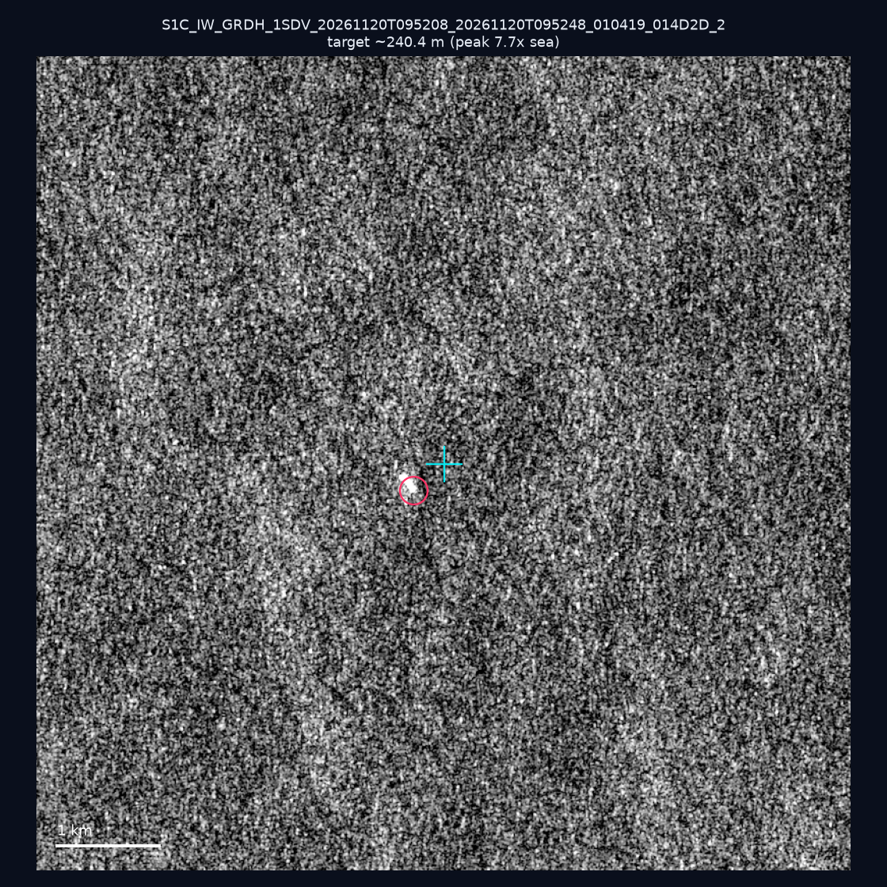
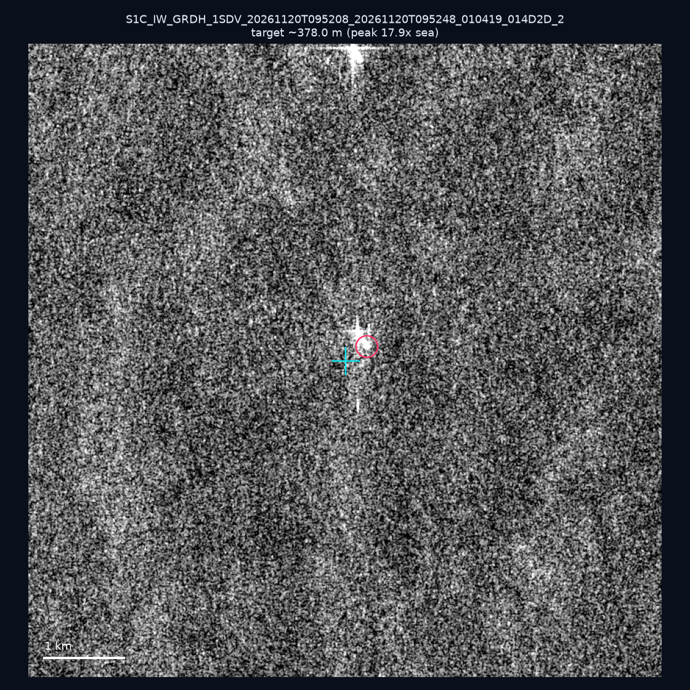
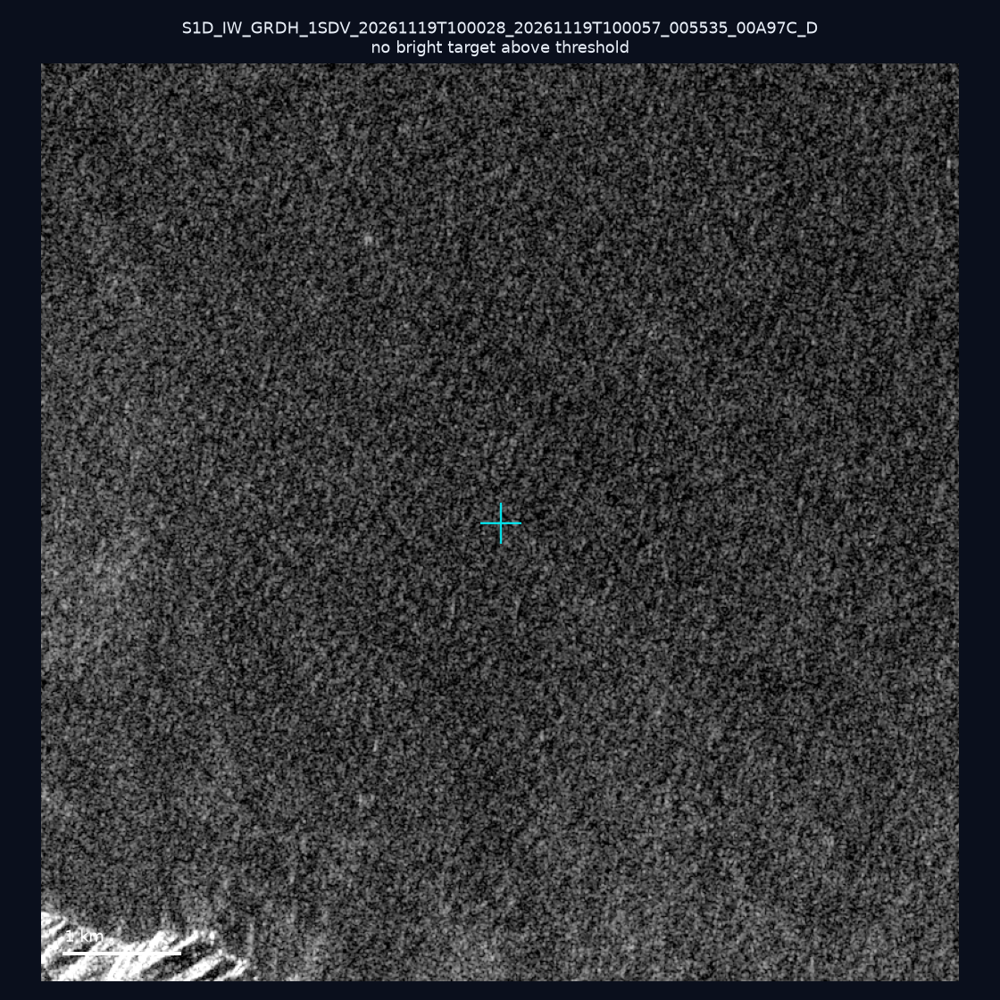
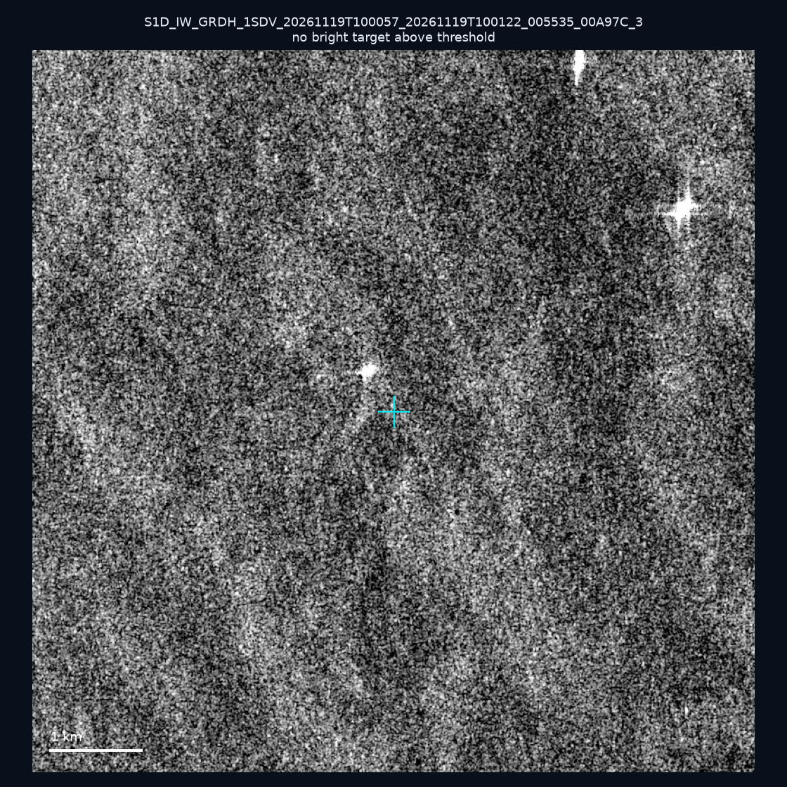
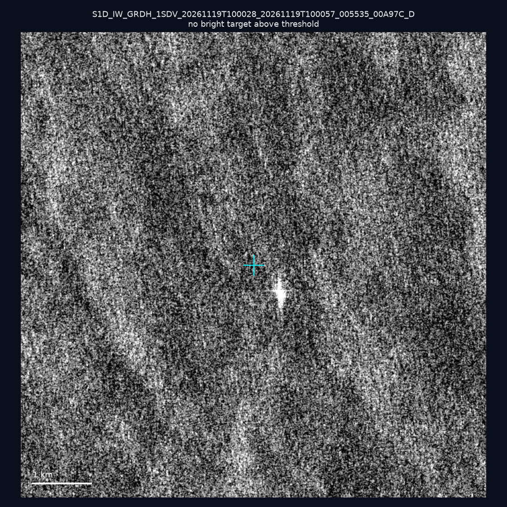
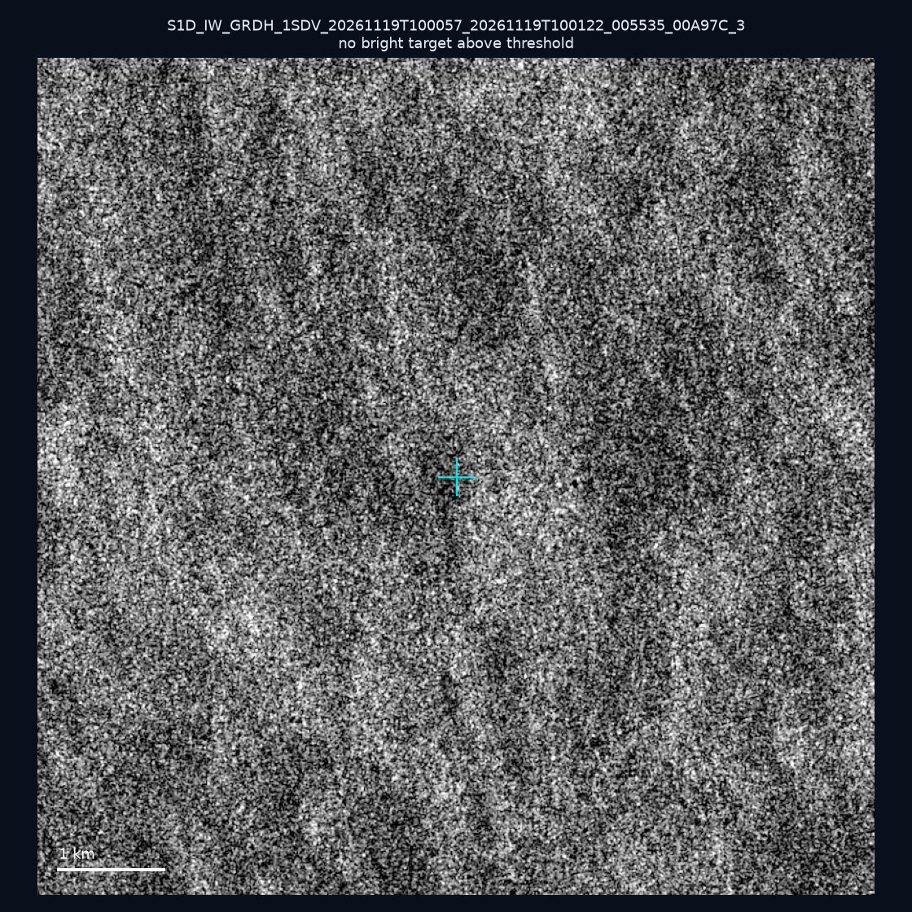
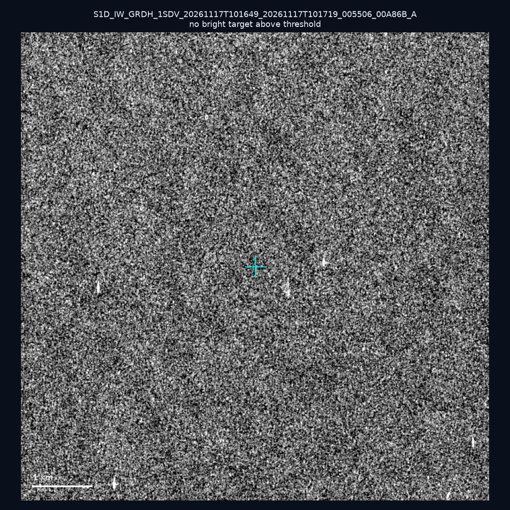
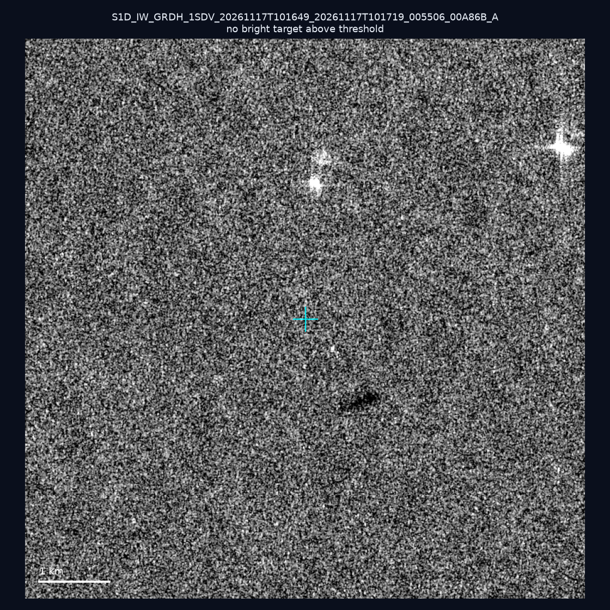
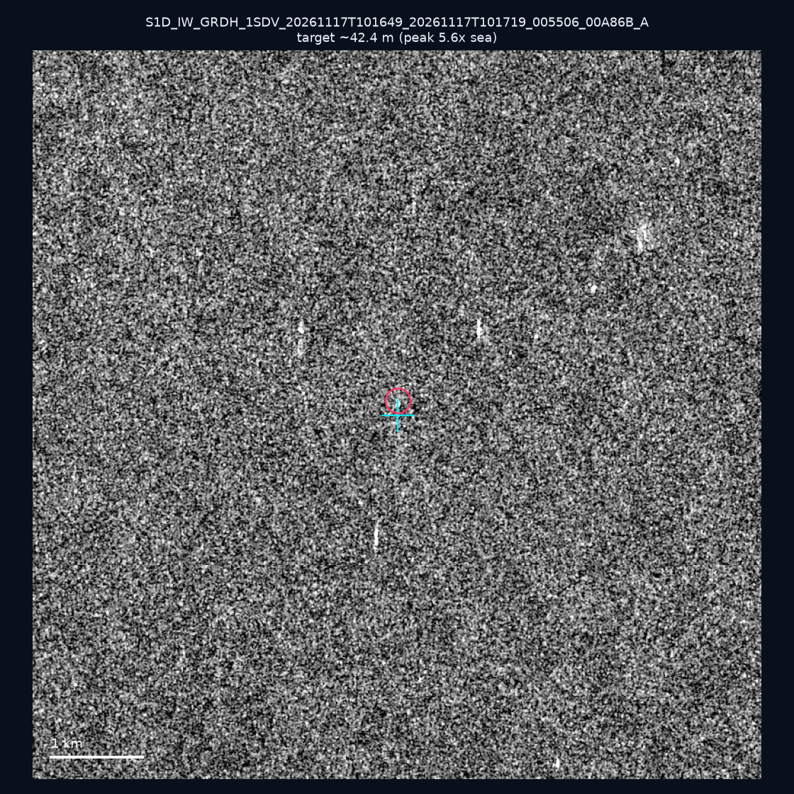
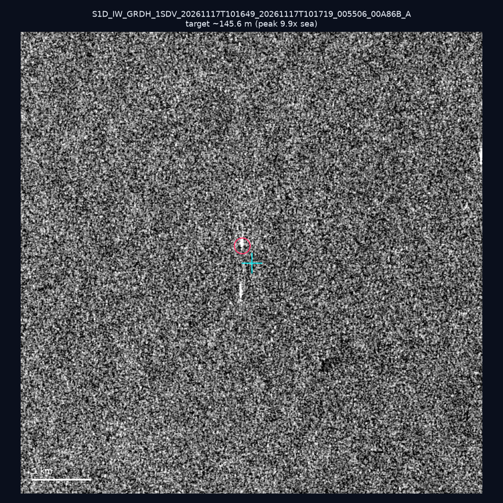

# 暗船 SAR 取證報告 — 2026-11-25

## 1. 總覽

- 執行時間：2026-11-25（GitHub Actions cron 自動執行）
- 線上比對摘要：暗偵測 29437 筆、殘餘暗船 14635 筆、假暗船剔除率 50.3%
- 本輪測試：10 筆
- 成功：10 筆
- 找到亮目標：4 筆
- 失敗：0 筆

## 2. 結果總表

| 日期 | 座標 | 海域 | 法域 | 成像時刻 | 判定 | 估計長度 | 峰值比 |
|------|------|------|------|----------|------|----------|--------|
| 2026-11-20 | 24.13, 122.27 | east | eez | 09:52:08 | 🟡 弱目標 | ~240.4 m | 7.7× |
| 2026-11-20 | 25.25, 122.8 | east | eez | 09:52:08 | ✅ 確認實體目標 | ~378.0 m | 17.9× |
| 2026-11-19 | 24.5, 121.9 | east | territorial_sea | 10:00:28 | ⚪ 無目標（雜訊或低RCS） | — | — |
| 2026-11-19 | 25.33, 121.65 | east | internal_waters | 10:00:57 | ⚪ 無目標（雜訊或低RCS） | — | — |
| 2026-11-19 | 23.51, 122.15 | east | eez | 10:00:28 | ⚪ 無目標（雜訊或低RCS） | — | — |
| 2026-11-19 | 25.41, 121.7 | east | territorial_sea | 10:00:57 | ⚪ 無目標（雜訊或低RCS） | — | — |
| 2026-11-17 | 22.95, 117.61 | southwest | eez | 10:16:49 | ⚪ 無目標（雜訊或低RCS） | — | — |
| 2026-11-17 | 23.02, 117.38 | southwest | eez | 10:16:49 | ⚪ 無目標（雜訊或低RCS） | — | — |
| 2026-11-17 | 23.03, 118.05 | southwest | eez | 10:16:49 | 🟡 弱目標 | ~42.4 m | 5.6× |
| 2026-11-17 | 23.04, 117.05 | southwest | eez | 10:16:49 | 🟡 弱目標 | ~145.6 m | 9.9× |

## 3. 逐目標段落

### 2026-11-20 (24.13, 122.27)

🟡 弱目標，估計長度 ~240.4 m，峰值 7.7× 海面背景（106 px）。

### 2026-11-20 (25.25, 122.8)

✅ 確認實體目標，估計長度 ~378.0 m，峰值 17.9× 海面背景（231 px）。

### 2026-11-19 (24.5, 121.9)

⚪ 無目標（雜訊或低RCS）。

### 2026-11-19 (25.33, 121.65)

⚪ 無目標（雜訊或低RCS）。

### 2026-11-19 (23.51, 122.15)

⚪ 無目標（雜訊或低RCS）。

### 2026-11-19 (25.41, 121.7)

⚪ 無目標（雜訊或低RCS）。

### 2026-11-17 (22.95, 117.61)

⚪ 無目標（雜訊或低RCS）。

### 2026-11-17 (23.02, 117.38)

⚪ 無目標（雜訊或低RCS）。

### 2026-11-17 (23.03, 118.05)

🟡 弱目標，估計長度 ~42.4 m，峰值 5.6× 海面背景（7 px）。

### 2026-11-17 (23.04, 117.05)

🟡 弱目標，估計長度 ~145.6 m，峰值 9.9× 海面背景（50 px）。

## 4. 後續建議

- 值得人工深查（確認實體目標且長度 ≥ 50m）：
  - 2026-11-20 (25.25, 122.8) ~378.0 m — 建議比對周邊 AIS 船長
- 累積統計：全歷史 933 筆（有效 931 筆），確認實體目標 117 筆（12.6%）

> 所有結果是研判線索，不是法律認定；無目標 ≠ 誤報（小型木殼漁船 RCS 低，SAR 可能拍不到）。
