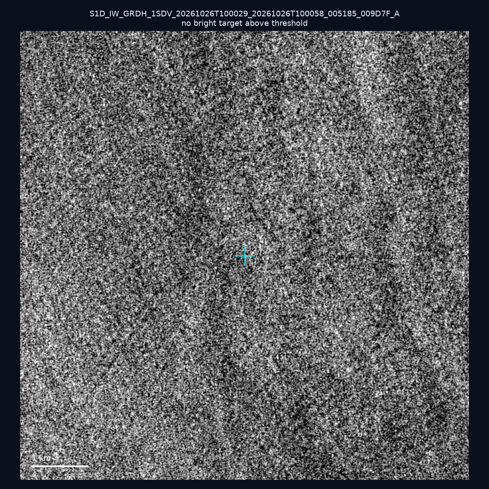
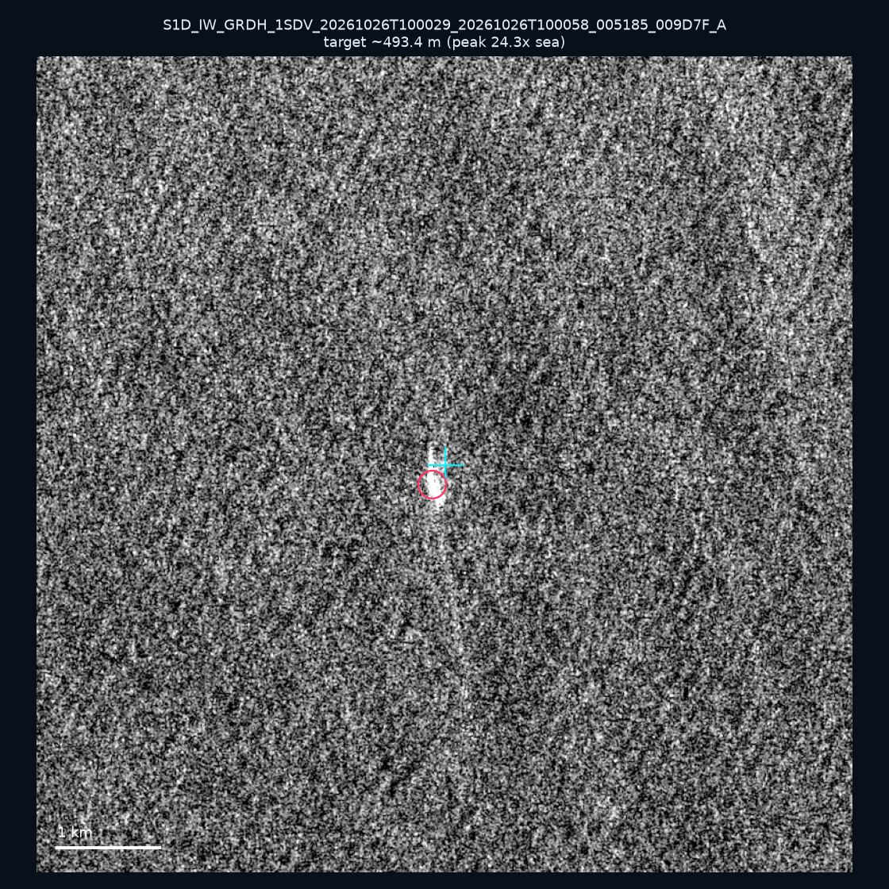
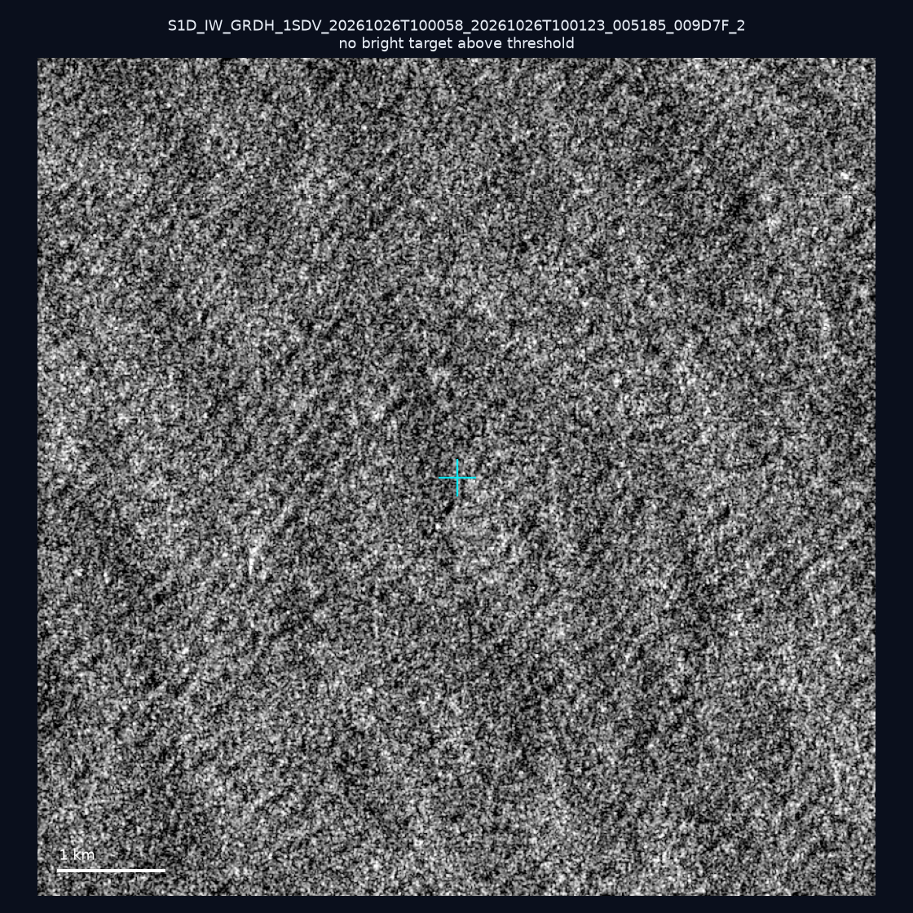
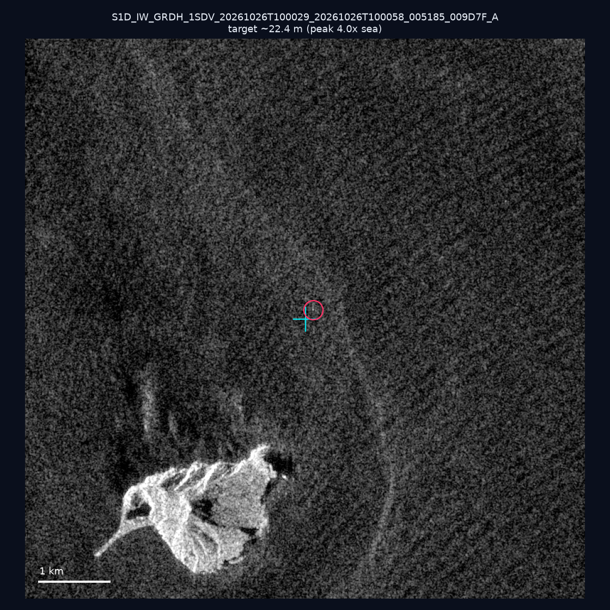

# 暗船 SAR 取證報告 — 2026-11-26

## 1. 總覽

- 執行時間：2026-11-26（GitHub Actions cron 自動執行）
- 線上比對摘要：暗偵測 29842 筆、殘餘暗船 14794 筆、假暗船剔除率 50.4%
- 本輪測試：4 筆
- 成功：4 筆
- 找到亮目標：2 筆
- 失敗：0 筆

## 2. 結果總表

| 日期 | 座標 | 海域 | 法域 | 成像時刻 | 判定 | 估計長度 | 峰值比 |
|------|------|------|------|----------|------|----------|--------|
| 2026-10-26 | 24.7, 121.91 | east | internal_waters | 10:00:29 | ⚪ 無目標（雜訊或低RCS） | — | — |
| 2026-10-26 | 24.29, 122.26 | east | eez | 10:00:29 | ✅ 確認實體目標 | ~493.4 m | 24.3× |
| 2026-10-26 | 25.42, 121.74 | east | internal_waters | 10:00:58 | ⚪ 無目標（雜訊或低RCS） | — | — |
| 2026-10-26 | 24.82, 121.97 | east | territorial_sea | 10:00:29 | 🟡 弱目標 | ~22.4 m | 4.0× |

## 3. 逐目標段落

### 2026-10-26 (24.7, 121.91)

⚪ 無目標（雜訊或低RCS）。

### 2026-10-26 (24.29, 122.26)

✅ 確認實體目標，估計長度 ~493.4 m，峰值 24.3× 海面背景（243 px）。

### 2026-10-26 (25.42, 121.74)

⚪ 無目標（雜訊或低RCS）。

### 2026-10-26 (24.82, 121.97)

🟡 弱目標，估計長度 ~22.4 m，峰值 4.0× 海面背景（2 px）。

## 4. 後續建議

- 值得人工深查（確認實體目標且長度 ≥ 50m）：
  - 2026-10-26 (24.29, 122.26) ~493.4 m — 建議比對周邊 AIS 船長
- 累積統計：全歷史 937 筆（有效 935 筆），確認實體目標 118 筆（12.6%）

> 所有結果是研判線索，不是法律認定；無目標 ≠ 誤報（小型木殼漁船 RCS 低，SAR 可能拍不到）。
