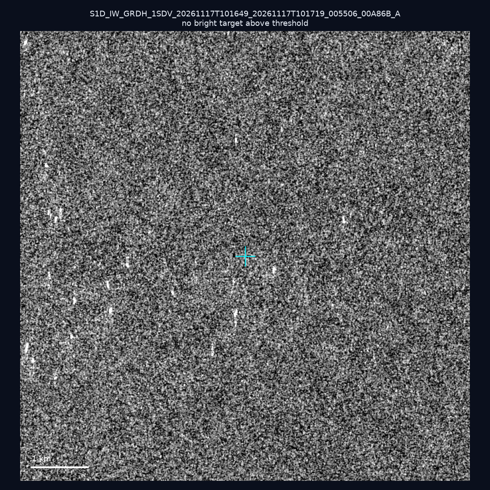
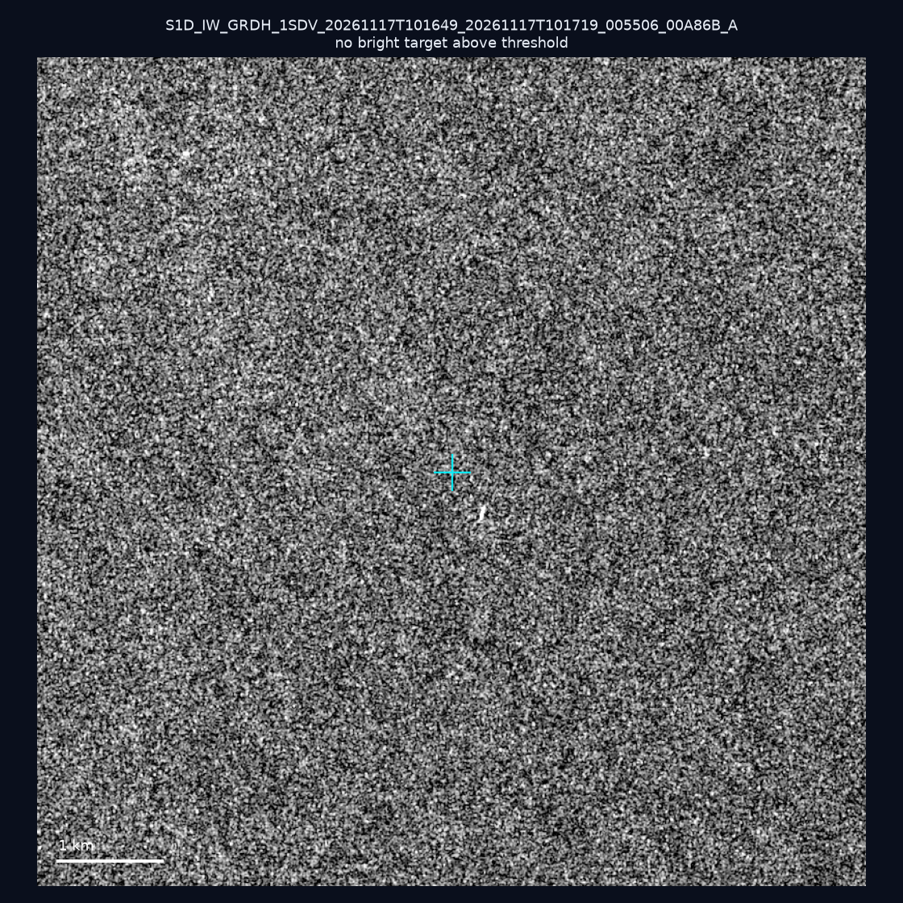
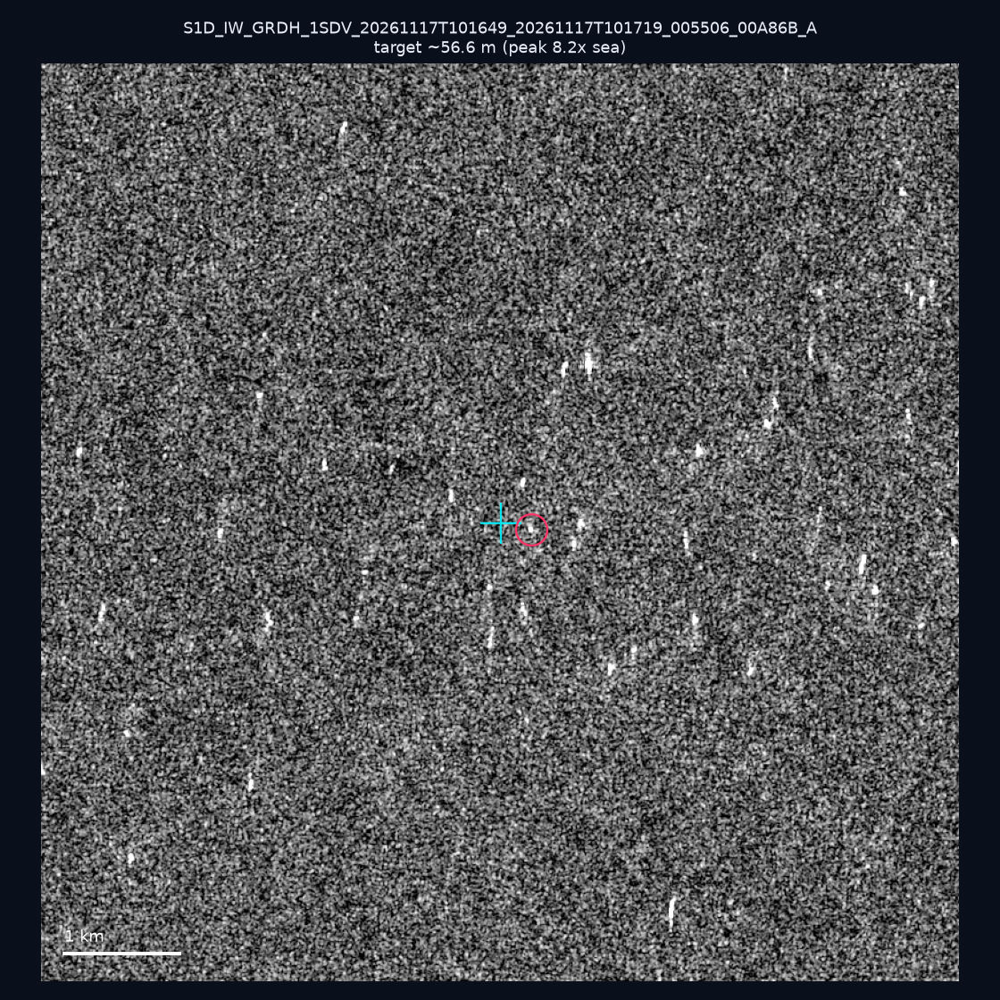
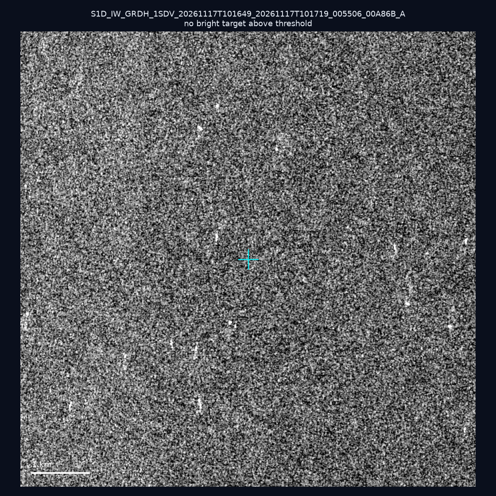
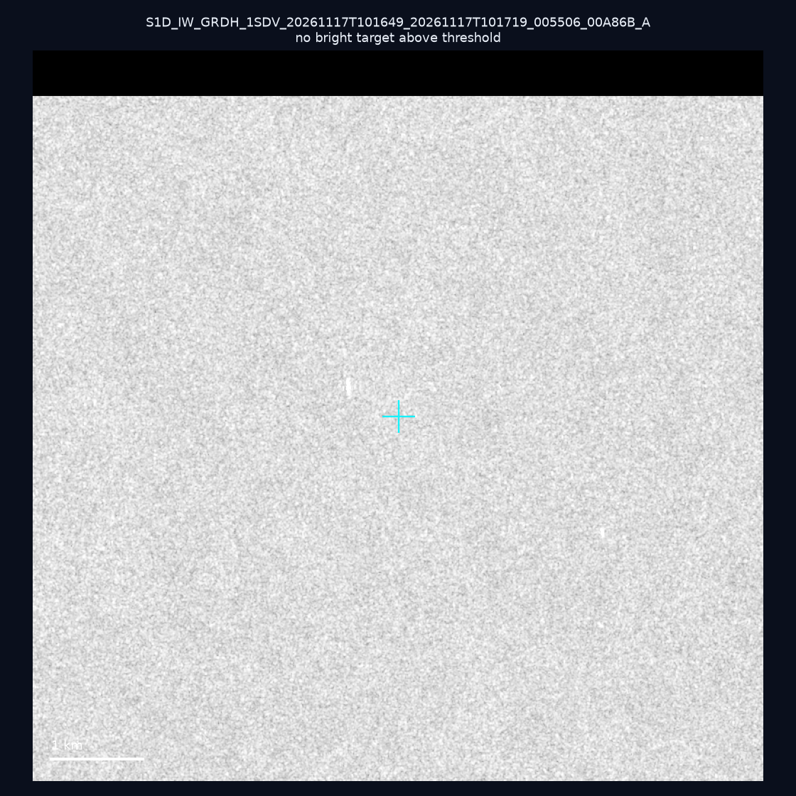
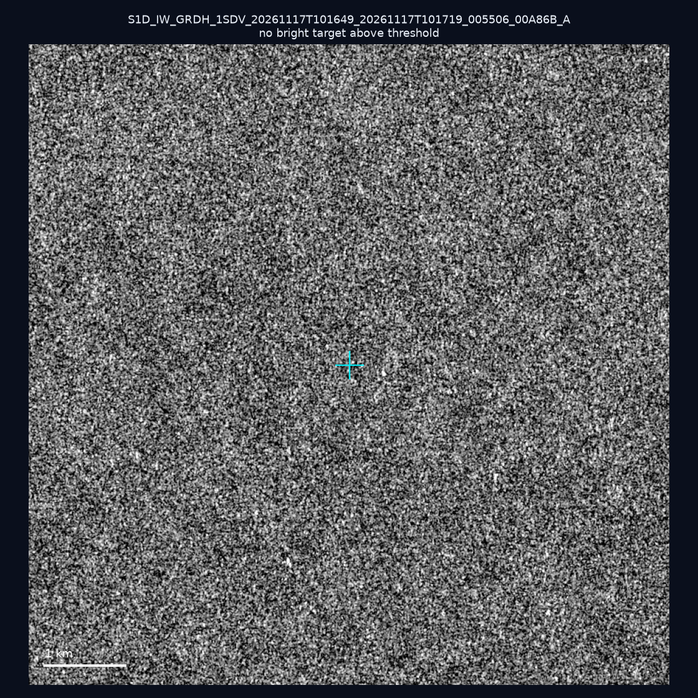
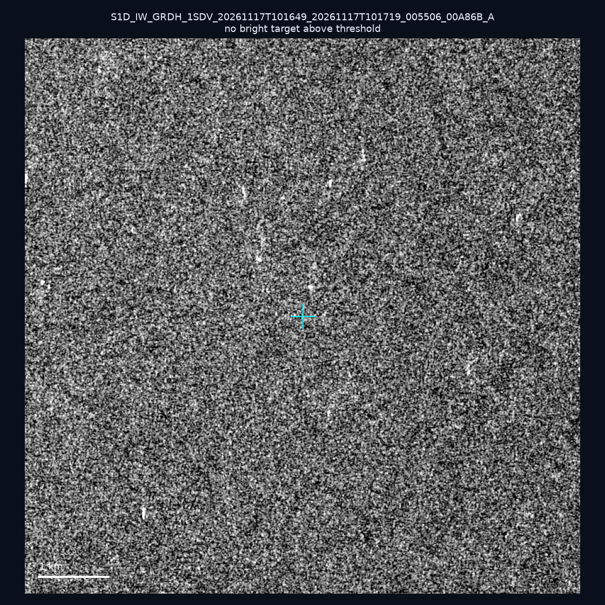
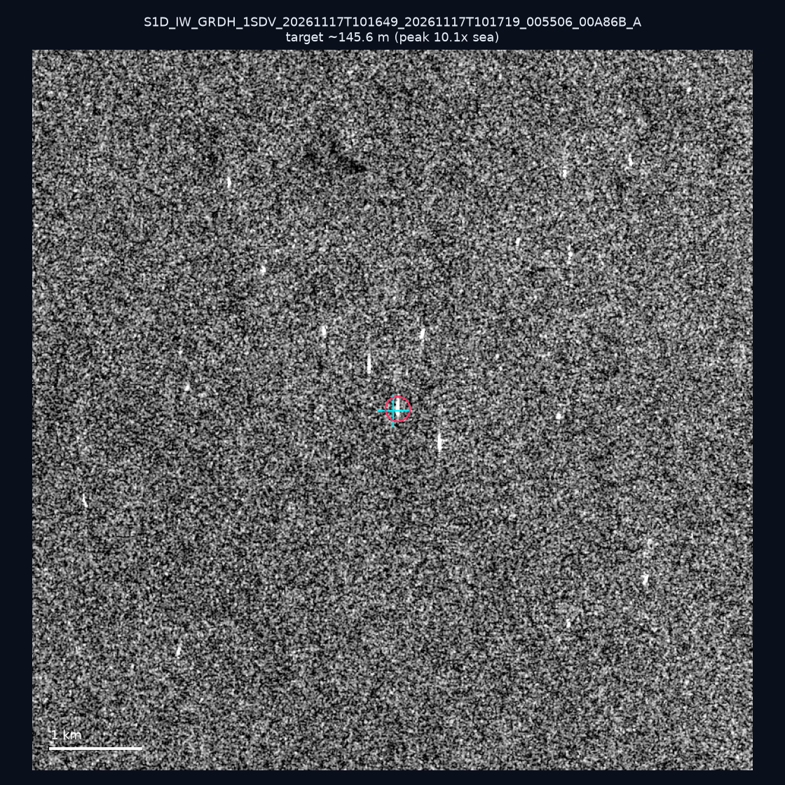
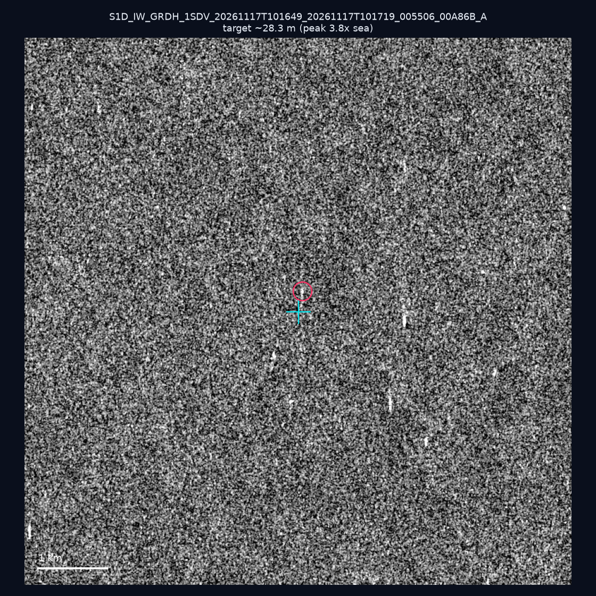
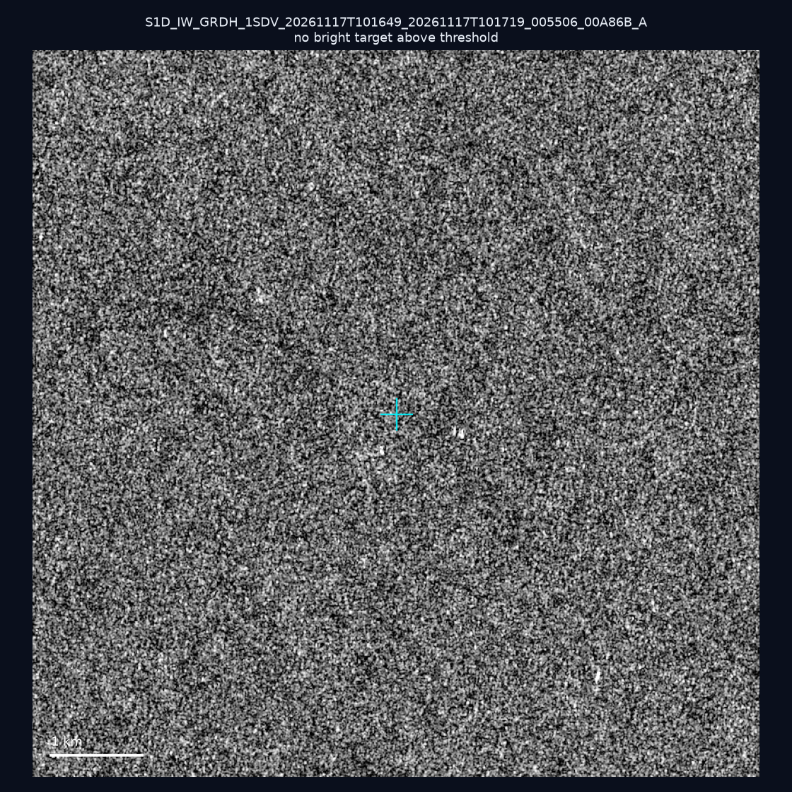

# 暗船 SAR 取證報告 — 2026-11-27

## 1. 總覽

- 執行時間：2026-11-27（GitHub Actions cron 自動執行）
- 線上比對摘要：暗偵測 28914 筆、殘餘暗船 14486 筆、假暗船剔除率 49.9%
- 本輪測試：10 筆
- 成功：10 筆
- 找到亮目標：3 筆
- 失敗：0 筆

## 2. 結果總表

| 日期 | 座標 | 海域 | 法域 | 成像時刻 | 判定 | 估計長度 | 峰值比 |
|------|------|------|------|----------|------|----------|--------|
| 2026-11-17 | 23.14, 117.94 | southwest | eez | 10:16:49 | ⚪ 無目標（雜訊或低RCS） | — | — |
| 2026-11-17 | 23.01, 118.17 | southwest | eez | 10:16:49 | ⚪ 無目標（雜訊或低RCS） | — | — |
| 2026-11-17 | 23.14, 117.87 | southwest | eez | 10:16:49 | 🟡 弱目標 | ~56.6 m | 8.2× |
| 2026-11-17 | 23.02, 117.75 | southwest | eez | 10:16:49 | ⚪ 無目標（雜訊或低RCS） | — | — |
| 2026-11-17 | 22.92, 118.14 | southwest | eez | 10:16:49 | ⚪ 無目標（雜訊或低RCS） | — | — |
| 2026-11-17 | 22.76, 117.47 | southwest | eez | 10:16:49 | ⚪ 無目標（雜訊或低RCS） | — | — |
| 2026-11-17 | 23.04, 117.78 | southwest | eez | 10:16:49 | ⚪ 無目標（雜訊或低RCS） | — | — |
| 2026-11-17 | 23.27, 118.35 | southwest | eez | 10:16:49 | ✅ 確認實體目標 | ~145.6 m | 10.1× |
| 2026-11-17 | 22.78, 117.56 | southwest | eez | 10:16:49 | 🟡 弱目標 | ~28.3 m | 3.8× |
| 2026-11-17 | 23.2, 117.57 | southwest | eez | 10:16:49 | ⚪ 無目標（雜訊或低RCS） | — | — |

## 3. 逐目標段落

### 2026-11-17 (23.14, 117.94)

⚪ 無目標（雜訊或低RCS）。

### 2026-11-17 (23.01, 118.17)

⚪ 無目標（雜訊或低RCS）。

### 2026-11-17 (23.14, 117.87)

🟡 弱目標，估計長度 ~56.6 m，峰值 8.2× 海面背景（14 px）。

### 2026-11-17 (23.02, 117.75)

⚪ 無目標（雜訊或低RCS）。

### 2026-11-17 (22.92, 118.14)

⚪ 無目標（雜訊或低RCS）。

### 2026-11-17 (22.76, 117.47)

⚪ 無目標（雜訊或低RCS）。

### 2026-11-17 (23.04, 117.78)

⚪ 無目標（雜訊或低RCS）。

### 2026-11-17 (23.27, 118.35)

✅ 確認實體目標，估計長度 ~145.6 m，峰值 10.1× 海面背景（44 px）。

### 2026-11-17 (22.78, 117.56)

🟡 弱目標，估計長度 ~28.3 m，峰值 3.8× 海面背景（4 px）。

### 2026-11-17 (23.2, 117.57)

⚪ 無目標（雜訊或低RCS）。

## 4. 後續建議

- 值得人工深查（確認實體目標且長度 ≥ 50m）：
  - 2026-11-17 (23.27, 118.35) ~145.6 m — 建議比對周邊 AIS 船長
- 累積統計：全歷史 947 筆（有效 945 筆），確認實體目標 119 筆（12.6%）

> 所有結果是研判線索，不是法律認定；無目標 ≠ 誤報（小型木殼漁船 RCS 低，SAR 可能拍不到）。
