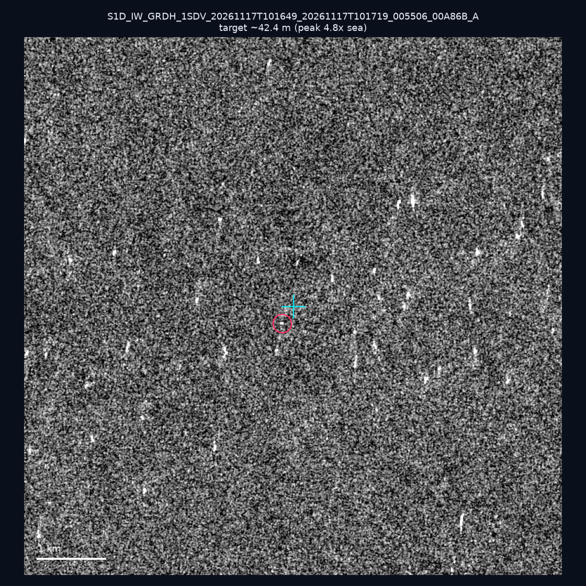
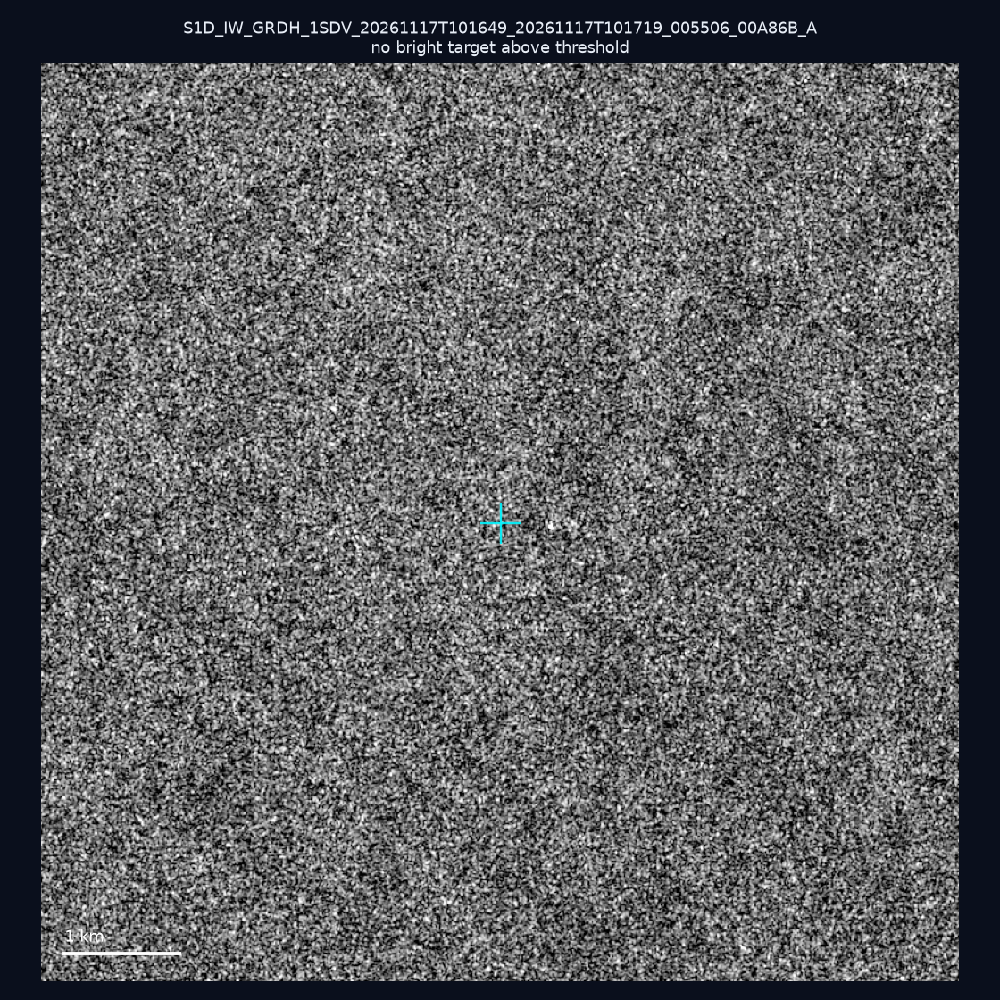

# 暗船 SAR 取證報告 — 2026-11-28

## 1. 總覽

- 執行時間：2026-11-28（GitHub Actions cron 自動執行）
- 線上比對摘要：暗偵測 29320 筆、殘餘暗船 14350 筆、假暗船剔除率 51.1%
- 本輪測試：2 筆
- 成功：2 筆
- 找到亮目標：1 筆
- 失敗：0 筆

## 2. 結果總表

| 日期 | 座標 | 海域 | 法域 | 成像時刻 | 判定 | 估計長度 | 峰值比 |
|------|------|------|------|----------|------|----------|--------|
| 2026-11-17 | 23.14, 117.86 | southwest | eez | 10:16:49 | 🟡 弱目標 | ~42.4 m | 4.8× |
| 2026-11-17 | 22.97, 118.23 | southwest | eez | 10:16:49 | ⚪ 無目標（雜訊或低RCS） | — | — |

## 3. 逐目標段落

### 2026-11-17 (23.14, 117.86)

🟡 弱目標，估計長度 ~42.4 m，峰值 4.8× 海面背景（7 px）。

### 2026-11-17 (22.97, 118.23)

⚪ 無目標（雜訊或低RCS）。

## 4. 後續建議

- 累積統計：全歷史 949 筆（有效 947 筆），確認實體目標 119 筆（12.6%）

> 所有結果是研判線索，不是法律認定；無目標 ≠ 誤報（小型木殼漁船 RCS 低，SAR 可能拍不到）。
